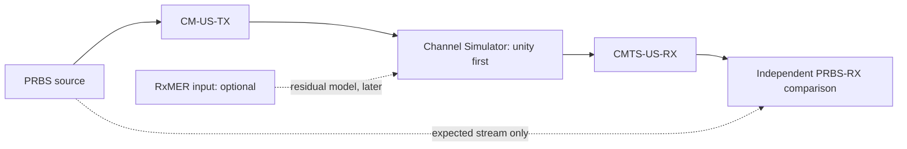

<p align="center">
  <picture>
    <source media="(prefers-color-scheme: dark)" srcset="docs/images/morgana-logo-dark-rounded.svg">
    <source media="(prefers-color-scheme: light)" srcset="docs/images/morgana-logo-light-rounded.svg">
    
  </picture>
</p>

# MORGANA — DOCSIS Upstream OFDMA Simulation Toolkit

[](docs/development/checklist.md)
[](VERSION)
[](rust-toolchain.toml)
[](docs/development/setup.md)
[](LICENSE)

MORGANA is being developed to simulate the DOCSIS 3.1/4.0 upstream physical
layer for one cable modem and a simulated CMTS receiver. The target is a closed
loop from a reproducible test source through transmission, a channel and receiver
recovery, with independent bit comparison and shared signal instruments.
All scientific processing, FEC and orchestration belong to Rust.

**In development: unfinished foundation and standalone LDPC checkpoint.**
Further simulation implementation awaits plan approval.

## Current capabilities

| Area | Status |
| --- | --- |
| Upstream LDPC | Long, medium and short codecs, shortening and bounded soft decoding exist; normative matrix review remains incomplete. |
| Rust interface | A facade runs one noiseless FEC trial and returns owned, schema-versioned JSON results. |
| CLI and example | A deterministic single-codeword CLI trial and a runnable Rust facade example are available. |
| Development setup | Ubuntu 22.04/24.04 amd64 prerequisite installer with read-only inspection and plan modes; fresh-machine provisioning remains unverified. |
| Full signal path | PRBS, OFDMA waveform, unity channel, CMTS receiver and QAM/SA instruments are planned. |
| Adapters and delivery | GUI, Python bindings and published packages are planned. |

The current 23 Rust unit tests pass, but share matrix constants with the
implementation. A known long-code matrix transcription correction is pending;
see [LDPC-01 in the official checklist](docs/development/checklist.md).
Passing round trips do not establish normative table correctness or a validated
upstream PHY release. Current trials expose decoder convergence, syndrome checks
and original-bit comparison separately.

## Getting started

Run these commands from the repository root. Development setup targets Ubuntu
22.04/24.04 amd64 and requires Python 3.10+ on PATH.

Inspect prerequisites or preview setup without changing the host:

```bash
./install.sh --development --check
./install.sh --development --dry-run
```

To prepare the development environment:

```bash
./install.sh --development
```

Setup installs missing apt prerequisites, prepares isolated Rust 1.85.1 with
rustfmt/Clippy and fetches locked Cargo sources. It does not build the toolkit.
See the [setup guide](docs/development/setup.md) for supported hosts, exit statuses,
local tool roots and provisioning limits.

With prerequisites available, run a standalone LDPC trial or the Rust example:

```bash
scripts/cargo-local.sh run --locked -p morgana-cli -- ldpc short 420 42
scripts/cargo-local.sh run --locked -p morgana --example ldpc_loop
```

The CLI command selects the short code, 420 information bits and fixture seed 42.
It uses a seeded ChaCha8 test payload and writes one deterministic reference trial
to standard output. Its JSON identifies the experiment as standalone LDPC and
leaves waveform RxMER null. The Rust example uses the same facade; Python
bindings are a future adapter.

Run the local validation gate:

```bash
scripts/validate.sh
```

The gate checks local guidance and links, setup/Git tooling, Rust formatting,
workspace tests and Clippy. See [build and validation](docs/development/build.md)
for individual commands. Installed application behavior, hosted CI and native
Windows/macOS execution remain unverified.

## Planned signal path



CM-US-TX will own grant framing, upstream LDPC, PHY randomization, QAM mapping,
pilots/interleaving, Pre-Eq, IFFT and burst sample assembly. CMTS-US-RX will recover
the payload from received samples and accepted configuration, with pilot-derived
channel correction. Original source bits stay in the independent verifier.

The first Channel Simulator will pass samples through unchanged. Shared
**QAM Analyzer** and **Spectrum Analyzer (SA)** views will inspect bounded Rust
observations at TX, channel and RX test points. Impairments follow the unity
closed loop. A full MAC, scheduler and downstream waveform are outside scope.
The planned [RxMER input](docs/architecture.md#rxmer-input) preserves upstream
measurements and offers single, power-average and scheduled playback policies
for a later residual model. Loading measurements leaves unity mode unchanged.

The [canonical architecture](docs/architecture.md#planned-upstream-signal-path-and-workbenches)
defines ordered stages, instrument contracts and ownership. The
[implementation checklist](docs/development/checklist.md) tracks prerequisites
and progress; the diagram above describes the target rather than current runtime.

## Documentation and development guidance

- [Development index](docs/development/README.md): feature plans and validation records.
- [Architecture](docs/architecture.md): current owners and planned processing contracts.
- [Foundation design](docs/development/features/foundation/design.md): requirements and reuse decisions.
- [Agent instructions](AGENTS.md) and [skill catalog](skills/README.md): local engineering and pinned PHY guidance.
- [PDE adoption record](docs/development/foundation-adoption.md): guidance origins and local adaptations.
- [Specification setup](docs/reference/specifications.md): pinned evidence and private local inputs.
- [Local Git workflow](docs/git.md): guarded local save commands.

## License and source status

MORGANA-owned scientific code and development tooling are Apache-2.0. Read
[LICENSE](LICENSE), [NOTICE](NOTICE) and the
[foundation adoption record](docs/development/foundation-adoption.md) for component
attribution and unresolved redistribution terms for imported guidance.
Source packages are version 0.1.0 and are not published. Private specifications,
captures, toolchain caches and build outputs are excluded from distribution.
