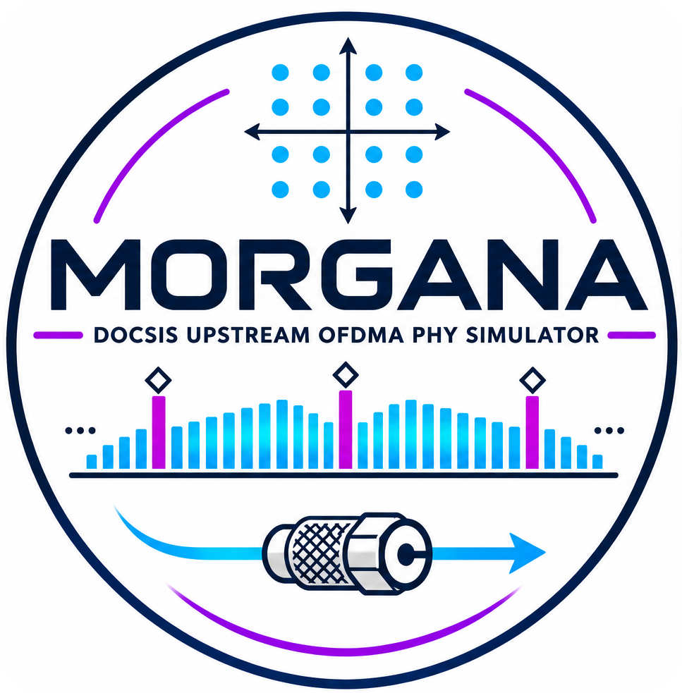
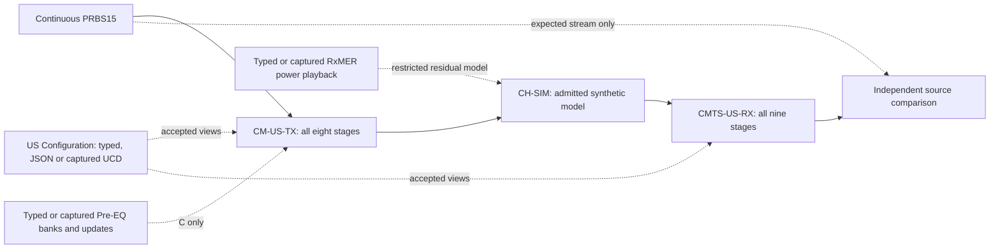

<p align="center">
  <picture>
    <source media="(prefers-color-scheme: dark)" srcset="docs/images/morgana-logo-dark-rounded.svg">
    <source media="(prefers-color-scheme: light)" srcset="docs/images/morgana-logo-light-rounded.svg">
    
  </picture>
</p>

# MORGANA — DOCSIS Upstream OFDMA Simulation Toolkit

[](docs/development/checklist.md)
[](VERSION)
[](rust-toolchain.toml)
[](docs/development/setup.md)
[](LICENSE)

MORGANA is a standalone Rust toolkit for bounded DOCSIS upstream OFDMA
experiments with one CM transmitter and a simulated CMTS receiver.

**In development: the synthetic upstream backend is implemented.**



| Capability | Current support |
| --- | --- |
| Waveform | 2K/50 kHz and 4K/25 kHz scheduled data, source-audited upstream LDPC, QAM through 4096 including non-square orders, all 14 pilot patterns, exact CP/rolloff/overlap. |
| Receiver | Configured timing and received-pilot frame-flat or bounded linear-frequency correction; actual failed decisions, iterations, parity and source coverage stay separate. |
| Channel | Exact unity, causal synthetic FIR, sample AWGN, integer delay, constant phase/CFO and restricted synthetic RxMER residual waveform. |
| Side inputs | Explicit synthetic RxMER single/average/hold/interpolation; Pre-EQ fixed banks/snapshots/probe-based updates at symbol boundaries. Measured files retain exact sources and use explicit CM/channel/grid/time/probe association. |
| Configuration | Versioned generic US Configuration JSON with named inventory/selection, source-field audit, strict bounded parsing and atomic shared endpoint projections. |
| Capture inspection | Offline Type51/version5 inspection plus bounded multipart reconstruction and source-valid captured-channel projection through shared Rust/native admission. |
| Measured RxMER inspection | Bounded CCAP upstream major2 file decoding through Rust/native Python, preserving metadata, raw/quarter-dB values and missing subcarrier positions. Explicit measured association and bounded single/average/hold/interpolated playback are implemented. |
| APIs and controls | High-level Rust and optional native Python; preview/run, progress, pause/resume/cancel and owned complete/partial reports. |
| Instruments | Bounded actual QAM/SA taps and independent matched-data MER; no invented history, calibrated RF power or target-to-RX shortcut. |

The [validation record](docs/development/features/backend-stages/validation.md)
separates independent source/numerical cases, internal closed-loop results and
actual native/wheel checks. There is no external interoperability, live MAC,
modem-certification or installed-platform claim. Ranging/probe/testing waveform
execution, GUI and wider platform delivery remain
explicitly pending in the [checklist](docs/development/checklist.md).

## Run an experiment

With development prerequisites available, run from the repository root:

```bash
scripts/cargo-local.sh run --locked -p morgana-cli -- upstream examples/configuration/us-50khz.json
scripts/cargo-local.sh run --locked -p morgana-cli -- upstream examples/configuration/us-25khz.json
scripts/cargo-local.sh run --locked -p morgana --example upstream_loop
```

The CLI writes the actual owned experiment report to stdout. `Completed` is
separate from `reference_recovered`; failures and partial coverage remain visible.
The existing standalone FEC command remains available:

```bash
scripts/cargo-local.sh run --locked -p morgana-cli -- ldpc short 420 42
```

Use the [experiment guide](docs/user/upstream-experiments.md) for typed Rust/native
Python examples, controls, model compatibility, units, limits and report semantics.
The [capture-driven experiment guide](docs/user/measured-experiments.md) covers
actual UCD/RxMER/Pre-EQ admission, paired APIs and preserved provenance.
The [UCD inspection guide](docs/user/capture-inspection.md) defines its exact
byte envelope, examples and structural-only acceptance.
The [example index](examples/README.md) includes generic JSON, mixed/zero loading,
synthetic playback and inspection-only ranging/probe controls. Optional vendor
numbers such as 224 are provenance rather than normative profile meanings.

## Development and validation

Development setup targets Ubuntu 22.04/24.04 amd64. Inspect or preview it without
applying host changes:

```bash
./install.sh --development --check
./install.sh --development --dry-run
```

`./install.sh --development` explicitly applies missing prerequisites and prepares
the isolated pinned Rust toolchain; it does not build/install the application.
See the [setup guide](docs/development/setup.md). Fresh Ubuntu22.04/24.04 VM provisioning has passed;
hosted CI and native Windows/macOS lifecycle acceptance remain unverified.

Run the core and optional native gates:

```bash
scripts/validate.sh
python3 tools/python/check_native.py
```

The core remains independent of Python/PyO3/Qt. The optional native gate requires
an existing Python 3.10+ interpreter/header toolchain and stages local artifacts
under ignored `target/`. A local optimized CPython 3.10/Linux x86_64 wheel is
artifact-tested with full host-dependency attribution; no package is installed or
published. See [build/validation](docs/development/build.md) and the user guide.

## Design and guidance

- [Architecture](docs/architecture.md): actual stage owners, code/test layout and deferred contracts.
- [Requirements](docs/requirements.md): mandatory behavior and stable acceptance IDs.
- [Developer checklist](docs/development/checklist.md): completed stage evidence and remaining work.
- [Development index](docs/development/README.md): designs and validation records.
- [User guides](docs/user/README.md) and [examples](examples/README.md).
- [Agent instructions](AGENTS.md), [skills](skills/README.md) and [specification evidence](docs/reference/specifications.md).
- [Local Git workflow](docs/git.md): reviewed guarded save commands.

## License and delivery

MORGANA-owned scientific code/tooling is Apache-2.0. Adapted source/resources
retain their actual notices and origin hashes. Read [LICENSE](LICENSE),
[NOTICE](NOTICE) and the [foundation adoption record](docs/development/foundation-adoption.md).
Imported PDE instructional material has unresolved public redistribution terms;
it is excluded from the scientific wheel. Source packages are version 0.1.0 and
unpublished. Private specifications/captures, caches and build artifacts are ignored.
