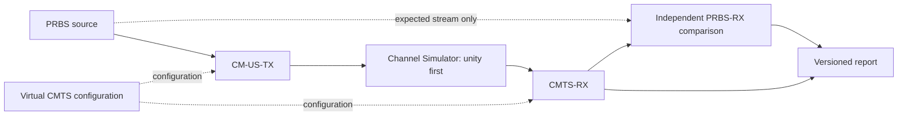
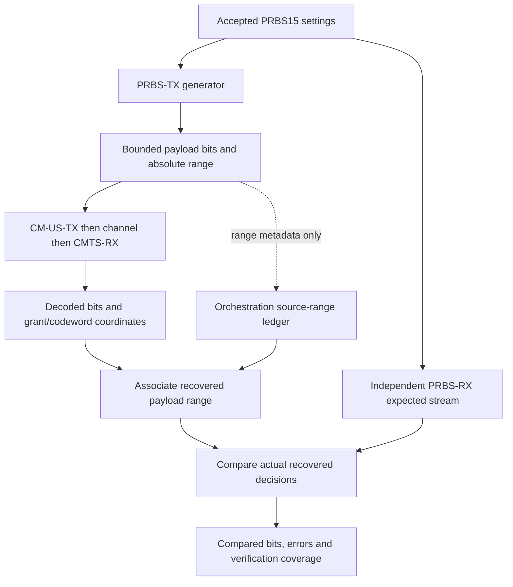
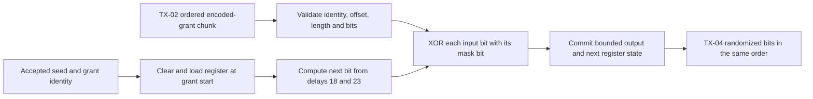
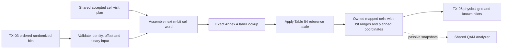
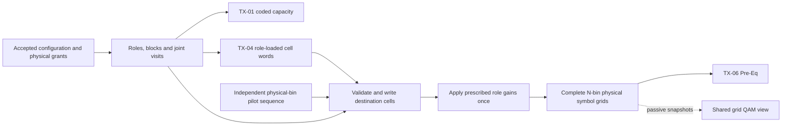

# MORGANA architecture

Status: unfinished checkpoint; further scientific implementation awaits plan
approval. The [foundation design](development/features/foundation/design.md)
contains requirements, reuse assessments, evidence, API proposal and milestones.

| Current owner | Responsibility | Status |
| --- | --- | --- |
| `crates/ldpc` | Upstream QC matrices, sparse systematic encoder, shortening, bounded layered soft decoder | Implemented; normative table review incomplete |
| `crates/morgana` | Configure/run/report facade for one noiseless FEC trial; schema-1 owned results | Implemented; broader API planned |
| `crates/cli` | Arguments, deterministic fixture source and JSON stdout | Implemented; no waveform processing |
| `skills/` | Canonical engineering/PHY guidance and operational references | Adopted for this checkpoint |
| `scripts/` and `tools/git/` | Local validation and guarded local save | Checkpoint tooling |
| `install.sh` and `scripts/bootstrap/` | Explicit development dispatcher, host/package admission, pinned local Rust and locked source setup | Inspection/mock validation; clean provisioning unverified |

The current executable path is information bits → upstream LDPC encode →
noiseless LLRs → soft decode → separate syndrome/source comparison. Decoder
convergence does not prove original-bit recovery. The encoder uses an Apache
adaptation of the existing sparse substitution helper; no runtime dependency on
another source checkout exists. Maximum iterations are application-bounded to 100.

Planned top-level path (expanded in the workbench section below):



Receiver inputs must contain received signals and explicit configuration, never
hidden injected H or original bits. Normal receiver estimation observes C×H.
Simulator truth is available only to independent diagnostic comparisons.

Virtual CMTS, grant/codeword selection, UCD/IUC mapping, randomization,
interleaving, pilot/preamble placement, waveform generation/acquisition, Pre-Eq
capture import, impairment pipeline, RxMER and full experiment reports are planned.
Python is a future native wrapper of the same public Rust API; all calculations
and validation remain Rust. No saved-workbench format or stable C ABI exists.

See the [official checklist](development/checklist.md) for incomplete acceptance,
especially LDPC-01's source transcription issue. Internal tests share the
transcribed table data and cannot establish its correctness by round trip alone.

## Planned upstream signal path and workbenches

ARCH-01 defines the target organization. This section is planned architecture;
the existing executable still runs isolated LDPC trials. No PRBS waveform,
channel object, CMTS receiver, instrument or GUI is claimed implemented here.

Use the same left-to-right organization as the reference workbench:
**PRBS → CM-US-TX → Channel Simulator → CMTS-RX → PRBS-RX/results**.
CM-US-TX and CMTS-RX open their own stage workbenches. Test-point actions open
the shared **QAM Analyzer** or **Spectrum Analyzer (SA)** for the selected tap.
The direction changes to CM transmission and CMTS reception; upstream FEC,
framing, pilot and interleaving rules determine the actual stage order.

### Planned code layout

All paths below are relative to the repository root. **Create (planned)** means
that the file does not exist in this checkpoint; **reuse (existing)** and
**extend (existing)** identify inspected files. These are placement decisions,
not implemented modules. No empty files, Cargo members or adapters are added now.
Each block/stage below gives its concrete implementation and test filenames.

The dependency direction is CLI/future Python or UI adapters → public
`crates/morgana` facade → proposed `crates/phy` → existing `crates/ldpc`.
Keep the current facade's direct LDPC imports/re-exports compatible. Algorithms,
validation and bounded orchestration stay Rust; adapters present owned results.

| Path / directory entrypoint | Disposition | Responsibility |
| --- | --- | --- |
| `Cargo.toml` | Extend (existing) | Register the future PHY member/dependency when implemented; update `Cargo.lock` through Cargo. |
| `crates/phy/Cargo.toml`, `crates/phy/src/lib.rs`, `crates/phy/src/error.rs` | Create (planned) | Rust PHY crate, module declarations/public domain surface and typed stage errors. |
| `crates/phy/src/configuration/mod.rs` | Create (planned) | Accepted virtual-CMTS configuration, profiles and burst modes. |
| `crates/phy/src/types/mod.rs` | Create (planned) | Register `bits.rs`, `iq.rs` and `samples.rs` in this directory for bit ranges, complex cells and indexed sample blocks. |
| `crates/phy/src/source/mod.rs` | Create (planned) | PRBS source and independent verifier. |
| `crates/phy/src/resources/mod.rs` | Create (planned) | Shared grant grids, pilot roles/patterns, block partitioning and cell permutations. |
| `crates/phy/src/grant/mod.rs` | Create (planned) | Shared pure capacity/codeword planning. |
| `crates/phy/src/bit_processing/mod.rs` | Create (planned) | Shared payload randomizer and independent known-pilot sequence. |
| `crates/phy/src/signal_processing/mod.rs` | Create (planned) | Shared QAM and transform algorithms. |
| `crates/phy/src/transmitter/mod.rs` | Create (planned) | Compose the eight TX stage adapters. |
| `crates/phy/src/channel/mod.rs` | Create (planned) | Unity sample transport and future ordered channel stages. |
| `crates/phy/src/receiver/mod.rs` | Create (planned) | Compose the nine RX stage adapters without source truth. |
| `crates/phy/src/instruments/mod.rs` | Create (planned) | Bounded passive observations and shared QAM/SA calculations. |
| `crates/phy/src/simulation/mod.rs` | Create (planned) | Run lifecycle, source associations and independent comparisons. |
| `crates/phy/tests/` | Create (planned) | Integration/acceptance files named in each block/stage below. |
| `crates/morgana/src/lib.rs`, `crates/morgana/src/report.rs` | Extend (existing) | Preserve the FEC API while exposing reviewed experiment operations and versioned results. |
| `crates/cli/src/args.rs`, `crates/cli/src/command.rs` | Extend (existing) | Expose accepted facade inputs/results after the Rust capability exists. |
| `bindings/python/src/lib.rs`, `bindings/python/tests/test_experiment.py` | Create (planned; later API milestone) | Native adapter and Rust/Python contract-parity checks; no Python science. |

Module directories above use their named `mod.rs`; their leaf files are specified
in the corresponding sections below. The module roots and `crates/phy/src/lib.rs`
register those leaves when implemented. Numerical dependency selection and actual
Qt application file placement remain open decisions for their implementation/UI
plans; this layout does not introduce a new numerical dependency or UI crate.

### Configuration and source

**Planned code paths (repository-relative).**

| Path | Disposition | Responsibility |
| --- | --- | --- |
| `crates/phy/src/configuration/profile.rs` | Create (planned) | Accepted numerology, loading, pilot pattern and PHY seed configuration. |
| `crates/phy/src/configuration/grant.rs` | Create (planned) | Synthetic grant identity, resource assignment and configured clock epoch. |
| `crates/phy/src/configuration/burst.rs` | Create (planned) | Scheduled-data mode admission and explicit unsupported-mode results. |
| `crates/phy/src/types/bits.rs` | Create (planned) | Binary chunks, checked ranges and bit-role identities. |
| `crates/phy/src/types/iq.rs` | Create (planned) | Complex-cell representation with explicit grid/reference metadata. |
| `crates/phy/src/types/samples.rs` | Create (planned) | Complex samples, rates, indices, burst boundaries and validity. |
| `crates/phy/tests/configuration.rs` | Create (planned) | Configuration bounds, atomic admission and matching endpoint validation. |


An immutable Virtual CMTS configuration supplies the upstream channel/numerology,
IUC-to-burst-profile mapping, per-minislot loading, pilot pattern, synthetic grant,
clock/frame epoch and accepted ranging/timing state. It is a configuration input
to both endpoints, separate from source bits and injected-channel truth. The
first run uses one valid data profile, configured timing and unity Pre-Eq.
No downstream waveform, real UCD/MAP parser, contention or service-group scheduler
is required. IUC is an identifier selecting a configured profile, not a fixed QAM order.

PRBS uses the same explicit PRBS15 source/verifier contract as the reference
implementation: recurrence `s[n+15] = s[n+14] XOR s[n]`, nonzero 15-bit seed,
seed bits emitted least-significant first and continuous absolute bit position.
The source runs across codewords/grants and pauses without reseeding. The verifier
independently regenerates the expected stream for recovered meaningful source
positions; source bits/seed do not enter receiver recovery or equalization.
PRBS15 is the test payload. The separate upstream PHY randomizer is the
grant-seeded 23-bit process required by PHY3.1 §7.4.4.

### PRBS block architecture

**Planned code paths (repository-relative).**

| Path | Disposition | Responsibility |
| --- | --- | --- |
| `crates/phy/src/source/prbs15.rs` | Create (planned) | Validated Prbs15Config/Prbs15, recurrence, bounded generation and position. |
| `crates/phy/src/source/verifier.rs` | Create (planned) | Independently owned expected stream, comparison counters and coverage. |
| `crates/phy/src/types/bits.rs` | Create (planned) | Shared SourceChunk and meaningful source-range representation. |
| `crates/phy/src/simulation/source_ledger.rs` | Create (planned) | Bounded grant/codeword-to-source association outside receiver recovery. |
| `crates/phy/src/simulation/comparison.rs` | Create (planned) | Validate recovered associations and invoke the independent verifier. |
| `crates/phy/tests/prbs.rs` | Create (planned) | Independent sequence/period, continuity, bounds and verifier cases. |
| `crates/phy/tests/source_association.rs` | Create (planned) | Missing/reordered/wrong-run ranges and incomplete comparison coverage. |


Status: **designed, not implemented**. ARCH-PRBS-01 expands the first block in
the signal path; SOURCE-01 remains the implementation milestone. The existing
CLI still generates a seeded ChaCha8 fixture. Selecting that fixture is not
selecting PRBS15. The design below is complete within this repository and has
no dependency on reference-project documentation or source checkouts.

The block has two independently owned roles: **PRBS-TX** supplies continuous
test payload bits, and **PRBS-RX** compares recovered payload decisions after
CMTS-RX. Both use the accepted source seed, with separate mutable registers and
counters. Only the comparison branch receives expected PRBS truth; neither
the PRBS seed nor expected bits enter the receiver's decoding/equalization API.



#### Sequence and bit representation

The selected sequence is defined by the recurrence
`s[n+15] = s[n+14] XOR s[n]`, with sequence polynomial `x^15 + x^14 + 1`.
The recurrence and emission order are authoritative for this test source;
polynomial names alone do not settle reciprocal or hardware shift conventions.

| Property | Contract |
| --- | --- |
| Kind | Continuous PRBS15; other polynomials are unsupported in this stage. |
| Seed | Nonzero 15-bit integer, 1–32767 inclusive; proposed initial draft value 32767 (`0x7fff`). Explicit Apply/run acceptance is still required. |
| Initial bits | Seed bits 0 through 14 are `s[0]` through `s[14]`, least-significant bit first. |
| Register step | Emit old bit 0; shift right; insert old bit 14 XOR old bit 0 into bit 14. |
| Period | 32767 bits for every allowed seed; the absolute source position continues across periods. |
| Position | Checked `u64` absolute index of the next bit; a fresh run begins at zero. |
| Bit storage | One binary `u8` value per bit in transmission order; no implicit byte packing or QAM bit reordering. |
| Per-operation bound | At most 1,048,576 generated or compared bits. This is a proposed application work/allocation limit, not a DOCSIS requirement. Larger streams use repeated bounded calls. |

For seed `0x7fff`, the first 32 emitted bits are:

```text
11111111111111101010101010101001
```

This vector and the period are mathematical test-source properties, not external
DOCSIS interoperability evidence. The generator uses no host entropy and shares
no state with channel noise. PRBS15 is separate from the post-FEC upstream PHY
randomizer; a grant resets the latter according to its own contract while PRBS
continues. Fixed waveform symbol sizes, downstream BCH payload sizes and
downstream randomizer reset intervals do not belong in this block.

#### Rust owners and stage interfaces

The proposed `crates/phy` source owner contains focused generator, verifier and
source-range types. Orchestration owns acceptance, the grant/source ledger and
job lifecycle. TX grant framing requests exactly the meaningful information-bit
count from a validated upstream grant/codeword plan. It adds coding fill,
shortened zeros and grant padding separately; those bits never advance PRBS or
enter its BER denominator. Idle/guard resources consume no source bits.

Bound the pending source ledger by the configured in-flight grant/codeword
budget. Retire completed associations into cumulative counters and bounded
diagnostics; continuous operation must not retain the full source or range
history. If the pipeline cannot accept a payload, apply backpressure before
generating it rather than advancing PRBS for discarded work.

| Proposed contract | Inputs and result | State/ownership |
| --- | --- | --- |
| `Prbs15Config` | Kind and validated seed; fixed recurrence/period are descriptive metadata. | Immutable accepted settings, frozen per run. |
| `Prbs15` | Validated seed; `generate(count)` returns the next bounded binary chunk, and `position()` reports the next absolute index. | Owns its register and position; no shared mutable state with observers or the verifier. |
| `SourceChunk` | Owned bits with `first_bit`; its checked half-open range is `[first_bit, first_bit + len)`. | Immutable output handed to TX; diagnostic copies are bounded. |
| Source-range ledger | Run/configuration identity and meaningful source ranges associated with accepted grant/codeword payload coordinates. | Orchestration metadata only; no original bits or PRBS seed are injected into CMTS-RX. |
| Recovered association | Actual decoded information decisions and grant/codeword coordinates, mapped to a source range outside RX. | Validate run identity, length and expected next range before comparison. |
| `PrbsVerifier` | Same accepted seed and independently owned expected stream; compares ordered binary decisions. | Advances through mismatches without correcting decisions or searching for another PRBS phase. |
| `PrbsComparison` | First compared position, bits tested, bit errors and optional absolute first-error position, per window and cumulatively. | Owned result snapshots remain valid after later operations. |

Generation and comparison accept zero-length calls as no-ops. Invalid seeds,
excessive work, nonbinary decisions, counter overflow or invalid recovered-range
association return typed errors before changing the affected source/verifier
state or totals. Preview uses a fresh independent generator, never the active
source or expected stream. A disabled/full diagnostic buffer cannot advance,
rewind or reseed either stream.

The future public Rust facade exposes this source selection and its results;
CLI, Qt and native Python adapters consume the same validation. Future Python
seed/count inputs are range-checked before narrowing to Rust integers, and
binary buffers preserve one 0/1 value per bit. Rust returns typed errors and
owned snapshots; Python raises corresponding domain exceptions and returns
equivalent values, with absent first error/BER represented as `None`.
These are proposed contracts, not currently callable Rust/Python APIs. No
PRBS source selector is added to the current FEC-only CLI by this document.

#### Independent comparison and incomplete recovery

Compare meaningful decisions even when the LDPC decoder reports a failure, if
it returns a complete binary decision range. Keep decoder convergence, parity,
shortened-zero consistency and source mismatch counts separate. A valid but
wrong codeword can pass parity and still produce PRBS errors; a failure flag
must not suppress those actual decisions.

The first verifier accepts a contiguous ordered stream. Before comparison,
orchestration checks each recovered association against the next expected
absolute source range. Missing, duplicated, reordered, wrong-run or wrong-length
payload produces an explicit incomplete/discontinuous verification outcome.
Retain all prior comparisons; stop contiguous comparison at the first unresolved
gap, while receiver results may continue to be collected. Never silently skip a
gap, count it as zero errors, infer alignment from decoded values or resynchronize
by searching the PRBS period. Explicit gap-aware continuation would be a later
contract, not an assumed feature of `compare`.

Report generated meaningful bits, compared bits, unverified generated bits,
coverage and run completion separately from the comparison totals. For `N > 0`
compared bits and `E` mismatches, BER is `E/N`; for `N = 0`, BER is unavailable
(`null` in future JSON), not zero. A null first-error index only means no
mismatch was observed in the compared data. Error-free complete source recovery
requires a completed/drained run, matching expected/generated/recovered counts,
full contiguous coverage and zero mismatches. No-payload, cancelled, truncated
or discontinuous runs cannot claim that acceptance from a zero error count.
Report export/schema changes require their own versioned API compatibility work.

#### Lifecycle and PRBS-TX / PRBS-RX presentation

| Event | Source, verifier and presentation behavior |
| --- | --- |
| Edit/open | Stage a draft; do not construct an active stream or consume bits. |
| Apply | Rust validates a candidate and atomically accepts it for the next run. Invalid drafts preserve the previous accepted settings/readiness. |
| Cancel/close | Discard drafts and preserve accepted settings. |
| Start a fresh run | Freeze accepted source/run/grant settings; create independent generator/verifier state at position zero with a new run identity. Bound run duration/work separately from the continuous source. |
| Generate next payload | Consume only the requested meaningful bits, preserving continuity across grants, codewords, chunks and sequence periods. |
| Pause/resume | Retain registers, positions, pending payload associations and comparison totals; no reseeding. |
| Stop/cancel | Stop admitting new work; retain completed comparisons and report queued/unrecovered ranges and partial status. Drain versus discard follows the accepted job policy. |
| Restart/reconfigure | Begin a new run at position zero; invalidate old observations by run/configuration identity. Settings never mutate an active run. |

The future **PRBS-TX** editor follows a Parameter/Value layout with contextual
descriptions and Apply/Cancel. Show Continuous PRBS15, editable decimal seed,
read-only recurrence/polynomial, period, initial bit order and continuous operation.
Duration/trial limits belong in run settings. An optional bounded Rust preview
shows the first bits without affecting readiness or runtime state. File input,
file fill, repeat modes and other PRBS polynomials require their own later design;
do not expose them as working source choices in this first block.

PRBS-TX readiness means a valid source was explicitly accepted. PRBS-RX readiness
means independent verification is configured for that accepted source; it does
not require an earlier successful run. Source acceptance alone does not make the
transmitter, receiver or whole experiment ready. Pending/ready/invalid states
must have text labels as well as color. The PRBS-RX results view displays actual
coverage, errors, first mismatch and complete/partial/discontinuous status; it
does not change receiver decisions or convert missing data into successful BER.
QAM/SA open on their waveform/cell taps, not on the PRBS bit array.

#### Reference assessment and acceptance

The reference inspection covered MERLIN's PRBS generator/verifier, literal-vector
and period tests, source-selection adapter and source editor at revision
`096d5a476194d4f2e016863d723b225257bb6037`. Reuse the sequence/seed contract,
independent verification, bounded chunking and draft/accepted UI pattern.
Replace its fixed downstream payload adapter with upstream grant-driven lengths;
defer its file/fill modes. This design is written locally; no implementation or
presentation source is copied in this task. Future actual code reuse must retain
the applicable copyright, Apache license and adaptation notices.

Required implementation checks are literal recurrence vectors for multiple
seeds, period/nonzero-state coverage, chunk/grant/codeword continuity, independent
error counts across boundaries, empty/no-observation behavior, rejected-call
invariance, checked counter limits, source-gap detection, pause/resume/restart,
observer neutrality and Rust/future Python contract parity. The feature record
maps these requirements to owners and planned checks:
[PRBS block design](development/features/prbs-source/design.md).

### CM-US-TX block architecture

**Planned code paths (repository-relative).**

| Path | Disposition | Responsibility |
| --- | --- | --- |
| `crates/phy/src/transmitter/mod.rs` | Create (planned) | Register and sequence the eight focused stage adapters listed below. |
| `crates/phy/tests/tx_pipeline.rs` | Create (planned) | Stage-boundary identities, chunk invariance and bounded partial emission. |


Status: **planned**. ARCH-TX-00 defines the transmitter block; ARCH-TX-01 through
ARCH-TX-05 expand its first five stages below. The isolated LDPC codec is a
dependency; it does not make this transmitter implemented. CM-US-TX converts meaningful
PRBS source bits and an accepted upstream grant into complex baseband samples
delivered to the Channel Simulator.

Rust owns every stage, its validation and bounded observations. The transmitter
accepts an immutable run configuration: channel geometry/clock, grant/profile,
pilot/loading/resource plan, randomizer seed, Pre-Eq response and execution
limits. Source generation keeps its own state. Injected channel impairments and
receiver estimates are outside this block. A presentation adapter opens a
transmitter workbench; opening an inspector does not start transmission.

#### Internal stage sequence

Each stage label in the tables below links to its local section.


| Stage | Responsibility and inspectable result |
| --- | --- |
| [TX-01: grant framing](#tx-01-grant-framing-and-fec-selection) | Derive usable grant bits and codeword sequence from accepted profile/resources; consume exact PRBS ranges and keep meaningful data, information fill and grant padding distinct. |
| [TX-02: upstream LDPC](#tx-02-ldpc-encoding-and-shortening) | Select long/medium/short mother codes; append shortening zeros, encode systematic information/parity, omit shortened zeros and account for remaining grant padding. No downstream BCH or ordinary-data puncturing. Expose code identity, retained length and encoded bits. |
| [TX-03: randomization](#tx-03-grant-seeded-phy-randomization) | Randomize the encoded grant stream, including padding as specified, with accepted upstream seed/state. Reset the PHY randomizer at the grant boundary; never reset PRBS15 because a grant starts. |
| [TX-04: cell-word/QAM mapping](#tx-04-cell-word-construction-and-qam-mapping) | Group randomized bits in MSB-first cell order; map data and data-bearing complementary-pilot cells using their respective loading and normalized constellation references. |
| [TX-05: OFDMA framer/interleaver](#tx-05-pilots-ofdma-framing-and-interleaving) | Generate known BPSK pilots and edge/body patterns, apply prescribed role gains, allocate logical grant cells and perform the upstream joint time/frequency interleaving and map to physical carriers with exclusions/unused bins preserved. Export role/order/grid metadata. |
| [TX-06: CM Pre-Eq](#tx-06-cm-pre-eq) | Apply one complex corrective coefficient per carrier; identity coefficients initially. Keep the correction response distinct from an injected physical channel. |
| [TX-07: IFFT](#tx-07-ifft) | Convert the complete physical frequency grid into complex baseband useful-symbol samples with explicit transform normalization and bin order. |
| [TX-08: sample assembly](#tx-08-sample-assembly) | Add configured CP/roll-off extension, apply the specified transmit window/overlap treatment, and emit correctly indexed burst/guard samples. Preserve state across arbitrary output chunk boundaries. |

The boundaries carry three different representations: TX-01..03 operate on
information/coded bits and explicit bit-role plans; TX-04..06 operate on loaded
complex cells and the complete frequency grid; TX-07..08 produce useful-symbol
and assembled time samples. Each stage accepts the preceding representation
with matching run/grant/configuration identity, not an untyped array whose
meaning depends on the selected viewer.

| Stage output | Retained identity and inspection |
| --- | --- |
| [TX-01 grant plan](#tx-01-grant-framing-and-fec-selection) | Ordered codewords, source ranges, information fill, shortening and grant padding; plan/bit inspector. |
| [TX-02 encoded grant](#tx-02-ldpc-encoding-and-shortening) | Actual systematic/parity bits, transmitted lengths and zero grant padding; bounded bit inspector. |
| [TX-03 randomized grant](#tx-03-grant-seeded-phy-randomization) | Actual post-randomization bits with accepted seed/grant epoch; bounded bit inspector. |
| [TX-04 mapped cells](#tx-04-cell-word-construction-and-qam-mapping) | Actual symbol values, constellation/loading and logical cell identity; shared QAM Analyzer. |
| [TX-05 physical grid](#tx-05-pilots-ofdma-framing-and-interleaving) | Role-scaled physical carrier/symbol coordinates with gain, known-pilot, complementary-data, data and excluded/unused roles; shared QAM Analyzer. |
| [TX-06 Pre-Eq grid](#tx-06-cm-pre-eq) | Actual corrected carrier values and response reference plane; shared QAM Analyzer. |
| [TX-07 useful samples](#tx-07-ifft) | Contiguous complex time samples per symbol, transform normalization and sample rate; shared Spectrum Analyzer. |
| [TX-08 burst samples](#tx-08-sample-assembly) | Actual windowed/assembled stream with sample indices and burst boundaries; shared Spectrum Analyzer and channel input. |

Retain the existing shared tap names; detailed later stages may add a typed tap
only for an actual produced boundary. Bit arrays are not QAM or SA inputs, and
frequency-grid lists are not time waveforms. Disable or bound inspection without
changing source/randomizer/overlap state or processing decisions.

TX-04 and TX-05 are functional boundaries, not permission to invent a separate
downstream bit-interleaver. PHY3.1 §7.4.5 couples address generation, bit loading
and cell placement; an implementation may fuse them while retaining observable
stage contracts. Known pilots reserve their cells; complementary pilots carry
data with their own loading. Do not discard them as if they were known pilots.
Excluded/unused carriers and zero-valued minislots follow upstream mapping rules.

The initial path is a normal scheduled data burst. Do not insert a generic
training/ranging preamble into every data burst. Initial/fine ranging require
dedicated preambles and special coding; probing has a separate pilot-based format.

The first run uses accepted scheduled-data resources, unity Pre-Eq and the unity
channel. Grant validation/readiness is separate from source acceptance. Start
freezes the complete request; pause/resume preserves accepted source/randomizer,
grant progress and waveform history. A configuration change applies to a fresh
run and invalidates older observations by generation. Explicit cancellation
retains completed work and reports partial emission rather than treating
generated codewords as proof that their waveform was delivered.

Detailed contracts below cover TX-01 through TX-05. TX-06 through TX-08 remain
overview contracts and will be expanded one at a time in processing order. The local
[CM-US-TX feature record](development/features/cm-us-tx/design.md) tracks those
architecture steps separately from implementation.

#### Deferred burst modes and preambles

**Planned code paths (repository-relative).**

| Path | Disposition | Responsibility |
| --- | --- | --- |
| `crates/phy/src/configuration/burst.rs` | Create (planned) | Shared explicit mode selection; initial implementation accepts scheduled data only. |
| `crates/phy/src/transmitter/burst_mode.rs` | Create (planned) | Dispatch before TX-01 and reject unsupported ranging/probing modes. |
| `crates/phy/tests/burst_modes.rs` | Create (planned) | Unsupported-mode rejection without source consumption or waveform fallback. |

Mode-specific ranging/probing algorithm files remain an open placement decision
for ARCH-RANGING-01. The paths above reserve mode validation/dispatch only.


ARCH-RANGING-00 reserves this extension now; detailed architecture and
implementation follow the first verified scheduled-data TX → unity channel → RX
closed loop. These are documented mode boundaries, not new source enums or
empty algorithm modules. All full-waveform modes remain unimplemented today.

| Proposed burst mode | Architecture status |
| --- | --- |
| Scheduled data | First full-waveform target: use the normal grant/FEC path and edge/body pilots, with configured timing initially. No generic preamble is prepended. |
| Initial ranging | Future dedicated preamble, data coding and waveform construction; unsupported by the initial data path. |
| Fine ranging | Future dedicated preamble/data structure and corresponding timing/power procedures; unsupported by the initial data path. |
| Probing | Future probing-symbol/pilot generation and observation; keep distinct from a data burst with an added preamble. |

A future burst-mode dispatcher validates the accepted request **before** normal
TX-01 planning or source consumption. Unsupported modes return a typed error;
they never fall back to scheduled data. Ranging waveform construction must own
its mode-specific coding, mapping and sample assembly instead of simply adding
a prefix to the ordinary data chain.

The matching receiver work must define bounded preamble detection and applicable
timing/frequency estimation from received samples and configured known sequences.
Configured-timing data recovery does not establish preamble acquisition support.
Keep these modes unavailable in future UI/API selectors until their complete
contracts, implementation and validation exist.

Detailed follow-up is ARCH-RANGING-01: review PHY3.1 §7.4.15.1–3, identify the
mode-specific TX/RX boundaries and MULPI dependencies, then define source vectors,
bounds, observables and acceptance before implementation. Initial/fine-ranging
preambles and probing pilots were identified in the pinned extraction at PDF
pp89–95 and pp98–99; their detailed construction is not specified by this placeholder.

#### TX-01: Grant framing and FEC selection

**Planned code paths (repository-relative).**

| Path | Disposition | Responsibility |
| --- | --- | --- |
| `crates/phy/src/resources/grid.rs` | Create (planned) | Shared accepted data/complementary-data cell roles, loading and coded capacity. |
| `crates/phy/src/grant/fec_selection.rs` | Create (planned) | Pure normative family/shortening/borrowing selection, used independently by TX and RX. |
| `crates/phy/src/grant/plan.rs` | Create (planned) | TxGrantPlan/codeword descriptors, bit-role lengths and offsets. |
| `crates/phy/src/transmitter/framing.rs` | Create (planned) | Admit the plan, request meaningful source bits and insert information fill. |
| `crates/phy/tests/grant_plan.rs` | Create (planned) | Independent threshold, borrowing, capacity and byte-residue cases. |


[Return to TX stage overview](#internal-stage-sequence).

**Purpose:** build a complete, deterministic upstream grant plan before consuming
source bits. This is a PHY convergence/planning boundary, not a MAC scheduler.
Both CM transmission and CMTS reception derive the same codeword layout from
accepted grant/profile information; receiver recovery must not need hidden
transmitter decisions to discover that layout.


**Inputs and ownership.** A proposed Rust `TxGrantContext` carries run/configuration
identity, grant epoch/ordered minislots, selected IUC/profile, per-cell loading
and role, exclusions, accepted timing and explicit work limits. The common
resource-plan owner supplies the same cell geometry/order used by TX-04/05;
TX-01 does not duplicate a different pilot/exclusion counter. The virtual CMTS
supplies these accepted synthetic inputs without a real UCD/MAP parser. IUC
selects a profile; it does not by itself determine one QAM order or codeword size.

Count grant capacity `G` in **transmitted coded-bit positions**: sum the loading
of granted data and data-bearing complementary-pilot cells. Known pilot cells,
excluded/unused carriers and ungranted resources contribute no FEC capacity.
Keep complementary-pilot loading distinct from ordinary data loading. A
codeword may cross minislot/frame boundaries; neither an OFDMA symbol nor a
minislot boundary implicitly resets FEC selection or starts another codeword.

**Selection.** For normal scheduled data, implement the ordered algorithm in
CM-SP-PHYv3.1-I20-230419 §7.4.3.1.1. Both endpoint plans must agree on count,
type, retained size and order. The following is a design summary of that
algorithm, not a replacement reference for implementation-time source checks:

| Decision | Rule |
| --- | --- |
| Too-small grant | Below 700 bits, select no codewords. The specification says the CM SHOULD NOT transmit; the initial simulator policy is an explicit no-transmission outcome with no PRBS consumption. Do not emit a fake all-padding burst. |
| Long codes | Take full 16200-bit codewords while possible; if the remainder is at least 11881 bits, use one shortened long codeword and finish selection. |
| Medium codes | Otherwise take full 5940-bit codewords while possible; if the remainder is at least 3421 bits, use one shortened medium codeword and finish selection. |
| Short codes | Otherwise take full 1120-bit codewords while possible; a remainder of at least 281 bits starts the shortened-short decision. A standalone shortened short needs at least 420 information bits plus 280 parity bits. |
| Borrowing | If that final short remainder would provide fewer than 420 information bits, remove exactly 420 bits from the last full codeword, making it shortened, and add those 420 positions to the final shortened short. Preserve both shortened descriptors and their order. |
| Remaining positions | A remainder too small to make another codeword becomes zero grant padding outside FEC. |

The filled/transmitted order is full long, shortened long, full medium,
shortened medium, full short, shortened short, then zero grant padding, omitting
absent categories. Borrowing can produce two shortened codewords; an output
model with only one optional shortened descriptor is insufficient. For a
transmitted codeword with mother dimensions `N`, `K`, parity `P = N - K` and
shortening `S`, retain `I = K - S` information bits and `T = I + P = N - S`
transmitted bits. Shortening removes information coordinates, not parity.

**Framing and bit roles.** First compute the complete ordered information region
from the selected plan. Group the available information bits into whole payload
bytes; consume the PRBS stream in that byte-bearing region and retain byte/bit
coordinates across codeword boundaries. A synthetic source byte uses its next
eight sequential PRBS bits in MSB-first byte order; it never reverses the PRBS
emission sequence. Unused whole information bytes are `0xFF`, and any final
1–7 information bits that cannot form a byte are ones before FEC. The first
continuous PRBS run fills all available whole payload bytes, so unused whole
information bytes arise only in a later explicit finite-source policy.

Keep these roles separate in every plan and count:

| Bit role | Value/handling | PRBS comparison |
| --- | --- | --- |
| Meaningful source | Continuous PRBS bits in payload byte order. | Advances PRBS and contributes to source comparison. |
| Unused information bytes | `0xFF` before encoding when the accepted source policy leaves whole bytes unfilled. | Does not advance PRBS; exclude from its BER. |
| Information byte residue | Mandatory ones for the final non-byte-aligned information remainder. | Does not advance PRBS; exclude from its BER. |
| Shortening zeros | TX-02 appends zeros after retained information to form the mother input, encodes, then removes only those appended coordinates. | Not transmitted and not source bits. |
| LDPC parity | Computed by TX-02 and retained in each transmitted codeword. | Not source bits. |
| Grant padding | Zero positions after encoded codewords and before TX-03 grant randomization. | Outside FEC and source comparison. |

For a transmittable grant, enforce the checked conservation identities
`G = sum(T_i) + grant_pad_bits` and
`sum(I_i) = meaningful_source_bits + information_fill_bits`, where information
fill includes unused whole bytes and byte-residue ones. The source request is
the meaningful count, not `G`, the mother-code `K` total or the number of QAM
cells. For the no-transmission outcome, report unused grant capacity explicitly
instead of claiming pad bits were emitted.

For example, a 700-bit capacity selects a shortened short codeword with 420
retained information bits and 280 parity bits. Its meaningful byte capacity is
416 bits (52 bytes), followed by four one-valued information-fill bits; 420
additional zeros restore the 840-bit mother input and are omitted from the
transmitted word after encoding. This example is an integer-capacity planner
case, not evidence that a particular physical minislot allocation realizes it.

**Output and failure boundaries.** A proposed immutable `TxGrantPlan` contains
the accepted resource/configuration identity, transmission/no-transmission
status, ordered codeword descriptors, retained/mother lengths, shortening,
information-role ranges and encoded-stream offsets, and final grant-padding
count. Planning from configuration is pure and consumes no PRBS. A separate
admitted-payload result attaches the actual source range and ledger association
during bounded payload admission; CMTS-RX derives
its layout independently from the accepted grant configuration without the
transmitter's source ledger or original bits.

Validate missing profiles, unsupported burst modes, inconsistent cells/loading,
exclusion conflicts, arithmetic overflow and grant/codeword/in-flight limits
before accepting a plan or consuming source bits. Reserve output/queue capacity
before generation; build the next bounded payload against candidate source state
and commit source progress plus its ledger entry together. Rejecting a plan or
an admission request leaves the accepted configuration, source and prior results
unchanged. Bound grants, descriptors and pending work; continuous operation must
retire completed ledger entries rather than retain all source history.

Rust owns planning and all totals. The future Rust facade exposes typed plans,
errors and owned snapshots; future Python uses the same planner, validates
integers before narrowing, and maps typed errors/absent values consistently.
Neither Qt nor Python reconstructs selection, capacity or fill arithmetic.
These public operations and exported report fields remain proposed and require
versioned API work before they become callable or persisted contracts.

**Stage view and acceptance.** The future TX-01 view shows the accepted grant,
IUC/profile identity, coded-bit capacity, ordered codewords, transmitted and
information lengths, source bits, information fill, omitted shortening and grant
padding. These are Rust-derived read-only results. A bounded bit-role inspector
shows actual admitted bits after generation; a pre-run plan must be labeled as a
plan. Source acceptance alone cannot make TX-01 ready, and this stage offers no
QAM or SA view of its bit arrays.

Validation must cover minimum-grant boundaries, both sides of every shortening
threshold, exact full words, zero-pad remainders, borrowing from each mother
code, multiple full words, both shortened descriptors, information-byte residue,
mixed loading/pilot roles, cross-minislot/frame continuity and matching independent
endpoint plans. Include 699/700, 3420/3421 and 11880/11881 capacities and 281-bit
remainders after a full word. Check conservation, exact bit roles and rejected-
call/source invariance independently of encode/decode round trips. Normative
matrix review LDPC-01 remains a prerequisite for claiming validated FEC output;
correct selection arithmetic does not resolve the known matrix transcription.

Evidence: CM-SP-PHYv3.1-I20-230419 §7.4.1.1–3, PDF p50; §7.4.3–7.4.3.1.1,
pp52–56; §7.4.3.3, p58; §8.2.1–3, p172. Selection thresholds, borrowing and
information-fill prose were visually checked against the original PDF pp53–55;
other cited prose was checked in the pinned extraction. The CM/CMTS selection
algorithm and CM fill/shortening requirements retain their normative endpoint;
no-transmission handling and bounded admission are explicit simulator policies.
Actual MAC byte framing and UCD/MAP wire semantics require MULPI evidence and
remain outside this synthetic-grant path. DOCSIS 4.0 mode extensions require
separate applicability review; this section does not claim full FDD/FDX support.

#### TX-02: LDPC encoding and shortening

**Planned code paths (repository-relative).**

| Path | Disposition | Responsibility |
| --- | --- | --- |
| `crates/ldpc/src/definitions.rs` | Reuse (existing) | Existing upstream families, dimensions and matrix construction; source audit remains pending. |
| `crates/ldpc/src/sparse_encoder.rs` | Reuse (existing) | Existing sparse systematic parity owner; preserve notices. |
| `crates/ldpc/src/codec.rs` | Reuse (existing) | Existing append/encode/omit shortening and syndrome operations. |
| `crates/ldpc/src/tests.rs` | Reuse (existing) | Existing family/shortening checks; these do not complete the source-table audit. |
| `crates/ldpc/src/tests/oracle.rs` | Reuse (existing) | Existing independent arithmetic oracle; matrix data is still shared. |
| `crates/phy/src/transmitter/ldpc.rs` | Create (planned) | Encode validated descriptors and assemble ordered words plus grant pad; no duplicated parity algorithm. |
| `crates/phy/tests/tx_ldpc.rs` | Create (planned) | Grant-integrated codeword lengths/order, bit roles, chunking and failures. |


[Return to TX stage overview](#internal-stage-sequence).

Status: **architecture defined; transmitter integration remains planned**.
ARCH-TX-02 uses the existing standalone codec as the numerical owner. It does
not complete LDPC-01/02 or claim that a complete transmitter already exists.

**Purpose and boundary.** Convert each TX-01 information block into its selected
upstream systematic LDPC codeword, omit its known shortening coordinates and
assemble the ordered encoded grant with any final zero grant padding. TX-01 owns
codeword selection, information fill and source admission. TX-02 preserves that
plan; it does not select a more convenient code or consume additional PRBS bits.
TX-03 receives the completed/streamed encoded grant before PHY randomization.
Normal scheduled data has no BCH outer code or additional parity-bit puncturing.
Future ranging modes retain their separate mode-specific coding boundary.


**Mother-code identity and source.** Select the exact upstream matrix specified
by CM-SP-PHYv3.1-I20-230419 §7.4.3.2. Code size alone is not sufficient to
identify a matrix. The selected plan fixes these dimensions:

| Upstream code | Mother codeword `N` | Mother information `K` | Parity `P = N - K` | Lift `L` | Base matrix |
| --- | ---: | ---: | ---: | ---: | --- |
| Long | 16200 | 14400 | 1800 | 360 | 5 × 45 |
| Medium | 5940 | 5040 | 900 | 180 | 5 × 33 |
| Short | 1120 | 840 | 280 | 56 | 5 × 20 |

The expanded binary parity-check matrix `H` has `P` rows and `N` columns. A
dash in the base table is an all-zero block; a numeric shift represents an
`L × L` cyclically right-shifted identity. With zero-based block row `b_r`, block
column `b_c` and local row `r`, a shift `s` contributes an edge at row
`b_r*L + r`, column `b_c*L + ((r+s) mod L)`. Check every source-table entry and
this orientation independently before declaring a code family source-validated.

Current source review is incomplete. In particular, the long table's fifth row,
zero-based column 20, remains `-1` in the checkpoint where PDF p57 shows `12`.
This documentation task does not correct the matrix. Existing unit tests and
the Gaussian test encoder share transcribed tables, so matching parity and
successful round trips cannot resolve that finding. A future validated TX-02
path must require the applicable code's source checks to pass; current codec
availability is not a substitute for that acceptance.

**Encoding and shortening coordinates.** Let `I` be the retained information
count supplied by TX-01, including any information-fill ones, and let
`S = K - I` be the omitted information count. Validate the exact planner-issued
descriptor before encoding. The standalone codec accepts `1..=K`; this broad
codec domain does not authorize a normal-grant size that TX-01 would not select.

| Representation | Ordered bits and length |
| --- | --- |
| Retained information `u` | `I` binary values, preserving meaningful source and information-fill coordinates. |
| Mother information | `u` followed by `S` zeros; exactly `K` values. |
| Mother codeword `c` | `u`, then those `S` zeros, then `P` computed parity bits; exactly `N` values. |
| Transmitted codeword `t` | `u` followed by all `P` parity bits; exactly `T = I + P = N - S` values. |

Compute parity over the complete mother information so `H*c^T = 0` in binary
arithmetic. Remove only mother positions `[I, K)` after parity calculation.
Parity comes from mother positions `[K, N)` and remains in its original order.
Do not shift parity into the shortened coordinates before computing it, drop
zero-valued payload bits, strip TX-01's one-valued fill or reverse byte/bit order.
For `S = 0`, transmit the entire mother word unchanged.

The existing sparse substitution plan is the initial encoder implementation:
compile its parity dependencies from the selected matrix and reject malformed
or unsolvable definitions. Keep this algorithm in `crates/ldpc`; waveform code
must not introduce a second encoder or its own shortening calculation. A
pre-emission integrity check evaluates the mother syndrome, restoring omitted
zeros when checking a transmitted word. Syndrome validity is an encoder check,
not a declaration of correct original payload or successful receiver recovery.

For the TX-01 700-bit example, encode 420 retained information bits, including
the four byte-residue ones, followed by 420 shortening zeros. The mother short
word contains 840 information positions and 280 parity bits. Transmit the
original 420 retained bits followed by all 280 computed parity bits. The four
fill ones remain transmitted; the appended 420 zeros do not.

**Grant assembly and output identity.** Concatenate transmitted codewords in
the precise TX-01 order. Borrowing may yield two shortened codewords; both use
their own descriptors and lengths. Append exactly the plan's zero grant padding
after the final codeword, outside FEC and before TX-03. Zero pad is not another
codeword, additional information fill or a decoder input. Preserve the identity
`sum(T_i) + grant_pad_bits = G` without adding symbol alignment or byte padding.
A TX-01 no-transmission result produces no encoded burst and consumes no source.

A proposed owned `EncodedCodeword` result carries run/configuration/grant identity,
codeword ordinal, matrix/code identity, `N/K/P/L`, retained/shortened lengths,
actual transmitted bits and the planned encoded-grant offset. Preserve TX-01's
information-role ranges for diagnostics and later independent source association.
A proposed encoded-grant stream carries a checked next bit offset, codeword
boundaries, final-pad range and explicit complete/partial status. Descriptor
metadata is not proof that corresponding samples have been emitted.

Stream only complete encoded codewords or bounded slices with explicit offsets;
arbitrary transport chunking does not restart an encoder or alter output order.
TX-03 owns grant-seeded randomizer state across all codeword and padding chunks.
Never silently replace a missing/failed codeword with zeros to finish a grant.
If a later word fails after an earlier prefix was delivered, retain that prefix's
actual status and mark the grant/run incomplete rather than fabricate completion.

**Validation, work bounds and public ownership.** Before encoding, check matching
run/grant/configuration identity, descriptor consistency, exact binary input
length, valid code, shortening coordinates and remaining queue/retention budget.
Reject inputs before publishing output; do not modify caller buffers or accepted
plans. TX-02 never advances the source. If TX-01 already admitted a payload,
later encoding failure preserves that recorded admission as un-emitted work;
it does not silently rewind PRBS or count the payload as delivered.

Use the existing local owners:

| Owner | Reuse and boundary |
| --- | --- |
| `crates/ldpc/src/definitions.rs` | Upstream family/dimensions and matrix construction; pending source review stays visible. |
| `crates/ldpc/src/sparse_encoder.rs` | Sparse parity dependencies and encoding; preserve its existing copyright/adaptation notices. |
| `crates/ldpc/src/codec.rs` | Reuse `LdpcCodec::encode` and `valid_syndrome`; the latter restores shortened zero coordinates internally. |
| `crates/phy/src/transmitter/ldpc.rs` (planned) | Validate TX-01 descriptors, call the codec and assemble ordered output/pad; no matrix or parity arithmetic here. |

Keep codec/context caches bounded by the job's admitted code/settings budget;
do not accumulate every shortening length encountered during a continuous run.
Word work is bounded by the selected mother code, while grant/in-flight/output
budgets bound aggregate work and memory. Preserve earlier completed results on
cancellation, with checks between bounded work units. Encoding is deterministic
and needs no noise RNG, decoder trials or iterative convergence loop.

The current `LdpcSettings` also contains a decoder iteration limit; that is shared
codec API plumbing, not a TX parity-generation parameter or TX-02 control. A
future encoder-only handle, if justified, must reuse the same numerical owner.
The public Rust facade exposes typed validation and owned results first; future
Python/Qt consumers use those exact semantics, with checked integer conversion,
equivalent binary buffers and structured error mapping. No new callable API or
report-schema change is implemented by this architecture section.

**Stage view and acceptance.** The future TX-02 view reports codeword identity,
mother/retained/transmitted sizes, information fill, omitted shortening count,
parity count, grant offset and actual encoder-check status. A bounded bit inspector
separates information/fill/parity/grant-pad roles. Mother zero coordinates may
be shown as an explicitly reconstructed diagnostic view, never as transmitted
samples. Planned values, retained actual bits and unretained history must be
distinguishable. This stage has no QAM/SA input and no RX MER or decoder-iteration
result; those remain owned by later stages.

Implementation acceptance requires independent source-table/orientation checks,
systematic/parity ordering and syndrome checks, a separately structured parity
oracle, full/shortened cases for all three families, preservation of fill ones,
exact zero omission and unchanged caller buffers. Exercise TX-01-approved mixed
codeword orders and two-shortened-word cases, final grant pad, boundary offsets,
chunk-invariant concatenation, stale/malformed descriptors, bounded context
reuse and partial cancellation/failure. Standalone `I = 1`, `K-1` and `K` codec
tests remain separate from normal-grant admissibility. Matched RX restoration
and independent PRBS recovery are later closed-loop acceptance, not substitutes
for encoder/source checks. Keep missing external interoperability evidence honest.

Evidence: CM-SP-PHYv3.1-I20-230419 §7.4.3, Table 8, PDF p52;
§7.4.3.1.1, p56; §7.4.3.2 and the upstream matrix tables, pp56–57;
§7.4.3.3, p58. Original PDF pp56–58 were rendered and inspected for systematic
ordering, matrix dimensions/right-shift convention, the known long-table cell
and shortening steps. This is not a completed cell-by-cell transcription audit.
Stage metadata, bounded streaming and pre-emission checks are engineering
contracts around the normative CM encoding/shortening behavior.

#### TX-03: Grant-seeded PHY randomization

**Planned code paths (repository-relative).**

| Path | Disposition | Responsibility |
| --- | --- | --- |
| `crates/phy/src/bit_processing/randomizer.rs` | Create (planned) | One validated seed/register/mask algorithm shared by independently owned TX and RX contexts. |
| `crates/phy/src/transmitter/randomization.rs` | Create (planned) | Grant reset, ordered XOR, atomic chunk admission and retained snapshots. |
| `crates/phy/src/receiver/derandomization.rs` | Create (planned) | Independent mask state, soft-sign inverse and grant-pad removal before LDPC. |
| `crates/phy/tests/randomization.rs` | Create (planned) | Independent literal masks, coverage/reset rules, chunk/failure invariance and soft inverse. |


[Return to TX stage overview](#internal-stage-sequence).

Status: **architecture defined; implementation remains planned**. ARCH-TX-03
defines the upstream data randomizer and its matching receiver inverse. It is
separate from the PRBS15 payload source, pilot generation and channel noise.

**Purpose and placement.** Randomize the ordered encoded-grant bits from TX-02
before TX-04 groups them into loaded QAM cell words. The transform is additive
binary XOR with a deterministic 23-bit-register sequence. It preserves length,
bit order, grant offsets and all bit-role associations. The PHY polynomial is
`x^23 + x^18 + 1`, with the seed supplied by accepted virtual-CMTS configuration.
Actual UCD wire-field parsing remains outside this synthetic-grant path.



**Seed and first-bit convention.** Figure 7 in PHY3.1 §7.4.4 labels delay element
1 with seed LSB and delay element 23 with seed MSB. Let `D1..D23` be those delay
elements before a bit is processed. Load numeric seed bit 0 into `D1`, bit 17
into `D18` and bit 22 into `D23`. For each encoded-grant position `j`:

```text
mask[j]       = D18 XOR D23
randomized[j] = encoded[j] XOR mask[j]
next D1       = mask[j]
next Di       = old D(i-1), for i = 2..23
```

Compute the first mask from the loaded state, XOR the first input bit, then
clock the register. Do not discard a warm-up sequence, emit seed bits as a
prefix, output a single register tap in place of the XOR, or feed payload bits
back into the register. The register evolution depends on the seed and number
of processed bit positions, not on the coded data values.

For a Rust numeric register `q` with bit 0 representing `D1`, the equivalent
explicit convention is `m = ((q >> 17) XOR (q >> 22)) AND 1`, followed by
`q_next = ((q << 1) AND 0x7fffff) OR m`. This expression fixes the internal
representation; it does not specify a UCD byte-serialization format.

| Loaded numeric seed | First mask bit | Register after one clock |
| --- | ---: | --- |
| `0x020000` (only D18 set) | 1 | `0x040001` |
| `0x400000` (only D23 set) | 1 | `0x000001` |
| `0x7fffff` (all 23 elements set) | 0 | `0x7ffffe` |

These are locally derived Figure 7 first-step cases, not external reference
vectors. Implementation requires longer independent literal vectors to catch
phase, shift-direction and tap errors beyond the first clock.

A proposed `PhyRandomizerSeed23` uses checked integer admission before conversion
to `u32`; values must fit 23 bits. Never silently truncate a wider integer or
substitute the PRBS15 source seed. Require an explicitly accepted seed; this
section assigns no implicit modem/UCD default. The raw register primitive also
has defined all-zero behavior: its mask remains zero. Do not copy PRBS15's
nonzero rule into this primitive or silently repair a zero seed. Whether an
actual UCD field permits that value requires its separate MULPI field review;
a raw-state reference test does not establish wire-configuration conformance.

**Bit coverage and reset boundary.** Process exactly the `G` encoded-grant bit
positions from TX-02, in their accepted order:

| Input role/resource | Randomizer behavior |
| --- | --- |
| Retained information, including information-fill ones | XOR and advance once per transmitted bit. Preserve role metadata; fill need not remain one after randomization. |
| LDPC parity | XOR and advance once per parity bit, continuing the same grant sequence. |
| Final zero grant padding | XOR and advance once per pad position. Zero padding is defined before this stage; its randomized output need not be zero. |
| Omitted shortening coordinates | Not in the transmitted stream; consume no mask bits. |
| Data-bearing complementary-pilot cells | Their payload bits are included in the grant stream and consume mask bits through ordinary ordered mapping. |
| Known pilot cells, excluded/unused carriers and ungranted/idle resources | Not encoded-grant bit positions; do not consume mask bits or randomize their symbols here. |

Clear/load once at the start of each admitted grant, including a later grant
using the same seed. Codeword, byte, QAM-cell, minislot, OFDMA-frame and transport-
chunk boundaries inside a grant do not reset this state. TX-04/05 keep one
consistent address/loading plan; they cannot insert extra randomizer clocks
because a grid contains a pilot or an excluded carrier. No-transmission grants
produce no randomized data, and the next actual grant starts from its own seed.
PRBS15 payload continuity remains independent across all these grant resets.

**Stateful interface, bounds and failures.** The proposed Rust PHY bit-processing
owner contains one mask-generation algorithm, used with independently owned TX
and RX state. A grant context records accepted run/configuration/grant identity,
seed, capacity `G`, next coded-bit offset and active/complete/aborted status.
Begin-grant is explicit; repeating it to restart an active grant is an error.

A proposed `RandomizedGrantChunk` contains owned 0/1 output values, first
coded-bit offset, matching configuration/grant identity and inherited role/range
metadata. Optional before/after state and mask snapshots are diagnostics with
bounded retention, not mandatory copies of the entire mask stream. Ordinary RX
processing does not consume TX register snapshots or original coded bits.

Each transform checks active identity, exact next offset, binary input, remaining
grant capacity and checked counter/allocation arithmetic before changing state.
Use a configured per-call bit budget no greater than 1,048,576; this is a proposed
application work limit, not a PHY limit. Process larger grants through ordered
calls with bounded queues and constant-size register state. Empty input produces
empty output without clocking, reseeding or changing counters.

Perform a chunk against candidate state, then commit its output and next state
together after admission succeeds. Invalid/stale/duplicate/reordered chunks,
overruns and exhausted output budgets preserve the prior state and results;
they never trigger a phase search, hidden rewind or automatic reset. If an earlier
prefix was already handed downstream, retain that actual progress on a later
failure and mark the grant partial. Do not manufacture missing bits to reach `G`.

Pause/resume keeps the live register and offset. Cancellation stops new work at
a bounded boundary and retains completed output; a fresh run or new grant uses
a new context and seed load. Preview/inspection reads completed snapshots or a
separate state copy without advancing the active stream. Constant-size state
does not remove the need to bound chunk buffers, queues and retained views.

**Matching RX-07 inverse.** After resource deinterleaving and soft demapping,
CMTS-RX uses the accepted grant configuration and its own register to regenerate
the same mask at the same ordered coded-bit positions. The PHY seed is legitimate
receiver configuration; it is separate from hidden PRBS payload truth.
For natural-log `L = log(P(randomized_bit=0)/P(randomized_bit=1))`, return `L`
when the mask is zero and `-L` when it is one. Preserve finite magnitude, zero
confidence and caller buffers; a hard-decision diagnostic can instead XOR its
binary decisions with the same mask. Hard slicing must not replace the LLR path.

RX-07 walks the planned grant positions, including padding, then removes grant-
only padding before codeword decoding. It restores encoded-bit order before
RX-08 inserts known-zero shortening priors and invokes LDPC. Do not run this
inverse after LDPC or advance it for omitted shortening zeros. Missing received
cells must retain their planned positions through the receiver's erasure/validity
contract; compacting available LLRs would shift every subsequent mask position.
A missing/reordered chunk is an explicit state/coverage failure, not permission
to guess phase. Receiver synchronization details remain a later RX design.

Rust owns seed validation, masks, bit XOR and LLR sign operations. The future
public Rust facade returns typed errors and owned snapshots; future Python/Qt
adapters reuse it with matching integer/bit/finite-LLR validation and optional-
value semantics. This section adds no callable methods, saved settings or report
fields; those changes require their own versioned API work when implemented.

**Stage view and acceptance.** Show accepted seed in decimal/hex with its 23-bit
width, fixed polynomial/tap convention, grant identity, processed/remaining count
and complete/partial status. A bounded bit inspector can pair input, mask and
output at exact grant offsets, with codeword/pad roles retained. Live register
state is read-only diagnostic data. Pre-run previews are labeled as plans;
unretained history is unavailable. This stage supplies bits, not QAM points or
time samples for SA, and has no decoder-iteration or RxMER metric.

Implementation acceptance requires independently derived literal masks for
multiple seeds, explicit first-bit/shift tests, zero-register reference behavior,
bit-exact XOR and soft-inverse checks. Cover all transmitted roles, final pad,
omitted-zero/pilot non-consumption, repeated equal-seed grants, different-seed
grants, continuity across every internal boundary, empty/rejected calls, bounds,
counter limits, pause/resume and passive observations. Test malformed/stale/
duplicate/missing chunks and preservation of completed prefixes on cancellation.
An XOR round trip alone cannot establish the right polynomial, phase or reset
rule; full FEC/source recovery remains separate closed-loop acceptance.

Evidence: CM-SP-PHYv3.1-I20-230419 §7.4.1.2–3, PDF p50, and §7.4.4,
Figure 7, PDF p58. The original PDF pp50/58 were rendered and visually
checked: Figure 6 identifies scrambled FEC codewords and scrambled minislot
padding; Figure 7 fixes grant reset, seed loading, delay-element labels, taps
and first-bit behavior. Ordering/coverage prose was also reviewed in the pinned
extraction.
The numeric-register convention and first-step examples above are engineering
transcriptions of that figure, requiring independent implementation vectors.
Only general state/validation/soft-inverse patterns from the read-only reference
were reviewed; its downstream cell-field arithmetic and reset cycle are not
upstream algorithms. No reference implementation is copied or linked here.

#### TX-04: Cell-word construction and QAM mapping

[Return to TX stage overview](#internal-stage-sequence).

Status: **architecture defined; implementation remains planned**. ARCH-TX-04
converts TX-03's ordered randomized bits into normalized, labeled complex cells.
It does not complete the shared resource permutation, receiver or waveform.

**Planned code paths (repository-relative).** All files below are **create
(planned)**; module registration uses the roots in the
[planned code layout](#planned-code-layout). No code/data files are created now.

| Path | Disposition | Responsibility |
| --- | --- | --- |
| `crates/phy/src/configuration/modulation.rs` | Create (planned) | Checked constellation/role/loading models, endpoint requirements and separate implementation availability. |
| `crates/phy/src/signal_processing/qam_tables.rs` | Create (planned) | Immutable label-indexed integer coordinates, Table 54 energy constants and source identifiers. |
| `crates/phy/src/signal_processing/qam.rs` | Create (planned) | Shared checked lookup and normalization used by TX, future RX and instruments. |
| `crates/phy/src/resources/grid.rs` | Create (planned) | Accepted cell roles/loading and the shared grant-cell descriptor contract. |
| `crates/phy/src/resources/permutation.rs` | Create (planned) | Single address/visit-order owner shared with TX-05 and RX-05; its detailed algorithm remains ARCH-TX-05 work. |
| `crates/phy/src/transmitter/mapping.rs` | Create (planned) | Stateful cell-word assembly, bit-range association, bounded normalized output and partial status. |
| `crates/phy/tests/qam_mapping.rs` | Create (planned) | Independently transcribed label/energy/shape and invalid-lookup cases. |
| `crates/phy/tests/tx_mapping.rs` | Create (planned) | Mixed cell loading, split words, plan/bit conservation, failures and observer neutrality. |

**Placement and shared address plan.** TX-04 and TX-05 are functional boundaries
inside one upstream operation. The mapper needs the next destination cell's role
and loading from the shared grant-cell visit plan before consuming its bits.
That plan derives from accepted resources and the upstream interleaving address
sequence, not a frequency-sorted list or the modulation of the previous cell.
Its run/configuration/grant identity and sum of data-bearing cell loadings must
agree with TX-01/02/03's coded capacity `G`.

TX-04 emits loaded cells in that visit order, with their planned destination
coordinates as metadata. TX-05 writes them into the physical grid and generates
known pilots; exclusions and zero-valued resources remain explicit. The stages
may be fused without duplicating address generation or changing either tap's
meaning. Do not add downstream bit demultiplexing, parity interleaving, twist or
another bit permutation to construct upstream cell words. TX-05 must supply its
verified visit plan before a grant-integrated TX-04 implementation can run.



**Supported roles and loading.** Let `m` be bits per cell and `M = 2^m` be its
constellation size. Never use these quantities interchangeably. For the pinned
ordinary upstream contract, data loading is 2 through 12 bits: QPSK, 8-QAM,
16-QAM, 32-QAM, 64-QAM, 128-QAM, 256-QAM, 512-QAM, 1024-QAM, 2048-QAM and
4096-QAM. BPSK is used for known pilots and complementary data, not ordinary
data cells. Zero-valued minislots are a separate inactive role, not a zero-bit
constellation or a request to emit label zero. Annex A excludes 8192-QAM and
16384-QAM from upstream; their downstream tables do not enable upstream use.

PHY3.1 §7.4.7.1 requires the CM modulator to support the listed upstream formats.
The CMTS demodulator MUST support the listed formats through 1024-QAM and SHOULD
support 2048-QAM and 4096-QAM. Preserve those endpoint distinctions in capability
metadata. MORGANA's actual mapping, demapping and grant-integrated coding support
are separate implementation states; every mapping here is currently planned.
An accepted run requires all of its data/complementary orders to be implemented
at the required endpoints. A known order never permits a substitute constellation.

| Cell role | Bit consumption and mapping |
| --- | --- |
| Ordinary data | Consume `m_data` randomized bits using the accepted minislot's data constellation. |
| Complementary data | Consume `m_comp = max(m_data - 4, 1)` randomized bits and use its own constellation. These bits are payload, including when `m_comp = 1` (BPSK). |
| Known pilot | Consume no randomized grant bits. TX-05 supplies the prescribed known BPSK value using the same reference convention. |
| Zero-valued minislot | Consume no payload bits; TX-05 sets every resource, including pilot/complementary positions, to zero. Exclude it from the interleaving plan. |
| Excluded, unused or ungranted resource | Consume no payload bits here; preserve its distinct resource role for framing. |

The complementary loading rule follows §7.4.16, PDF p102: a 12-bit data cell uses
8-bit complementary data, a 7-bit data cell uses 3-bit complementary data, and a
4-bit data cell uses 1-bit complementary data. Loading is constant per resource
type within one minislot; different minislots may differ. Validate the profile
and the cell descriptors against this rule before consuming input, rather than
accepting an independently inconsistent complementary order.

**Cell-word and reference convention.** For a cell beginning at coded offset `b`,
assign `y_i = randomized[b+i]` for `i = 0..m-1`, then form
`label = sum(y_i * 2^(m-1-i))`. Thus the first incoming bit is the MSB. A label is
an integer in `[0, M)`, proposed storage `u16`; validate before narrowing. Label
values identify constellation points, not resource codes or source-byte order.
Consecutive cells partition the ordered randomized stream, including randomized
grant padding. A cell word may cross codeword, byte or incoming chunk boundaries;
none of those boundaries add bits, reset grouping or restart the randomizer.

Look up the exact integer `(I,Q)` for that label in the pinned Annex A figure.
The horizontal axis is I/real and the vertical axis is Q/imaginary. Do not sort
points geometrically, rotate/conjugate them, swap axes, infer labels from raw
resource row order, or apply a generic Gray-code formula without full agreement
with the relevant figure. In particular 8-QAM and cross-shaped 32-QAM need their
own exact coordinates; odd-bit constellations are not fabricated square grids.
Tables are compiled Rust reference data, with no runtime filesystem or Python
generation/calculation dependency. RX and instruments share the same reference
owner; tests require an independently transcribed source of expected labels.

Let `E_ref` be the integer-coordinate mean energy represented by Table 54's
scaling factor. Apply `z = (I + j*Q) / sqrt(E_ref)` to both axes exactly once:

| Constellation | Bits per cell | `E_ref` | Scale on I and Q |
| --- | ---: | ---: | --- |
| BPSK | 1 | 1 | `1` |
| QPSK | 2 | 2 | `1/sqrt(2)` |
| 8-QAM | 3 | 10 | `1/sqrt(10)` |
| 16-QAM | 4 | 10 | `1/sqrt(10)` |
| 32-QAM | 5 | 20 | `1/sqrt(20)` |
| 64-QAM | 6 | 42 | `1/sqrt(42)` |
| 128-QAM | 7 | 82 | `1/sqrt(82)` |
| 256-QAM | 8 | 170 | `1/sqrt(170)` |
| 512-QAM | 9 | 330 | `1/sqrt(330)` |
| 1024-QAM | 10 | 682 | `1/sqrt(682)` |
| 2048-QAM | 11 | 1322 | `1/sqrt(1322)` |
| 4096-QAM | 12 | 2730 | `1/sqrt(2730)` |

The unit-energy statement is the average over all labels of a constellation.
Individual symbol energies and finite-grant averages need not equal one. Never
normalize each symbol or observed chunk to its measured energy. Pre-Eq, transmit
power allocation, pilot construction and IFFT normalization belong to their own
stages; this reference scale is not an RF output-power setting.

Small unscaled label anchors, visually checked in Figures 99–103, are:

| Constellation | MSB-first label | Integer `(I,Q)` before reference scale |
| --- | --- | --- |
| BPSK | `0`, `1` | `(1,0)`, `(-1,0)` respectively. |
| QPSK | `00`, `01`, `10`, `11` | `(1,1)`, `(1,-1)`, `(-1,1)`, `(-1,-1)` respectively. |
| 8-QAM | `000`, `101`, `110` | `(1,-3)`, `(-3,1)`, `(3,3)` respectively. |
| 16-QAM | `0000`, `1111` | `(3,3)`, `(-1,-1)` respectively. |
| 32-QAM | `00000`, `11001` | `(3,5)`, `(-5,-3)` respectively. |

For a visit sequence of three data cells in different minislots with loadings
2, 3 and 5, the stream `10|101|11001` yields labels 2, 5 and 25 and the
corresponding QPSK, 8-QAM and 32-QAM points above. The separators illustrate cell
boundaries; they are not stream bits. These anchors are local figure
transcriptions, not externally supplied interoperability vectors. Full mapping
acceptance still needs every label of every enabled order verified.

**State, streaming and failures.** A proposed mapping context owns accepted
identity/plan, next coded-bit offset, next data-bearing visit ordinal and at most
11 pending bits for an incomplete 12-bit word. It does not own the PRBS source,
PHY randomizer state, global profile mutations or receiver results. Proposed
mapped-cell records own normalized finite I/Q, order/loading, label, role, cell
ordinal, coded-bit range and planned destination identity. Retain bit-role span
associations when one cell crosses a codeword/information/parity/padding boundary.

Use checked bit/visit/offset arithmetic and explicit configured limits for pending
plans, input chunks, output records and retained observations. Proposed per-call
ceilings are 1,048,576 input bits and 16,384 emitted cells, with an independently
bounded output queue; these are engineering work limits, not PHY constants.
Admission computes the required output budget before committing any input or
state. Callers split work under these limits and use backpressure instead of
allocating a whole unbounded grant. Immutable shared reference tables are bounded
by the explicitly admitted constellation set; no arbitrary order-sized allocation.

Validate identity, exact input offset, bits, plan role/loading, mapping availability
and output budget against candidate state, then commit together. Invalid, stale,
duplicate, reordered, overlong or budget-exceeding calls preserve prior state and
output; never silently drop bits, select a lower order or replace bad I/Q with
zero. An incomplete cell can retain accepted bits across valid chunks, with no
emitted point until its `m` bits exist. Empty calls are no-ops. Distinguish accepted
input-bit progress from emitted complete-cell progress in diagnostics.

End-of-grant succeeds only when exactly `G` bits have been consumed, every planned
data-bearing cell has been emitted and no partial word remains. Do not add a final
cell-fill bit; TX-01/02's padding already fills accepted coded capacity. Pause
preserves the partial word and visit cursor. Cancellation retains earlier emitted
cells and reports accepted-but-unemitted bits as partial; a fresh grant uses a new
context without carrying those bits forward. Passive previews use an independent
context or retained snapshots, and cannot advance the active stream.

**Receiver, API and instrument boundary.** RX-05 reconstructs this cell order and
RX-06 uses each cell's accepted order and the same immutable references to return
MSB-first positive-for-zero soft bits. RX-07 then reverses grant randomization.
Receiver recovery needs no TX labels, original bits or TX diagnostic snapshots.
The inverse's noise/LLR metric policy remains RX-06 work; a TX mapping table does
not establish an implemented demapper or full coding chain.

The future public Rust facade owns loading/role/label validation and returned
snapshots. Future Python/Qt adapters reuse those checks and finite numeric values;
Python integers are range-checked before conversion, errors map to domain
exceptions, and unavailable observations remain absent rather than fabricated.
No callable API, export schema or saved-setting change is introduced here.

The `tx.qam.mapped` tap shows actual normalized loaded cells before physical-grid
assembly/Pre-Eq, selected by role, order and grant/range. Overlay the corresponding
reference without rescaling actual points. Keep BPSK complementary data distinct
from known pilots and label plans/previews as such. Missing retained history is
unavailable. No time waveform exists at this boundary for the Spectrum Analyzer,
and decoder iterations, BER and RxMER require their later processing/observers.

**Implementation acceptance and evidence.** Verify every enabled table's label
coverage, exact integer coordinates, uniqueness, finite normalized points and
uniform-label energy, with independent expected values and explicit float
comparison tolerances. Include 8-QAM/32-QAM and every admitted higher order;
cardinality/energy or a map/demap round trip alone cannot prove correct labels.
Test literal MSB-first/mixed-loading anchors, all complementary-loading pairs,
zero-minislot/known-pilot non-consumption, split words at every bit position,
codeword/chunk continuity, exact `G` conservation, bad plans/labels/bits, work
bounds, stale/duplicate input, pause/cancel and observer neutrality. Grant-level
placement acceptance depends on TX-05's independently checked permutation.

Controlling source: CM-SP-PHYv3.1-I20-230419 §7.4.5.1, PDF p61 (shared
address/loading contract, extracted prose); §7.4.6–7.4.7.2, pp64–65, Figure 13;
§7.4.16, p102; Annex A/A.1, pp197–198, Figures 99–103; and A.2, p206, Table 54.
Original PDF pp64–65/102/197–198/206 were rendered and visually inspected for
bit order, roles, endpoint requirements, low-order labels and scale factors.
Higher-order diagrams remain a complete-label implementation-time audit; no
claim of their completed transcription follows from the verified scaling table.
Read-only reference review informed checked label lookup, immutable references
and bounded observations. Its downstream-only order list omits 8-QAM/32-QAM
and includes higher orders unsuitable here. No source code or table assets are
copied, and no external source checkout is linked or required by this design.

#### TX-05: Pilots, OFDMA framing and interleaving

[Return to TX stage overview](#internal-stage-sequence).

Status: **architecture defined; implementation remains planned**. ARCH-TX-05
owns the shared resource/visit plan and assembles TX-04 cells plus known pilots
into complete physical frequency grids for TX-06. The pure planning operation
runs before source consumption; waveform assembly uses that accepted plan.

**Planned code paths (repository-relative).** Every file below is **create
(planned)**. Register the leaves through the existing
[planned module roots](#planned-code-layout); no source placeholders are added.

| Path | Disposition | Responsibility |
| --- | --- | --- |
| `crates/phy/src/configuration/profile.rs` | Create (planned) | Accepted numerology, frame size, channel bandwidth and per-minislot pattern/loading configuration. |
| `crates/phy/src/resources/grid.rs` | Create (planned) | Physical/compact row association, immutable cell roles/loading, coverage and coded capacity. |
| `crates/phy/src/resources/pilot_patterns.rs` | Create (planned) | Source-indexed scheduled-data pilot/complementary masks and admitted frame-length variants. |
| `crates/phy/src/resources/pilots.rs` | Create (planned) | Edge/body selection, pattern-family validation and shared role/power expectations. |
| `crates/phy/src/resources/interleaving_blocks.rs` | Create (planned) | Per-frame eligible-minislot ordering and Figure 8 block partitioning. |
| `crates/phy/src/resources/permutation.rs` | Create (planned) | Figure 11/12 joint address iterator and matching inverse association; one owner for TX and RX. |
| `crates/phy/src/bit_processing/pilot_sequence.rs` | Create (planned) | Independent fixed-seed 12-bit pilot sequence indexed by every physical FFT bin. |
| `crates/phy/src/transmitter/framer.rs` | Create (planned) | Validate mapped-cell identity/order, write grid cells, insert/scale pilots and emit complete physical symbol grids. |
| `crates/phy/src/receiver/resources.rs` | Create (planned) | Later RX-05 adapter gathers the same configured visits without TX labels or state. |
| `crates/phy/tests/ofdma_framing.rs` | Create (planned) | Independent physical-grid placement, coverage, ordering and bounded-lifecycle checks. |
| `crates/phy/tests/upstream_interleaving.rs` | Create (planned) | Independent partition/address literals, exhaustive bounded bijection and inverse cases. |
| `crates/phy/tests/upstream_pilots.rs` | Create (planned) | Audited masks, physical-bin sequence vectors and boost/exception expectations. |

**Geometry and identities.** Accepted synthetic configuration supplies the grant,
frame epochs, profile/loading, pattern per minislot, exclusion map and numerology.
For the initial ordinary coaxial contract, 50 kHz uses `N=2048` and `Q=8`
subcarriers per minislot; 25 kHz uses `N=4096` and `Q=16`. RFoG exceptions,
REQ subslots, ranging and probing remain distinct unsupported modes, not alternate
inputs silently passed through scheduled-data framing. Real UCD/MAP parsing is
outside this synthetic configuration path.

`K` is symbols per OFDMA frame. Validate `K >= 6` and the Table 51/§8.2.3.2.1
bandwidth-dependent maxima before creating a plan:

| Encompassed channel bandwidth | `K_max`, 2K/20 microsecond useful symbol | `K_max`, 4K/40 microsecond useful symbol |
| --- | ---: | ---: |
| At least 72 MHz | 18 | 9 |
| At least 48 MHz, less than 72 MHz | 24 | 12 |
| Less than 48 MHz | 36 | 18 |

Bandwidth here is the configured encompassed channel spectrum, not the count of
currently loaded subcarriers. Each granted minislot is `Q` contiguous physical
carriers with no internal excluded/unused carrier. Validate channel-wide exclusions
independently of profile assignment. Preserve physical `k=0..N-1` in ascending
frequency, including outside excluded bins; TX-07 later adapts that normative
coordinate order to its transform storage convention.

The plan retains run/configuration/grant, absolute frame/symbol, physical minislot,
block, compact `(t,f)`, physical `k`, resource role, loading and expected amplitude.
Compact rows concatenate eligible minislots in physical frequency order, omitting
exclusions/zero-valued minislots from the interleaving domain. Preserve the inverse
row-to-physical mapping rather than renumbering physical pilot sequence positions.

**Pilot roles and edge/body selection.** Determine roles on the physical resource
allocation before compaction or interleaving-block partitioning. Use an edge
minislot for the burst's first minislot, the first nonzero minislot in each frame,
and the first after an exclusion band, skipped subcarriers or zero-valued minislots;
other minislots are body minislots. An arbitrary software chunk or a new
interleaving block alone does not create an edge transition. A gap remains a gap
even after the participating minislots become adjacent compact rows.

| Minislot width | Patterns | CM requirement | CMTS requirement / channel-family rule |
| --- | --- | --- | --- |
| 8 carriers | 1–4 | MUST support | MUST support; do not mix with 5–7 on the same channel. |
| 8 carriers | 5–7 | MUST support | SHOULD support; separate boosted family. |
| 16 carriers | 8–11 | MUST support | MUST support; do not mix with 12–14 on the same channel. |
| 16 carriers | 12–14 | MUST support | SHOULD support; separate boosted family. |

Patterns may vary per minislot within the permitted channel family. Keep required
endpoint support separate from which exact pattern/length cases MORGANA actually
implements. Figures 39–42 control cell coordinates; every admitted mask requires
an independently reviewed transcription of both edge/body cases, local carrier
orientation and time indexing. No pattern is enabled by recognizing its ID alone.

For 8-carrier patterns, the figures cover `K=6..16`; the prose fixes complementary
positions to the 14th/16th symbols for `K>16`, with later symbols carrying data
only. For 16-carrier patterns the corresponding range is `K=6..9`, with fixed
7th/9th complementary positions for `K>9` and later symbols carrying data only.
Preserve the separate short-frame variants for patterns 7 and 14 at `K=6/7`.
Convert one-based figure symbol positions to zero-based indices explicitly; never
stretch a bitmap, infer a period through omitted columns or move the fixed pilots
when extending a frame. Full per-cell mask auditing remains implementation work.

Known pilots reserve their positions and contribute no randomized payload bits.
Complementary cells carry TX-04 payload at `max(m_data-4,1)` bits. A zero-valued
minislot sets data, pilot and complementary positions to zero and contributes no
coded capacity. TX-01 sums exactly the shared data/complementary loadings; TX-04
queries those same roles in visit order. Figure 85 illustrates pre-interleaving
serial order with complementary data inline, not a second source of pilot masks.
The actual address-coupled loading follows §7.4.5.1/Figure 11; do not add a second
payload shuffle to manufacture a separate intermediate minislot fill.

**Per-frame interleaving blocks.** For each grant/frame, let `n` be the number of
eligible nonzero minislots after preserving their physical association. Do not
include zero-valued minislots or exclusion holes in `n`. If `n=0`, produce no
interleaver block and consume no coded bits. Otherwise Figure 8 defines
`blocks = ceil(n/24)`. Starting with `remaining=n` and `blocks_remaining=blocks`,
each block takes `floor(remaining/blocks_remaining)` successive minislots, then
both remaining counts are reduced. This fixes the order of unequal block sizes:

| Eligible minislots | Ordered block sizes |
| ---: | --- |
| 24 | 24 |
| 25 | 12, 13 |
| 48 | 24, 24 |
| 49 | 16, 16, 17 |

Never take a 24-minislot prefix plus a tiny remainder, move a minislot into another
frame or interleave across grants. Each block has `L=Q*block_minislots` compact
carrier rows and `K` symbol columns. Its known-pilot and complementary locations
are still those of the original physical minislots; partitioning does not select
new pilot masks.

**Joint address generation and mapping.** One `resources/permutation.rs` iterator
produces all `K*L` coordinate visits for a block. Maintain `Count_t`, `Count_f`
and `Count_diagonal`, initially zero. Use the actual Figure 12 bit-reverse counter,
which tests the current counter, advances past out-of-range reversed values and
returns both the accepted coordinate and the accepted (unreversed) counter.
The caller's increment is separate; do not increment a valid counter twice.

Honor §7.4.5.1's explicit sizes: `K1` is the smallest power of two at least `K`,
whereas the prose defines `L1` as the smallest power of two greater than `L`.
Reverse exactly `log2(K1)` or `log2(L1)` bits and use the respective modulus.
Do not silently replace these definitions with one common rounding helper;
power-of-two boundary cases require independent vectors.

For each of the `K` outer passes, generate `L` pairs by applying that counter to
`Count_t/K` and `Count_f/L`, then increment the accepted counters modulo `K1` and
`L1`. At the end of the pass, increment `Count_diagonal` modulo `K1`, run it
through the K counter, set `Count_t` to its updated **unreversed counter** and
reset `Count_f` to zero. The returned diagonal coordinate is not assigned to
`Count_t`. This is a Rust design transcription of §7.4.5.1/Figures 11–12;
Appendix III's illustrative C is not an implementation dependency or a substitute
for the controlling flow/prose. Check each bounded block's complete coverage and
uniqueness independently; a matching inverse round trip alone is insufficient.

At each visited `(t,f)`, identify its original minislot/role. Skip known pilot
positions without consuming payload; request the exact data/complementary word
from TX-04 for every other eligible cell. Check its label/loading, ordinal,
coded-bit range and planned coordinates before writing exactly once. A known
pilot visit is part of address enumeration even though it is absent from the
payload-cell sequence. Do not compact the counters down to payload-only positions.

Read completed block columns in ascending `t`, with carrier rows in frequency
order, then restore the physical holes via the retained row mapping. Merge all
blocks belonging to a frame into the same `N`-bin symbol at each `t`; do not emit
all symbols of block 1 followed by all symbols of block 2. Grant codewords can
cross block/frame boundaries without resetting TX-03's grant randomizer or the
continuous source. Only the joint address counters reset for a new block.

**Known pilot sequence and power.** Scheduled-data pilots use §7.4.16.6's reference
to §7.4.15.3.3/Figure 35: polynomial `x^12+x^9+x^8+x^5+1`, fixed seed 3071
(`0xBFF`), independent of PRBS15 and the 23-bit grant randomizer. With numeric
register bit 0 as Figure 35's rightmost output, emit old bit 0, compute feedback
from old bits 0, 5, 8 and 9, shift right, and insert feedback into bit 11.
This numeric convention is an engineering transcription of the inspected figure;
implementation requires independent vectors, not just agreement with its mirror.

Initialize at physical `k=0` for a useful OFDMA symbol and clock after every
physical bin, including data/complementary, excluded, zero and unused bins. Select
the sign for a pilot at its original physical `k`; do not clock only on pilots or
only compact rows. The same immutable N-bin sequence can be reused each symbol.
Generate exactly N bits, including the 4095-period wrap when N is 4096. The
source's first 16 bits are `1,1,1,1,1,1,1,1,1,1,0,1,0,1,1,1`; verify the stated
2K/4K tail anchors before enabling an implementation. Map 0 to `(1,0)` and 1 to
`(-1,0)` before role-dependent power scaling. Complementary payload is never
replaced by this sequence or XORed with it.

For patterns 5–7 and 12–14, the specified pilot/complementary boost is a factor
of three in power, hence `sqrt(3)` in I/Q amplitude. If a known pilot and a
complementary pilot occur in the same symbol **and** the same minislot, boost the
known pilot but keep that complementary cell at normal power. Otherwise apply
the required boosted-family role gain. Normal data cells keep amplitude gain one;
nonboosted families use their ordinary reference amplitudes. Apply the gain once
in TX-05, after TX-04's unit-average-energy reference mapping and before Pre-Eq.
Zero roles remain zero. Do not normalize the resulting grid back to unit energy
or reinterpret this relative boost as absolute RF power calibration.



**Bounded state and failures.** A proposed immutable resource plan owns geometry,
role/pattern identities, block descriptors, physical row associations and visit
metadata needed by independent TX/RX contexts. A proposed framer context owns
only its accepted identity, expected cell/visit offsets, bounded frame grid and
write/validity coverage. Keep input configuration/cells unchanged. Unwritten cells
are incomplete/invalid, not zero-valued resources and not receiver observations.

Allocate through checked `N*K`, `L*K` and byte-count admission. The engineering
baseline permits one pending frame plus an independently bounded output queue;
reject an oversized plan before source/mapping state advances. The conservative
block envelope `24*16*36` is at most 13,824 coordinate visits, but actual K/Q pairs
must still obey the validated geometry above. Bound per-call processing to at
most 16,384 visits/cell writes and separately bound retained instrument snapshots.
Never accumulate a continuous grant's whole history or unbounded cached plans.

Validate a chunk against candidate counters/writes, then commit its accepted cells,
coverage and cursor together. Reject stale/mismatched identity, duplicate/skipped
visits, wrong role/loading, missing capacity, nonfinite values, double writes,
invalid coordinates and exhausted budgets without modifying prior state. Do not
repair malformed input by zero-fill, lower loading or a different pilot pattern.
Pause preserves the partial grid and counters. Cancellation retains already
emitted complete symbols/frames and reports the uncompleted frame explicitly;
never flush a partial grid as a complete reference waveform. A fresh grant uses
new contexts. Preview/observer reads do not clock pilots or advance payload visits.

The baseline may finish a bounded frame before emitting its `K` physical columns.
It must not emit a symbol until every participating block's cells for that symbol
are valid. Preserve exact frame/symbol order, sample-clock association and N-bin
roles for TX-06; no CP, window or time-sample production occurs here.

**Receiver, API and observation boundary.** RX independently derives the same
resource/visit plan from accepted configuration. RX-04 knows pilot locations,
signs and nominal role gains; those known transmitted amplitudes must not be
mistaken for channel response. RX-05 gathers data/complementary cells in payload
visit order, and RX-06 accounts for configured complementary amplitude in its
soft metric/noise policy. Missing cells retain erasure coordinates; never delete
them and shift later randomized bits. TX payload labels/register state are not
normal receiver inputs. Pilot-derived effective C×H estimation remains RX work.

Rust owns role/geometry validation, sequence, partition/permutation, gains and
complete-grid snapshots. The future facade and native Python/Qt adapters share
those checks, range/finite-value semantics, typed errors and missing observations.
No new callable API or persisted schema is introduced by this architecture.

The existing `tx.grid.iq` tap represents actual role-scaled physical cells before
Pre-Eq, unlike `tx.qam.mapped`'s unit-reference loaded cells. Show role, pattern,
edge/body, physical/compact coordinates, gain and coverage when selecting a QAM
view. Known pilot, complementary data and genuine zero remain separate. SA needs
later time samples; incomplete plans and previews are labeled rather than shown
as emitted results. Applying or disabling diagnostics cannot change processing.

**Implementation acceptance and evidence.** Require independent partition/address
literals plus coverage/bijection checks across admitted K/Q/block lengths,
non-power-of-two and power-of-two counter boundaries, 24/25/48/49-minislot splits,
multiple frames, physical gaps, mixed loading/patterns and zero-minislot cases.
Audit each enabled edge/body/short/extended mask against Figures 39–42, with exact
P/CP counts and payload capacity. Cover incompatible channel families, malformed
minislots, physical indexing/orientation and all three consumers' plan agreement.

Verify Figure 35 first/tail/period vectors, first-bin output, excluded-bin clocks,
per-symbol reuse, every boost/exception combination and exact zero conservation.
Check complete-column merging, input/output ownership, every arbitrary chunk
boundary, stale/duplicate/missing cells, budgets, pause/cancel and observer
neutrality. TX/RX round trips complement independent expectations and do not
replace them. Full mask/address/vector audits and the closed-loop waveform remain
implementation acceptance, not checks executed by this documentation change.

Controlling evidence: CM-SP-PHYv3.1-I20-230419 §7.4.5–7.4.5.1, pp58–64,
Figures 8–12; §7.4.15.3.3, p99, Figure 35; §7.4.16–7.4.16.3, pp101–105,
Figures 38–42; §7.4.16.6, p106; and §8.2.1–8.2.3.11, pp172–175, Table 51
and Figure 85. Original PDF pp59–60/62–63/99/102–106/173/175 were rendered and
visually reviewed for partition/control flow, register taps, pilot patterns,
boosting and geometry/serial-order context; remaining cited prose was read in
the pinned extraction. This is not a completed per-cell mask transcription audit.
Read-only reference review supplied immutable physical-index observations and
checked ownership patterns only. Its downstream interleaver and 13-bit pilot
sequence are unsuitable upstream; no code, mask assets or sample C is imported,
and no other checkout is linked or required by the design.

#### TX-06: CM Pre-Eq

**Planned code paths (repository-relative).**

| Path | Disposition | Responsibility |
| --- | --- | --- |
| `crates/phy/src/transmitter/pre_eq.rs` | Create (planned) | Validated carrier correction on the accepted reference plane. |
| `crates/phy/tests/pre_eq.rs` | Create (planned) | Unity and known-complex coefficient cases with metadata conservation. |


Status: **placeholder; detailed architecture and implementation remain planned**.
Apply the accepted complex correction on its defined carrier/reference plane;
the initial response is unity.
ARCH-TX-06 stays unchecked until its detailed contract and acceptance criteria
are defined. [Return to TX stage overview](#internal-stage-sequence).

#### TX-07: IFFT

**Planned code paths (repository-relative).**

| Path | Disposition | Responsibility |
| --- | --- | --- |
| `crates/phy/src/signal_processing/transform.rs` | Create (planned) | Single shared Rust transform owner for IFFT/FFT and instrument reuse; dependency choice remains open. |
| `crates/phy/src/transmitter/ifft.rs` | Create (planned) | TX geometry/bin-order/normalization adapter around the shared transform. |
| `crates/phy/tests/transforms.rs` | Create (planned) | Independent impulse/tone, bin-order and normalization checks for both directions. |


Status: **placeholder; detailed architecture and implementation remain planned**.
Transform the complete frequency grid into useful complex samples with
explicit bin order, geometry and normalization.
ARCH-TX-07 stays unchecked until its detailed contract and acceptance criteria
are defined. [Return to TX stage overview](#internal-stage-sequence).

#### TX-08: Sample assembly

**Planned code paths (repository-relative).**

| Path | Disposition | Responsibility |
| --- | --- | --- |
| `crates/phy/src/transmitter/assembly.rs` | Create (planned) | CP/roll-off/window/overlap, guard samples and indexed burst emission. |
| `crates/phy/tests/burst_assembly.rs` | Create (planned) | Independent extension/window boundaries and arbitrary-chunk equivalence. |


Status: **placeholder; detailed architecture and implementation remain planned**.
Define CP, roll-off, window/overlap, guard treatment and indexed burst output
across processing chunks.
ARCH-TX-08 stays unchecked until its detailed contract and acceptance criteria
are defined. [Return to TX stage overview](#internal-stage-sequence).

### Channel Simulator: unity stub first

**Planned code paths (repository-relative).**

| Path | Disposition | Responsibility |
| --- | --- | --- |
| `crates/phy/src/channel/unity.rs` | Create (planned) | Exact bounded pass-through of sample blocks and metadata, with no random state. |
| `crates/phy/src/channel/mod.rs` | Create (planned) | Channel boundary/dispatch; reject nonidentity configuration until supported. |
| `crates/phy/tests/unity_channel.rs` | Create (planned) | Bit-exact sample/metadata transport, arbitrary chunking and rejection cases. |


The Channel Simulator remains a visible stage with input/output test points even
when it has no impairment controls. Its first future implementation is an exact
pass-through: `y[n] = x[n]`, unit gain, zero delay and zero added samples/noise.
Preserve sample rate, complex values, sample indices, burst boundaries and
normalization. Input and output snapshots identify the same transported samples;
do not regenerate them from symbols or change them according to chunk size.
No random draws, filtering, resampling, quantization, clipping, jitter, frequency
offset or phase change occurs in this baseline. There is no impairment engine yet.

The stub exposes one bounded sample-processing boundary and retained input/output
observations. Reserve an ordered channel-stage contract for later complex response,
AWGN, ingress/impulsive noise and timing/frequency/phase models. Unsupported
nonidentity configuration must be rejected until implemented. An empty stage list
must remain equivalent to the unity stub. Keep truth parameters in channel/metrics
ownership; never pass them to CMTS-RX for ordinary channel correction.

### CMTS-RX stages

**Planned code paths (repository-relative).** All receiver adapter/test files
below are **create (planned)**. The shared PHY files are also planned; the
explicitly marked LDPC codec is existing reuse. `crates/phy/src/receiver/mod.rs`
registers these stages. These paths locate work without completing RX design.

| Stage | Planned adapter file | Shared algorithm owner | Planned acceptance file |
| --- | --- | --- | --- |
| RX-01 | `crates/phy/src/receiver/framing.rs` | Accepted configuration; no hidden TX acquisition state. | `crates/phy/tests/rx_framing.rs` |
| RX-02 | `crates/phy/src/receiver/symbols.rs` | Accepted geometry and indexed sample types. | `crates/phy/tests/rx_symbols.rs` |
| RX-03 | `crates/phy/src/receiver/fft.rs` | `crates/phy/src/signal_processing/transform.rs` shared with TX-07. | `crates/phy/tests/transforms.rs` |
| RX-04 | `crates/phy/src/receiver/channel_estimation.rs` | Pilot-derived estimate/correction uses configured expectations from `crates/phy/src/resources/pilots.rs` and `crates/phy/src/bit_processing/pilot_sequence.rs`; no injected response input. | `crates/phy/tests/channel_estimation.rs` |
| RX-05 | `crates/phy/src/receiver/resources.rs` | `crates/phy/src/resources/grid.rs`, `crates/phy/src/resources/permutation.rs` shared with TX-01/05. | `crates/phy/tests/ofdma_framing.rs` |
| RX-06 | `crates/phy/src/receiver/demapping.rs` | `crates/phy/src/signal_processing/qam.rs` shared with TX-04. | `crates/phy/tests/soft_demapping.rs` |
| RX-07 | `crates/phy/src/receiver/derandomization.rs` | `crates/phy/src/bit_processing/randomizer.rs` shared with TX-03. | `crates/phy/tests/randomization.rs` |
| RX-08 | `crates/phy/src/receiver/ldpc.rs` | `crates/ldpc/src/codec.rs` (reuse existing), with no BCH stage. | `crates/phy/tests/rx_ldpc.rs` |
| RX-09 | `crates/phy/src/receiver/deframing.rs` | `crates/phy/src/grant/plan.rs`; source association remains outside RX. | `crates/phy/tests/deframing.rs` |


| Stage | Responsibility and inspectable result |
| --- | --- |
| RX-01: burst framing/timing | Accept received samples and configured grant/clock state; retain a bounded burst buffer and explicit validity. Initially use configured epoch, zero frequency offset and accepted ranging. Later acquisition/tracking derives corrections from received observations, not transmitter diagnostics. |
| RX-02: useful-symbol extraction | Select the valid FFT interval and remove CP/extension overhead according to accepted upstream geometry; preserve raw and useful samples as different taps. Do not attempt to invert a transmit window by arbitrary pointwise division. |
| RX-03: FFT | Transform received useful samples to the matching physical-bin grid and normalization. Retain raw received bins before correction. |
| RX-04: Channel Estimation (CH-EST-RX) | Extract known pilot observations, estimate effective `C[k]H[k]` and correct carrier I/Q using that received estimate. Keep estimate, validity/coverage and corrected I/Q separate. Initially the estimated response should approach unity; blind synchronization and adaptive tracking are later extensions. |
| RX-05: resources/inverse interleaving | Gather only the granted physical cells, preserve known-pilot/complementary-data roles, undo the upstream cell permutation and reconstruct the ordered loaded data cells. Do not turn excluded or absent carriers into fabricated payload. |
| RX-06: soft demapping | Produce MSB-first natural-log `P(0)/P(1)` LLRs from equalized data/complementary-data I/Q using the selected cell constellation. Positive favors zero. Hard slicing is a diagnostic branch, never the soft decoder input. |
| RX-07: soft derandomization | Regenerate the configured grant-seeded PHY randomizer and invert LLR signs where its bit is one. Restore encoded-codeword order and remove grant-only padding using the validated grant plan. |
| RX-08: LDPC recovery | Restore omitted shortening coordinates as known-zero priors, invoke the selected upstream decoder, retain failed decisions/actual iterations and independently check syndrome/shortened-zero consistency. No BCH stage. |
| RX-09: payload deframing | Remove only fill/padding identified by the accepted framing contract and return information bits in grant/codeword coordinates with status. The orchestration/comparison branch associates meaningful source ranges; the separate PRBS verifier measures bit errors/gaps without silently resynchronizing. |

RX-05/06 may be fused if varying cell orders/loading are preserved exactly.
Derandomization precedes LDPC decoding because the upstream randomizer follows
FEC at TX. Pre-Eq is transmitter compensation; the receiver corrects estimated
effective response rather than separately dividing by a hidden injected `C` or `H`.
The noiseless first mode uses an explicit finite-confidence LLR policy so zero
noise never causes division by zero. That confidence is a reference assumption,
not a measured SNR; received noise estimation is a later receiver capability.
The receiver does not infer original source length from PRBS truth or strip
arbitrary decoded values as padding. Start with continuous PRBS filling the
accepted data capacity. Finite-file payload framing needs an explicit shared
length/segmentation contract before it can promise recovered original bytes.

### Shared QAM Analyzer and Spectrum Analyzer

**Planned code paths (repository-relative).**

| Path | Disposition | Responsibility |
| --- | --- | --- |
| `crates/phy/src/instruments/observation.rs` | Create (planned) | Bounded typed taps, run/grant/reference identities and owned snapshots. |
| `crates/phy/src/instruments/qam.rs` | Create (planned) | Matched QAM observations and diagnostic results; reuse shared constellation definitions. |
| `crates/phy/src/instruments/spectrum.rs` | Create (planned) | Sample-based PSD/window/normalization and SA results. |
| `crates/phy/src/signal_processing/transform.rs` | Create (planned) | Shared numerical transform; instrument settings remain independent of active TX/RX state. |
| `crates/phy/tests/instruments.rs` | Create (planned) | Known spectra, reference-plane matching, bounded retention and observer neutrality. |


Keep one reusable instrument implementation per instrument type, with tap
selection rather than separate numerical implementations for TX/channel/RX.
The instrument availability table is an interface plan, not a list of implemented taps.

| Proposed tap | Data and reference plane | Instruments |
| --- | --- | --- |
| `tx.qam.mapped` | Normalized loaded cell symbols before grant permutation/Pre-Eq | QAM |
| `tx.grid.iq` | Role-scaled physical data/pilot/complementary-data cells before Pre-Eq | QAM |
| `tx.pre_eq.iq` | Actual corrected carrier symbols after Pre-Eq | QAM |
| `tx.output.samples` | Complete assembled complex baseband burst | SA |
| `channel.input.samples` | Identical channel-input waveform/reference plane to TX output | SA |
| `channel.output.samples` / `rx.input.samples` | Actual delivered waveform/reference plane; identical in the unity baseline | SA |
| `rx.useful.samples` | Actual contiguous FFT-input samples with CP/guards removed, identified per symbol | SA |
| `rx.fft.iq` | Received physical-bin I/Q before correction | QAM |
| `rx.equalized.iq` | Received I/Q after CH-EST-RX correction and before decisions | QAM; default RX view |
| `rx.deinterleaved.iq` | Corrected loaded cells in recovered grant order | QAM |

**QAM Analyzer:** retain the reference workbench's Raw / Equalized / Paired
views and symbol/carrier/range selection. Offer upstream **Data / Known pilots /
Complementary data** roles with profile/IUC and actual modulation filters. Do
not show downstream PLC/NCP selectors or pool incompatible constellations. Match
raw/equalized/TX-reference observations by run, burst, frame, symbol, carrier,
role and loading; mark mismatches/unretained history unavailable. A reference
overlay is an independent diagnostic view and must not feed receiver recovery.
Show real/imaginary points, nominal constellation/labels, bounded sample count,
reference plane and available Rust-derived MER/EVM. Keep hard-decision/LLR and
FEC diagnostics as separate views of the same recovered cells/codewords.

**SA:** reuse the same tap chooser and viewing/zoom pattern, powered by one
Rust PSD estimator using actual contiguous complex time samples. Never feed
bit arrays, FFT-bin lists or concatenated discontinuous useful symbols as if
they were one time waveform. Independent useful-symbol windows retain their own
time/validity metadata. Carry sample rate, FFT length, window/averaging policy,
frequency origin, PSD units and bounds in every result. Default to complex
baseband frequency offset; an RF-frequency display mapping changes labels only.
Use normalized power density until explicit physical calibration exists.

The upstream geometry must be admitted explicitly: PHY3.1 §7.4.9 specifies
102.4 Msamples/s with 2048 useful samples at 50 kHz or 4096 at 25 kHz. The
reference SA/FFT currently binds downstream geometry and 204.8 MHz; numerical
reuse needs parameterized geometry/sample rate. Preserve its periodic-Hann,
linear-power averaging, explicit zero-power and bounded viewport principles.
Analysis windowing is separate from transmit CP/windowing. TX/channel/RX SA
results must agree for the same sample interval through the unity channel.

All observation/PSD/QAM/MER/LLR calculations and retained buffers belong to Rust.
Capture identity includes run/configuration generation, burst/grant, source or
receive sample range, domain, normalization, role and validity. Use bounded
retention/queues; disabled, failed or exhausted observers must not change RNG,
interleaver or receiver state. Qt or a future Python adapter only selects/displays
Rust results. Applying settings affects the next run and invalidates stale views;
pause/resume preserves source, randomizer, interleaver and receiver state.

### Ownership, results and acceptance

**Planned code paths (repository-relative).**

| Path | Disposition | Responsibility |
| --- | --- | --- |
| `crates/phy/src/simulation/job.rs` | Create (planned) | Accepted-run lifecycle, bounded pipeline work, pause/resume and partial cancellation. |
| `crates/phy/src/simulation/source_ledger.rs` | Create (planned) | Source-range metadata owner, separate from normal receiver inputs. |
| `crates/phy/src/simulation/comparison.rs` | Create (planned) | Independent source and matched-symbol metrics after receiver recovery. |
| `crates/phy/tests/closed_loop.rs` | Create (planned) | Bounded unity runs with independent source comparison and lifecycle invariants. |
| `crates/morgana/src/experiment.rs` | Create (planned) | Typed public Rust experiment operation delegating into PHY orchestration. |
| `crates/morgana/src/lib.rs` | Extend (existing) | Expose reviewed operations and preserve existing FEC imports/methods. |
| `crates/morgana/src/report.rs` | Extend (existing) | Add reviewed versioned experiment results while preserving schema-1 FEC behavior. |
| `crates/morgana/tests/experiment.rs` | Create (planned) | Public configuration, errors, owned results and FEC compatibility. |
| `crates/cli/src/args.rs` | Extend (existing) | Parse future experiment requests without numerical calculations. |
| `crates/cli/src/command.rs` | Extend (existing) | Dispatch through the same facade and serialize returned results. |
| `bindings/python/src/lib.rs` | Create (planned) | Later native Python adapter to the same public Rust operations. |
| `bindings/python/tests/test_experiment.py` | Create (planned) | Later adapter contract tests; expected science comes from independent Rust fixtures. |


Retain `crates/ldpc` as the waveform-independent codec. The
[planned code layout](#planned-code-layout) defines the proposed `crates/phy`
module roots; the per-stage tables above name their implementation/test files.
These remain planned responsibilities, not empty files to create now.
`crates/morgana` exposes their typed Rust facade
and reports; the CLI and future Python wrapper consume it. Numerical reuse from
the reference toolkit requires a reviewed shared-code plan and preserved licenses.
Actual GPL Qt presentation reuse requires a separate compatible application
adapter; it does not change the Apache scientific-core boundary.

The result joins recovered source ranges/BER, separate convergence and parity
flags, failed codewords, actual LDPC iterations, receiver estimate/coverage,
sample/cell observations and configuration provenance. Reference-based data
RxMER compares matched symbols in an independent metrics branch, never in the
receiver's equalization path. Receiver-derived pilot/decision metrics are labeled
by their own reference and must not be presented as injected-truth measurements.
Zero observed symbol error has an explicit unbounded/zero-error status rather
than fabricated finite RxMER or a non-JSON infinity. Finite reconstruction
residuals may still exist in a no-impairment run.

Implement in dependency order: resolve LDPC source validation → typed grant/
codeword plan and PRBS source → TX stages → unity channel boundary → configured-
timing RX with pilot-derived correction → exact payload comparison → shared
QAM/SA instruments → optional impairment/acquisition extensions. Stage-level
typed taps are added with each stage; GUI implementation stays separate.

Acceptance requires independent stage/order/source checks, exact unity sample
transport under different chunking, complete noiseless source recovery, matched
TX/raw/equalized cell observations and identical unity-path SA reference planes.
Full codeword convergence and original-bit comparison remain separate assertions.
No external interoperability or clean-machine/native UI claim follows from these
planned internal checks. See [ARCH-01 design](development/features/upstream-signal-path/design.md)
and the official checklist for current prerequisite gaps.

Source: CM-SP-PHYv3.1-I20-230419 §7.4.1, Figure 5, PDF p50; §7.4.1.5–7,
p51; §7.4.3–7, pp52–65; §7.4.9–10, pp65–69; §7.4.16–17, pp101–107.
Figure 5/p50 was checked in the original local PDF; remaining detailed equations,
pilot tables and permutations require their implementation-time PDF checks.
PHY4.0 I07 §7.2.4 and §7.3.4 delegation was checked in pinned extracted text;
FDX/FDD extensions remain separate applicability work, not implied full support.
