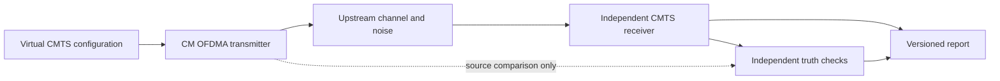

# MORGANA architecture

Status: unfinished checkpoint; further scientific implementation awaits plan
approval. The [foundation design](development/features/foundation/design.md)
contains requirements, reuse assessments, evidence, API proposal and milestones.

| Current owner | Responsibility | Status |
| --- | --- | --- |
| `crates/ldpc` | Upstream QC matrices, sparse systematic encoder, shortening, bounded layered soft decoder | Implemented; normative table review incomplete |
| `crates/morgana` | Configure/run/report facade for one noiseless FEC trial; schema-1 owned results | Implemented; broader API planned |
| `crates/cli` | Arguments, deterministic fixture source and JSON stdout | Implemented; no waveform processing |
| `skills/` | Canonical engineering/PHY guidance and operational references | Adopted for this checkpoint |
| `scripts/` and `tools/git/` | Local validation and guarded local save | Checkpoint tooling |
| `install.sh` and `scripts/bootstrap/` | Explicit development dispatcher, host/package admission, pinned local Rust and locked source setup | Inspection/mock validation; clean provisioning unverified |

The current executable path is information bits → upstream LDPC encode →
noiseless LLRs → soft decode → separate syndrome/source comparison. Decoder
convergence does not prove original-bit recovery. The encoder uses an Apache
adaptation of the existing sparse substitution helper; no runtime dependency on
another source checkout exists. Maximum iterations are application-bounded to 100.

Planned integration:

Receiver inputs must contain received signals and explicit configuration, never
hidden injected H or original bits. Normal receiver estimation observes C×H.
Simulator truth is available only to independent diagnostic comparisons.

Virtual CMTS, grant/codeword selection, UCD/IUC mapping, randomization,
interleaving, pilot/preamble placement, waveform generation/acquisition, Pre-Eq
capture import, impairment pipeline, RxMER and full experiment reports are planned.
Python is a future native wrapper of the same public Rust API; all calculations
and validation remain Rust. No saved-workbench format or stable C ABI exists.

See the [official checklist](development/checklist.md) for incomplete acceptance,
especially LDPC-01's source transcription issue. Internal tests share the
transcribed table data and cannot establish its correctness by round trip alone.
