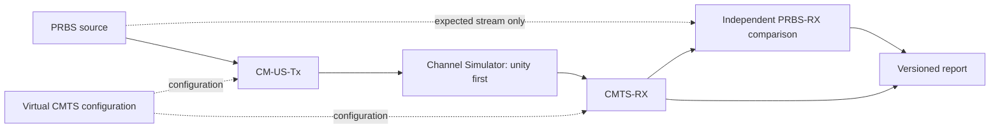

# MORGANA architecture

Status: unfinished checkpoint; further scientific implementation awaits plan
approval. The [foundation design](development/features/foundation/design.md)
contains requirements, reuse assessments, evidence, API proposal and milestones.

| Current owner | Responsibility | Status |
| --- | --- | --- |
| `crates/ldpc` | Upstream QC matrices, sparse systematic encoder, shortening, bounded layered soft decoder | Implemented; normative table review incomplete |
| `crates/morgana` | Configure/run/report facade for one noiseless FEC trial; schema-1 owned results | Implemented; broader API planned |
| `crates/cli` | Arguments, deterministic fixture source and JSON stdout | Implemented; no waveform processing |
| `skills/` | Canonical engineering/PHY guidance and operational references | Adopted for this checkpoint |
| `scripts/` and `tools/git/` | Local validation and guarded local save | Checkpoint tooling |
| `install.sh` and `scripts/bootstrap/` | Explicit development dispatcher, host/package admission, pinned local Rust and locked source setup | Inspection/mock validation; clean provisioning unverified |

The current executable path is information bits → upstream LDPC encode →
noiseless LLRs → soft decode → separate syndrome/source comparison. Decoder
convergence does not prove original-bit recovery. The encoder uses an Apache
adaptation of the existing sparse substitution helper; no runtime dependency on
another source checkout exists. Maximum iterations are application-bounded to 100.

Planned top-level path (expanded in the workbench section below):

Receiver inputs must contain received signals and explicit configuration, never
hidden injected H or original bits. Normal receiver estimation observes C×H.
Simulator truth is available only to independent diagnostic comparisons.

Virtual CMTS, grant/codeword selection, UCD/IUC mapping, randomization,
interleaving, pilot/preamble placement, waveform generation/acquisition, Pre-Eq
capture import, impairment pipeline, RxMER and full experiment reports are planned.
Python is a future native wrapper of the same public Rust API; all calculations
and validation remain Rust. No saved-workbench format or stable C ABI exists.

See the [official checklist](development/checklist.md) for incomplete acceptance,
especially LDPC-01's source transcription issue. Internal tests share the
transcribed table data and cannot establish its correctness by round trip alone.

## Planned upstream signal path and workbenches

ARCH-01 defines the target organization. This section is planned architecture;
the existing executable still runs isolated LDPC trials. No PRBS waveform,
channel object, CMTS receiver, instrument or GUI is claimed implemented here.

Use the same left-to-right organization as the reference workbench:
**PRBS → CM-US-Tx → Channel Simulator → CMTS-RX → PRBS-RX/results**.
CM-US-Tx and CMTS-RX open their own stage workbenches. Test-point actions open
the shared **QAM Analyzer** or **Spectrum Analyzer (SA)** for the selected tap.
The direction changes to CM transmission and CMTS reception; upstream FEC,
framing, pilot and interleaving rules determine the actual stage order.

### Configuration and source

An immutable Virtual CMTS configuration supplies the upstream channel/numerology,
IUC-to-burst-profile mapping, per-minislot loading, pilot pattern, synthetic grant,
clock/frame epoch and accepted ranging/timing state. It is a configuration input
to both endpoints, separate from source bits and injected-channel truth. The
first run uses one valid data profile, configured timing and unity Pre-Eq.
No downstream waveform, real UCD/MAP parser, contention or service-group scheduler
is required. IUC is an identifier selecting a configured profile, not a fixed QAM order.

PRBS uses the same explicit PRBS15 source/verifier contract as the reference
implementation: recurrence `s[n+15] = s[n+14] XOR s[n]`, nonzero 15-bit seed,
seed bits emitted least-significant first and continuous absolute bit position.
The source runs across codewords/grants and pauses without reseeding. The verifier
independently regenerates the expected stream for recovered meaningful source
positions; source bits/seed do not enter receiver recovery or equalization.
PRBS15 is the test payload. The separate upstream PHY randomizer is the
grant-seeded 23-bit process required by PHY3.1 §7.4.4.

### CM-US-Tx stages

| Stage | Responsibility and inspectable result |
| --- | --- |
| TX-01: grant framing | Derive usable grant bits and codeword sequence from accepted profile/resources; consume exact PRBS ranges and keep meaningful data, information fill and grant padding distinct. |
| TX-02: upstream LDPC | Select long/medium/short mother codes; append shortening zeros, encode systematic information/parity, omit shortened zeros and account for remaining grant padding. No downstream BCH or ordinary-data puncturing. Expose code identity, retained length and encoded bits. |
| TX-03: randomization | Randomize the encoded grant stream, including padding as specified, with accepted upstream seed/state. Reset the PHY randomizer at the grant boundary; never reset PRBS15 because a grant starts. |
| TX-04: cell-word/QAM mapping | Group randomized bits in MSB-first cell order; map data and data-bearing complementary-pilot cells using their respective loading and normalized constellation references. |
| TX-05: OFDMA framer/interleaver | Generate known BPSK pilots and edge/body patterns; allocate logical grant cells, perform the upstream joint time/frequency interleaving and map to physical carriers with exclusions/unused bins preserved. Export role/order/grid metadata. |
| TX-06: CM Pre-Eq | Apply one complex corrective coefficient per carrier; identity coefficients initially. Keep the correction response distinct from an injected physical channel. |
| TX-07: IFFT | Convert the complete physical frequency grid into complex baseband useful-symbol samples with explicit transform normalization and bin order. |
| TX-08: sample assembly | Add configured CP/roll-off extension, apply the specified transmit window/overlap treatment, and emit correctly indexed burst/guard samples. Preserve state across arbitrary output chunk boundaries. |

TX-04 and TX-05 are functional boundaries, not permission to invent a separate
downstream bit-interleaver. PHY3.1 §7.4.5 couples address generation, bit loading
and cell placement; an implementation may fuse them while retaining observable
stage contracts. Known pilots reserve their cells; complementary pilots carry
data with their own loading. Do not discard them as if they were known pilots.
Excluded/unused carriers and zero-valued minislots follow upstream mapping rules.

The initial path is a normal scheduled data burst. Do not insert a generic
training/ranging preamble into every data burst. Dedicated ranging/probe formats,
their preambles and special coding are later modes requiring their own evidence.

### Channel Simulator: unity stub first

The Channel Simulator remains a visible stage with input/output test points even
when it has no impairment controls. Its first future implementation is an exact
pass-through: `y[n] = x[n]`, unit gain, zero delay and zero added samples/noise.
Preserve sample rate, complex values, sample indices, burst boundaries and
normalization. Input and output snapshots identify the same transported samples;
do not regenerate them from symbols or change them according to chunk size.
No random draws, filtering, resampling, quantization, clipping, jitter, frequency
offset or phase change occurs in this baseline. There is no impairment engine yet.

The stub exposes one bounded sample-processing boundary and retained input/output
observations. Reserve an ordered channel-stage contract for later complex response,
AWGN, ingress/impulsive noise and timing/frequency/phase models. Unsupported
nonidentity configuration must be rejected until implemented. An empty stage list
must remain equivalent to the unity stub. Keep truth parameters in channel/metrics
ownership; never pass them to CMTS-RX for ordinary channel correction.

### CMTS-RX stages

```mermaid
flowchart LR
    C[Channel output samples] --> R1[RX-01 Burst framing and timing]
    R1 --> R2[RX-02 CP removal and useful-symbol extraction]
    R2 --> R3[RX-03 FFT]
    R3 --> R4[RX-04 Pilot CH-EST-RX and equalization]
    R4 --> R5[RX-05 Resource extraction and deinterleaving]
    R5 --> R6[RX-06 Soft QAM demapping]
    R6 --> R7[RX-07 PHY soft derandomization]
    R7 --> R8[RX-08 Shortening restoration and LDPC decode]
    R8 --> R9[RX-09 Payload deframing]
    R9 --> V[Independent PRBS-RX comparison]
```

| Stage | Responsibility and inspectable result |
| --- | --- |
| RX-01: burst framing/timing | Accept received samples and configured grant/clock state; retain a bounded burst buffer and explicit validity. Initially use configured epoch, zero frequency offset and accepted ranging. Later acquisition/tracking derives corrections from received observations, not transmitter diagnostics. |
| RX-02: useful-symbol extraction | Select the valid FFT interval and remove CP/extension overhead according to accepted upstream geometry; preserve raw and useful samples as different taps. Do not attempt to invert a transmit window by arbitrary pointwise division. |
| RX-03: FFT | Transform received useful samples to the matching physical-bin grid and normalization. Retain raw received bins before correction. |
| RX-04: Channel Estimation (CH-EST-RX) | Extract known pilot observations, estimate effective `C[k]H[k]` and correct carrier I/Q using that received estimate. Keep estimate, validity/coverage and corrected I/Q separate. Initially the estimated response should approach unity; blind synchronization and adaptive tracking are later extensions. |
| RX-05: resources/inverse interleaving | Gather only the granted physical cells, preserve known-pilot/complementary-data roles, undo the upstream cell permutation and reconstruct the ordered loaded data cells. Do not turn excluded or absent carriers into fabricated payload. |
| RX-06: soft demapping | Produce MSB-first natural-log `P(0)/P(1)` LLRs from equalized data/complementary-data I/Q using the selected cell constellation. Positive favors zero. Hard slicing is a diagnostic branch, never the soft decoder input. |
| RX-07: soft derandomization | Regenerate the configured grant-seeded PHY randomizer and invert LLR signs where its bit is one. Restore encoded-codeword order and remove grant-only padding using the validated grant plan. |
| RX-08: LDPC recovery | Restore omitted shortening coordinates as known-zero priors, invoke the selected upstream decoder, retain failed decisions/actual iterations and independently check syndrome/shortened-zero consistency. No BCH stage. |
| RX-09: payload deframing | Remove only fill/padding identified by the accepted framing contract and return information bits in grant/codeword coordinates with status. The orchestration/comparison branch associates meaningful source ranges; the separate PRBS verifier measures bit errors/gaps without silently resynchronizing. |

RX-05/06 may be fused if varying cell orders/loading are preserved exactly.
Derandomization precedes LDPC decoding because the upstream randomizer follows
FEC at TX. Pre-Eq is transmitter compensation; the receiver corrects estimated
effective response rather than separately dividing by a hidden injected `C` or `H`.
The noiseless first mode uses an explicit finite-confidence LLR policy so zero
noise never causes division by zero. That confidence is a reference assumption,
not a measured SNR; received noise estimation is a later receiver capability.
The receiver does not infer original source length from PRBS truth or strip
arbitrary decoded values as padding. Start with continuous PRBS filling the
accepted data capacity. Finite-file payload framing needs an explicit shared
length/segmentation contract before it can promise recovered original bytes.

### Shared QAM Analyzer and Spectrum Analyzer

Keep one reusable instrument implementation per instrument type, with tap
selection rather than separate numerical implementations for TX/channel/RX.
The instrument availability table is an interface plan, not a list of implemented taps.

| Proposed tap | Data and reference plane | Instruments |
| --- | --- | --- |
| `tx.qam.mapped` | Normalized loaded cell symbols before grant permutation/Pre-Eq | QAM |
| `tx.grid.iq` | Physical data/pilot/complementary-data cells before Pre-Eq | QAM |
| `tx.pre_eq.iq` | Actual corrected carrier symbols after Pre-Eq | QAM |
| `tx.output.samples` | Complete assembled complex baseband burst | SA |
| `channel.input.samples` | Identical channel-input waveform/reference plane to TX output | SA |
| `channel.output.samples` / `rx.input.samples` | Actual delivered waveform/reference plane; identical in the unity baseline | SA |
| `rx.useful.samples` | Actual contiguous FFT-input samples with CP/guards removed, identified per symbol | SA |
| `rx.fft.iq` | Received physical-bin I/Q before correction | QAM |
| `rx.equalized.iq` | Received I/Q after CH-EST-RX correction and before decisions | QAM; default RX view |
| `rx.deinterleaved.iq` | Corrected loaded cells in recovered grant order | QAM |

**QAM Analyzer:** retain the reference workbench's Raw / Equalized / Paired
views and symbol/carrier/range selection. Offer upstream **Data / Known pilots /
Complementary data** roles with profile/IUC and actual modulation filters. Do
not show downstream PLC/NCP selectors or pool incompatible constellations. Match
raw/equalized/TX-reference observations by run, burst, frame, symbol, carrier,
role and loading; mark mismatches/unretained history unavailable. A reference
overlay is an independent diagnostic view and must not feed receiver recovery.
Show real/imaginary points, nominal constellation/labels, bounded sample count,
reference plane and available Rust-derived MER/EVM. Keep hard-decision/LLR and
FEC diagnostics as separate views of the same recovered cells/codewords.

**SA:** reuse the same tap chooser and viewing/zoom pattern, powered by one
Rust PSD estimator using actual contiguous complex time samples. Never feed
bit arrays, FFT-bin lists or concatenated discontinuous useful symbols as if
they were one time waveform. Independent useful-symbol windows retain their own
time/validity metadata. Carry sample rate, FFT length, window/averaging policy,
frequency origin, PSD units and bounds in every result. Default to complex
baseband frequency offset; an RF-frequency display mapping changes labels only.
Use normalized power density until explicit physical calibration exists.

The upstream geometry must be admitted explicitly: PHY3.1 §7.4.9 specifies
102.4 Msamples/s with 2048 useful samples at 50 kHz or 4096 at 25 kHz. The
reference SA/FFT currently binds downstream geometry and 204.8 MHz; numerical
reuse needs parameterized geometry/sample rate. Preserve its periodic-Hann,
linear-power averaging, explicit zero-power and bounded viewport principles.
Analysis windowing is separate from transmit CP/windowing. TX/channel/RX SA
results must agree for the same sample interval through the unity channel.

All observation/PSD/QAM/MER/LLR calculations and retained buffers belong to Rust.
Capture identity includes run/configuration generation, burst/grant, source or
receive sample range, domain, normalization, role and validity. Use bounded
retention/queues; disabled, failed or exhausted observers must not change RNG,
interleaver or receiver state. Qt or a future Python adapter only selects/displays
Rust results. Applying settings affects the next run and invalidates stale views;
pause/resume preserves source, randomizer, interleaver and receiver state.

### Ownership, results and acceptance

Retain `crates/ldpc` as the waveform-independent codec. A proposed `crates/phy`
would own focused `configuration`, `source`, `transmitter`, `channel`, `receiver`,
`instruments` and `simulation` modules; these are planned module responsibilities,
not empty files to create now. `crates/morgana` exposes their typed Rust facade
and reports; the CLI and future Python wrapper consume it. Numerical reuse from
the reference toolkit requires a reviewed shared-code plan and preserved licenses.
Actual GPL Qt presentation reuse requires a separate compatible application
adapter; it does not change the Apache scientific-core boundary.

The result joins recovered source ranges/BER, separate convergence and parity
flags, failed codewords, actual LDPC iterations, receiver estimate/coverage,
sample/cell observations and configuration provenance. Reference-based data
RxMER compares matched symbols in an independent metrics branch, never in the
receiver's equalization path. Receiver-derived pilot/decision metrics are labeled
by their own reference and must not be presented as injected-truth measurements.
Zero observed symbol error has an explicit unbounded/zero-error status rather
than fabricated finite RxMER or a non-JSON infinity. Finite reconstruction
residuals may still exist in a no-impairment run.

Implement in dependency order: resolve LDPC source validation → typed grant/
codeword plan and PRBS source → TX stages → unity channel boundary → configured-
timing RX with pilot-derived correction → exact payload comparison → shared
QAM/SA instruments → optional impairment/acquisition extensions. Stage-level
typed taps are added with each stage; GUI implementation stays separate.

Acceptance requires independent stage/order/source checks, exact unity sample
transport under different chunking, complete noiseless source recovery, matched
TX/raw/equalized cell observations and identical unity-path SA reference planes.
Full codeword convergence and original-bit comparison remain separate assertions.
No external interoperability or clean-machine/native UI claim follows from these
planned internal checks. See [ARCH-01 design](development/features/upstream-signal-path/design.md)
and the official checklist for current prerequisite gaps.

Source: CM-SP-PHYv3.1-I20-230419 §7.4.1, Figure 5, PDF p50; §7.4.1.5–7,
p51; §7.4.3–7, pp52–65; §7.4.9–10, pp65–69; §7.4.16–17, pp101–107.
Figure 5/p50 was checked in the original local PDF; remaining detailed equations,
pilot tables and permutations require their implementation-time PDF checks.
PHY4.0 I07 §7.2.4 and §7.3.4 delegation was checked in pinned extracted text;
FDX/FDD extensions remain separate applicability work, not implied full support.
