# MORGANA architecture

Status: backend implementation authorized; all-family standalone LDPC source audit
and codec acceptance complete. Waveform integration remains planned.
The [foundation design](development/features/foundation/design.md)
contains requirements, reuse assessments, evidence, API proposal and milestones.
The consolidated [requirements baseline](requirements.md) defines stable behavior
and acceptance IDs; this document owns their design and planned code/test layout.
The [software development checklist](development/checklist.md) maps those
requirements and owners to dependency-ordered implementation/acceptance tasks
and preserves completed design records separately from scientific completion.

**Table of contents**

- [PRBS](#prbs-block-architecture)
- [CM-US-TX](#cm-us-tx-block-architecture)
- [CH-SIM](#channel-simulator-unity-stub-first)
- [CMTS-US-RX](#cmts-us-rx-block-architecture)

[US Configuration](#us-configuration)

**PNM Files**

- [RxMER](#rxmer-input)
- [US-Pre-EQ](#us-pre-eq-input)

[High-level Rust and Python APIs](#high-level-rust-and-python-apis) ·
[Backend delivery decisions](#accepted-backend-delivery-decisions)

## Checkpoint and target overview

| Current owner | Responsibility | Status |
| --- | --- | --- |
| `crates/ldpc` | Upstream QC matrices, sparse systematic encoder, shortening, bounded layered soft decoder | Source-audited and locally accepted for all three families; waveform integration planned |
| `crates/morgana` | Configure/run/report facade for one noiseless FEC trial; schema-1 owned results | Implemented; broader API planned |
| `crates/cli` | Arguments, deterministic fixture source and JSON stdout | Implemented; no waveform processing |
| `skills/` | Canonical engineering/PHY guidance and operational references | Adopted for this checkpoint |
| `scripts/` and `tools/git/` | Local validation and guarded local save | Checkpoint tooling |
| `install.sh` and `scripts/bootstrap/` | Explicit development dispatcher, host/package admission, pinned local Rust and locked source setup | Inspection/mock validation; clean provisioning unverified |

The current executable path is information bits → upstream LDPC encode →
noiseless LLRs → soft decode → separate syndrome/source comparison. Decoder
convergence does not prove original-bit recovery. The encoder uses an Apache
adaptation of the existing sparse substitution helper; no runtime dependency on
another source checkout exists. Maximum iterations are application-bounded to 100.

Planned top-level path (expanded in the workbench section below):

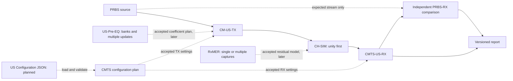

Receiver inputs must contain received signals and explicit configuration, never
hidden injected H or original bits. Normal receiver estimation observes C×H.
Simulator truth is available only to independent diagnostic comparisons.

US Configuration, grant/codeword selection, UCD/IUC mapping, randomization,
interleaving, pilot/preamble placement, waveform generation/acquisition, Pre-Eq
capture import, impairment pipeline, RxMER and full experiment reports are planned.
Python is a future native wrapper of the same public Rust API; all calculations
and validation remain Rust. No saved-workbench format or stable C ABI exists.
The separate [API architecture](#high-level-rust-and-python-apis) defines paired
interface stubs, placement, lifecycle and delivery gates; it adds no PHY stage.

See the [official checklist](development/checklist.md) for remaining work and the
[LDPC audit](development/features/ldpc-source-audit/validation.md) for completed
source/codec acceptance. Independent page-derived fingerprints and frozen parity
supplement shared-data round trips; neither is external interoperability evidence.

## Accepted backend delivery decisions

The six decisions below were accepted during the backend review. They define
implementation scope/order. The user subsequently authorized starting this plan;
completion remains tied to each task's evidence in the official checklist.
See the [decision/validation record](development/features/backend-delivery/design.md)
and [developer checklist](development/checklist.md). Existing stage contracts
remain the detailed design; all corresponding runtime gates remain pending.

| Decision | Accepted contract | Architecture / delivery |
| --- | --- | --- |
| BACKEND-01 | Audit and validate all three LDPC families before dependent waveform implementation. Resolve the recorded matrix discrepancy using independent source checks. | [TX-02](#tx-02-ldpc-encoding-and-shortening), [RX-08](#rx-08-shortening-restoration-and-ldpc-decoding); LDPC-01/02. |
| BACKEND-02 | Keep MORGANA standalone while adapting suitable reviewed MERLIN code into locally owned modules. Retain origin/revision/licenses and independently validate upstream behavior. No MERLIN crate, checkout or runtime dependency is introduced. | [Code layout](#planned-code-layout), [scientific ownership](#ownership-results-and-acceptance); DEV-CORE-01, DEV-LICENSE-01. |
| BACKEND-03 | Deliver bounded execution, cooperative cancellation and completed/partial results first. Pause/resume follows the accepted reference loop and its own state/time-accounting tests. | [API lifecycle](#api-lifecycle-errors-and-result-contracts); DEV-RUN-01, DEV-PAUSE-01. |
| BACKEND-04 | Prepare independent source-checked expected inputs/outputs before implementing each stage. Build the catalog stage by stage; a complete upfront vector catalog or external interoperability dataset is not a prerequisite. | [TX stages](#internal-stage-sequence), [RX stages](#receiver-stage-sequence); each stage task and LDPC-01/02. |
| BACKEND-05 | Use typed synthetic US Configuration for the first unity loop. Add versioned JSON loading and verified RxMER/Pre-EQ capture import afterward. Full applicable MULPI coverage remains required delivery work. | [US Configuration](#us-configuration), [CMTS JSON](#cmts-configuration-us-configuration-json), [PNM RxMER](#rxmer-input), [PNM Pre-EQ](#us-pre-eq-input); phase 7 after DEV-LOOP-01. |
| BACKEND-06 | Develop the high-level Rust API alongside the backend and accept the reference loop through it. Add the native Python wrapper only after the Rust unity loop passes. An early FEC-only Python wrapper is outside the selected first milestone. | [API delivery](#api-delivery-and-validation-gates); API-RUST/INPUT-01, API-RUN-01, DEV-LOOP-01, API-PY/STUB-01. |

The first milestone is the typed, Rust-driven PRBS → CM-US-TX → exact unity
CH-SIM → configured-timing CMTS-US-RX → independent comparison loop, with finite
work limits and cancellation/partial results. Unsupported pause controls,
configuration/capture loaders and native Python remain unavailable until their
later acceptance gates pass. Full later requirements are retained.
Per-stage pause/resume descriptions remain the later continuity contract; their
pause-specific acceptance belongs to DEV-PAUSE-01. Initial stage gates cover the
declared bounded/cancellable reference scope, without claiming paused execution.

**File ownership for these decisions.** No source files are added here. Detailed
stage/API tables remain authoritative for all leaf files and tests.

| Path | Disposition at implementation | Responsibility |
| --- | --- | --- |
| `crates/ldpc/src/definitions.rs`, `crates/ldpc/src/codec.rs`, `crates/ldpc/src/tests.rs`, `crates/ldpc/src/tests/oracle.rs` | Edit/reuse existing after audit | Source-verified matrices, codec behavior and independent acceptance. |
| `crates/phy/src/signal_processing/mod.rs` | Add (already planned) | Focused local numerical owners; inspect each reuse candidate and its upstream applicability. |
| `crates/phy/src/simulation/job.rs` | Add (already planned) | Bounded cancellation/partial results first; later verified pause/resume state. |
| `crates/morgana/src/api/simulation.rs` | Add (already planned) | Rust session integration developed with the backend and exercised by reference acceptance. |
| `bindings/python/src/simulation.rs` | Add (already planned; later milestone) | Native adapter after the accepted Rust unity loop. |

Concrete cumulative job budgets, per-primitive reuse/dependency choices, exact
schema fields and capture formats still require their implementation-time
review. Borrowing code does not establish compatibility by itself. Existing
independent pinned Rust dependencies remain valid; this decision selects no new
external numerical library or shared cross-project crate. MERLIN inspection
remains read-only. Preserve every actual copied/adapted notice and modification.

## Planned upstream signal path and workbenches

ARCH-01 defines the target organization. This section is planned architecture;
the existing executable still runs isolated LDPC trials. No PRBS waveform,
channel object, CMTS receiver, instrument or GUI is claimed implemented here.

Use the same left-to-right organization as the reference workbench:
**PRBS → CM-US-TX → Channel Simulator → CMTS-US-RX → PRBS-RX/results**.
CM-US-TX and CMTS-US-RX open their own stage workbenches. Test-point actions open
the shared **QAM Analyzer** or **Spectrum Analyzer (SA)** for the selected tap.
The **PNM Files** inputs sit beside the main path. The [RxMER input](#rxmer-input)
accepts single or multiple captures and feeds
the future residual-power planner in [CH-SIM](#channel-simulator-unity-stub-first).
The separate [US-Pre-EQ input](#us-pre-eq-input) accepts corrective banks and
multiple update records for [TX-06](#tx-06-cm-pre-eq). Accepting either input does
not enable its model or start processing. [US Configuration](#us-configuration)
provides accepted common settings to TX/RX. Each main block retains its own
stage index; the contents keeps the four processing blocks, US Configuration
and the two PNM inputs.
The generic JSON plan is owned by the CMTS control/configuration boundary,
documented under [CMTS-US-RX configuration](#cmts-configuration-us-configuration-json).
Configuration is accepted before scientific execution; it is not an extra RX
signal-processing stage. The public input name remains **US Configuration**.
The direction changes to CM transmission and CMTS reception; upstream FEC,
framing, pilot and interleaving rules determine the actual stage order.

### Planned code layout

All paths below are relative to the repository root. **Create (planned)** means
that the file does not exist in this checkpoint; **reuse (existing)** and
**extend (existing)** identify inspected files. These are placement decisions,
not implemented modules. No empty files, Cargo members or adapters are added now.
Each block/stage below gives its concrete implementation and test filenames.

The dependency direction is CLI/future Python or UI adapters → public
`crates/morgana` facade → proposed `crates/phy` → existing `crates/ldpc`.
Keep the current facade's direct LDPC imports/re-exports compatible. Algorithms,
validation and bounded orchestration stay Rust; adapters present owned results.

| Path / directory entrypoint | Disposition | Responsibility |
| --- | --- | --- |
| `Cargo.toml` | Extend (existing) | Register the future PHY member/dependency when implemented; update `Cargo.lock` through Cargo. |
| `crates/phy/Cargo.toml`, `crates/phy/src/lib.rs`, `crates/phy/src/error.rs` | Create (planned) | Rust PHY crate, module declarations/public domain surface and typed stage errors. |
| `crates/phy/src/configuration/mod.rs` | Create (planned) | Accepted US Configuration/profile/waveform/burst/Pre-Eq configuration and separate channel/RxMER/receiver policies. |
| `crates/phy/src/types/mod.rs` | Create (planned) | Register `bits.rs`, `iq.rs` and `samples.rs` in this directory for bit ranges, complex cells and indexed sample blocks. |
| `crates/phy/src/source/mod.rs` | Create (planned) | PRBS source and independent verifier. |
| `crates/phy/src/resources/mod.rs` | Create (planned) | Shared grant grids, pilot roles/patterns, block partitioning and cell permutations. |
| `crates/phy/src/grant/mod.rs` | Create (planned) | Shared pure capacity/codeword planning. |
| `crates/phy/src/bit_processing/mod.rs` | Create (planned) | Shared payload randomizer and independent known-pilot sequence. |
| `crates/phy/src/signal_processing/mod.rs` | Create (planned) | Shared QAM/transform/coefficient-bank arithmetic, waveform/channel primitives and received-pilot/correction/soft-demapping numerics. |
| `crates/phy/src/transmitter/mod.rs` | Create (planned) | Compose the eight TX stage adapters. |
| `crates/phy/src/channel/mod.rs` | Create (planned) | Unity sample transport and future ordered channel stages. |
| `crates/phy/src/measurements/mod.rs` | Create (planned) | Register separate upstream RxMER observations and US-Pre-EQ bank/update records with original provenance. |
| `crates/phy/src/receiver/mod.rs` | Create (planned) | Compose the nine RX stage adapters without source truth. |
| `crates/phy/src/instruments/mod.rs` | Create (planned) | Bounded passive observations and shared QAM/SA calculations. |
| `crates/phy/src/simulation/mod.rs` | Create (planned) | Run lifecycle, source associations and independent comparisons. |
| `crates/phy/tests/` | Create (planned) | Integration/acceptance files named in each block/stage below. |
| `crates/morgana/src/lib.rs`, `crates/morgana/src/report.rs` | Extend (existing) | Preserve the FEC API while exposing reviewed experiment operations and versioned results. |
| `crates/morgana/src/api/mod.rs` | Create (planned) | High-level typed session surface; leaf modules and paired stubs are defined in the [API architecture](#high-level-rust-and-python-apis). |
| `crates/cli/src/args.rs`, `crates/cli/src/command.rs` | Extend (existing) | Expose accepted facade inputs/results after the Rust capability exists. |
| `bindings/python/src/lib.rs`, `bindings/python/tests/test_experiment.py` | Create (planned; later API milestone) | Native adapter and Rust/Python contract-parity checks; no Python science. |

Module directories above use their named `mod.rs`; their leaf files are specified
in the corresponding sections below. The module roots and `crates/phy/src/lib.rs`
register those leaves when implemented. The accepted numerical strategy is
[standalone local adaptations](#accepted-backend-delivery-decisions); each primitive
and dependency still needs source/license/upstream review before adoption. Actual
Qt file placement remains for its separate UI plan. No numerical dependency or
UI crate is introduced by this layout.

### US Configuration

[CM-US-TX](#cm-us-tx-block-architecture) ·
[CMTS-US-RX](#cmts-us-rx-block-architecture).

Status: **configuration-input architecture defined; editor, import and full
waveform configuration remain planned**. This is the upstream counterpart to
the reference modulation-profile input/editor concept. Use the name **US
Configuration**, including diagram labels; it supplies accepted common channel,
profile and grant settings to both endpoints. It does not implement a CMTS MAC.
The [CMTS configuration subsection](#cmts-configuration-us-configuration-json)
owns the versioned generic JSON plan, MULPI coverage requirement, acceptance flow
and endpoint-specific projections. Keep numerical configuration validation in
the shared Rust configuration owners below, independent of receiver algorithms.

**Planned code paths (repository-relative).**

| Path | Disposition | Responsibility |
| --- | --- | --- |
| `crates/phy/src/configuration/mod.rs` | Create (planned) | Compose and atomically validate the immutable US Configuration snapshot/generation. |
| `crates/phy/src/configuration/profile.rs` | Create (planned) | Accepted loading, pilot pattern and PHY seed configuration, composing the shared waveform geometry. |
| `crates/phy/src/configuration/waveform.rs` | Create (planned) | Accepted upstream N/clock/CP/RP geometry and checked lengths, shared by TX/RX; detailed in TX-08. |
| `crates/phy/src/configuration/grant.rs` | Create (planned) | Synthetic grant identity, resource assignment and configured clock epoch. |
| `crates/phy/src/configuration/burst.rs` | Create (planned) | Scheduled-data mode admission and explicit unsupported-mode results. |
| `crates/phy/src/types/bits.rs` | Create (planned) | Binary chunks, checked ranges and bit-role identities. |
| `crates/phy/src/types/iq.rs` | Create (planned) | Complex-cell representation with explicit grid/reference metadata. |
| `crates/phy/src/types/samples.rs` | Create (planned) | Complex samples, rates, indices, burst boundaries and validity. |
| `crates/phy/tests/configuration.rs` | Create (planned) | Configuration bounds, atomic admission and matching endpoint validation. |
| `crates/morgana/src/inputs/us_configuration.rs` | Create (planned) | Manual/typed or future verified decoded input, retained profile inventory and selected-profile queries. |
| `crates/morgana/src/inputs/mod.rs` | Create (planned) | Register configuration separately from PNM measurement importers. |
| `crates/morgana/src/lib.rs` | Extend (existing) | Expose Rust admission/inventory/preview before matching future Python/UI adapters. |
| `crates/morgana/tests/us_configuration.rs` | Create (planned) | Inventory selection, malformed import, shared validation and original-input preservation. |


An immutable US Configuration supplies the upstream channel/numerology,
IUC-to-burst-profile mapping, per-minislot loading, pilot pattern, synthetic grant,
clock/frame epoch and accepted ranging/timing state. It is a configuration input
to both endpoints, separate from source bits and injected-channel truth. The
first run uses one valid data profile, configured timing and unity Pre-Eq.
No downstream waveform, real UCD/MAP parser, contention or service-group scheduler
is required. IUC is an identifier selecting a configured profile, not a fixed QAM order.

**Editor groups and accepted ownership.** The future editor follows the reference
profile interaction: inspect original information, retain a profile inventory,
choose a profile, edit a draft, preview and Apply/Cancel. Rust owns all checks.

| Group | Accepted content / consumer |
| --- | --- |
| Channel | Upstream channel/CM identity, physical frequency origin, N/spacing/sample clock and used/unused/excluded carrier map; shared TX/RX geometry. |
| Timing | CP/RP, frame/physical-symbol epoch, synthetic grant origin and configured receiver timing; shared TX-08/RX-01/02 conventions. |
| Burst/profile inventory | Stable profile IDs, source identity and IUC associations, supported per-minislot data/complementary loading, pilot pattern and PHY randomizer seed; TX-01..05 and corresponding RX stages. |
| Grant | Explicit ordered allocations, selected profile/IUC, scheduled-data mode and work limits; shared pure capacity/codeword planning. |
| Compatibility | PNM grid/reset identity, coverage and selected model support; validate RxMER and US-Pre-EQ without importing their measured values into this configuration. |

Keep original imported configuration/profile records and their provenance
separate from edited/derived settings. A manually entered configuration is
labeled synthetic. A future captured upstream descriptor/profile importer needs
its own pinned type/version/units and OSSI/MULPI fixtures; downstream DPD file
types, PLC/NCP fields and downstream timing/interleaving are not inherited.
The planned standalone configuration JSON has its own format/version contract;
its schema and parser are not implemented. It is not a raw UCD/P-MAP wire format
or an existing saved-workbench schema.

**Single-profile and multiple-profile selection.** Retain a bounded inventory
with unique IDs and explicit IUC associations. Single-shot selects exactly one
valid scheduled-data profile/grant configuration. Multiple retained profiles
remain discoverable/queryable through Rust and future Python/UI, with explicit
selection; never merge their loading or infer a profile from QAM order alone.
The first run still uses one selected profile. A future sequential profile sweep
needs separately accepted per-profile requests, bounded work and distinct
results; importing multiple profiles does not automatically run a sweep or
imply simultaneous multi-CM traffic. US-Pre-EQ update replay changes C, not
the accepted profile/channel geometry during that run.

Proposed application limits are 1..256 retained profiles, N<=4096 and at most
1,048,576 retained expanded carrier assignments, 16 MiB per imported file and
64 MiB original bytes per batch. These cap storage and do not define legal IUCs,
PHY modulation support or a normative profile count. Admission checks actual
upstream loading/pilot rules against TX-01/04/05, grant feasibility, finite
values, unique IDs, geometry, counts and operation budgets before allocation/run.
Unsupported modes/orders return explicit errors; recognizing a value is not
an implemented waveform or decoder capability.

Apply validates the complete candidate configuration and dependent PNM selections
without consuming source/RNG state or starting a job. Incompatible retained PNM
inputs remain inspectable with explicit not-ready reasons; they never become
silently resampled or replaced. Cancel/rejected drafts preserve accepted settings.
Start freezes the accepted snapshot and dependencies. Edits affect a fresh run;
pause/resume preserves the old generation and pending Pre-EQ/RxMER events.
Changes to reset identity require a fresh compatible bank/default and acceptance.
Only legitimate known profile/grant/timing settings reach normal RX; no source
bits, injected H/C, update factors or target noise are included as receiver truth.

Planned acceptance covers single/multiple inventories, selection and unknown/
duplicate IDs, wrong grids, unsupported loading/modes, invalid grant/timing,
atomic edits, stale generation rejection, retained originals and unchanged state
on preview/cancel. The underlying PHY rules remain owned/cited by the TX stage
contracts. This editor/control architecture is an engineering adaptation of the
reference profile workflow, not evidence of upstream capture compatibility.

PRBS uses the same explicit PRBS15 source/verifier contract as the reference
implementation: recurrence `s[n+15] = s[n+14] XOR s[n]`, nonzero 15-bit seed,
seed bits emitted least-significant first and continuous absolute bit position.
The source runs across codewords/grants and pauses without reseeding. The verifier
independently regenerates the expected stream for recovered meaningful source
positions; source bits/seed do not enter receiver recovery or equalization.
PRBS15 is the test payload. The separate upstream PHY randomizer is the
grant-seeded 23-bit process required by PHY3.1 §7.4.4.

### PRBS block architecture

**Planned code paths (repository-relative).**

| Path | Disposition | Responsibility |
| --- | --- | --- |
| `crates/phy/src/source/prbs15.rs` | Create (planned) | Validated Prbs15Config/Prbs15, recurrence, bounded generation and position. |
| `crates/phy/src/source/verifier.rs` | Create (planned) | Independently owned expected stream, comparison counters and coverage. |
| `crates/phy/src/types/bits.rs` | Create (planned) | Shared SourceChunk and meaningful source-range representation. |
| `crates/phy/src/simulation/source_ledger.rs` | Create (planned) | Bounded grant/codeword-to-source association outside receiver recovery. |
| `crates/phy/src/simulation/comparison.rs` | Create (planned) | Validate recovered associations and invoke the independent verifier. |
| `crates/phy/tests/prbs.rs` | Create (planned) | Independent sequence/period, continuity, bounds and verifier cases. |
| `crates/phy/tests/source_association.rs` | Create (planned) | Missing/reordered/wrong-run ranges and incomplete comparison coverage. |


Status: **designed, not implemented**. ARCH-PRBS-01 expands the first block in
the signal path; SOURCE-01 remains the implementation milestone. The existing
CLI still generates a seeded ChaCha8 fixture. Selecting that fixture is not
selecting PRBS15. The design below is complete within this repository and has
no dependency on reference-project documentation or source checkouts.

The block has two independently owned roles: **PRBS-TX** supplies continuous
test payload bits, and **PRBS-RX** compares recovered payload decisions after
CMTS-US-RX. Both use the accepted source seed, with separate mutable registers and
counters. Only the comparison branch receives expected PRBS truth; neither
the PRBS seed nor expected bits enter the receiver's decoding/equalization API.

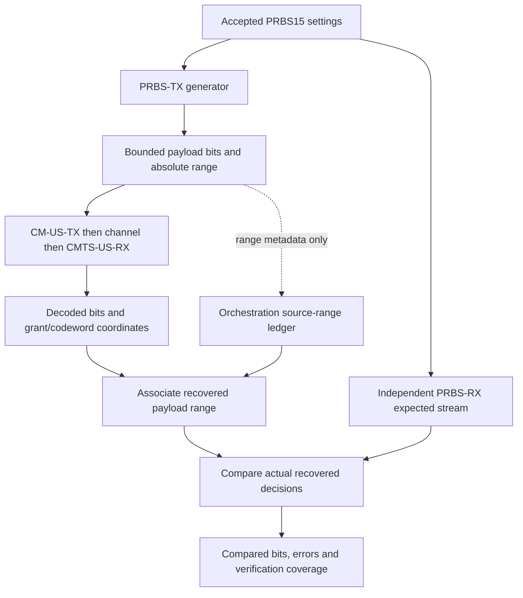

#### Sequence and bit representation

The selected sequence is defined by the recurrence
`s[n+15] = s[n+14] XOR s[n]`, with sequence polynomial `x^15 + x^14 + 1`.
The recurrence and emission order are authoritative for this test source;
polynomial names alone do not settle reciprocal or hardware shift conventions.

| Property | Contract |
| --- | --- |
| Kind | Continuous PRBS15; other polynomials are unsupported in this stage. |
| Seed | Nonzero 15-bit integer, 1–32767 inclusive; proposed initial draft value 32767 (`0x7fff`). Explicit Apply/run acceptance is still required. |
| Initial bits | Seed bits 0 through 14 are `s[0]` through `s[14]`, least-significant bit first. |
| Register step | Emit old bit 0; shift right; insert old bit 14 XOR old bit 0 into bit 14. |
| Period | 32767 bits for every allowed seed; the absolute source position continues across periods. |
| Position | Checked `u64` absolute index of the next bit; a fresh run begins at zero. |
| Bit storage | One binary `u8` value per bit in transmission order; no implicit byte packing or QAM bit reordering. |
| Per-operation bound | At most 1,048,576 generated or compared bits. This is a proposed application work/allocation limit, not a DOCSIS requirement. Larger streams use repeated bounded calls. |

For seed `0x7fff`, the first 32 emitted bits are:

```text
11111111111111101010101010101001
```

This vector and the period are mathematical test-source properties, not external
DOCSIS interoperability evidence. The generator uses no host entropy and shares
no state with channel noise. PRBS15 is separate from the post-FEC upstream PHY
randomizer; a grant resets the latter according to its own contract while PRBS
continues. Fixed waveform symbol sizes, downstream BCH payload sizes and
downstream randomizer reset intervals do not belong in this block.

#### Rust owners and stage interfaces

The proposed `crates/phy` source owner contains focused generator, verifier and
source-range types. Orchestration owns acceptance, the grant/source ledger and
job lifecycle. TX grant framing requests exactly the meaningful information-bit
count from a validated upstream grant/codeword plan. It adds coding fill,
shortened zeros and grant padding separately; those bits never advance PRBS or
enter its BER denominator. Idle/guard resources consume no source bits.

Bound the pending source ledger by the configured in-flight grant/codeword
budget. Retire completed associations into cumulative counters and bounded
diagnostics; continuous operation must not retain the full source or range
history. If the pipeline cannot accept a payload, apply backpressure before
generating it rather than advancing PRBS for discarded work.

| Proposed contract | Inputs and result | State/ownership |
| --- | --- | --- |
| `Prbs15Config` | Kind and validated seed; fixed recurrence/period are descriptive metadata. | Immutable accepted settings, frozen per run. |
| `Prbs15` | Validated seed; `generate(count)` returns the next bounded binary chunk, and `position()` reports the next absolute index. | Owns its register and position; no shared mutable state with observers or the verifier. |
| `SourceChunk` | Owned bits with `first_bit`; its checked half-open range is `[first_bit, first_bit + len)`. | Immutable output handed to TX; diagnostic copies are bounded. |
| Source-range ledger | Run/configuration identity and meaningful source ranges associated with accepted grant/codeword payload coordinates. | Orchestration metadata only; no original bits or PRBS seed are injected into CMTS-US-RX. |
| Recovered association | Actual decoded information decisions and grant/codeword coordinates, mapped to a source range outside RX. | Validate run identity, length and expected next range before comparison. |
| `PrbsVerifier` | Same accepted seed and independently owned expected stream; compares ordered binary decisions. | Advances through mismatches without correcting decisions or searching for another PRBS phase. |
| `PrbsComparison` | First compared position, bits tested, bit errors and optional absolute first-error position, per window and cumulatively. | Owned result snapshots remain valid after later operations. |

Generation and comparison accept zero-length calls as no-ops. Invalid seeds,
excessive work, nonbinary decisions, counter overflow or invalid recovered-range
association return typed errors before changing the affected source/verifier
state or totals. Preview uses a fresh independent generator, never the active
source or expected stream. A disabled/full diagnostic buffer cannot advance,
rewind or reseed either stream.

The future public Rust facade exposes this source selection and its results;
CLI, Qt and native Python adapters consume the same validation. Future Python
seed/count inputs are range-checked before narrowing to Rust integers, and
binary buffers preserve one 0/1 value per bit. Rust returns typed errors and
owned snapshots; Python raises corresponding domain exceptions and returns
equivalent values, with absent first error/BER represented as `None`.
These are proposed contracts, not currently callable Rust/Python APIs. No
PRBS source selector is added to the current FEC-only CLI by this document.

#### Independent comparison and incomplete recovery

Compare meaningful decisions even when the LDPC decoder reports a failure, if
it returns a complete binary decision range. Keep decoder convergence, parity,
shortened-zero consistency and source mismatch counts separate. A valid but
wrong codeword can pass parity and still produce PRBS errors; a failure flag
must not suppress those actual decisions.

The first verifier accepts a contiguous ordered stream. Before comparison,
orchestration checks each recovered association against the next expected
absolute source range. Missing, duplicated, reordered, wrong-run or wrong-length
payload produces an explicit incomplete/discontinuous verification outcome.
Retain all prior comparisons; stop contiguous comparison at the first unresolved
gap, while receiver results may continue to be collected. Never silently skip a
gap, count it as zero errors, infer alignment from decoded values or resynchronize
by searching the PRBS period. Explicit gap-aware continuation would be a later
contract, not an assumed feature of `compare`.

Report generated meaningful bits, compared bits, unverified generated bits,
coverage and run completion separately from the comparison totals. For `N > 0`
compared bits and `E` mismatches, BER is `E/N`; for `N = 0`, BER is unavailable
(`null` in future JSON), not zero. A null first-error index only means no
mismatch was observed in the compared data. Error-free complete source recovery
requires a completed/drained run, matching expected/generated/recovered counts,
full contiguous coverage and zero mismatches. No-payload, cancelled, truncated
or discontinuous runs cannot claim that acceptance from a zero error count.
Report export/schema changes require their own versioned API compatibility work.

#### Lifecycle and PRBS-TX / PRBS-RX presentation

| Event | Source, verifier and presentation behavior |
| --- | --- |
| Edit/open | Stage a draft; do not construct an active stream or consume bits. |
| Apply | Rust validates a candidate and atomically accepts it for the next run. Invalid drafts preserve the previous accepted settings/readiness. |
| Cancel/close | Discard drafts and preserve accepted settings. |
| Start a fresh run | Freeze accepted source/run/grant settings; create independent generator/verifier state at position zero with a new run identity. Bound run duration/work separately from the continuous source. |
| Generate next payload | Consume only the requested meaningful bits, preserving continuity across grants, codewords, chunks and sequence periods. |
| Pause/resume | Retain registers, positions, pending payload associations and comparison totals; no reseeding. |
| Stop/cancel | Stop admitting new work; retain completed comparisons and report queued/unrecovered ranges and partial status. Drain versus discard follows the accepted job policy. |
| Restart/reconfigure | Begin a new run at position zero; invalidate old observations by run/configuration identity. Settings never mutate an active run. |

The future **PRBS-TX** editor follows a Parameter/Value layout with contextual
descriptions and Apply/Cancel. Show Continuous PRBS15, editable decimal seed,
read-only recurrence/polynomial, period, initial bit order and continuous operation.
Duration/trial limits belong in run settings. An optional bounded Rust preview
shows the first bits without affecting readiness or runtime state. File input,
file fill, repeat modes and other PRBS polynomials require their own later design;
do not expose them as working source choices in this first block.

PRBS-TX readiness means a valid source was explicitly accepted. PRBS-RX readiness
means independent verification is configured for that accepted source; it does
not require an earlier successful run. Source acceptance alone does not make the
transmitter, receiver or whole experiment ready. Pending/ready/invalid states
must have text labels as well as color. The PRBS-RX results view displays actual
coverage, errors, first mismatch and complete/partial/discontinuous status; it
does not change receiver decisions or convert missing data into successful BER.
QAM/SA open on their waveform/cell taps, not on the PRBS bit array.

#### Reference assessment and acceptance

The reference inspection covered MERLIN's PRBS generator/verifier, literal-vector
and period tests, source-selection adapter and source editor at revision
`096d5a476194d4f2e016863d723b225257bb6037`. Reuse the sequence/seed contract,
independent verification, bounded chunking and draft/accepted UI pattern.
Replace its fixed downstream payload adapter with upstream grant-driven lengths;
defer its file/fill modes. This design is written locally; no implementation or
presentation source is copied in this task. Future actual code reuse must retain
the applicable copyright, Apache license and adaptation notices.

Required implementation checks are literal recurrence vectors for multiple
seeds, period/nonzero-state coverage, chunk/grant/codeword continuity, independent
error counts across boundaries, empty/no-observation behavior, rejected-call
invariance, checked counter limits, source-gap detection, pause/resume/restart,
observer neutrality and Rust/future Python contract parity. The feature record
maps these requirements to owners and planned checks:
[PRBS block design](development/features/prbs-source/design.md).

### CM-US-TX block architecture

**Planned code paths (repository-relative).**

| Path | Disposition | Responsibility |
| --- | --- | --- |
| `crates/phy/src/transmitter/mod.rs` | Create (planned) | Register and sequence the eight focused stage adapters listed below. |
| `crates/phy/tests/tx_pipeline.rs` | Create (planned) | Stage-boundary identities, chunk invariance and bounded partial emission. |


Status: **planned**. ARCH-TX-00 defines the transmitter block; ARCH-TX-01 through
ARCH-TX-08 expand all eight stages below. The isolated LDPC codec is a
dependency; it does not make this transmitter implemented. CM-US-TX converts meaningful
PRBS source bits and an accepted upstream grant into complex baseband samples
delivered to the Channel Simulator.

Rust owns every stage, its validation and bounded observations. The transmitter
accepts an immutable run configuration: channel geometry/clock, grant/profile,
pilot/loading/resource plan, randomizer seed, Pre-Eq response and execution
limits. Source generation keeps its own state. Injected channel impairments and
receiver estimates are outside this block. A presentation adapter opens a
transmitter workbench; opening an inspector does not start transmission.

#### Internal stage sequence

Each stage label in the tables below links to its local section.


| Stage | Responsibility and inspectable result |
| --- | --- |
| [TX-01: grant framing](#tx-01-grant-framing-and-fec-selection) | Derive usable grant bits and codeword sequence from accepted profile/resources; consume exact PRBS ranges and keep meaningful data, information fill and grant padding distinct. |
| [TX-02: upstream LDPC](#tx-02-ldpc-encoding-and-shortening) | Select long/medium/short mother codes; append shortening zeros, encode systematic information/parity, omit shortened zeros and account for remaining grant padding. No downstream BCH or ordinary-data puncturing. Expose code identity, retained length and encoded bits. |
| [TX-03: randomization](#tx-03-grant-seeded-phy-randomization) | Randomize the encoded grant stream, including padding as specified, with accepted upstream seed/state. Reset the PHY randomizer at the grant boundary; never reset PRBS15 because a grant starts. |
| [TX-04: cell-word/QAM mapping](#tx-04-cell-word-construction-and-qam-mapping) | Group randomized bits in MSB-first cell order; map data and data-bearing complementary-pilot cells using their respective loading and normalized constellation references. |
| [TX-05: OFDMA framer/interleaver](#tx-05-pilots-ofdma-framing-and-interleaving) | Generate known BPSK pilots and edge/body patterns, apply prescribed role gains, allocate logical grant cells and perform the upstream joint time/frequency interleaving and map to physical carriers with exclusions/unused bins preserved. Export role/order/grid metadata. |
| [TX-06: CM Pre-Eq](#tx-06-cm-pre-eq) | Apply one normalized complex corrective coefficient per physical carrier; unity on non-excluded carriers and zero on excluded carriers initially. Keep the correction response distinct from an injected physical channel. |
| [TX-07: IFFT](#tx-07-ifft) | Convert the complete physical frequency grid into complex baseband useful-symbol samples with explicit transform normalization and bin order. |
| [TX-08: sample assembly](#tx-08-sample-assembly) | Add configured CP/roll-off extension, apply the specified transmit window/overlap treatment, and emit correctly indexed burst/guard samples. Preserve state across arbitrary output chunk boundaries. |

The boundaries carry three different representations: TX-01..03 operate on
information/coded bits and explicit bit-role plans; TX-04..06 operate on loaded
complex cells and the complete frequency grid; TX-07..08 produce useful-symbol
and assembled time samples. Each stage accepts the preceding representation
with matching run/grant/configuration identity, not an untyped array whose
meaning depends on the selected viewer.

| Stage output | Retained identity and inspection |
| --- | --- |
| [TX-01 grant plan](#tx-01-grant-framing-and-fec-selection) | Ordered codewords, source ranges, information fill, shortening and grant padding; plan/bit inspector. |
| [TX-02 encoded grant](#tx-02-ldpc-encoding-and-shortening) | Actual systematic/parity bits, transmitted lengths and zero grant padding; bounded bit inspector. |
| [TX-03 randomized grant](#tx-03-grant-seeded-phy-randomization) | Actual post-randomization bits with accepted seed/grant epoch; bounded bit inspector. |
| [TX-04 mapped cells](#tx-04-cell-word-construction-and-qam-mapping) | Actual symbol values, constellation/loading and logical cell identity; shared QAM Analyzer. |
| [TX-05 physical grid](#tx-05-pilots-ofdma-framing-and-interleaving) | Role-scaled physical carrier/symbol coordinates with gain, known-pilot, complementary-data, data and excluded/unused roles; shared QAM Analyzer. |
| [TX-06 Pre-Eq grid](#tx-06-cm-pre-eq) | Actual corrected carrier values, coefficient generation and response reference plane; shared QAM Analyzer. |
| [TX-07 useful samples](#tx-07-ifft) | Contiguous complex time samples per symbol, transform normalization and sample rate; shared Spectrum Analyzer. |
| [TX-08 burst samples](#tx-08-sample-assembly) | Actual windowed/assembled stream with sample indices and burst boundaries; shared Spectrum Analyzer and channel input. |

Retain the existing shared tap names; detailed later stages may add a typed tap
only for an actual produced boundary. Bit arrays are not QAM or SA inputs, and
frequency-grid lists are not time waveforms. Disable or bound inspection without
changing source/randomizer/overlap state or processing decisions.

TX-04 and TX-05 are functional boundaries, not permission to invent a separate
downstream bit-interleaver. PHY3.1 §7.4.5 couples address generation, bit loading
and cell placement; an implementation may fuse them while retaining observable
stage contracts. Known pilots reserve their cells; complementary pilots carry
data with their own loading. Do not discard them as if they were known pilots.
Excluded/unused carriers and zero-valued minislots follow upstream mapping rules.

The initial path is a normal scheduled data burst. Do not insert a generic
training/ranging preamble into every data burst. Initial/fine ranging require
dedicated preambles and special coding; probing has a separate pilot-based format.

The first run uses accepted scheduled-data resources, unity Pre-Eq and the unity
channel. Grant validation/readiness is separate from source acceptance. Start
freezes the complete request; pause/resume preserves accepted source/randomizer,
grant progress and waveform history. A configuration change applies to a fresh
run and invalidates older observations by generation. Explicit cancellation
retains completed work and reports partial emission rather than treating
generated codewords as proof that their waveform was delivered.

Detailed contracts below cover TX-01 through TX-08. Scientific implementation
and integrated transmitter acceptance remain planned. The local
[CM-US-TX feature record](development/features/cm-us-tx/design.md) tracks those
architecture steps separately from implementation.

#### Deferred burst modes and preambles

**Planned code paths (repository-relative).**

| Path | Disposition | Responsibility |
| --- | --- | --- |
| `crates/phy/src/configuration/burst.rs` | Create (planned) | Shared explicit mode selection; initial implementation accepts scheduled data only. |
| `crates/phy/src/transmitter/burst_mode.rs` | Create (planned) | Dispatch before TX-01 and reject unsupported ranging/probing modes. |
| `crates/phy/tests/burst_modes.rs` | Create (planned) | Unsupported-mode rejection without source consumption or waveform fallback. |

Mode-specific ranging/probing algorithm files remain an open placement decision
for ARCH-RANGING-01. The paths above reserve mode validation/dispatch only.


ARCH-RANGING-00 reserves this extension now; detailed architecture and
implementation follow the first verified scheduled-data TX → unity channel → RX
closed loop. These are documented mode boundaries, not new source enums or
empty algorithm modules. All full-waveform modes remain unimplemented today.

| Proposed burst mode | Architecture status |
| --- | --- |
| Scheduled data | First full-waveform target: use the normal grant/FEC path and edge/body pilots, with configured timing initially. No generic preamble is prepended. |
| Initial ranging | Future dedicated preamble, data coding and waveform construction; unsupported by the initial data path. |
| Fine ranging | Future dedicated preamble/data structure and corresponding timing/power procedures; unsupported by the initial data path. |
| Probing | Future probing-symbol/pilot generation and observation; keep distinct from a data burst with an added preamble. |

A future burst-mode dispatcher validates the accepted request **before** normal
TX-01 planning or source consumption. Unsupported modes return a typed error;
they never fall back to scheduled data. Ranging waveform construction must own
its mode-specific coding, mapping and sample assembly instead of simply adding
a prefix to the ordinary data chain.

The matching receiver work must define bounded preamble detection and applicable
timing/frequency estimation from received samples and configured known sequences.
Configured-timing data recovery does not establish preamble acquisition support.
Keep these modes unavailable in future UI/API selectors until their complete
contracts, implementation and validation exist.

Detailed follow-up is ARCH-RANGING-01: review PHY3.1 §7.4.15.1–3, identify the
mode-specific TX/RX boundaries and MULPI dependencies, then define source vectors,
bounds, observables and acceptance before implementation. Initial/fine-ranging
preambles and probing pilots were identified in the pinned extraction at PDF
pp89–95 and pp98–99; their detailed construction is not specified by this placeholder.

#### TX-01: Grant framing and FEC selection

**Planned code paths (repository-relative).**

| Path | Disposition | Responsibility |
| --- | --- | --- |
| `crates/phy/src/resources/grid.rs` | Create (planned) | Shared accepted data/complementary-data cell roles, loading and coded capacity. |
| `crates/phy/src/grant/fec_selection.rs` | Create (planned) | Pure normative family/shortening/borrowing selection, used independently by TX and RX. |
| `crates/phy/src/grant/plan.rs` | Create (planned) | TxGrantPlan/codeword descriptors, bit-role lengths and offsets. |
| `crates/phy/src/transmitter/framing.rs` | Create (planned) | Admit the plan, request meaningful source bits and insert information fill. |
| `crates/phy/tests/grant_plan.rs` | Create (planned) | Independent threshold, borrowing, capacity and byte-residue cases. |


[Return to TX stage overview](#internal-stage-sequence).

**Purpose:** build a complete, deterministic upstream grant plan before consuming
source bits. This is a PHY convergence/planning boundary, not a MAC scheduler.
Both CM transmission and CMTS reception derive the same codeword layout from
accepted grant/profile information; receiver recovery must not need hidden
transmitter decisions to discover that layout.


**Inputs and ownership.** A proposed Rust `TxGrantContext` carries run/configuration
identity, grant epoch/ordered minislots, selected IUC/profile, per-cell loading
and role, exclusions, accepted timing and explicit work limits. The common
resource-plan owner supplies the same cell geometry/order used by TX-04/05;
TX-01 does not duplicate a different pilot/exclusion counter. US Configuration
supplies these accepted synthetic inputs without a real UCD/MAP parser. IUC
selects a profile; it does not by itself determine one QAM order or codeword size.

Count grant capacity `G` in **transmitted coded-bit positions**: sum the loading
of granted data and data-bearing complementary-pilot cells. Known pilot cells,
excluded/unused carriers and ungranted resources contribute no FEC capacity.
Keep complementary-pilot loading distinct from ordinary data loading. A
codeword may cross minislot/frame boundaries; neither an OFDMA symbol nor a
minislot boundary implicitly resets FEC selection or starts another codeword.

**Selection.** For normal scheduled data, implement the ordered algorithm in
CM-SP-PHYv3.1-I20-230419 §7.4.3.1.1. Both endpoint plans must agree on count,
type, retained size and order. The following is a design summary of that
algorithm, not a replacement reference for implementation-time source checks:

| Decision | Rule |
| --- | --- |
| Too-small grant | Below 700 bits, select no codewords. The specification says the CM SHOULD NOT transmit; the initial simulator policy is an explicit no-transmission outcome with no PRBS consumption. Do not emit a fake all-padding burst. |
| Long codes | Take full 16200-bit codewords while possible; if the remainder is at least 11881 bits, use one shortened long codeword and finish selection. |
| Medium codes | Otherwise take full 5940-bit codewords while possible; if the remainder is at least 3421 bits, use one shortened medium codeword and finish selection. |
| Short codes | Otherwise take full 1120-bit codewords while possible; a remainder of at least 281 bits starts the shortened-short decision. A standalone shortened short needs at least 420 information bits plus 280 parity bits. |
| Borrowing | If that final short remainder would provide fewer than 420 information bits, remove exactly 420 bits from the last full codeword, making it shortened, and add those 420 positions to the final shortened short. Preserve both shortened descriptors and their order. |
| Remaining positions | A remainder too small to make another codeword becomes zero grant padding outside FEC. |

The filled/transmitted order is full long, shortened long, full medium,
shortened medium, full short, shortened short, then zero grant padding, omitting
absent categories. Borrowing can produce two shortened codewords; an output
model with only one optional shortened descriptor is insufficient. For a
transmitted codeword with mother dimensions `N`, `K`, parity `P = N - K` and
shortening `S`, retain `I = K - S` information bits and `T = I + P = N - S`
transmitted bits. Shortening removes information coordinates, not parity.

**Framing and bit roles.** First compute the complete ordered information region
from the selected plan. Group the available information bits into whole payload
bytes; consume the PRBS stream in that byte-bearing region and retain byte/bit
coordinates across codeword boundaries. A synthetic source byte uses its next
eight sequential PRBS bits in MSB-first byte order; it never reverses the PRBS
emission sequence. Unused whole information bytes are `0xFF`, and any final
1–7 information bits that cannot form a byte are ones before FEC. The first
continuous PRBS run fills all available whole payload bytes, so unused whole
information bytes arise only in a later explicit finite-source policy.

Keep these roles separate in every plan and count:

| Bit role | Value/handling | PRBS comparison |
| --- | --- | --- |
| Meaningful source | Continuous PRBS bits in payload byte order. | Advances PRBS and contributes to source comparison. |
| Unused information bytes | `0xFF` before encoding when the accepted source policy leaves whole bytes unfilled. | Does not advance PRBS; exclude from its BER. |
| Information byte residue | Mandatory ones for the final non-byte-aligned information remainder. | Does not advance PRBS; exclude from its BER. |
| Shortening zeros | TX-02 appends zeros after retained information to form the mother input, encodes, then removes only those appended coordinates. | Not transmitted and not source bits. |
| LDPC parity | Computed by TX-02 and retained in each transmitted codeword. | Not source bits. |
| Grant padding | Zero positions after encoded codewords and before TX-03 grant randomization. | Outside FEC and source comparison. |

For a transmittable grant, enforce the checked conservation identities
`G = sum(T_i) + grant_pad_bits` and
`sum(I_i) = meaningful_source_bits + information_fill_bits`, where information
fill includes unused whole bytes and byte-residue ones. The source request is
the meaningful count, not `G`, the mother-code `K` total or the number of QAM
cells. For the no-transmission outcome, report unused grant capacity explicitly
instead of claiming pad bits were emitted.

For example, a 700-bit capacity selects a shortened short codeword with 420
retained information bits and 280 parity bits. Its meaningful byte capacity is
416 bits (52 bytes), followed by four one-valued information-fill bits; 420
additional zeros restore the 840-bit mother input and are omitted from the
transmitted word after encoding. This example is an integer-capacity planner
case, not evidence that a particular physical minislot allocation realizes it.

**Output and failure boundaries.** A proposed immutable `TxGrantPlan` contains
the accepted resource/configuration identity, transmission/no-transmission
status, ordered codeword descriptors, retained/mother lengths, shortening,
information-role ranges and encoded-stream offsets, and final grant-padding
count. Planning from configuration is pure and consumes no PRBS. A separate
admitted-payload result attaches the actual source range and ledger association
during bounded payload admission; CMTS-US-RX derives
its layout independently from the accepted grant configuration without the
transmitter's source ledger or original bits.

Validate missing profiles, unsupported burst modes, inconsistent cells/loading,
exclusion conflicts, arithmetic overflow and grant/codeword/in-flight limits
before accepting a plan or consuming source bits. Reserve output/queue capacity
before generation; build the next bounded payload against candidate source state
and commit source progress plus its ledger entry together. Rejecting a plan or
an admission request leaves the accepted configuration, source and prior results
unchanged. Bound grants, descriptors and pending work; continuous operation must
retire completed ledger entries rather than retain all source history.

Rust owns planning and all totals. The future Rust facade exposes typed plans,
errors and owned snapshots; future Python uses the same planner, validates
integers before narrowing, and maps typed errors/absent values consistently.
Neither Qt nor Python reconstructs selection, capacity or fill arithmetic.
These public operations and exported report fields remain proposed and require
versioned API work before they become callable or persisted contracts.

**Stage view and acceptance.** The future TX-01 view shows the accepted grant,
IUC/profile identity, coded-bit capacity, ordered codewords, transmitted and
information lengths, source bits, information fill, omitted shortening and grant
padding. These are Rust-derived read-only results. A bounded bit-role inspector
shows actual admitted bits after generation; a pre-run plan must be labeled as a
plan. Source acceptance alone cannot make TX-01 ready, and this stage offers no
QAM or SA view of its bit arrays.

Validation must cover minimum-grant boundaries, both sides of every shortening
threshold, exact full words, zero-pad remainders, borrowing from each mother
code, multiple full words, both shortened descriptors, information-byte residue,
mixed loading/pilot roles, cross-minislot/frame continuity and matching independent
endpoint plans. Include 699/700, 3420/3421 and 11880/11881 capacities and 281-bit
remainders after a full word. Check conservation, exact bit roles and rejected-
call/source invariance independently of encode/decode round trips. Normative
matrix review LDPC-01 remains a prerequisite for claiming validated FEC output;
correct selection arithmetic does not resolve the known matrix transcription.

Evidence: CM-SP-PHYv3.1-I20-230419 §7.4.1.1–3, PDF p50; §7.4.3–7.4.3.1.1,
pp52–56; §7.4.3.3, p58; §8.2.1–3, p172. Selection thresholds, borrowing and
information-fill prose were visually checked against the original PDF pp53–55;
other cited prose was checked in the pinned extraction. The CM/CMTS selection
algorithm and CM fill/shortening requirements retain their normative endpoint;
no-transmission handling and bounded admission are explicit simulator policies.
Actual MAC byte framing and UCD/MAP wire semantics require MULPI evidence and
remain outside this synthetic-grant path. DOCSIS 4.0 mode extensions require
separate applicability review; this section does not claim full FDD/FDX support.

#### TX-02: LDPC encoding and shortening

**Planned code paths (repository-relative).**

| Path | Disposition | Responsibility |
| --- | --- | --- |
| `crates/ldpc/src/definitions.rs` | Edit/reuse (existing) | Source-audited upstream families/dimensions and matrix construction; corrected long row 5 and medium rows 4/5. |
| `crates/ldpc/src/sparse_encoder.rs` | Reuse (existing) | Existing sparse systematic parity owner; preserve notices. |
| `crates/ldpc/src/codec.rs` | Reuse (existing) | Existing append/encode/omit shortening and syndrome operations. |
| `crates/ldpc/src/tests.rs` | Edit/reuse (existing) | Family/shortening/noise/failure/invalid-state checks; source acceptance is in the focused audit module. |
| `crates/ldpc/src/tests/oracle.rs` | Reuse (existing) | Existing independent arithmetic oracle; matrix data is still shared. |
| `crates/ldpc/src/tests/source_audit.rs` | Added/implemented | Check independent source fingerprints, every lifted edge, frozen impulse parity and decoder boundaries for each family. |
| `crates/ldpc/src/tests/source_fixtures.rs` | Added/implemented | Compact source-derived row/edge fingerprints and impulse parity expectations; no production-data generation. |
| `tools/validation/ldpc_source_reference.rs` | Added/implemented | Development-only Rust reference deriving compact fixtures from a separately reviewed local transcription. No runtime dependency or specification corpus is shipped. |
| `crates/ldpc/Cargo.toml` | Edit (existing) | Register the source-reference tool as a compile/Clippy-checked example. |
| `crates/morgana/src/report.rs` | Edit (existing) | All-family report tests preserve separate payload, parity and shortened-zero outcomes without changing schema 1. |
| `crates/phy/src/transmitter/ldpc.rs` | Create (planned) | Encode validated descriptors and assemble ordered words plus grant pad; no duplicated parity algorithm. |
| `crates/phy/tests/tx_ldpc.rs` | Create (planned) | Grant-integrated codeword lengths/order, bit roles, chunking and failures. |


[Return to TX stage overview](#internal-stage-sequence).

Status: **architecture defined; transmitter integration remains planned**.
ARCH-TX-02 uses the existing standalone codec as the numerical owner.
LDPC-01/02 are complete for the isolated codec; this does not complete TX-02 grant
integration or claim that a complete transmitter already exists.

**Purpose and boundary.** Convert each TX-01 information block into its selected
upstream systematic LDPC codeword, omit its known shortening coordinates and
assemble the ordered encoded grant with any final zero grant padding. TX-01 owns
codeword selection, information fill and source admission. TX-02 preserves that
plan; it does not select a more convenient code or consume additional PRBS bits.
TX-03 receives the completed/streamed encoded grant before PHY randomization.
Normal scheduled data has no BCH outer code or additional parity-bit puncturing.
Future ranging modes retain their separate mode-specific coding boundary.


**Mother-code identity and source.** Select the exact upstream matrix specified
by CM-SP-PHYv3.1-I20-230419 §7.4.3.2. Code size alone is not sufficient to
identify a matrix. The selected plan fixes these dimensions:

| Upstream code | Mother codeword `N` | Mother information `K` | Parity `P = N - K` | Lift `L` | Base matrix |
| --- | ---: | ---: | ---: | ---: | --- |
| Long | 16200 | 14400 | 1800 | 360 | 5 × 45 |
| Medium | 5940 | 5040 | 900 | 180 | 5 × 33 |
| Short | 1120 | 840 | 280 | 56 | 5 × 20 |

The expanded binary parity-check matrix `H` has `P` rows and `N` columns. A
dash in the base table is an all-zero block; a numeric shift represents an
`L × L` cyclically right-shifted identity. With zero-based block row `b_r`, block
column `b_c` and local row `r`, a shift `s` contributes an edge at row
`b_r*L + r`, column `b_c*L + ((r+s) mod L)`. Check every source-table entry and
this orientation independently before declaring a code family source-validated.

The 2026-11-20 source audit checked every cell of all three original tables and
corrected long row 5 and medium rows 4/5, including the long column-20 value 12.
Independent row/expanded-edge fingerprints and 20 frozen impulse vectors now
pass alongside Gaussian parity, shortening, noise and failed-decision checks.
See the [audit evidence](development/features/ldpc-source-audit/validation.md).
Grant integration remains a separate acceptance gate; codec acceptance is not a
complete upstream waveform claim.

**Encoding and shortening coordinates.** Let `I` be the retained information
count supplied by TX-01, including any information-fill ones, and let
`S = K - I` be the omitted information count. Validate the exact planner-issued
descriptor before encoding. The standalone codec accepts `1..=K`; this broad
codec domain does not authorize a normal-grant size that TX-01 would not select.

| Representation | Ordered bits and length |
| --- | --- |
| Retained information `u` | `I` binary values, preserving meaningful source and information-fill coordinates. |
| Mother information | `u` followed by `S` zeros; exactly `K` values. |
| Mother codeword `c` | `u`, then those `S` zeros, then `P` computed parity bits; exactly `N` values. |
| Transmitted codeword `t` | `u` followed by all `P` parity bits; exactly `T = I + P = N - S` values. |

Compute parity over the complete mother information so `H*c^T = 0` in binary
arithmetic. Remove only mother positions `[I, K)` after parity calculation.
Parity comes from mother positions `[K, N)` and remains in its original order.
Do not shift parity into the shortened coordinates before computing it, drop
zero-valued payload bits, strip TX-01's one-valued fill or reverse byte/bit order.
For `S = 0`, transmit the entire mother word unchanged.

The existing sparse substitution plan is the initial encoder implementation:
compile its parity dependencies from the selected matrix and reject malformed
or unsolvable definitions. Keep this algorithm in `crates/ldpc`; waveform code
must not introduce a second encoder or its own shortening calculation. A
pre-emission integrity check evaluates the mother syndrome, restoring omitted
zeros when checking a transmitted word. Syndrome validity is an encoder check,
not a declaration of correct original payload or successful receiver recovery.

For the TX-01 700-bit example, encode 420 retained information bits, including
the four byte-residue ones, followed by 420 shortening zeros. The mother short
word contains 840 information positions and 280 parity bits. Transmit the
original 420 retained bits followed by all 280 computed parity bits. The four
fill ones remain transmitted; the appended 420 zeros do not.

**Grant assembly and output identity.** Concatenate transmitted codewords in
the precise TX-01 order. Borrowing may yield two shortened codewords; both use
their own descriptors and lengths. Append exactly the plan's zero grant padding
after the final codeword, outside FEC and before TX-03. Zero pad is not another
codeword, additional information fill or a decoder input. Preserve the identity
`sum(T_i) + grant_pad_bits = G` without adding symbol alignment or byte padding.
A TX-01 no-transmission result produces no encoded burst and consumes no source.

A proposed owned `EncodedCodeword` result carries run/configuration/grant identity,
codeword ordinal, matrix/code identity, `N/K/P/L`, retained/shortened lengths,
actual transmitted bits and the planned encoded-grant offset. Preserve TX-01's
information-role ranges for diagnostics and later independent source association.
A proposed encoded-grant stream carries a checked next bit offset, codeword
boundaries, final-pad range and explicit complete/partial status. Descriptor
metadata is not proof that corresponding samples have been emitted.

Stream only complete encoded codewords or bounded slices with explicit offsets;
arbitrary transport chunking does not restart an encoder or alter output order.
TX-03 owns grant-seeded randomizer state across all codeword and padding chunks.
Never silently replace a missing/failed codeword with zeros to finish a grant.
If a later word fails after an earlier prefix was delivered, retain that prefix's
actual status and mark the grant/run incomplete rather than fabricate completion.

**Validation, work bounds and public ownership.** Before encoding, check matching
run/grant/configuration identity, descriptor consistency, exact binary input
length, valid code, shortening coordinates and remaining queue/retention budget.
Reject inputs before publishing output; do not modify caller buffers or accepted
plans. TX-02 never advances the source. If TX-01 already admitted a payload,
later encoding failure preserves that recorded admission as un-emitted work;
it does not silently rewind PRBS or count the payload as delivered.

Use the existing local owners:

| Owner | Reuse and boundary |
| --- | --- |
| `crates/ldpc/src/definitions.rs` | Source-audited upstream family/dimensions and matrix construction; retain independent source regression fixtures. |
| `crates/ldpc/src/sparse_encoder.rs` | Sparse parity dependencies and encoding; preserve its existing copyright/adaptation notices. |
| `crates/ldpc/src/codec.rs` | Reuse `LdpcCodec::encode` and `valid_syndrome`; the latter restores shortened zero coordinates internally. |
| `crates/phy/src/transmitter/ldpc.rs` (planned) | Validate TX-01 descriptors, call the codec and assemble ordered output/pad; no matrix or parity arithmetic here. |

Keep codec/context caches bounded by the job's admitted code/settings budget;
do not accumulate every shortening length encountered during a continuous run.
Word work is bounded by the selected mother code, while grant/in-flight/output
budgets bound aggregate work and memory. Preserve earlier completed results on
cancellation, with checks between bounded work units. Encoding is deterministic
and needs no noise RNG, decoder trials or iterative convergence loop.

The current `LdpcSettings` also contains a decoder iteration limit; that is shared
codec API plumbing, not a TX parity-generation parameter or TX-02 control. A
future encoder-only handle, if justified, must reuse the same numerical owner.
The public Rust facade exposes typed validation and owned results first; future
Python/Qt consumers use those exact semantics, with checked integer conversion,
equivalent binary buffers and structured error mapping. No new callable API or
report-schema change is implemented by this architecture section.

**Stage view and acceptance.** The future TX-02 view reports codeword identity,
mother/retained/transmitted sizes, information fill, omitted shortening count,
parity count, grant offset and actual encoder-check status. A bounded bit inspector
separates information/fill/parity/grant-pad roles. Mother zero coordinates may
be shown as an explicitly reconstructed diagnostic view, never as transmitted
samples. Planned values, retained actual bits and unretained history must be
distinguishable. This stage has no QAM/SA input and no RX MER or decoder-iteration
result; those remain owned by later stages.

Implementation acceptance requires independent source-table/orientation checks,
systematic/parity ordering and syndrome checks, a separately structured parity
oracle, full/shortened cases for all three families, preservation of fill ones,
exact zero omission and unchanged caller buffers. Exercise TX-01-approved mixed
codeword orders and two-shortened-word cases, final grant pad, boundary offsets,
chunk-invariant concatenation, stale/malformed descriptors, bounded context
reuse and partial cancellation/failure. Standalone `I = 1`, `K-1` and `K` codec
tests remain separate from normal-grant admissibility. Matched RX restoration
and independent PRBS recovery are later closed-loop acceptance, not substitutes
for encoder/source checks. Keep missing external interoperability evidence honest.

Evidence: CM-SP-PHYv3.1-I20-230419 §7.4.3, Table 8, PDF p52;
§7.4.3.1.1, p56; §7.4.3.2 and the upstream matrix tables, pp56–57;
§7.4.3.3, p58. Original PDF pp56–58 were rendered and inspected for systematic
ordering, matrix dimensions/right-shift convention, the known long-table cell
and shortening steps. This is not a completed cell-by-cell transcription audit.
Stage metadata, bounded streaming and pre-emission checks are engineering
contracts around the normative CM encoding/shortening behavior.

#### TX-03: Grant-seeded PHY randomization

**Planned code paths (repository-relative).**

| Path | Disposition | Responsibility |
| --- | --- | --- |
| `crates/phy/src/bit_processing/randomizer.rs` | Create (planned) | One validated seed/register/mask algorithm shared by independently owned TX and RX contexts. |
| `crates/phy/src/transmitter/randomization.rs` | Create (planned) | Grant reset, ordered XOR, atomic chunk admission and retained snapshots. |
| `crates/phy/src/receiver/derandomization.rs` | Create (planned) | Independent mask state, soft-sign inverse and grant-pad removal before LDPC. |
| `crates/phy/tests/randomization.rs` | Create (planned) | Independent literal masks, coverage/reset rules, chunk/failure invariance and soft inverse. |


[Return to TX stage overview](#internal-stage-sequence).

Status: **architecture defined; implementation remains planned**. ARCH-TX-03
defines the upstream data randomizer and its matching receiver inverse. It is
separate from the PRBS15 payload source, pilot generation and channel noise.

**Purpose and placement.** Randomize the ordered encoded-grant bits from TX-02
before TX-04 groups them into loaded QAM cell words. The transform is additive
binary XOR with a deterministic 23-bit-register sequence. It preserves length,
bit order, grant offsets and all bit-role associations. The PHY polynomial is
`x^23 + x^18 + 1`, with the seed supplied by accepted US Configuration.
Actual UCD wire-field parsing remains outside this synthetic-grant path.

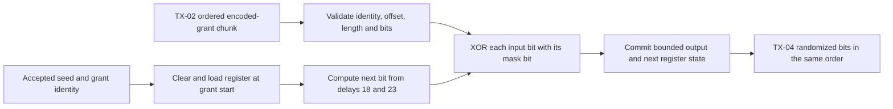

**Seed and first-bit convention.** Figure 7 in PHY3.1 §7.4.4 labels delay element
1 with seed LSB and delay element 23 with seed MSB. Let `D1..D23` be those delay
elements before a bit is processed. Load numeric seed bit 0 into `D1`, bit 17
into `D18` and bit 22 into `D23`. For each encoded-grant position `j`:

```text
mask[j]       = D18 XOR D23
randomized[j] = encoded[j] XOR mask[j]
next D1       = mask[j]
next Di       = old D(i-1), for i = 2..23
```

Compute the first mask from the loaded state, XOR the first input bit, then
clock the register. Do not discard a warm-up sequence, emit seed bits as a
prefix, output a single register tap in place of the XOR, or feed payload bits
back into the register. The register evolution depends on the seed and number
of processed bit positions, not on the coded data values.

For a Rust numeric register `q` with bit 0 representing `D1`, the equivalent
explicit convention is `m = ((q >> 17) XOR (q >> 22)) AND 1`, followed by
`q_next = ((q << 1) AND 0x7fffff) OR m`. This expression fixes the internal
representation; it does not specify a UCD byte-serialization format.

| Loaded numeric seed | First mask bit | Register after one clock |
| --- | ---: | --- |
| `0x020000` (only D18 set) | 1 | `0x040001` |
| `0x400000` (only D23 set) | 1 | `0x000001` |
| `0x7fffff` (all 23 elements set) | 0 | `0x7ffffe` |

These are locally derived Figure 7 first-step cases, not external reference
vectors. Implementation requires longer independent literal vectors to catch
phase, shift-direction and tap errors beyond the first clock.

A proposed `PhyRandomizerSeed23` uses checked integer admission before conversion
to `u32`; values must fit 23 bits. Never silently truncate a wider integer or
substitute the PRBS15 source seed. Require an explicitly accepted seed; this
section assigns no implicit modem/UCD default. The raw register primitive also
has defined all-zero behavior: its mask remains zero. Do not copy PRBS15's
nonzero rule into this primitive or silently repair a zero seed. Whether an
actual UCD field permits that value requires its separate MULPI field review;
a raw-state reference test does not establish wire-configuration conformance.

**Bit coverage and reset boundary.** Process exactly the `G` encoded-grant bit
positions from TX-02, in their accepted order:

| Input role/resource | Randomizer behavior |
| --- | --- |
| Retained information, including information-fill ones | XOR and advance once per transmitted bit. Preserve role metadata; fill need not remain one after randomization. |
| LDPC parity | XOR and advance once per parity bit, continuing the same grant sequence. |
| Final zero grant padding | XOR and advance once per pad position. Zero padding is defined before this stage; its randomized output need not be zero. |
| Omitted shortening coordinates | Not in the transmitted stream; consume no mask bits. |
| Data-bearing complementary-pilot cells | Their payload bits are included in the grant stream and consume mask bits through ordinary ordered mapping. |
| Known pilot cells, excluded/unused carriers and ungranted/idle resources | Not encoded-grant bit positions; do not consume mask bits or randomize their symbols here. |

Clear/load once at the start of each admitted grant, including a later grant
using the same seed. Codeword, byte, QAM-cell, minislot, OFDMA-frame and transport-
chunk boundaries inside a grant do not reset this state. TX-04/05 keep one
consistent address/loading plan; they cannot insert extra randomizer clocks
because a grid contains a pilot or an excluded carrier. No-transmission grants
produce no randomized data, and the next actual grant starts from its own seed.
PRBS15 payload continuity remains independent across all these grant resets.

**Stateful interface, bounds and failures.** The proposed Rust PHY bit-processing
owner contains one mask-generation algorithm, used with independently owned TX
and RX state. A grant context records accepted run/configuration/grant identity,
seed, capacity `G`, next coded-bit offset and active/complete/aborted status.
Begin-grant is explicit; repeating it to restart an active grant is an error.

A proposed `RandomizedGrantChunk` contains owned 0/1 output values, first
coded-bit offset, matching configuration/grant identity and inherited role/range
metadata. Optional before/after state and mask snapshots are diagnostics with
bounded retention, not mandatory copies of the entire mask stream. Ordinary RX
processing does not consume TX register snapshots or original coded bits.

Each transform checks active identity, exact next offset, binary input, remaining
grant capacity and checked counter/allocation arithmetic before changing state.
Use a configured per-call bit budget no greater than 1,048,576; this is a proposed
application work limit, not a PHY limit. Process larger grants through ordered
calls with bounded queues and constant-size register state. Empty input produces
empty output without clocking, reseeding or changing counters.

Perform a chunk against candidate state, then commit its output and next state
together after admission succeeds. Invalid/stale/duplicate/reordered chunks,
overruns and exhausted output budgets preserve the prior state and results;
they never trigger a phase search, hidden rewind or automatic reset. If an earlier
prefix was already handed downstream, retain that actual progress on a later
failure and mark the grant partial. Do not manufacture missing bits to reach `G`.

Pause/resume keeps the live register and offset. Cancellation stops new work at
a bounded boundary and retains completed output; a fresh run or new grant uses
a new context and seed load. Preview/inspection reads completed snapshots or a
separate state copy without advancing the active stream. Constant-size state
does not remove the need to bound chunk buffers, queues and retained views.

**Matching RX-07 inverse.** After resource deinterleaving and soft demapping,
CMTS-US-RX uses the accepted grant configuration and its own register to regenerate
the same mask at the same ordered coded-bit positions. The PHY seed is legitimate
receiver configuration; it is separate from hidden PRBS payload truth.
For natural-log `L = log(P(randomized_bit=0)/P(randomized_bit=1))`, return `L`
when the mask is zero and `-L` when it is one. Preserve finite magnitude, zero
confidence and caller buffers; a hard-decision diagnostic can instead XOR its
binary decisions with the same mask. Hard slicing must not replace the LLR path.

RX-07 walks the planned grant positions, including padding, then removes grant-
only padding before codeword decoding. It restores encoded-bit order before
RX-08 inserts known-zero shortening priors and invokes LDPC. Do not run this
inverse after LDPC or advance it for omitted shortening zeros. Missing received
cells must retain their planned positions through the receiver's erasure/validity
contract; compacting available LLRs would shift every subsequent mask position.
A missing/reordered chunk is an explicit state/coverage failure, not permission
to guess phase. Receiver synchronization details remain a later RX design.

Rust owns seed validation, masks, bit XOR and LLR sign operations. The future
public Rust facade returns typed errors and owned snapshots; future Python/Qt
adapters reuse it with matching integer/bit/finite-LLR validation and optional-
value semantics. This section adds no callable methods, saved settings or report
fields; those changes require their own versioned API work when implemented.

**Stage view and acceptance.** Show accepted seed in decimal/hex with its 23-bit
width, fixed polynomial/tap convention, grant identity, processed/remaining count
and complete/partial status. A bounded bit inspector can pair input, mask and
output at exact grant offsets, with codeword/pad roles retained. Live register
state is read-only diagnostic data. Pre-run previews are labeled as plans;
unretained history is unavailable. This stage supplies bits, not QAM points or
time samples for SA, and has no decoder-iteration or RxMER metric.

Implementation acceptance requires independently derived literal masks for
multiple seeds, explicit first-bit/shift tests, zero-register reference behavior,
bit-exact XOR and soft-inverse checks. Cover all transmitted roles, final pad,
omitted-zero/pilot non-consumption, repeated equal-seed grants, different-seed
grants, continuity across every internal boundary, empty/rejected calls, bounds,
counter limits, pause/resume and passive observations. Test malformed/stale/
duplicate/missing chunks and preservation of completed prefixes on cancellation.
An XOR round trip alone cannot establish the right polynomial, phase or reset
rule; full FEC/source recovery remains separate closed-loop acceptance.

Evidence: CM-SP-PHYv3.1-I20-230419 §7.4.1.2–3, PDF p50, and §7.4.4,
Figure 7, PDF p58. The original PDF pp50/58 were rendered and visually
checked: Figure 6 identifies scrambled FEC codewords and scrambled minislot
padding; Figure 7 fixes grant reset, seed loading, delay-element labels, taps
and first-bit behavior. Ordering/coverage prose was also reviewed in the pinned
extraction.
The numeric-register convention and first-step examples above are engineering
transcriptions of that figure, requiring independent implementation vectors.
Only general state/validation/soft-inverse patterns from the read-only reference
were reviewed; its downstream cell-field arithmetic and reset cycle are not
upstream algorithms. No reference implementation is copied or linked here.

#### TX-04: Cell-word construction and QAM mapping

[Return to TX stage overview](#internal-stage-sequence).

Status: **architecture defined; implementation remains planned**. ARCH-TX-04
converts TX-03's ordered randomized bits into normalized, labeled complex cells.
It does not complete the shared resource permutation, receiver or waveform.

**Planned code paths (repository-relative).** All files below are **create
(planned)**; module registration uses the roots in the
[planned code layout](#planned-code-layout). No code/data files are created now.

| Path | Disposition | Responsibility |
| --- | --- | --- |
| `crates/phy/src/configuration/modulation.rs` | Create (planned) | Checked constellation/role/loading models, endpoint requirements and separate implementation availability. |
| `crates/phy/src/signal_processing/qam_tables.rs` | Create (planned) | Immutable label-indexed integer coordinates, Table 54 energy constants and source identifiers. |
| `crates/phy/src/signal_processing/qam.rs` | Create (planned) | Shared checked lookup and normalization used by TX, future RX and instruments. |
| `crates/phy/src/resources/grid.rs` | Create (planned) | Accepted cell roles/loading and the shared grant-cell descriptor contract. |
| `crates/phy/src/resources/permutation.rs` | Create (planned) | Single address/visit-order owner shared with TX-05 and RX-05; its detailed algorithm remains ARCH-TX-05 work. |
| `crates/phy/src/transmitter/mapping.rs` | Create (planned) | Stateful cell-word assembly, bit-range association, bounded normalized output and partial status. |
| `crates/phy/tests/qam_mapping.rs` | Create (planned) | Independently transcribed label/energy/shape and invalid-lookup cases. |
| `crates/phy/tests/tx_mapping.rs` | Create (planned) | Mixed cell loading, split words, plan/bit conservation, failures and observer neutrality. |

**Placement and shared address plan.** TX-04 and TX-05 are functional boundaries
inside one upstream operation. The mapper needs the next destination cell's role
and loading from the shared grant-cell visit plan before consuming its bits.
That plan derives from accepted resources and the upstream interleaving address
sequence, not a frequency-sorted list or the modulation of the previous cell.
Its run/configuration/grant identity and sum of data-bearing cell loadings must
agree with TX-01/02/03's coded capacity `G`.

TX-04 emits loaded cells in that visit order, with their planned destination
coordinates as metadata. TX-05 writes them into the physical grid and generates
known pilots; exclusions and zero-valued resources remain explicit. The stages
may be fused without duplicating address generation or changing either tap's
meaning. Do not add downstream bit demultiplexing, parity interleaving, twist or
another bit permutation to construct upstream cell words. TX-05 must supply its
verified visit plan before a grant-integrated TX-04 implementation can run.

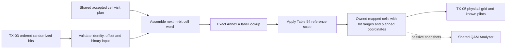

**Supported roles and loading.** Let `m` be bits per cell and `M = 2^m` be its
constellation size. Never use these quantities interchangeably. For the pinned
ordinary upstream contract, data loading is 2 through 12 bits: QPSK, 8-QAM,
16-QAM, 32-QAM, 64-QAM, 128-QAM, 256-QAM, 512-QAM, 1024-QAM, 2048-QAM and
4096-QAM. BPSK is used for known pilots and complementary data, not ordinary
data cells. Zero-valued minislots are a separate inactive role, not a zero-bit
constellation or a request to emit label zero. Annex A excludes 8192-QAM and
16384-QAM from upstream; their downstream tables do not enable upstream use.

PHY3.1 §7.4.7.1 requires the CM modulator to support the listed upstream formats.
The CMTS demodulator MUST support the listed formats through 1024-QAM and SHOULD
support 2048-QAM and 4096-QAM. Preserve those endpoint distinctions in capability
metadata. MORGANA's actual mapping, demapping and grant-integrated coding support
are separate implementation states; every mapping here is currently planned.
An accepted run requires all of its data/complementary orders to be implemented
at the required endpoints. A known order never permits a substitute constellation.

| Cell role | Bit consumption and mapping |
| --- | --- |
| Ordinary data | Consume `m_data` randomized bits using the accepted minislot's data constellation. |
| Complementary data | Consume `m_comp = max(m_data - 4, 1)` randomized bits and use its own constellation. These bits are payload, including when `m_comp = 1` (BPSK). |
| Known pilot | Consume no randomized grant bits. TX-05 supplies the prescribed known BPSK value using the same reference convention. |
| Zero-valued minislot | Consume no payload bits; TX-05 sets every resource, including pilot/complementary positions, to zero. Exclude it from the interleaving plan. |
| Excluded, unused or ungranted resource | Consume no payload bits here; preserve its distinct resource role for framing. |

The complementary loading rule follows §7.4.16, PDF p102: a 12-bit data cell uses
8-bit complementary data, a 7-bit data cell uses 3-bit complementary data, and a
4-bit data cell uses 1-bit complementary data. Loading is constant per resource
type within one minislot; different minislots may differ. Validate the profile
and the cell descriptors against this rule before consuming input, rather than
accepting an independently inconsistent complementary order.

**Cell-word and reference convention.** For a cell beginning at coded offset `b`,
assign `y_i = randomized[b+i]` for `i = 0..m-1`, then form
`label = sum(y_i * 2^(m-1-i))`. Thus the first incoming bit is the MSB. A label is
an integer in `[0, M)`, proposed storage `u16`; validate before narrowing. Label
values identify constellation points, not resource codes or source-byte order.
Consecutive cells partition the ordered randomized stream, including randomized
grant padding. A cell word may cross codeword, byte or incoming chunk boundaries;
none of those boundaries add bits, reset grouping or restart the randomizer.

Look up the exact integer `(I,Q)` for that label in the pinned Annex A figure.
The horizontal axis is I/real and the vertical axis is Q/imaginary. Do not sort
points geometrically, rotate/conjugate them, swap axes, infer labels from raw
resource row order, or apply a generic Gray-code formula without full agreement
with the relevant figure. In particular 8-QAM and cross-shaped 32-QAM need their
own exact coordinates; odd-bit constellations are not fabricated square grids.
Tables are compiled Rust reference data, with no runtime filesystem or Python
generation/calculation dependency. RX and instruments share the same reference
owner; tests require an independently transcribed source of expected labels.

Let `E_ref` be the integer-coordinate mean energy represented by Table 54's
scaling factor. Apply `z = (I + j*Q) / sqrt(E_ref)` to both axes exactly once:

| Constellation | Bits per cell | `E_ref` | Scale on I and Q |
| --- | ---: | ---: | --- |
| BPSK | 1 | 1 | `1` |
| QPSK | 2 | 2 | `1/sqrt(2)` |
| 8-QAM | 3 | 10 | `1/sqrt(10)` |
| 16-QAM | 4 | 10 | `1/sqrt(10)` |
| 32-QAM | 5 | 20 | `1/sqrt(20)` |
| 64-QAM | 6 | 42 | `1/sqrt(42)` |
| 128-QAM | 7 | 82 | `1/sqrt(82)` |
| 256-QAM | 8 | 170 | `1/sqrt(170)` |
| 512-QAM | 9 | 330 | `1/sqrt(330)` |
| 1024-QAM | 10 | 682 | `1/sqrt(682)` |
| 2048-QAM | 11 | 1322 | `1/sqrt(1322)` |
| 4096-QAM | 12 | 2730 | `1/sqrt(2730)` |

The unit-energy statement is the average over all labels of a constellation.
Individual symbol energies and finite-grant averages need not equal one. Never
normalize each symbol or observed chunk to its measured energy. Pre-Eq, transmit
power allocation, pilot construction and IFFT normalization belong to their own
stages; this reference scale is not an RF output-power setting.

Small unscaled label anchors, visually checked in Figures 99–103, are:

| Constellation | MSB-first label | Integer `(I,Q)` before reference scale |
| --- | --- | --- |
| BPSK | `0`, `1` | `(1,0)`, `(-1,0)` respectively. |
| QPSK | `00`, `01`, `10`, `11` | `(1,1)`, `(1,-1)`, `(-1,1)`, `(-1,-1)` respectively. |
| 8-QAM | `000`, `101`, `110` | `(1,-3)`, `(-3,1)`, `(3,3)` respectively. |
| 16-QAM | `0000`, `1111` | `(3,3)`, `(-1,-1)` respectively. |
| 32-QAM | `00000`, `11001` | `(3,5)`, `(-5,-3)` respectively. |

For a visit sequence of three data cells in different minislots with loadings
2, 3 and 5, the stream `10|101|11001` yields labels 2, 5 and 25 and the
corresponding QPSK, 8-QAM and 32-QAM points above. The separators illustrate cell
boundaries; they are not stream bits. These anchors are local figure
transcriptions, not externally supplied interoperability vectors. Full mapping
acceptance still needs every label of every enabled order verified.

**State, streaming and failures.** A proposed mapping context owns accepted
identity/plan, next coded-bit offset, next data-bearing visit ordinal and at most
11 pending bits for an incomplete 12-bit word. It does not own the PRBS source,
PHY randomizer state, global profile mutations or receiver results. Proposed
mapped-cell records own normalized finite I/Q, order/loading, label, role, cell
ordinal, coded-bit range and planned destination identity. Retain bit-role span
associations when one cell crosses a codeword/information/parity/padding boundary.

Use checked bit/visit/offset arithmetic and explicit configured limits for pending
plans, input chunks, output records and retained observations. Proposed per-call
ceilings are 1,048,576 input bits and 16,384 emitted cells, with an independently
bounded output queue; these are engineering work limits, not PHY constants.
Admission computes the required output budget before committing any input or
state. Callers split work under these limits and use backpressure instead of
allocating a whole unbounded grant. Immutable shared reference tables are bounded
by the explicitly admitted constellation set; no arbitrary order-sized allocation.

Validate identity, exact input offset, bits, plan role/loading, mapping availability
and output budget against candidate state, then commit together. Invalid, stale,
duplicate, reordered, overlong or budget-exceeding calls preserve prior state and
output; never silently drop bits, select a lower order or replace bad I/Q with
zero. An incomplete cell can retain accepted bits across valid chunks, with no
emitted point until its `m` bits exist. Empty calls are no-ops. Distinguish accepted
input-bit progress from emitted complete-cell progress in diagnostics.

End-of-grant succeeds only when exactly `G` bits have been consumed, every planned
data-bearing cell has been emitted and no partial word remains. Do not add a final
cell-fill bit; TX-01/02's padding already fills accepted coded capacity. Pause
preserves the partial word and visit cursor. Cancellation retains earlier emitted
cells and reports accepted-but-unemitted bits as partial; a fresh grant uses a new
context without carrying those bits forward. Passive previews use an independent
context or retained snapshots, and cannot advance the active stream.

**Receiver, API and instrument boundary.** RX-05 reconstructs this cell order and
RX-06 uses each cell's accepted order and the same immutable references to return
MSB-first positive-for-zero soft bits. RX-07 then reverses grant randomization.
Receiver recovery needs no TX labels, original bits or TX diagnostic snapshots.
The inverse's noise/LLR metric policy remains RX-06 work; a TX mapping table does
not establish an implemented demapper or full coding chain.

The future public Rust facade owns loading/role/label validation and returned
snapshots. Future Python/Qt adapters reuse those checks and finite numeric values;
Python integers are range-checked before conversion, errors map to domain
exceptions, and unavailable observations remain absent rather than fabricated.
No callable API, export schema or saved-setting change is introduced here.

The `tx.qam.mapped` tap shows actual normalized loaded cells before physical-grid
assembly/Pre-Eq, selected by role, order and grant/range. Overlay the corresponding
reference without rescaling actual points. Keep BPSK complementary data distinct
from known pilots and label plans/previews as such. Missing retained history is
unavailable. No time waveform exists at this boundary for the Spectrum Analyzer,
and decoder iterations, BER and RxMER require their later processing/observers.

**Implementation acceptance and evidence.** Verify every enabled table's label
coverage, exact integer coordinates, uniqueness, finite normalized points and
uniform-label energy, with independent expected values and explicit float
comparison tolerances. Include 8-QAM/32-QAM and every admitted higher order;
cardinality/energy or a map/demap round trip alone cannot prove correct labels.
Test literal MSB-first/mixed-loading anchors, all complementary-loading pairs,
zero-minislot/known-pilot non-consumption, split words at every bit position,
codeword/chunk continuity, exact `G` conservation, bad plans/labels/bits, work
bounds, stale/duplicate input, pause/cancel and observer neutrality. Grant-level
placement acceptance depends on TX-05's independently checked permutation.

Controlling source: CM-SP-PHYv3.1-I20-230419 §7.4.5.1, PDF p61 (shared
address/loading contract, extracted prose); §7.4.6–7.4.7.2, pp64–65, Figure 13;
§7.4.16, p102; Annex A/A.1, pp197–198, Figures 99–103; and A.2, p206, Table 54.
Original PDF pp64–65/102/197–198/206 were rendered and visually inspected for
bit order, roles, endpoint requirements, low-order labels and scale factors.
Higher-order diagrams remain a complete-label implementation-time audit; no
claim of their completed transcription follows from the verified scaling table.
Read-only reference review informed checked label lookup, immutable references
and bounded observations. Its downstream-only order list omits 8-QAM/32-QAM
and includes higher orders unsuitable here. No source code or table assets are
copied, and no external source checkout is linked or required by this design.

#### TX-05: Pilots, OFDMA framing and interleaving

[Return to TX stage overview](#internal-stage-sequence).

Status: **architecture defined; implementation remains planned**. ARCH-TX-05
owns the shared resource/visit plan and assembles TX-04 cells plus known pilots
into complete physical frequency grids for TX-06. The pure planning operation
runs before source consumption; waveform assembly uses that accepted plan.

**Planned code paths (repository-relative).** Every file below is **create
(planned)**. Register the leaves through the existing
[planned module roots](#planned-code-layout); no source placeholders are added.

| Path | Disposition | Responsibility |
| --- | --- | --- |
| `crates/phy/src/configuration/profile.rs` | Create (planned) | Frame size, channel bandwidth and per-minislot pattern/loading configuration, composing the shared waveform geometry. |
| `crates/phy/src/resources/grid.rs` | Create (planned) | Physical/compact row association, immutable cell roles/loading, coverage and coded capacity. |
| `crates/phy/src/resources/pilot_patterns.rs` | Create (planned) | Source-indexed scheduled-data pilot/complementary masks and admitted frame-length variants. |
| `crates/phy/src/resources/pilots.rs` | Create (planned) | Edge/body selection, pattern-family validation and shared role/power expectations. |
| `crates/phy/src/resources/interleaving_blocks.rs` | Create (planned) | Per-frame eligible-minislot ordering and Figure 8 block partitioning. |
| `crates/phy/src/resources/permutation.rs` | Create (planned) | Figure 11/12 joint address iterator and matching inverse association; one owner for TX and RX. |
| `crates/phy/src/bit_processing/pilot_sequence.rs` | Create (planned) | Independent fixed-seed 12-bit pilot sequence indexed by every physical FFT bin. |
| `crates/phy/src/transmitter/framer.rs` | Create (planned) | Validate mapped-cell identity/order, write grid cells, insert/scale pilots and emit complete physical symbol grids. |
| `crates/phy/src/receiver/resources.rs` | Create (planned) | Later RX-05 adapter gathers the same configured visits without TX labels or state. |
| `crates/phy/tests/ofdma_framing.rs` | Create (planned) | Independent physical-grid placement, coverage, ordering and bounded-lifecycle checks. |
| `crates/phy/tests/upstream_interleaving.rs` | Create (planned) | Independent partition/address literals, exhaustive bounded bijection and inverse cases. |
| `crates/phy/tests/upstream_pilots.rs` | Create (planned) | Audited masks, physical-bin sequence vectors and boost/exception expectations. |

**Geometry and identities.** Accepted synthetic configuration supplies the grant,
frame epochs, profile/loading, pattern per minislot, exclusion map and numerology.
For the initial ordinary coaxial contract, 50 kHz uses `N=2048` and `Q=8`
subcarriers per minislot; 25 kHz uses `N=4096` and `Q=16`. RFoG exceptions,
REQ subslots, ranging and probing remain distinct unsupported modes, not alternate
inputs silently passed through scheduled-data framing. Real UCD/MAP parsing is
outside this synthetic configuration path.

`K` is symbols per OFDMA frame. Validate `K >= 6` and the Table 51/§8.2.3.2.1
bandwidth-dependent maxima before creating a plan:

| Encompassed channel bandwidth | `K_max`, 2K/20 microsecond useful symbol | `K_max`, 4K/40 microsecond useful symbol |
| --- | ---: | ---: |
| At least 72 MHz | 18 | 9 |
| At least 48 MHz, less than 72 MHz | 24 | 12 |
| Less than 48 MHz | 36 | 18 |

Bandwidth here is the configured encompassed channel spectrum, not the count of
currently loaded subcarriers. Each granted minislot is `Q` contiguous physical
carriers with no internal excluded/unused carrier. Validate channel-wide exclusions
independently of profile assignment. Preserve physical `k=0..N-1` in ascending
frequency, including outside excluded bins; TX-07 later adapts that normative
coordinate order to its transform storage convention.

The plan retains run/configuration/grant, absolute frame/symbol, physical minislot,
block, compact `(t,f)`, physical `k`, resource role, loading and expected amplitude.
Compact rows concatenate eligible minislots in physical frequency order, omitting
exclusions/zero-valued minislots from the interleaving domain. Preserve the inverse
row-to-physical mapping rather than renumbering physical pilot sequence positions.

**Pilot roles and edge/body selection.** Determine roles on the physical resource
allocation before compaction or interleaving-block partitioning. Use an edge
minislot for the burst's first minislot, the first nonzero minislot in each frame,
and the first after an exclusion band, skipped subcarriers or zero-valued minislots;
other minislots are body minislots. An arbitrary software chunk or a new
interleaving block alone does not create an edge transition. A gap remains a gap
even after the participating minislots become adjacent compact rows.

| Minislot width | Patterns | CM requirement | CMTS requirement / channel-family rule |
| --- | --- | --- | --- |
| 8 carriers | 1–4 | MUST support | MUST support; do not mix with 5–7 on the same channel. |
| 8 carriers | 5–7 | MUST support | SHOULD support; separate boosted family. |
| 16 carriers | 8–11 | MUST support | MUST support; do not mix with 12–14 on the same channel. |
| 16 carriers | 12–14 | MUST support | SHOULD support; separate boosted family. |

Patterns may vary per minislot within the permitted channel family. Keep required
endpoint support separate from which exact pattern/length cases MORGANA actually
implements. Figures 39–42 control cell coordinates; every admitted mask requires
an independently reviewed transcription of both edge/body cases, local carrier
orientation and time indexing. No pattern is enabled by recognizing its ID alone.

For 8-carrier patterns, the figures cover `K=6..16`; the prose fixes complementary
positions to the 14th/16th symbols for `K>16`, with later symbols carrying data
only. For 16-carrier patterns the corresponding range is `K=6..9`, with fixed
7th/9th complementary positions for `K>9` and later symbols carrying data only.
Preserve the separate short-frame variants for patterns 7 and 14 at `K=6/7`.
Convert one-based figure symbol positions to zero-based indices explicitly; never
stretch a bitmap, infer a period through omitted columns or move the fixed pilots
when extending a frame. Full per-cell mask auditing remains implementation work.

Known pilots reserve their positions and contribute no randomized payload bits.
Complementary cells carry TX-04 payload at `max(m_data-4,1)` bits. A zero-valued
minislot sets data, pilot and complementary positions to zero and contributes no
coded capacity. TX-01 sums exactly the shared data/complementary loadings; TX-04
queries those same roles in visit order. Figure 85 illustrates pre-interleaving
serial order with complementary data inline, not a second source of pilot masks.
The actual address-coupled loading follows §7.4.5.1/Figure 11; do not add a second
payload shuffle to manufacture a separate intermediate minislot fill.

**Per-frame interleaving blocks.** For each grant/frame, let `n` be the number of
eligible nonzero minislots after preserving their physical association. Do not
include zero-valued minislots or exclusion holes in `n`. If `n=0`, produce no
interleaver block and consume no coded bits. Otherwise Figure 8 defines
`blocks = ceil(n/24)`. Starting with `remaining=n` and `blocks_remaining=blocks`,
each block takes `floor(remaining/blocks_remaining)` successive minislots, then
both remaining counts are reduced. This fixes the order of unequal block sizes:

| Eligible minislots | Ordered block sizes |
| ---: | --- |
| 24 | 24 |
| 25 | 12, 13 |
| 48 | 24, 24 |
| 49 | 16, 16, 17 |

Never take a 24-minislot prefix plus a tiny remainder, move a minislot into another
frame or interleave across grants. Each block has `L=Q*block_minislots` compact
carrier rows and `K` symbol columns. Its known-pilot and complementary locations
are still those of the original physical minislots; partitioning does not select
new pilot masks.

**Joint address generation and mapping.** One `resources/permutation.rs` iterator
produces all `K*L` coordinate visits for a block. Maintain `Count_t`, `Count_f`
and `Count_diagonal`, initially zero. Use the actual Figure 12 bit-reverse counter,
which tests the current counter, advances past out-of-range reversed values and
returns both the accepted coordinate and the accepted (unreversed) counter.
The caller's increment is separate; do not increment a valid counter twice.

Honor §7.4.5.1's explicit sizes: `K1` is the smallest power of two at least `K`,
whereas the prose defines `L1` as the smallest power of two greater than `L`.
Reverse exactly `log2(K1)` or `log2(L1)` bits and use the respective modulus.
Do not silently replace these definitions with one common rounding helper;
power-of-two boundary cases require independent vectors.

For each of the `K` outer passes, generate `L` pairs by applying that counter to
`Count_t/K` and `Count_f/L`, then increment the accepted counters modulo `K1` and
`L1`. At the end of the pass, increment `Count_diagonal` modulo `K1`, run it
through the K counter, set `Count_t` to its updated **unreversed counter** and
reset `Count_f` to zero. The returned diagonal coordinate is not assigned to
`Count_t`. This is a Rust design transcription of §7.4.5.1/Figures 11–12;
Appendix III's illustrative C is not an implementation dependency or a substitute
for the controlling flow/prose. Check each bounded block's complete coverage and
uniqueness independently; a matching inverse round trip alone is insufficient.

At each visited `(t,f)`, identify its original minislot/role. Skip known pilot
positions without consuming payload; request the exact data/complementary word
from TX-04 for every other eligible cell. Check its label/loading, ordinal,
coded-bit range and planned coordinates before writing exactly once. A known
pilot visit is part of address enumeration even though it is absent from the
payload-cell sequence. Do not compact the counters down to payload-only positions.

Read completed block columns in ascending `t`, with carrier rows in frequency
order, then restore the physical holes via the retained row mapping. Merge all
blocks belonging to a frame into the same `N`-bin symbol at each `t`; do not emit
all symbols of block 1 followed by all symbols of block 2. Grant codewords can
cross block/frame boundaries without resetting TX-03's grant randomizer or the
continuous source. Only the joint address counters reset for a new block.

**Known pilot sequence and power.** Scheduled-data pilots use §7.4.16.6's reference
to §7.4.15.3.3/Figure 35: polynomial `x^12+x^9+x^8+x^5+1`, fixed seed 3071
(`0xBFF`), independent of PRBS15 and the 23-bit grant randomizer. With numeric
register bit 0 as Figure 35's rightmost output, emit old bit 0, compute feedback
from old bits 0, 5, 8 and 9, shift right, and insert feedback into bit 11.
This numeric convention is an engineering transcription of the inspected figure;
implementation requires independent vectors, not just agreement with its mirror.

Initialize at physical `k=0` for a useful OFDMA symbol and clock after every
physical bin, including data/complementary, excluded, zero and unused bins. Select
the sign for a pilot at its original physical `k`; do not clock only on pilots or
only compact rows. The same immutable N-bin sequence can be reused each symbol.
Generate exactly N bits, including the 4095-period wrap when N is 4096. The
source's first 16 bits are `1,1,1,1,1,1,1,1,1,1,0,1,0,1,1,1`; verify the stated
2K/4K tail anchors before enabling an implementation. Map 0 to `(1,0)` and 1 to
`(-1,0)` before role-dependent power scaling. Complementary payload is never
replaced by this sequence or XORed with it.

For patterns 5–7 and 12–14, the specified pilot/complementary boost is a factor
of three in power, hence `sqrt(3)` in I/Q amplitude. If a known pilot and a
complementary pilot occur in the same symbol **and** the same minislot, boost the
known pilot but keep that complementary cell at normal power. Otherwise apply
the required boosted-family role gain. Normal data cells keep amplitude gain one;
nonboosted families use their ordinary reference amplitudes. Apply the gain once
in TX-05, after TX-04's unit-average-energy reference mapping and before Pre-Eq.
Zero roles remain zero. Do not normalize the resulting grid back to unit energy
or reinterpret this relative boost as absolute RF power calibration.

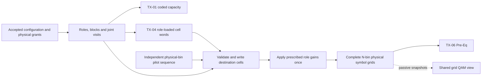

**Bounded state and failures.** A proposed immutable resource plan owns geometry,
role/pattern identities, block descriptors, physical row associations and visit
metadata needed by independent TX/RX contexts. A proposed framer context owns
only its accepted identity, expected cell/visit offsets, bounded frame grid and
write/validity coverage. Keep input configuration/cells unchanged. Unwritten cells
are incomplete/invalid, not zero-valued resources and not receiver observations.

Allocate through checked `N*K`, `L*K` and byte-count admission. The engineering
baseline permits one pending frame plus an independently bounded output queue;
reject an oversized plan before source/mapping state advances. The conservative
block envelope `24*16*36` is at most 13,824 coordinate visits, but actual K/Q pairs
must still obey the validated geometry above. Bound per-call processing to at
most 16,384 visits/cell writes and separately bound retained instrument snapshots.
Never accumulate a continuous grant's whole history or unbounded cached plans.

Validate a chunk against candidate counters/writes, then commit its accepted cells,
coverage and cursor together. Reject stale/mismatched identity, duplicate/skipped
visits, wrong role/loading, missing capacity, nonfinite values, double writes,
invalid coordinates and exhausted budgets without modifying prior state. Do not
repair malformed input by zero-fill, lower loading or a different pilot pattern.
Pause preserves the partial grid and counters. Cancellation retains already
emitted complete symbols/frames and reports the uncompleted frame explicitly;
never flush a partial grid as a complete reference waveform. A fresh grant uses
new contexts. Preview/observer reads do not clock pilots or advance payload visits.

The baseline may finish a bounded frame before emitting its `K` physical columns.
It must not emit a symbol until every participating block's cells for that symbol
are valid. Preserve exact frame/symbol order, sample-clock association and N-bin
roles for TX-06; no CP, window or time-sample production occurs here.

**Receiver, API and observation boundary.** RX independently derives the same
resource/visit plan from accepted configuration. RX-04 knows pilot locations,
signs and nominal role gains; those known transmitted amplitudes must not be
mistaken for channel response. RX-05 gathers data/complementary cells in payload
visit order, and RX-06 accounts for configured complementary amplitude in its
soft metric/noise policy. Missing cells retain erasure coordinates; never delete
them and shift later randomized bits. TX payload labels/register state are not
normal receiver inputs. Pilot-derived effective C×H estimation remains RX work.

Rust owns role/geometry validation, sequence, partition/permutation, gains and
complete-grid snapshots. The future facade and native Python/Qt adapters share
those checks, range/finite-value semantics, typed errors and missing observations.
No new callable API or persisted schema is introduced by this architecture.

The existing `tx.grid.iq` tap represents actual role-scaled physical cells before
Pre-Eq, unlike `tx.qam.mapped`'s unit-reference loaded cells. Show role, pattern,
edge/body, physical/compact coordinates, gain and coverage when selecting a QAM
view. Known pilot, complementary data and genuine zero remain separate. SA needs
later time samples; incomplete plans and previews are labeled rather than shown
as emitted results. Applying or disabling diagnostics cannot change processing.

**Implementation acceptance and evidence.** Require independent partition/address
literals plus coverage/bijection checks across admitted K/Q/block lengths,
non-power-of-two and power-of-two counter boundaries, 24/25/48/49-minislot splits,
multiple frames, physical gaps, mixed loading/patterns and zero-minislot cases.
Audit each enabled edge/body/short/extended mask against Figures 39–42, with exact
P/CP counts and payload capacity. Cover incompatible channel families, malformed
minislots, physical indexing/orientation and all three consumers' plan agreement.

Verify Figure 35 first/tail/period vectors, first-bin output, excluded-bin clocks,
per-symbol reuse, every boost/exception combination and exact zero conservation.
Check complete-column merging, input/output ownership, every arbitrary chunk
boundary, stale/duplicate/missing cells, budgets, pause/cancel and observer
neutrality. TX/RX round trips complement independent expectations and do not
replace them. Full mask/address/vector audits and the closed-loop waveform remain
implementation acceptance, not checks executed by this documentation change.

Controlling evidence: CM-SP-PHYv3.1-I20-230419 §7.4.5–7.4.5.1, pp58–64,
Figures 8–12; §7.4.15.3.3, p99, Figure 35; §7.4.16–7.4.16.3, pp101–105,
Figures 38–42; §7.4.16.6, p106; and §8.2.1–8.2.3.11, pp172–175, Table 51
and Figure 85. Original PDF pp59–60/62–63/99/102–106/173/175 were rendered and
visually reviewed for partition/control flow, register taps, pilot patterns,
boosting and geometry/serial-order context; remaining cited prose was read in
the pinned extraction. This is not a completed per-cell mask transcription audit.
Read-only reference review supplied immutable physical-index observations and
checked ownership patterns only. Its downstream interleaver and 13-bit pilot
sequence are unsuitable upstream; no code, mask assets or sample C is imported,
and no other checkout is linked or required by the design.

#### TX-06: CM Pre-Eq

[Return to TX stage overview](#internal-stage-sequence).

Status: **architecture defined; implementation remains planned**. ARCH-TX-06
applies an accepted corrective frequency response to TX-05's complete physical
symbol grids. The first scheduled-data reference run uses unity on all
non-excluded carriers and zero coefficients on excluded carriers. A configured
correction is not an injected physical-channel response or a receiver estimate.

**Planned code paths (repository-relative).** Every file below is **create
(planned)**. Module registration follows the
[planned code layout](#planned-code-layout); no numerical code is introduced here.

| Path | Disposition | Responsibility |
| --- | --- | --- |
| `crates/phy/src/configuration/pre_eq.rs` | Create (planned) | Typed coefficient-bank/source identity, geometry/reset metadata and atomic candidate admission. |
| `crates/phy/src/signal_processing/pre_eq.rs` | Create (planned) | Single Rust owner for stable bank normalization, complex replacement/adjustment arithmetic and carrier multiplication. |
| `crates/phy/src/transmitter/pre_eq.rs` | Create (planned) | Validate complete grid/bank identities and apply the bank selected by the immutable static/replay plan without altering roles or upstream state. |
| `crates/phy/src/resources/grid.rs` | Create (planned) | Shared channel-wide exclusion mask, physical carrier coordinates and symbol-role metadata. |
| `crates/phy/src/types/iq.rs` | Create (planned) | Shared complex-cell representation and declared observation reference plane. |
| `crates/phy/tests/pre_eq.rs` | Create (planned) | Independent complex/normalization/default/update/reset reference cases. |
| `crates/phy/tests/tx_pre_eq.rs` | Create (planned) | Grid streaming, coefficient generations, failure atomicity and matched passive observations. |

**Operation and reference plane.** Let `X[t,k]` be the actual TX-05 physical
frequency cell, including its prescribed pilot/complementary power gain. Let
`C[t,k]` be the applied Pre-Eq coefficient at the same physical index. TX-06 returns
`Z[t,k] = C[t,k] * X[t,k]`; static mode uses the same bank for every t.
For `C=a+jb` and `X=u+jv`, the output is
`(a*u-b*v) + j*(a*v+b*u)`. This is multiplication, not division, conjugation or
application of a second QAM/pilot normalization. Retain physical `k=0..N-1`
ordering, symbol/frame/grant identity, coefficient generation, role, validity and
normalization metadata for TX-07.

Use the same physical-bin convention as the resource plan, including excluded
and currently unused carriers. Do not index coefficients by compact interleaver
row, payload-cell ordinal or a library's shifted FFT storage. Every data, known
pilot and complementary-data value receives its carrier coefficient once.
Excluded, inactive and ungranted cells remain exact zeros; a nonzero input at a
resource that the accepted plan requires to be zero is a validation error rather
than an opportunity to hide a framing defect. Do not change a data role to
excluded merely because its valid symbol or coefficient happens to be zero.

| Applied coefficient | Input cell | Expected output before IFFT |
| --- | --- | --- |
| `1+j0` | `2+j3` | `2+j3` |
| `0+j1` | `2+j3` | `-3+j2` |
| `-1+j0` | `2+j3` | `-2-j3` |

These are independent arithmetic anchors, not external DOCSIS vectors. Constant
unit-magnitude banks also exercise phase without changing coefficient energy.
Unity may copy admitted non-excluded input values unchanged; it must still check
identity, dimensions, finite values and required-zero roles.

**Coefficient bank and normalization.** A proposed owned `PreEqBank` contains
exactly `N` finite complex coefficients, a channel/geometry identity and exclusion
mask, source kind, coefficient generation and explicit normalization provenance.
Source kinds distinguish normative unity defaults, a synthetically calculated
bank and a future validated captured corrective response. Retain raw/source
values or their immutable provenance alongside the derived applied bank; do not
call a normalization result the original captured bytes.

A channel exclusion is different from a bin unused by this grant, a zero-valued
minislot, a pilot role or a future missing measurement. Define the normalization
domain `A` as all physical carrier indices classified by the accepted channel as
used or unused, excluding channel-excluded carriers. For newly calculated raw
candidate coefficients `C_raw`, the engineering expression of §7.4.17 is:

```text
E = sum(|C_raw[k]|^2 for k in A) / |A|
C_applied[k] = C_raw[k] / sqrt(E), for k in A
C_applied[k] = 0+j0, for channel-excluded k
mean(|C_applied[k]|^2 over k in A) = 1
```

Validate a nonempty domain and strictly positive, representable norm. Use stable
Rust norm arithmetic with checked finite results; naive squaring of a large
finite input is not a reason to accept an infinity, and underflow must not create
a fabricated unity bank. Define and test an explicit floating-point comparison
tolerance for admitted normalized results at implementation time. Preserve the
common phase: normalization uses one positive real scale, not phase removal.
Uniform raw `2+j0` becomes `1+j0`; uniform raw `0+j2` becomes `0+j1` over the
admitted domain. Individual coefficients need not have unit magnitude.

Normalize the complete bank once when admitting a calculated candidate. Do not
normalize separately per grant, active mask, pilot subset, symbol, chunk or QAM
constellation. Include currently unused non-excluded carriers in the denominator;
exclude channel-excluded zeros. Unit coefficient mean energy does not guarantee
unit mean output for a particular resource allocation or finite payload, and does
not undo TX-05 pilot boosting or establish an absolute dBmV calibration.

Default construction explicitly assigns zero to excluded indices and unity to
the remaining used/unused indices. An explicitly supplied bank must declare the
same physical mask and valid excluded-zero values; a mismatch is rejected rather
than silently changing its meaning. A zero coefficient on an individual
non-excluded bin is allowed by this mathematical bank contract if total energy
is positive; source recovery on a suppressed bin is a separate receiver outcome.
Do not impose an unstated inverse-channel floor on a transmitter multiplier.
The whole-bank zero case cannot satisfy normalization and is rejected.

**Initialization, adjustment and reset boundaries.** PHY3.1 §7.4.17 requires
replacement when CMTS coefficients initialize the equalizer and complex
multiplication for an adjustment: `C_next_raw[k] = C_base[k] * A_update[k]`.
The base is the coefficient set used in the corresponding last probe, not an
arbitrary newer mutable bank. A future update candidate therefore identifies its
base generation and addressed physical indices explicitly. Initialization replaces
addressed values; an adjustment multiplies them. Outside the specified range,
retain the base values before full-bank normalization; an explicit channel reset
instead starts from defaults. Distinguish this global normalization scale from
which raw indices the update addressed.

The CMTS's update I/Q components use signed 16-bit `s1.14` representation.
A future wire adapter must preserve that signed fixed-point interpretation; it
does not imply that cumulative normalized floating-point coefficients must be
clipped or quantized back into the update-field range. Wire decoding, byte order,
RNG-RSP/P-MAP/UCD parsing and CMTS coefficient estimation need their own pinned
MULPI/probe evidence and implementation. This section defines their mathematical
boundary without introducing a MAC exchange or adaptive equalization loop.

| Event | Required/default bank behavior and simulator boundary |
| --- | --- |
| First transmission after first UCD | PHY reset before transmission; the synthetic initial run constructs the matching default bank. |
| Change of upstream channel ID, index-zero frequency, subcarrier spacing, CP size or rolloff-period duration | PHY reset before the next transmission. Reject reuse of a bank bound to the old reset identity; a fresh default/configuration acceptance is required. |
| Carrier becomes excluded | Its applied coefficient is zero and its mask/geometry association is updated explicitly. |
| Carrier becomes non-excluded | PHY sets its coefficient to unity, including the next probe opportunity; never restore a stale hidden coefficient. |
| New calculated/initialized/adjusted candidate | Validate and normalize transactionally, then publish a new generation when allowed by the mode's configuration timing. |

Static mode freezes one bank and exclusion mask for the accepted run, including
pause/resume. The separately planned [US-Pre-EQ replay](#us-pre-eq-input) freezes
an entire bank/update schedule before Start and activates banks at declared
complete-symbol boundaries. Its synthetic event timing is an engineering policy,
not an RNG-RSP timing claim. Both modes exclude live exclusion transitions,
probe scheduling and disabled-equalizer probe mode. Future probe event ordering
must preserve the newly re-enabled carrier's next-probe unity rule; a generic bank
normalizer must not silently override that guarantee. Coupled reset/update/probe
timing is deferred to that mode's detailed contract. A change of unrelated UI
selection does not reset coefficients, source or PHY randomizer state.

**Input/output, state and failure handling.** Accept a complete valid `N`-bin
physical symbol from TX-05 plus the bank selected for it by the admitted plan.
Check matching channel, N/spacing/index-zero frequency, CP/rolloff reset identity, exclusions, run/grant
and coefficient generation before numerical work. Preserve caller buffers and
source provenance. A proposed output snapshot owns the corrected cells, the same
coordinates/roles/validity and the applied coefficient generation/reference plane.
A diagnostic raw/corrected pair does not become normal receiver configuration.

The stage's baseline call handles at most one complete physical symbol with
`N <= 4096`; output queues and retained snapshots have separate configured bounds.
Each coefficient transaction handles one N-element candidate. Static mode retains
only its bounded accepted/base/candidate generations; replay uses the explicit
bank/event budgets in the [input contract](#us-pre-eq-input). Do not
retain every update, symbol or captured bank in an unbounded cache. Check byte
counts, counters and generated results before publication, including finite-input
multiplications whose outputs would overflow.

Validate and compute against candidate state/output, then commit together.
Wrong length/coordinates, NaN/infinity, zero-domain/norm, stale or incompatible
bank generations, invalid required-zero input, exhausted budgets and nonfinite
results return typed failures without replacing the accepted bank, advancing the
symbol cursor or changing prior outputs. Never repair them with unity, clipping,
implicit resampling or a coefficient selected from the nearest available bin.
There is no temporal filter state: chunking cannot change a carrier's result,
but complete symbol identities/order must still be checked.

Pause preserves the bank, next replay event and next symbol identity.
Cancellation retains completed corrected symbols and reports any unfinished work as partial; no failed candidate
is labeled emitted. Changing settings applies to a fresh accepted run. Preview
uses an immutable bank/snapshot without advancing the pipeline or rewriting input.
A disabled/full observer cannot change coefficients or numerical decisions.

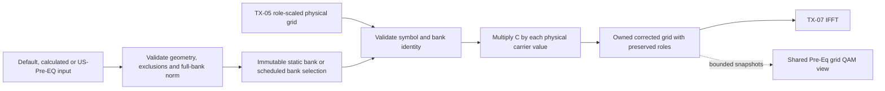

**Channel, receiver and measured-source boundaries.** Write `X` for the uncorrected
TX-05 grid, `C` for transmitter correction and `H` for the physical channel. In a
compatible diagonal reference, received useful bins contain `H*C*X` plus noise.
The first channel is an exact time-sample unity transport; it does not secretly
apply C again or divide by it. With unity C/H, matched active cells are unchanged;
with nonunity C and unity H, the actual transmitted waveform includes C.

Normal RX-04 estimates effective `C*H` from received known pilots and TX-05's
known sign/role amplitudes. It does not receive the injected H, C bank or TX labels
as a shortcut. Receiver noise after this correction is handled by the receiver's
own model, not borrowed from a measured transmitter response. Independent metrics
may compare C/H/received estimates with declared truth, outside ordinary recovery.

Future measured Pre-Eq is a corrective response with exact carrier grid, complex
sign/units, hashes/timestamps and source normalization metadata. It is not an
exact inverse of the RF channel, a calibrated CMTS noise observation or proof of
how a specific modem's analogue path behaved. Preserve original bytes and raw
values; any derived normalization or channel hypothesis has separate provenance.
Unknown grid coverage, coefficient direction or normalization is an admission gap,
not permission to interpolate, conjugate, invert or fill missing values with one.

The [US-Pre-EQ side input](#us-pre-eq-input) defines capture/update admission and
scheduled replay; its parsers and runtime remain unimplemented. No inferred-channel
mode is introduced. A later
channel hypothesis from `1/C` needs an explicit gain/delay reference, treatment of
zeros/missing carriers, regularization and a separate validation/acceptance plan.
Do not feed such a hypothesis back as both C and H or claim the resulting ideal
closure reproduces field RxMER. Real probe-derived CMTS adaptation and the
calibrated CMTS performance procedure on pp107–108 remain outside this baseline.

**API and instruments.** Rust owns bank admission/normalization, reset identities,
complex operations and snapshots. The future public facade and native Python/Qt
adapters reuse those checks and error semantics. Python indices/counts are checked
before narrowing; complex components must be finite and optional unavailable
results remain absent. No new callable API, persisted schema or report field is
implemented by this section.

`tx.pre_eq.iq` shows actual corrected carrier cells after C and before IFFT,
with coefficient generation, magnitude/phase, role gain and physical index visible.
Compare against `tx.grid.iq` on the same symbol/range. A reference overlay may show
the declared role-scaled constellation multiplied by C for a selected carrier;
it must not silently divide or normalize the actual observed points. A C response
plot is distinct from an RX channel estimate or time-domain Spectrum Analyzer.
SA uses the eventual assembled waveform. BER/RxMER require later matched recovery
or independent metrics, not the coefficient magnitude alone.

**Implementation acceptance and evidence.** Use independent complex arithmetic
anchors and whole-bank norm expectations, including constant real/imaginary raw
banks, nonuniform magnitudes, phase preservation, unused non-excluded indices,
excluded zeros, individual zeros and invalid whole-zero/empty/nonfinite domains.
Cover replacement versus adjustment, explicit ranges, base generations, default
construction and every reset-key change without conflating them with live probing.
Probe/exclusion event scheduling needs its later mode-specific acceptance.

Verify unchanged identity/roles, gain applied once after pilot boosting, literal
phase rotations, exact zeros, complete-symbol chunk invariance, immutable inputs,
rejected-call atomicity, bounded cancellation and observer neutrality. Nonunity C
must affect actual TX samples even when the channel stub is unity; received-pilot
recovery must estimate the effective response without consuming C/H truth.
Independent source comparison, LDPC matrix/source checks and the complete waveform
loop remain separate acceptance prerequisites.

Controlling source: CM-SP-PHYv3.1-I20-230419 §7.4.1.5–6, PDF p51 (placement,
extracted prose), and §7.4.17, pp106–108. Original pp107–108 were rendered and
visually inspected for defaults/exclusions, replacement/adjustment, update-number
format, full-domain normalization, resets and probe/control boundaries. The p108
continuation belongs to §7.4.17 even though its extraction file is indexed under
7.5; it was reviewed only up to the actual downstream heading. Stable norms,
immutable generations, transactional failure policy and bounded streaming are
engineering contracts, not invented CM RF/quantization requirements. Read-only
reference review covered complex response application and receiver-only estimates;
no downstream H/pilot geometry, inverse floor, code or capture assets are copied
or linked into this transmitter design.

#### TX-07: IFFT

[Return to TX stage overview](#internal-stage-sequence).

Status: **architecture defined; implementation remains planned**. ARCH-TX-07
converts each complete corrected frequency grid from
[TX-06](#tx-06-cm-pre-eq) into one useful complex time symbol. It fixes physical
bin order, transform sign, normalization and upstream sample geometry. It leaves
cyclic extension, roll-off/windowing, overlap, guards and final stream timing to
[TX-08](#tx-08-sample-assembly).

**Planned code paths (repository-relative).**

| Path | Disposition | Responsibility |
| --- | --- | --- |
| `crates/phy/src/configuration/profile.rs` | Create (planned) | Shared accepted upstream numerology/clock; already proposed by earlier stages, with no separate transform configuration owner. |
| `crates/phy/src/configuration/waveform.rs` | Create (planned) | Shared geometry composed by the profile; TX-07 reads N/spacing/fs and TX-08 validates CP/RP and derived lengths. |
| `crates/phy/src/types/samples.rs` | Create (planned) | Shared useful-symbol samples, local indices, rate, identity and timing/validity metadata; extend the existing plan for indexed sample blocks. |
| `crates/phy/src/signal_processing/transform.rs` | Create (planned) | Single safe Rust radix-2 numerical owner, reusable immutable plans and unitary centered synthesis/analysis wrappers. |
| `crates/phy/src/transmitter/ifft.rs` | Create (planned) | Admit one full corrected grid and return one owned useful symbol with accepted geometry and generation. |
| `crates/phy/src/receiver/fft.rs` | Create (planned) | Paired RX-03 adapter using the same transform convention on independently selected receive windows. |
| `crates/phy/tests/transforms.rs` | Create (planned) | Independent complex-sum, impulse/tone, bin-order and energy checks in both directions. |
| `crates/phy/tests/tx_ifft.rs` | Create (planned) | Full-grid admission, identity/timing, bounded output, observer, failure and cancellation checks. |

All paths remain proposed creations; references to shared owners extend their
design, not existing files. The transform kernel is independent of grant/FEC,
pilot roles, Pre-Eq banks, channel responses and presentation. TX/RX adapters own
stage admission. Instruments reuse numerical operations with separate settings
and scratch storage; they do not consume or alter a transmitter/receiver context.

**Accepted geometry and full-grid input.**

The accepted profile selects exactly one upstream mode:

| Mode | Physical grid / useful samples N | Carrier spacing | Sample rate fs | Useful duration N/fs |
| --- | --- | --- | --- | --- |
| 2K | 2048 | 50 kHz | 102.4 Msamples/s | 20 microseconds |
| 4K | 4096 | 25 kHz | 102.4 Msamples/s | 40 microseconds |

The interval between samples is `1/fs` (9.765625 ns, derived). These are useful
durations, before cyclic extension or window/overlap. Allocation size, codeword
count and number of occupied carriers never select a smaller transform or change
the clock. Validate N, spacing and fs together; reject downstream 4K/8K at
204.8 Msamples/s, unsupported lengths, resampling requests and stale geometry.

Input is exactly N finite complex values in ascending physical carrier order,
including every zero/unallocated/excluded position from TX-05/06. Validate its
run/configuration generation, burst/frame/symbol identity, grid layout and
accepted Pre-Eq generation before allocating output. TX-07 neither packs active
carriers nor fills a sparse carrier list implicitly. The adapter checks exact
zero values at roles declared inactive, without imposing real-only values on
active cells. A numerical kernel test can use arbitrary finite full-length
vectors independently of transmitter resource admission.

**Centered IDFT and normalization.**

Let `X[k]` be the actual TX-06 output, after pilot-role amplitude scaling and
complex C multiplication. For `i = 0 .. N-1`, the controlling synthesis is:

```text
x[i] = (1 / sqrt(N)) * sum over k=0..N-1 of
       X[k] * exp(+j * 2*pi * i * (k - N/2) / N)
```

`X[0]` is the lowest frequency component and `X[N-1]` the highest. Its baseband
frequency is `(k - N/2) * spacing`: k=0 is -fs/2, k=N/2 is DC and k=N-1 is
fs/2 minus one spacing. Preserve this physical index for resource/pilot identity.
The accepted RF frequency at physical k=0 supplies display labels only; deriving
baseband offsets does not retune the waveform or change the resource grid.

A conventional inverse FFT buffer with DC at index zero requires
`buffer[(k + N/2) % N] = X[k]`, followed by positive-exponent synthesis and
`1/sqrt(N)` scaling. Equivalently, the chosen centered wrapper can synthesize
unshifted X and multiply time sample i by `(-1)^i`. The initial design uses
that latter convention, matching the reviewed safe Rust radix-2 pattern.
Apply the centering adjustment exactly once; do not shift bins and also apply
the alternating sign. The externally visible contract remains the equation
above regardless of internal storage.

The kernel's inverse direction uses positive roots; its forward direction uses
negative roots. Both wrappers scale by `1/sqrt(N)`. RX-03 applies the matching
analysis equation to its useful receive window:

```text
X_recovered[k] = (1 / sqrt(N)) * sum over i=0..N-1 of
                 x_received[i] * exp(-j * 2*pi * i * (k - N/2) / N)
```

For that centered forward wrapper, apply `(-1)^i` before the conventional
negative-exponent transform. Receiver window alignment remains receiver work;
sharing this primitive does not expose TX bins, C, injected H or original bits
as recovery inputs. A transform round trip is numerical evidence only and must
not substitute for independent convention vectors or receiver acceptance.

Unitary scaling preserves discrete energy:
`sum_i |x[i]|^2 = sum_k |X[k]|^2`, within documented floating-point tolerance.
Mean sample power is the latter sum divided by N. Preserve QAM scaling,
pilot boosts and Pre-Eq effects already present in X; do not add normalization
by occupied-carrier count, AGC, clipping or a second `1/N` factor. A sparse
allocation legitimately changes mean waveform power. Values remain normalized
complex baseband quantities until a separately designed physical calibration;
this stage cannot claim CM RF output power or spectral-mask compliance.

Output retains both I and Q. No Hermitian mirror, forced real output or
conjugation is introduced. There is no transmit analysis window, cyclic prefix,
extra zero padding, gain adjustment, frequency impairment or channel convolution
in this stage. Inactive frequency bins remain zero in the input grid; their
presence does not imply zero-valued time samples.

**Useful-symbol output and processing bounds.**

Return one owned block of exactly N samples in increasing local time order,
with useful-relative indices 0 through N-1, fs, N, normalization/convention,
run/configuration generation and burst/frame/symbol/Pre-Eq identities. Preserve
the accepted timing reference if available; otherwise mark final stream origin
pending assembly. `i=0` is the start of this useful interval. Do not infer a
global sample index as `symbol_number * N`: CP, overlap and guard handling will
determine the actual interval placement in TX-08. Do not concatenate separate
useful intervals and label them as uninterrupted transmitted time.

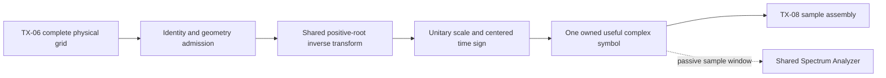

Plan the first implementation as an all-Rust, safe radix-2 kernel with finite
`f64` I/Q arithmetic. Reuse the reviewed immutable bit-reversal/root-plan and
butterfly organization, adapted to upstream geometry, rather than introducing
a second numerical algorithm per endpoint. No new FFT dependency is selected
or needed by this design. Any later code adaptation must preserve actual
copyright/SPDX notices and record origin/modifications under the reuse process;
this architecture copies no source code. A later optimized backend must retain
the same independent convention/energy tests and Rust-only dependency boundary.

Bound each operation to one admitted symbol, at most 4096 complex input/output
values and checked, linear-size plan/scratch storage. Precompute immutable
roots/bit reversal for the accepted N, with at most the two supported plans
retained by an owner. No unbounded global length cache or per-symbol plan
history is allowed. Mutable scratch belongs to the executing worker; concurrent
instruments use their own bounded buffers. Reject wrong lengths, nonfinite
components, stale identities, exhausted output budgets and nonfinite numerical
results with typed errors. Publish output atomically after the entire symbol
is valid, without mutating the accepted grid or configuration on failure.

This transform has no cross-symbol filter history or RNG. Source generation,
randomizer/pilot clocks and grant visitation never advance inside it. Validate
and acquire a bounded output slot before processing. Pause preserves the next
symbol identity and any already completed block; resume must not emit it twice.
Cancellation at symbol boundaries retains completed outputs and reports the
emitted prefix. At most one bounded transform may finish before cancellation
is observed; never publish a partial useful symbol as complete. TX-08 will add
its own overlap state and emission acceptance rather than inheriting fabricated
history here. Planning/readiness alone executes no transform or source read.

**Inspection and future adapters.**

The TX-07 sample tap supplies actual contiguous useful samples to the shared
Spectrum Analyzer, with sample rate, useful-window identity, frequency origin
and normalization. Independent symbol windows stay independent. A useful-window
spectrum is not the spectrum of an assembled/windowed burst; final transmitter
SA measurements belong at TX-08. FFT-bin lists and QAM cells are not SA sample
inputs. Time-domain I/Q samples are not a carrier QAM constellation. QAM views
continue to use matched frequency-grid taps. Disabled/full/failed observers
cannot change synthesis results, input ownership or processing order.

Rust owns geometry, transform arithmetic, observations and errors. Future Rust
public operations and native Python bindings must share these semantics and
owned sample ordering; Python supplies no FFT/scaling/reindexing implementation.
Any eventual persisted model needs the public API compatibility review. This
section introduces no public function, saved schema, Python binding or UI.

**Independent acceptance before implementation completion.**

1. Verify both upstream mode tuples and reject contradictory clock/spacing/N,
   partial/oversized grids, stale layout/Pre-Eq generations, inactive nonzero
   cells, nonfinite values and resource-budget failures without input mutation.
2. For both lengths, use independent literal/sum-derived vectors: a sole
   `X[N/2]=A` yields constant `A/sqrt(N)`; a sole `X[0]=A` yields alternating
   `A*(-1)^i/sqrt(N)`; `X[N/2+1]` and `X[N/2-1]` yield oppositely rotating
   tones. Use complex A and an asymmetric mixture to detect wrong sign,
   conjugation, I/Q exchange, one-bin shifts and double centering.
3. In kernel-only tests, constant X yields an impulse of `A*sqrt(N)` at i=0.
   Compare bounded selected samples of sparse/dense vectors against a direct
   Rust evaluation of the specified complex sum, independent of butterfly and
   RX code. Fixed source-derived convention cases are required in addition to
   TX/RX round trips; no duplicate production transform serves as the oracle.
4. Check Parseval and paired forward/inverse results with explicit absolute/
   relative tolerances appropriate to finite `f64` arithmetic and signal scale.
   Include zero, pilot-boosted, sparse-allocation and complex Pre-Eq cases.
   No waveform renormalization may make an incorrect gain pass.
5. Verify exact N output length, local order, useful duration, metadata and no
   CP/window/guard insertion. Test repeated-symbol determinism, chunk grouping,
   pause/resume, bounded cancellation and independent concurrent scratch.
6. Check passive/disabled/full observers, preserved completed symbols on error,
   useful-window SA labels and absence of invented global continuity. Future
   Rust/Python adapters must agree on samples/metadata/errors when implemented.

Controlling evidence: CM-SP-PHYv3.1-I20-230419 §7.3.2, Table 7, PDF p48;
§7.4.1.6, p51 (placement/unused inputs, extracted prose); and §7.4.9, pp65–66,
including Figure 15. Original pp48, 65 and 66 were rendered and visually
inspected for upstream geometry, the positive centered exponent, unitary factor
and ascending frequency order. The indexed useful-sample boundary, backend
organization, failure/retention policy and adapter rules are local engineering
contracts. This does not design §7.4.10 assembly, prove waveform execution or
resolve the earlier LDPC/source acceptance gaps.

#### TX-08: Sample assembly

[Return to TX stage overview](#internal-stage-sequence).

Status: **architecture defined; implementation remains planned**. ARCH-TX-08
turns the useful complex symbols from [TX-07](#tx-07-ifft) into the actual
indexed stream delivered to the [Channel Simulator](#channel-simulator-unity-stub-first).
It owns cyclic extension, the transmit taper, overlap history, isolated burst
edges and output cursors. The initial mode remains scheduled data; ranging,
probing and their different extension/preamble rules remain explicitly deferred.

**Planned code paths (repository-relative).**

| Path | Disposition | Responsibility |
| --- | --- | --- |
| `crates/phy/src/configuration/waveform.rs` | Create (planned) | Single accepted upstream N/clock/CP/RP geometry with checked stride/extension lengths, composed by the already planned profile owner. |
| `crates/phy/src/configuration/burst.rs` | Create (planned) | Extend the earlier plan with scheduled-data burst origin, ordered symbol count and explicit optional guard intervals. |
| `crates/phy/src/types/samples.rs` | Create (planned) | Shared sample ranges, prefix/useful origins, burst support/drain/guard validity and completion metadata. |
| `crates/phy/src/signal_processing/cyclic_extension.rs` | Create (planned) | Pure trailing-prefix/leading-suffix copy with no transmitter state or RX acquisition. |
| `crates/phy/src/signal_processing/transmit_window.rs` | Create (planned) | Immutable half-sample taper coefficients and finite complex multiplication; separate from SA analysis windows. |
| `crates/phy/src/signal_processing/overlap_add.rs` | Create (planned) | Bounded complex tail addition and explicit normal finish/reset, independent of source/FEC. |
| `crates/phy/src/transmitter/assembly.rs` | Create (planned) | Stage identity/admission, numerical-owner composition, output cursor, guards and transactional burst lifecycle. |
| `crates/phy/src/receiver/symbols.rs` | Create (planned) | Existing proposed RX-02 owner: independently select useful receive windows from accepted timing/geometry. |
| `crates/phy/tests/transmit_window.rs` | Create (planned) | Independent extension/taper/overlap vectors and upstream geometry boundaries. |
| `crates/phy/tests/burst_assembly.rs` | Create (planned) | Exact timeline, burst edges/drain, arbitrary output chunks, failure and lifecycle acceptance. |

All are proposed creations. Shared paths extend their earlier design; none
exists in the current checkpoint. The planned configuration/signal-processing
module roots register these focused leaves. `transmitter/assembly.rs` orchestrates
the primitives rather than hiding all DSP and timing in one adapter. Adapt the
reviewed pure-prefix, immutable-window and retained-tail organization, with
upstream parameters and the local contracts below. Preserve notices/provenance
if code is later adapted; no reference code, timing UI or capture data is copied
by this documentation change.

**Accepted parameters and extension.**

Freeze the same upstream N and 102.4 Msamples/s clock admitted by TX-07.
The accepted US Configuration selects CP count C and roll-off count R
from these sample-valued sets, transcribed from PHY Tables 9 and 10:

| Parameter | Allowed counts at 102.4 Msamples/s |
| --- | --- |
| C, cyclic prefix | 96, 128, 160, 192, 224, 256, 288, 320, 384, 512, 640 |
| R, roll-off | 0, 32, 64, 96, 128, 160, 192, 224 |

For scheduled data require `R < C`; R=0 is a specified upstream choice.
Reject zero CP, unsupported counts, R=C, R>C, contradictory clock/geometry and
configuration changes inside an active burst. Do not inherit downstream sample
tables or treat zero RP as an unsupported evaluation-only mode. Durations are
derived from counts/fs; accepting a floating duration never silently rounds it
to a permitted count. Initial ranging's exception is outside this stage mode.

Let `S = N+C` be symbol stride and `L = N+C+R` the extended length. For a
finite useful symbol x of length N, define the extension in local sample order:

```text
y = x[N-C .. N] followed by x[0 .. N] followed by x[0 .. R]
```

Ranges here are half-open. Equivalently `y[t] = x[(t-C) mod N]` for
`0 <= t < L`, using nonnegative modulo. The suffix comes from the beginning
of the useful symbol, not the beginning of the copied prefix. Neither CP nor
suffix consumes additional source bits, randomizer clocks or pilot states.
This is a time-sample operation after the complete IFFT; carrier roles and
frequency-grid nulls are not translated into inserted time-domain zeros.

**Transmit taper and overlap.**

Apply a real coefficient to both components of each complex y value. The
following full-index form is an engineering rearrangement of the symmetric
§7.4.10.1 half-window equation, retaining its half-sample offset:

```text
R = 0: w[t] = 1 for all 0 <= t < L

R > 0:
  r[q] = 0.5 * (1 - cos(pi * (q + 0.5) / R)), 0 <= q < R
  w[t] = r[t]          for 0 <= t < R
         1             for R <= t < S
         1 - r[t-S]    for S <= t < S+R

z[t] = y[t] * w[t]
```

This has `w[t] = w[L-1-t]` and `w[q] + w[S+q] = 1` for q in the overlap.
The first/last coefficient for R>0 is positive, not an imposed zero endpoint.
Do not replace this window with Hann, a square-root taper, endpoint-inclusive
cosines or a generic library Tukey default. Do not normalize window energy or
rescale each symbol. Unitary IFFT energy from TX-07 is a pre-window property;
cyclic copies, tapering and addition change the assembled burst energy.

Place each z symbol at stride S. For symbol j>0, combine the previous retained
tail with its first R values:

```text
output_j[q] = z_previous[S+q] + z_j[q], 0 <= q < R
output_j[q] = z_j[q],                 R <= q < S
next_tail[q] = z_j[S+q],              0 <= q < R
```

For j=0 there is no preceding tail, so output its first S values directly.
Never wrap the last symbol into the first. Adjacent samples being added can
differ; complementary weights do not make the overlap a copy of either symbol.
The symbol period remains S/fs, not L/fs. Chunk, codeword, minislot, interleaving
block and frame boundaries do not reset history within this contiguous burst.

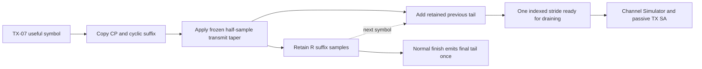

**Absolute timing, edges and guards.**

Let B be the accepted first-prefix sample index for a scheduled burst of K
symbols, K>=1. In the synthetic grant this is the configured starting frame
boundary; §7.4.11 places the first CP sample there. The useful construction
reference is separate, as in §7.4.11.1/Figure 19. Use checked integer arithmetic:

| Interval/reference | Absolute sample index or half-open range |
| --- | --- |
| Prefix start of symbol j | `B + j*S` |
| Useful start of symbol j | `B + j*S + C` |
| Useful window of symbol j | `[B+j*S+C, B+j*S+C+N)` |
| Nominal K-symbol extent | `[B, B+K*S)` |
| Final R-sample tail | `[B+K*S, B+K*S+R)` |
| Complete isolated-burst support | `[B, B+K*S+R)` |

Resolve TX-07's useful-relative origin to this accepted timeline. Preserve
frame/symbol identities and the distinction between nominal extent and emitted
support; appending the tail does not add a scheduled symbol. Do not shift B by
R/2, silently truncate the tail to the grant extent or add R to every stride.
If TX-07 supplies an absolute useful origin, require agreement; resolve a
pending origin here rather than rejecting an otherwise valid useful symbol.
Real MAP/UCD parsing, scheduling and ranging timing adjustments remain separate
MULPI/mode work; the synthetic timing contract does not implement those services.

An isolated burst begins with empty overlap history and finishes by emitting
the final tail exactly once. This models absent adjacent symbols as zero
contributions while retaining the actual leading/trailing tapers. For R=0
the tail is empty and support is exactly K*S. No generic preamble, cloned
neighbor, periodic wrap or extra full symbol is added. Normal finish before K
accepted symbols is an incomplete-input error; input after finish is rejected.
Repeated finish after the final drain reports completion without duplicate data.

Optional leading/trailing silence belongs to an explicit bounded simulation
interval: leading samples end at B; trailing samples start after the final
tail. Default extra guard counts are zero. Emit declared guards as exact complex
zeros with their own ranges, without truncating taper support. They are not
information-fill, grant padding, CP or the R-sample suffix. Absence of a retained
sample interval means unavailable, not observed silence. The baseline accepts
one isolated burst at a time; reject overlapping requested supports rather than
silently resetting/summing separately scheduled bursts. Future adjacent-grant
composition needs an explicit timeline contract; transport chunks cannot stand
in for burst boundaries.

For the unity channel and accepted timing, RX-02 independently selects the
configured useful window at offset C. Since R<C, this interval is inside the
unmodified flat portion of its own symbol; overlap with the prior symbol remains
in the prefix. Test this on received samples and shared accepted configuration,
not a TX sample ledger or supplied payload. Do not divide received samples by
the transmit window. Impaired timing/echo tolerance, acquisition and shifted
FFT-window phase correction remain later receiver work, not proved by the
existence of a CP or a C-R sample margin.

**Streaming, ownership and failure.**

Admission consumes one complete TX-07 symbol with the exact next identity and
accepted generation/geometry; partial useful arrays are rejected. Physical
configuration is immutable within a burst. At most one stride awaits draining,
with an output cursor and an R-value overlap tail. The numerical owners and
all sample/guard arithmetic remain safe Rust with finite f64 I/Q. Maximum
supported lengths are N=4096, C=640, R=224, S=4736 and L=4960. Bound the window,
work buffer and ready buffer by these lengths and the retained tail by 224;
check burst counts, all sample-index additions/products, guard budgets and total
output/runtime budgets before starting. Long silence is emitted in bounded
blocks, not allocated as one guard-length vector. No whole-burst buffer or
unbounded symbol/history queue is required.

Compute/validate a candidate stride and next tail before changing accepted
state. Reject nonfinite inputs/results, stale/duplicate/skipped identities,
wrong supplied origins, incompatible geometry, index underflow/overflow or
exceeded budgets without changing the prior tail, cursor or next-symbol identity. Account for
overflow from addition even if both summands are finite. A full ready buffer
applies backpressure; it never drops old samples to admit another symbol.

Output requests may drain any positive bounded count, including a single sample,
across prefix/useful boundaries; a request never fabricates missing future data.
Concatenated outputs must be identical for all drain chunk sizes. Do not accept
the next symbol until the prior ready stride is drained. Pause preserves ready
samples, cursor, tail and expected identity. Resume neither repeats nor omits
samples. A normal final tail is drained under the same bounded cursor rules.
Only after all scheduled symbols, tail and declared guards are delivered is
the burst complete; generated or accepted symbols alone do not prove delivery.

Cancellation preserves the already emitted sample prefix and reports accepted
symbols, emitted count, pending ready/tail counts and incomplete status. It
does not perform a successful normal finish or silently deliver pending samples.
An error similarly retains completed output; a fresh burst requires explicit
reset with new accepted identities/origin and empty overlap state. Observers
cannot advance cursors, finish a burst or consume source/RNG state. Rust owns
future public operations and Python parity; wrappers do no extension, window,
overlap or sample-index arithmetic independently. No API/schema is added now.

**Inspection and acceptance before implementation completion.**

The TX-08 SA tap and channel input see the same actual emitted complex blocks,
absolute indices, sample rate, normalized units and burst/guard/partial validity.
Distinguish assembled samples from TX-07 useful windows. Rust SA analysis
windowing/averaging remains independent of the transmit taper. Retained output
chunks alone are not separate bursts or FFT windows; feed only contiguous
available intervals to the analysis owner. This stage supplies time samples,
not carrier QAM points, and claims no calibrated RF power or spectral compliance.

1. Independently transcribe/test both modes and every permitted CP/RP count;
   cover R=0, R=C rejection, adjacent invalid counts, contradictory clocks,
   maximum lengths, stale identities and checked-index/budget failures.
2. Use labeled complex samples to check exact prefix/useful/suffix coordinates.
   Check half-sample taper endpoints, symmetry, flat indices and complementary
   weights against the original symmetric equation, not production coefficients.
   Independent toy lengths may test a primitive but are not admissible PHY modes.
3. Use distinct neighboring symbols to calculate overlap values directly.
   Include zero/constant/impulse and asymmetric complex cases; verify K*S+R
   support, S cadence, first/last edges and no per-symbol energy rescaling.
4. Check K=1 and multiple symbols across frame/grouping boundaries, exact
   prefix/useful origins, zero/default and nonzero guards, final tail once,
   premature finish, repeated finish and post-finish input rejection.
5. Compare sample-for-sample for single-value, odd-size and boundary-splitting
   drains, including pause in a stride/tail, backpressure, failures after prior
   output and cancellation with pending samples. Reset must prevent old tails
   entering a new burst; disabled/full observers must preserve all results.
6. Through unity transport, independently extract each configured useful window
   and compare it to its pre-assembly samples for numerical acceptance. This
   diagnostic comparison is outside receiver recovery. Full waveform/FEC/source
   recovery and future Rust/Python adapter parity need their own implementation
   evidence; existing codec tests do not validate this stage.

Controlling evidence: CM-SP-PHYv3.1-I20-230419 §7.4.1.7, PDF p51 (extracted
placement prose); §7.4.10–7.4.10.2.1, pp67–70, Tables 9/10 and Figures 17/18;
§7.4.11–7.4.11.1, pp70–71, Figure 19. Original pp67–71 were rendered and
visually inspected for counts/restrictions, exact extension, half-sample taper,
overlap, cadence and prefix/useful references. The full-index cosine form is
a local derivation of that equation. Isolated-burst drain, optional simulation
silence, buffer bounds and transactional streaming are explicit engineering
policies, not additional MAC guard requirements. All eight TX stages now have
architecture; source-table audits, scientific implementations and the integrated
closed loop remain unfinished and require the existing approval/prerequisites.

### US-Pre-EQ input

[Return to CM-US-TX](#cm-us-tx-block-architecture) ·
[TX-06 application](#tx-06-cm-pre-eq) · [RxMER side input](#rxmer-input).

Status: **single-shot and multi-input architecture defined; formats, import and
update replay remain planned**. This side input supplies corrective coefficients
C to TX-06. It supplies neither a physical channel H to CH-SIM nor a known
correction to normal CMTS-US-RX. The initial reference experiment still uses
the explicit unity default and needs no capture.

**Planned code paths (repository-relative).**

| Path | Disposition | Responsibility |
| --- | --- | --- |
| `crates/phy/src/measurements/pre_eq.rs` | Create (planned) | Original corrective-bank/update records, source IDs, exact grid and provenance. |
| `crates/phy/src/configuration/pre_eq.rs` | Create (planned) | Shared TX-06 bank admission, mode, reset identity, base/probe associations and accepted event plan. |
| `crates/phy/src/signal_processing/pre_eq.rs` | Create (planned) | Same TX-06 normalization/replacement/adjustment arithmetic; no separate importer math. |
| `crates/phy/src/transmitter/pre_eq_playback.rs` | Create (planned) | Pure symbol-to-bank queries and bounded event selection for TX-06. |
| `crates/phy/src/transmitter/pre_eq.rs` | Create (planned) | Apply the selected complete bank once to each actual TX-05 symbol. |
| `crates/morgana/src/inputs/pre_eq.rs` | Create (planned) | Bounded file/batch decoding, original byte retention and typed Rust admission. |
| `crates/morgana/src/inputs/mod.rs` | Create (planned) | Register separate RxMER and Pre-EQ import entrypoints. |
| `crates/morgana/src/lib.rs` | Extend (existing) | Expose shared Rust input/preview operations before future native Python/UI adapters. |
| `crates/phy/tests/pre_eq_input.rs` | Create (planned) | Original values, identity/coverage, source-kind and atomic batch admission. |
| `crates/phy/tests/pre_eq_playback.rs` | Create (planned) | Independent update chains, event boundaries, restart/pause and schedule budgets. |
| `crates/phy/tests/tx_pre_eq.rs` | Create (planned) | Actual changed waveform, unchanged upstream clocks and observer neutrality. |
| `crates/morgana/tests/pre_eq_import.rs` | Create (planned) | Verified format fixtures, unsupported types and bounded malformed batches. |

Register these leaves under the existing planned measurement/configuration/
transmitter/facade module roots. No source placeholders or callable API are
created by this design. Rust owns decoding admission, numerical operations and
immutable previews; Python/UI later use identical validation and domain errors.

**Single-shot and multi-input modes.** Input count and replay policy are explicit;
loading a batch does not start a run or select a mode automatically.

| Selection | Accepted behavior |
| --- | --- |
| Single-shot | Select exactly one complete applied bank, or unity default, and freeze it for the run. An adjustment alone cannot serve as an initial bank. |
| Multi-bank replay | Select an initial complete bank and an ordered schedule of later complete snapshots. Each snapshot replaces the whole bank at its offset; snapshots are never multiplied together. |
| Multiple-update replay | Select an initial bank plus ordered initialization/adjustment records. Resolve each explicit base/probe reference, derive and admit complete effective banks before Start, then activate them at their offsets. |

The multi-input inventory may contain both banks and updates; each event declares
its kind. No complex-coefficient averaging or interpolation is implicit. A user
may also select one bank from an inventory for a single-shot run. A source's
capture epoch, a replay event offset and a simulation trial count are separate
concepts; selecting multiple files does not silently launch multiple trials.

**Original records and association.** Keep original bytes, SHA-256, format/type/
version, capture time, CM/user and upstream channel identity, exact physical
frequency grid, complex sign/scale, excluded/missing mask and normalization
provenance. Distinguish a complete applied snapshot, a raw calculated bank,
initialization values and multiplicative adjustment factors. A downstream
channel estimate is not an upstream corrective bank. Do not invert, conjugate,
resample, fill missing coefficients or infer a record's kind from its filename.

All selected records share the accepted channel/reset identity: N, spacing,
index-zero frequency, CP, RP and exclusion mask, as well as CM/user association.
Full banks must cover used and unused non-excluded carriers; partial update
ranges are valid only with an explicit compatible complete base. Preserve raw
captured values separately from derived coefficients. A captured applied bank
must satisfy the declared normalization contract within a reviewed numerical
tolerance; do not silently renormalize it. Calculated/update candidates use
TX-06's one complete-bank normalization before admission.

For initialization, replace addressed values in the declared base. For adjustment,
multiply addressed values by the update factors; retain unaddressed base values
before complete-bank normalization. An adjustment identifies the bank used for
its corresponding last probe, not simply whichever bank is newest in memory.
Retain immutable base-bank and probe-reference IDs, addressed indices, event ID,
derived generation and source lineage. Synthetic records declare synthetic probe
associations explicitly. Reject missing, future, cyclic or incompatible base
references and duplicate events. An older known probe base may be intentional;
never substitute the immediately preceding event's result for it.

**Update timeline and lifecycle.** Accept event zero as the initial bank at
physical-symbol offset zero. Subsequent offsets are strictly increasing integers
within the accepted K-symbol interval. Reject ties, out-of-range offsets and
arithmetic overflow; do not reorder by filenames or wall-clock times. Explicit
symbol offsets are a synthetic replay policy, not a claim about MAC command
arrival or normative activation latency. Original epochs remain unchanged;
automatic epoch-to-symbol mapping and live RNG-RSP/P-MAP exchanges are deferred.

At offset j, TX-06 selects one complete bank for every carrier of symbol j before
TX-07 transforms it. No coefficient changes partway through a symbol. TX-08
retains the previous symbol's actual window tail and overlaps it with the new
symbol normally; an update never rewrites emitted samples or resets WOLA,
PRBS, randomizer, pilot, interleaver or RNG state. Hold the last bank to normal
finish. Channel geometry/exclusion transitions require a fresh acceptance/run;
live reset/probe sequencing remains outside this replay scope.

Preflight the entire batch, dependency graph, effective banks, event positions
and channel-mode compatibility before consuming source bits. Freeze the accepted
plan for the run. Pure preview/query returns selected generation and source IDs
without advancing state. Pause/resume retains the next symbol/event; failed
transactions advance neither. Cancellation retains completed symbols and reports
the unapplied suffix. Editing/Apply is atomic and affects a fresh run; invalid
drafts leave the accepted inventory and plan intact.

Proposed application budgets are 1..256 source records, at most 256 complete
effective banks and 256 scheduled entries including the initial bank, N<=4096
and at most 1,048,576 coefficients per original/derived bank collection. Bound
original files to 16 MiB each and 64 MiB per batch. Bound aggregate raw update
values to 1,048,576 as well; check allocation/work arithmetic before decoding or
deriving banks. Store bounded event references, not a new N-element bank per
emitted symbol or an unbounded generation cache. These are engineering limits,
not DOCSIS requirements; fixtures and runtime budgets remain implementation work.

**Relationship to multi-RxMER.** Both inputs can be inspected and accepted
independently. Optional capture/probe pairing requires explicit identities and
time tolerance; timestamp proximity does not establish causation or update order.
Unity CH-SIM passes the waveform containing each applied C. The first RxMER
residual model requires every effective C in the complete update plan to be
unity, identity H and disabled timing/phase. Reject incompatible joint models
before Start. Broader measured-RxMER/nonunity-C composition needs CH-EXT-02;
never apply the same correction in TX and channel or send bank truth to RX.
Diagnostics may join applied generations to received symbols outside normal
recovery. Tracking a changing effective C×H is an RX-04 design/validation task,
not a guaranteed BER or convergence outcome from this input architecture.

**Evidence and acceptance.** PHY I20 §7.4.17, PDF pp106–108 supplies the CM
coefficient/update/default/reset boundary described in TX-06. Its pp107–108
extraction was rechecked for corresponding-probe bases and full-bank normalization.
The scheduled replay policy and input budgets above are engineering choices.
Actual binary/wire formats, byte order, capture scaling and update control fields
need pinned upstream OSSI/MULPI evidence and lawful fixtures (PREEQ-FORMAT-01).
Typed synthetic records may precede those adapters, with honest provenance.

Planned acceptance covers single-shot identity and nonunity banks, multiple
snapshot replacements, mixed initialization/adjustment chains, explicit older
probe bases, partial ranges, independent complex/norm expectations, incompatible
grids, preserved originals and rejected-call atomicity. Exercise both sides of
every activation boundary, hold-last, malformed dependencies, budgets, chunk/
pause/retry invariance, unchanged random streams, passive observers, actual TX
sample changes and preflight rejection of a later nonunity C in RxMER mode.
No parser, replay engine or hardware/control behavior is claimed implemented.

### Channel Simulator: unity stub first

Status: **staged architecture defined; implementation remains planned**.
The Channel Simulator consumes the actual indexed
[TX-08 output](#tx-08-sample-assembly) and delivers received samples to CMTS-US-RX.
Its initial mode is exact unity, independent of whether an RxMER file is open.
The [channel design/checklist](development/features/channel-simulator/design.md)
tracks all six stage contracts, declared model scope and pending implementation.

**Planned code paths (repository-relative).**

| Path | Disposition | Responsibility |
| --- | --- | --- |
| `crates/phy/src/configuration/channel.rs` | Create (planned) | Accepted mode, enabled stage order, budgets and support-state validation. |
| `crates/phy/src/channel/mod.rs` | Create (planned) | Register focused channel owners; dispatch unity or explicitly supported future models. |
| `crates/phy/src/channel/pipeline.rs` | Create (planned) | Input identity/cursor validation, transactional stage execution and bounded output lifecycle. |
| `crates/phy/src/channel/unity.rs` | Create (planned) | Exact finite sample/metadata transfer, with no RNG or numerical rewriting. |
| `crates/phy/src/types/samples.rs` | Create (planned) | Same indexed blocks and burst/tail/guard/partial validity as TX-08 and RX input. |
| `crates/phy/tests/channel_pipeline.rs` | Create (planned) | Admission/order/budget/backpressure and lifecycle acceptance. |
| `crates/phy/tests/unity_channel.rs` | Create (planned) | Bit-identical I/Q/metadata, chunk invariance and observer neutrality. |

#### Channel stage sequence

The table is the linked stage index for the diagram. All six stages have
architecture for the initial modes below; all channel-stage scientific code
remains unimplemented. Enabling a designed mode still requires implementation
and its independent acceptance, with unity remaining the first milestone.

| Stage | Responsibility / output | Architecture and initial mode |
| --- | --- | --- |
| [CH-01: Input admission](#ch-01-input-admission) | Validate immutable samples, timing/identity and bounded execution request. | Defined; required. |
| [CH-02: Unity transport](#ch-02-unity-transport) | Preserve the admitted waveform/reference plane exactly. | Defined; initial transport owner. |
| [CH-03: Channel response](#ch-03-channel-response) | Bounded causal complex FIR, explicit state and terminal tail. | Defined; off in unity. |
| [CH-04: Residual error](#ch-04-residual-error) | Sample AWGN or restricted RxMER-conditioned sample synthesis. | Defined; off in unity. |
| [CH-05: Timing and phase](#ch-05-timing-and-phase) | Integer delay and constant phase/CFO with an emitted-sample clock. | Defined; off in unity. |
| [CH-06: Output and observations](#ch-06-output-and-observations) | Commit/deliver indexed samples and passive SA observations with completion status. | Defined; required. |

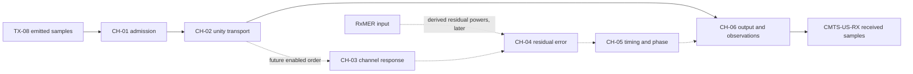

The solid path is the baseline. A later nonunity mode uses one ordered path
through its enabled stages; it does not run a second parallel channel and add
another copy of the transmitted signal. CH-02 is the identity starting boundary.
An empty impairment list is exactly unity. Until a stage is implemented and
accepted, enabling it is an unsupported-mode error, never a silent bypass.
No read-only input preview runs a channel or consumes source/noise state.

**Declared composition and limits.** The initial accepted designs are:

| Model selection | CH-03 | CH-04 | CH-05 | Meaning |
| --- | --- | --- | --- | --- |
| Unity | Identity | Off | Off | Exact TX-08 sample transport, with no RNG. |
| Deterministic | Identity or causal FIR | Off | Off or integer delay/phase/CFO | Deliberately impaired waveform; receiver outcomes need measurement. |
| Controlled AWGN | Identity or causal FIR | Explicit complex sample-noise power | Off or integer delay/phase/CFO | Output-referred sample noise after the response, before timing/phase. |
| RxMER residual | Identity; every scheduled TX C must also be unity | Accepted RxMER power synthesis | Off | Declared unit-reference probe-to-data approximation; no hidden H/C compensation. |

Reject incompatible selections before a run. Input inspection may still retain
an otherwise valid RxMER capture when a chosen response mode cannot use it.
The two side-input collections may be loaded independently or together. Unity
CH-SIM passes the actual TX waveform even when an accepted Pre-EQ plan changes C.
Initial RxMER residual mode instead preflights every effective Pre-EQ bank,
including later updates, and rejects any nonunity C before source consumption.
Never disable an update silently or derive H from C to force compatibility.
Captured-H-to-FIR reconstruction, fractional timing, sample-rate error, stochastic
phase noise and arbitrary RxMER/FIR/timing combinations remain unsupported
extensions. They need their own design/acceptance, not additional implicit steps.
The selected modes are engineering experiments, not modem conformance claims.

Prepare immutable geometry/model plans and validate total sample/work/retention
budgets before source consumption. Stage state is job-owned. Process at most
4096 samples per internal work quantum within the CH-01 block limit; cancellation
is observed between quanta. Clone/checkpoint bounded mutable state, calculate
finite candidate output, then commit state and one ready output quantum together.
Backpressure stops the next quantum. Failure leaves its prior state unchanged;
previously delivered quanta remain completed partial output. An admitted input
block may therefore have an explicit unprocessed suffix, never silent loss.

Rust owns these numerical operations and future public validation/results.
Record accepted models, units, seed/dependency versions, stage order and support
ranges in results. Normal RX gets received samples plus its own accepted
configuration; it is never automatically retimed or corrected using channel
delay, H, noise targets or seed. Python/UI adapters inherit the same validation,
errors, partial status and sample ordering after the public Rust operations exist.

#### RxMER input

[Return to channel stages](#channel-stage-sequence).

Status: **input architecture defined; import, playback and UI remain planned**.
Use the reference workbench's separate RxMER input concept: select one or more
local inputs, inspect original/combined values, choose policy, then Apply an
accepted immutable draft. A future focused editor/viewer opens from this input;
it is independent of transmitter settings, channel Start and receiver metrics.
The first unity run needs no RxMER. Loading/applying observations alone leaves
channel mode unchanged; a future measured-residual mode must be selected
explicitly and supported before it can run.

**Single-shot and multi-input inventory.** Single-shot selects exactly one
capture and Single policy for a fixed target throughout the run. Multi-input
selects compatible captures for Average, Hold or Interpolate below; selecting
one from a larger inventory may still use Single. These choices do not silently
change trial counts or start multiple runs. Load a bounded batch, each with an
immutable source ID and its own original bytes/provenance. Selection, ordering
and playback policy are separate accepted configuration; inspecting, deselecting
or reordering captures never alters originals. Reject duplicate source selection
instead of counting one capture twice in an average. A batch is for one accepted
CM/user, channel and compatible grid/reference cohort, not multiple simultaneous
users. Rust owns batch admission and policy validation; future Python/UI adapters
expose the same collection and failures. [US-Pre-EQ](#us-pre-eq-input) is an
independent collection, with optional explicit capture/probe association only;
file order or similar timestamps never pair the two inputs automatically.

**Planned code paths (repository-relative; all create, planned).**

| Path | Disposition | Responsibility |
| --- | --- | --- |
| `crates/phy/src/measurements/rxmer.rs` | Create (planned) | Typed original upstream observations, provenance, reference and exact grid/coverage validation. |
| `crates/phy/src/configuration/rxmer.rs` | Create (planned) | Accepted source selection, association/time tolerance and explicit playback policy. |
| `crates/phy/src/signal_processing/residual_power.rs` | Create (planned) | Single Rust owner of dB-to-error-power conversion, power combination and equivalent-dB preview. |
| `crates/phy/src/channel/measurement_playback.rs` | Create (planned) | Immutable symbol-scheduled power queries with source IDs/weights and no RNG. |
| `crates/morgana/src/inputs/mod.rs` | Create (planned) | Register bounded format adapters around the shared typed Rust models. |
| `crates/morgana/src/inputs/rxmer.rs` | Create (planned) | Preserve original capture bytes; identify/decode only verified upstream formats and versioned decoded inputs. |
| `crates/phy/tests/rxmer_input.rs` | Create (planned) | Reference/identity/grid/null/range and atomic-admission cases. |
| `crates/phy/tests/measurement_playback.rs` | Create (planned) | Independent power-average/schedule/interpolation, bounds and immutable-query cases. |
| `crates/morgana/tests/rxmer_import.rs` | Create (planned) | Source-format fixtures, exact provenance and malformed/unsupported/bounded import cases. |

The existing planned measurement/configuration/signal-processing/channel roots
register the PHY leaves. Future facade registration extends
`crates/morgana/src/lib.rs` (existing) only after shared Rust operations exist.
There is no new capture dependency or GUI implementation now. Original bytes
belong to the application/import adapter; numerical owners receive typed data,
not file paths. Any later source adaptation retains licenses and attribution.

**Upstream observation and association.** PHY I20 §9.4.8, PDF p196 defines
upstream RxMER from the equalized received probe and known ideal BPSK value.
It is a CMTS measurement for a particular CM/user and upstream channel. Preserve
that endpoint/reference explicitly; a downstream CM RxMER capture is not an
upstream measurement just because both arrays have dB values.

Keep source name/kind/format version, original byte count and SHA-256, original
capture epoch, CM/user/channel identity, reference-plane declaration, physical
first-bin/count/frequency origin/spacing and every optional dB reading. Retain
original missing entries/exclusion masks and full resolution, independent of
chart decimation. Do not derive IDs/times from filenames or rewrite capture
epochs to fit a synthetic run. Synthetic inputs must be labeled synthetic,
with an explicit grid/reference, rather than forged measured provenance.

Match the accepted upstream profile/geometry: N=2048/4096, 50/25 kHz spacing,
physical-bin/frequency mapping and CM/user/channel association. Preserve a
captured subgrid as supplied, then map exact physical coordinates; do not pack
active carriers, shift the origin to the first active bin, interpolate frequency
or silently extrapolate. Required active grant carriers, including known pilots
and complementary data, need valid readings for a model using those cells.
Excluded/inactive gaps may remain missing; a missing required value is an
admission error, not zero error power, zero dB or a guessed neighbor value.

Measured association requires the source identities/reference and epoch needed
by the selected policy. A readable but unassociated capture may be inspected
without becoming ready for simulation. Apply validates the whole selection,
explicit capture-time tolerance and geometry generation atomically; rejected
drafts leave prior accepted inputs intact. A US Configuration change invalidates
derived compatibility/results and requires revalidation. Applying edits affects
a fresh run, not the measurements frozen into an active or paused run.

Binary support is conditional on a verified upstream type/version/scale/null
contract and decoder fixtures. Do not reuse downstream file-type numbers,
DPD/PLC metadata or receiver identities. Rust typed inputs come first; decoded
JSON needs an explicit versioned schema and the same validation. Unsupported
binary/JSON types fail clearly. Actual upstream capture format support remains
RXMER-FORMAT-01 work, not a capability implied by this input diagram. No live
SNMP/TFTP/device acquisition is introduced.

**Selection and temporal policy.** Define dimensionless error-power ratio
`rho[k] = 10^(-mer_db[k]/10)` at the declared equalized probe reference.
Convert finite present readings with numeric overflow/underflow checks; retain
the original dB array. A normalized power preview is derived data, not an altered
measurement or an output noise waveform.

| Policy | Derived power and scheduling contract |
| --- | --- |
| Single | Exactly one selected capture; fixed rho for the run. |
| Average | One or more compatible captures; equal-capture arithmetic mean of rho at each required carrier. Report equivalent dB as `-10*log10(mean_rho)`. |
| Hold | At least two explicitly ordered captures at strictly increasing configured physical-symbol offsets; hold the current rho until the next offset. |
| Interpolate | Same explicit schedule; interpolate rho linearly between neighboring capture offsets, never dB. Hold the final capture after its offset. |

For sequence policies the first offset is zero. A positive interval in symbols
may generate the offsets with checked multiplication; all transitions must fit
the accepted observation/burst interval. Original capture times and synthetic
playback offsets remain separate. Optional original-time playback would need
an explicit epoch-to-symbol policy before support; timestamps are not silently
reinterpreted. Queries return derived powers, contributing source identities
and weights without changing frames, cursors or RNG. At a transition boundary
the newly selected capture applies exactly once; prefix/useful/tail scheduling
uses the same `(N+C)/fs` cadence as TX-08, independent of output chunk size.

Power averaging here is an engineering model-combination policy. It does not
replace §9.4.8's specified dB statistics for its CMTS performance test. Do not
combine different grids/users/reference planes or drop missing required values
to make a mean. The future preview shows original captures, derived effective
power/equivalent dB, source ordering and selected symbol; missing-value breaks
remain visible. Charts may be decimated, simulation data may not.

Proposed application bounds are 1..256 selected captures, at most 4096 readings
per capture and 1,048,576 selected readings total; 16 MiB per input and 64 MiB
original bytes per batch. These are resource budgets, not DOCSIS limits. Check
lengths before allocation and schedule arithmetic before acceptance; cancel
imports without replacing accepted state. Numerical model admission also needs
an explicit finite residual-power budget; extreme readings are not clamped to
fit it. A valid observation may remain inspectable when a particular model
cannot represent its power. Format fixtures must verify these bounds are usable.

**Model and metric boundaries.** A probe RxMER array does not specify error
phase, impulse timing, time correlation, RF noise PSD or an exact channel H.
The later CH-04 Gaussian model is an explicit approximation, not playback of the
original RF event. Treat selected RxMER as its total residual-error budget;
do not also add an implicit thermal/system floor or reinject an impairment
already included in that input. Controlled AWGN is a separate selection until
an explicit independent-power composition contract is designed.

Channel truth, chosen powers, seeds and applied H/C stay in channel/planning
and independent diagnostics. Normal CMTS-US-RX receives waveform/configuration
and estimates effective C×H from received pilots. Input targets do not become
receiver noise estimates, observed RxMER, decoded BER or FEC results. Reusing
probe statistics for scheduled data requires declared normalization/role and
stationarity assumptions. Simulated data-reference/pilot/decision metrics must
retain their own names; normative probe measurement remains a separate future
mode. Rust owns import validation, arithmetic, playback and eventual public API;
future Python/UI adapters only select inputs and display owned results.

Acceptance will cover exact original bytes/hash/grid/nulls, wrong endpoint/
identity/reference, incomplete active coverage, unsupported formats and atomic
failure; 10 dB and 20 dB inputs must average to power 0.055 rather than 15 dB.
Test single/average and both sides of hold/interpolation boundaries, final hold,
schedule overflow, stale generations and pure repeated queries. Ensure disabled
RxMER leaves unity output bit-identical and never starts or seeds a run.

Source: CM-SP-PHYv3.1-I20-230419 §9.4.8, PDF p196, rendered and visually
reviewed for probe/equalization/endpoint meaning and the distinct performance
statistics context. Exact-grid association, power playback, budgets and editor
lifecycle are local engineering contracts informed by read-only reference review.
No downstream field-guide thresholds, binary formats or supplied-H receiver
behavior are promoted to upstream requirements.

#### CH-01: Input admission

[Return to channel stages](#channel-stage-sequence).

Status: **architecture defined; implementation planned**.

| Planned path | Disposition | Responsibility |
| --- | --- | --- |
| `crates/phy/src/configuration/channel.rs` | Create (planned) | Freeze mode, sample/work limits and enabled stage order. |
| `crates/phy/src/channel/pipeline.rs` | Create (planned) | Validate input metadata/cursor before any state or RNG changes. |
| `crates/phy/src/types/samples.rs` | Create (planned) | Preserve shared sample/timing/validity types. |
| `crates/phy/tests/channel_pipeline.rs` | Create (planned) | Invalid identity/grid/range/budget and unchanged-state cases. |

Accept finite complex blocks, fs, absolute first index, exact length, burst/run/
configuration identity and TX-08 useful/tail/guard/partial metadata. Empty blocks
are no-op only, not end-of-stream. Require contiguous indices within a declared
stream; reject unexplained gaps, overlaps, duplicate ranges, stale generations,
unsupported units/clock and overflowing end indices. A new declared burst is
an explicit boundary. Do not synthesize missing gaps as silence.
Bound blocks to at most 65,536 samples (application choice) and cumulative run
work/output/retention to accepted budgets. Admit storage/output capacity before
processing. Unity does not require frequency-grid captures, RxMER or H. A request
enabling unimplemented stages fails before consuming any TX block. Acceptance
covers invalid finite/range/identity cases and transactionally preserved state.

Accept only the declared composition table and upstream clock. Report a typed
unsupported-model error for every undeclared combination; numeric failure,
identity mismatch, capacity/backpressure and cancellation remain distinct. For
nonunity jobs, preflight FIR/delay drain counts, per-quantum operation counts and
the full RxMER schedule/required role coverage and all scheduled Pre-EQ bank
compatibility. Never advance source, noise or
stage state just to check readiness. Tests include rejection after an accepted
plan, input split at a work-quantum boundary, buffer exhaustion and preserving
the accepted configuration when a proposed replacement fails.

#### CH-02: Unity transport

[Return to channel stages](#channel-stage-sequence).

Status: **architecture defined; implementation planned**.

| Planned path | Disposition | Responsibility |
| --- | --- | --- |
| `crates/phy/src/channel/unity.rs` | Create (planned) | Identity transport of validated finite samples/metadata. |
| `crates/phy/tests/unity_channel.rs` | Create (planned) | Bit-pattern equality, metadata preservation and chunk invariance. |

The initial channel is `y[n] = x[n]`: unit gain, zero delay, no added/removed
samples and no random state. Preserve sample bit patterns, including finite
signed zero, plus indices, rate, normalization, burst boundaries, tail/guards
and partial validity. Ownership may move or a bounded snapshot may copy bytes;
do not recompute samples by multiplication, FFT/IFFT, quantization or symbol
regeneration. Grouping blocks differently cannot change the concatenated
waveform. No filter, resampling, clipping, noise, jitter, frequency offset or
phase rotation is applied. Tests compare bits and metadata, not approximate
float equality alone. Empty impairment configuration must take this same path.

Canonical identity response, Off residual and zero-delay/zero-rotation timing
select this bypass even when optional inputs remain loaded. Do not allocate an
unused noise generator or perform add-zero/multiply-one operations. Accept
zero-length no-op blocks without emitting duplicate boundary events. Independent
cases include signed zero, subnormals, mixed I/Q signs, TX-08 tail/guard spans,
one-sample versus maximum-size chunks and paused/disabled/full observers.

#### CH-03: Channel response

[Return to channel stages](#channel-stage-sequence).

Status: **architecture defined for causal FIR; implementation planned**.

| Planned path | Disposition | Responsibility |
| --- | --- | --- |
| `crates/phy/src/configuration/channel.rs` | Create (planned) | Admit original synthetic tap/path settings and immutable response budgets. |
| `crates/phy/src/channel/response.rs` | Create (planned) | Indexed FIR stream, state checkpoint and explicit terminal drain adapter. |
| `crates/phy/src/signal_processing/channel_response.rs` | Create (planned) | Pure complex convolution and full-grid realized-response calculation. |
| `crates/phy/tests/channel_response.rs` | Create (planned) | Independent response/delay/history and unity-limit acceptance. |

**Model and reference.** Select identity or an explicitly supplied synthetic
causal complex FIR h with L coefficients, `1 <= L <= 1025`. A convenience list
of at most 32 unique integer-delay paths, delays 0..1024, expands into that same
tap vector; no second echo algorithm is introduced. Tap index is delay at the
102.4 Msamples/s clock. A delayed path need not have a nonzero direct path.
These are application bounds, not CM RF limits. Reject negative/fractional or
duplicate path delays, empty/nonfinite taps and out-of-budget work. Preserve
the caller's declared L, including trailing zeros, in duration/provenance.

For input starting at a, with relative index m and zero prehistory:

```text
v[a+m] = sum over ell=0..L-1 of h[ell] * u[a+m-ell]
H[k]   = sum over ell=0..L-1 of h[ell] *
         exp(-j * 2*pi * (k-N/2) * ell / N)
```

Input outside the finite admitted signal is zero only for the declared
startup/terminal convolution boundary. Use direct safe Rust complex arithmetic,
without an implicit circular convolution or another FFT-size convention. Report
H on the accepted physical grid as diagnostic truth; it never becomes a normal
RX equalizer input. Do not normalize tap energy, conjugate coefficients or
apply Pre-Eq again. C remains a transmitter correction; h/H is the separately
chosen channel. All-zero and deep-null responses are valid destructive tests;
do not clamp/invert them to make decoding succeed.

**State and finish.** Retain at most L-1 prior input values across every chunk,
symbol, prefix, frame and TX-08 tail/guard boundary. No per-symbol filter reset
or discarded startup transient is allowed. New explicit isolated streams have
zero history. An identity plan is exactly one tap `[1+j0]` and uses CH-02; a
different declared tap vector remains a distinct model even if some taps are zero.
Each quantum validates finite results before committing history/cursor/output.

For T input samples, normal finish processes exactly L-1 zero-input ticks and
returns T+L-1 samples at the original origin. Repeated finish requests do not
restart the bounded drain; after it is delivered they add nothing;
post-finish input rejects. This tail is channel memory after the entire TX-08
stream, separate from its R-sample suffix. Drain is resumable/cancellable under
the same quantum and budget rules. Do not truncate a response longer than CP:
the resulting ISI/ICI and receiver failure are experiment outcomes.

Bound work by `quantum_length * L` complex multiply-adds (at most
4,198,400 for a 4096-sample quantum), plus a separately bounded N*L diagnostic
calculation at planning time. Reject excessive accepted total work, not just
excess memory. Input/tap overflow leaves the failing quantum's history unchanged.
Measured H reconstruction and inverse-C inference remain separate extensions;
no unknown/excluded frequency bins are filled to synthesize an invented FIR.

**Independent acceptance.** Use literal impulse/complex-gain/path vectors and
a direct short convolution oracle, not only FFT round trips. Include pure delay,
two paths with differing phases, zero/deep-null taps, L=1/1025, signed values,
arbitrary chunking and tail pause/cancel. A positive-frequency tone must acquire
the stated negative delay phase in H. Verify T+L-1 length, preserved origin,
no CP-boundary reset, repeated finish, finite overflow failure and unchanged
unity bypass. Statistical source recovery is a later integration assertion.

#### CH-04: Residual error

[Return to channel stages](#channel-stage-sequence).

Status: **architecture defined for sample AWGN and restricted RxMER synthesis;
implementation planned**.

| Planned path | Disposition | Responsibility |
| --- | --- | --- |
| `crates/phy/src/channel/residual.rs` | Create (planned) | Future sample-stream residual synthesis/composition adapter. |
| `crates/phy/src/channel/measurement_playback.rs` | Create (planned) | Shared RxMER-derived power query owner defined above. |
| `crates/phy/src/signal_processing/residual_power.rs` | Create (planned) | Shared conversion/combination arithmetic; no duplicate adapter math. |
| `crates/phy/src/signal_processing/noise.rs` | Create (planned) | Pinned noise-only ChaCha8/StandardNormal draws and explicit I/Q ordering. |
| `crates/phy/src/signal_processing/transform.rs` | Create (planned) | Same unitary upstream numerical transform owner as TX-07. |
| `crates/phy/src/signal_processing/cyclic_extension.rs` | Create (planned) | Same pure cyclic-copy owner as TX-08. |
| `crates/phy/src/signal_processing/transmit_window.rs` | Create (planned) | Same immutable upstream taper owner as TX-08. |
| `crates/phy/src/signal_processing/overlap_add.rs` | Create (planned) | Same overlap primitive as TX-08 with independent residual-stream state. |
| `crates/phy/tests/channel_residual.rs` | Create (planned) | Independent power/reference, seeded reproducibility and stream acceptance. |

**Exclusive modes and reference power.** Select Off, ControlledSampleAwgn or
RxmerResidual. No mode adds a hidden system/thermal floor. Off and explicit
zero sample-noise power bypass arithmetic and consume no random draws.

ControlledSampleAwgn accepts a finite complex sample variance p, in normalized
sample-power units at CH-03 output. For independent standard normal gI/gQ:

```text
e[n] = sqrt(p/2) * (gI[n] + j*gQ[n])
q[n] = v[n] + e[n],  E[|e[n]|^2] = p
```

Apply it once to every sample supplied by CH-03, including explicit silence,
TX-08 suffix and FIR drain, with no inferred signal-present gating. Its power is
output-referred and is not multiplied by H again. Select `0 <= p <= 1,000,000`
as a proposed application ceiling, with finite per-run/total-energy/work checks.
Do not infer Eb/N0, RF dBmV or post-EQ RxMER from p without a separate reference.

RxmerResidual consumes the immutable [RxMER power playback](#rxmer-input).
The initial design requires identity CH-03, unity accepted TX Pre-Eq C throughout
the entire static/update plan and Off
CH-05. The unit BPSK-probe reference is explicitly mapped to unit-average-power
scheduled data/complementary QAM. This is a model assumption, not a recovered
field RF waveform. For physical symbol j and each full-grid carrier k:

```text
rho[j,k] = selected/interpolated 10^(-mer_db[k]/10)
E[j,k]   = sqrt(rho[j,k]/2) * (gI[j,k] + j*gQ[j,k]) for active cells
           0                                                   otherwise
```

Use the accepted resource plan to identify data, complementary data and known
pilots; require finite readings for every active carrier. Use the same rho
as absolute normalized error power on those roles. Do not multiply the error
by the pilot boost: a pilot with power 3 has expected ideal-reference MER
`10*log10(3/rho)`, while unit-power data has `-10*log10(rho)`. Missing required
values reject; excluded/unallocated cells remain exact zero residual bins.
Require strictly positive finite rho <=1,000,000 without clamping; an input
outside this model range may remain inspectable. "Noiseless" is Off, not infinity
stored in an RxMER array. This per-role reference must appear in model results.

Synthesize E with the shared centered/unitary TX-07 transform and TX-08 cyclic
extension/window/overlap primitives, using its own bounded tail and the same
symbol origin/stride. Add that actual contiguous residual stream once to the
original TX sample stream. Do not regenerate the payload, alter only QAM/LLRs
or route hidden TX frequency cells to RX. Playback is evaluated once per
physical symbol; changing its variance never resets overlap or the random
stream. Flush its final R samples exactly with TX-08's final tail. Declared
extra guards have zero synthesized residual in this symbol-conditioned model;
they differ deliberately from the all-sample AWGN model's noise floor.

No nonunity H/C composition is claimed for this first RxMER mode. Such requests
reject rather than guessing how to scale post-EQ measurements through a filter.
RxMER alone supplies no event correlation, impulsive process or noise phase.
Finite observed receiver MER fluctuates and includes estimation error; a target
curve is not proof that each simulated observation equals it.

**RNG and transactional streaming.** Reuse the workspace's exact Rust pins:
rand 0.9.5, rand_chacha 0.9.0, rand_distr 0.5.1. Use a channel-only ChaCha8Rng
with an explicit 32-byte seed through `from_seed`; retain seed bytes, algorithm
tag `chacha8-standardnormal-v1` and versions in the run record. No source/PRBS,
observer or future phase-noise RNG is shared. StandardNormal supplies two real
draws per complex event, I then Q. Internal rejection sampling consumes whatever
the pinned distribution requires; callers never reseed or reorder those calls.

For positive sample AWGN, events advance by increasing emitted CH-03 sample
index, including its drain. For RxMER mode, advance symbols then physical bins
0..N-1, taking I/Q draws for every bin before masking inactive bins to zero.
This fixes draw order independently of allocation, observer state, output chunks
and playback variance. A mode change starts a fresh accepted run. Clone the RNG,
synthesis state and playback position into a candidate quantum/symbol; commit
only after finite output and capacity checks pass. Retrying a rejected quantum
must yield the same next events. Pause preserves all state and excludes wall
time; cancellation retains delivered samples and pending counts without a
successful implicit drain. Bitwise reproducibility is for identical pinned
build/platform/settings; cross-platform normal/transform results use explicit
numerical tolerances rather than an unverified bitwise promise.

Bound RxMER synthesis to one N<=4096 symbol, one ready stride and R<=224 tail;
sample AWGN needs only the ready quantum and RNG. No whole-run noise array.
Validate prospective power/energy and finite addition even when both operands
are finite. Guards and masks do not consume source/randomizer/pilot clocks.

**Independent acceptance.** Test known complex variance with declared sample
count/seed and confidence bounds, I/Q variance p/2, near-zero mean/covariance and
sample-noise unitary FFT variance. Include independent dB/power examples and
pilot-boost/reference cases. Compare noise-only synthesis to a separate short
direct-sum/copy/window oracle, plus useful-window variance and exact K*S+R
support. Freeze seed-stream fixtures independently of the adapter; test missing
coverage, forbidden C/H/timing combinations, numeric extremes, schedule endpoints,
guard policy, tail finish, repeated finish, arbitrary drains and pause/retry.
Disabled/full observers and failed quantum retries must not change subsequent
draws. These are planned tests, not evidence from existing codec tests.

#### CH-05: Timing and phase

[Return to channel stages](#channel-stage-sequence).

Status: **architecture defined for integer delay, constant phase and CFO;
implementation planned**.

| Planned path | Disposition | Responsibility |
| --- | --- | --- |
| `crates/phy/src/configuration/channel.rs` | Create (planned) | Accepted delay/phase/frequency units, combination and output budgets. |
| `crates/phy/src/channel/timing_phase.rs` | Create (planned) | Indexed delay FIFO and emitted-sample phase state; stage admission/drain. |
| `crates/phy/src/signal_processing/timing_phase.rs` | Create (planned) | Pure complex rotation and phase-step arithmetic with no scheduler/receiver truth. |
| `crates/phy/tests/channel_timing_phase.rs` | Create (planned) | Independent phase/timing vectors, absolute-clock and pause/chunk cases. |

Select Off or integer delay D plus constant initial phase phi0 and carrier
frequency offset delta_f. Proposed bounds are D=0..4096 samples,
`-pi <= phi0 < pi` radians and finite `abs(delta_f) < fs/2` in Hz. These bound
an experiment, not a DOCSIS receiver tolerance. Reject fractional/negative delay,
sample-clock drift/jitter and stochastic phase noise; they need separate models.
The residual compatibility table rejects this stage in initial RxMER mode.

Let a be the absolute first CH-05 input/output tick, including any configured
leading guard, and v the CH-04 output. Define the finite stream by:

```text
w[n] = v[n-D] * exp(+j * (phi0 + 2*pi*delta_f*(n-a)/fs))
```

Use zero input before a for the explicit startup boundary. Positive delta_f
rotates counterclockwise and raises a tone's baseband frequency; there is no
complex conjugation. Delay shifts content, not the stored clock origin or fs.
Emit D leading zero samples, then the delayed content, and drain the final D
stored values: T input samples produce T+D output samples beginning at a.
Constant phase/CFO add no samples. When all parameters are zero, use CH-02's
exact bypass; do not rotate by a computed approximation of 1+j0.

Keep a bounded D-value FIFO. Phase state begins at phi0 at tick a and advances
by `omega=2*pi*delta_f/fs` once per emitted tick, including leading zeros,
explicit guards and terminal drain. Reduce the scalar phase modulo 2*pi each
step to bound argument growth, retaining the same sample-by-sample order across
chunks. Evaluate rotation in safe Rust f64 arithmetic; document absolute/relative
tolerances and accumulated phase error against the analytic formula. Never
convert a large absolute u64 index directly to a floating phase or use wall
clock elapsed time. Pausing causes no phase advance. A declared fresh stream
resets FIFO/phase; chunk, prefix, symbol and frame boundaries do not.

Validate finite rotations and complex products before committing FIFO, phase
and output cursor. CH-05 drain rotates the retained values with continuing
output phase; it does not request additional CH-04 noise draws. Repeated finish
does not restart the drain and is empty after delivery; post-finish input rejects.
Cancellation reports pending delayed
samples rather than calling a partial delayed stream complete. Explicit path
delays in CH-03 and D here are cumulative chosen effects; do not silently remove
or double-infer one from the other. Normal RX receives no hidden timing/CFO
correction derived from these settings; loss of synchronization is an outcome.

Independent acceptance covers a delayed impulse at a+D, exact T+D count,
positive/negative quarter-turn rotations, signed tone offsets, phi0 origin,
large absolute a, D=0/4096, phase continuity across odd chunks/frames and drain,
pause/cancel/retry, finite overflow and zero-mode bitwise identity. Test the
joint FIR+sample-AWGN+timing order with a small literal sequence. Do not describe
these tests as fractional-clock/phase-noise support or RF acquisition validation.

#### CH-06: Output and observations

[Return to channel stages](#channel-stage-sequence).

Status: **architecture defined; implementation planned**.

| Planned path | Disposition | Responsibility |
| --- | --- | --- |
| `crates/phy/src/channel/pipeline.rs` | Create (planned) | Commit valid output and preserve bounded delivery/pause/cancel state. |
| `crates/phy/src/instruments/observation.rs` | Create (planned) | Shared passive input/output tap and bounded retention owner. |
| `crates/phy/tests/channel_pipeline.rs` | Create (planned) | Atomic delivery, backpressure, partial results and failure behavior. |
| `crates/phy/tests/unity_channel.rs` | Create (planned) | Matching input/output/SA intervals and observer neutrality. |

Commit only complete valid blocks to the output queue, with at most one bounded
ready block and delivery cursor. Return owned immutable snapshots or explicit
borrows without changing scientific state through observers. Input and output
SA taps identify actual complex samples at their respective reference planes.
Unity must match for the same interval/settings; unavailable retained ranges
are unavailable rather than fabricated zeros or substituted TX data.

Backpressure retains pending output and stops admission; no block is dropped or
processed twice. Pause retains cursors and future stage state; resume preserves
sample order. Cancellation/failure retains completed delivery and reports input
accepted, samples delivered, pending count and partial status. Empty input or
end of one transport chunk is not finish. Unity adds no tail; normal completion
requires explicit upstream finish and every TX-08 tail/declared guard sample
delivered. Normal finish propagates exactly once in order: TX-08 final R tail
and explicit guards → CH-03 L-1 FIR drain → CH-04 processing/normal residual
finish → CH-05 D-value delay drain → final delivery. In sample-AWGN mode the
FIR tail is noised, while the CH-05 stored-value drain generates no new draws.
RxMER mode's separate synthesis emits exactly its TX-matched R tail, with no
FIR or delay extension. Repeated finish cannot restart noise or drain a stage
again; early finish with incomplete declared input is an error.

For T complete TX samples, identity transport and RxMER mode emit T samples.
An enabled L-tap FIR and D delay emit `T+(L-1)+D`, with p/phase/CFO adding no
length. Preserve original TX frame/useful origins as source association, and
separate actual output range, modeled startup/drain and configured content delay.
Do not relabel an echo/filter tail as another scheduled data symbol or imply
that noisy guard samples remain zero. Check all support/count additions before
starting and against actual delivered totals at completion.

Per-quantum atomic commits include every stage's history/RNG/phase, its consumed
input interval and output. If delivery is paused partway through a ready quantum,
retain its cursor without reexecuting that quantum. Failed/cancelled jobs retain
committed/delivered prefixes and explicitly report buffered, unprocessed and
drain-pending counts. Do not infer success from an empty queue before all finish
states are accepted. Tests exercise composed drains and failure at each stage,
as well as no changes to source/observer independence. An instrument failure or
exhausted observation budget is reported separately; it does not undo valid
scientific output, advance processing again or make a sample interval unavailable
to the receiver. A fresh isolated burst requires explicit reset after finish or
abort, with discarded pending state counted in the aborted result.

Channel plan/seed/H/RxMER truth remains in simulation and independent metrics.
CMTS-US-RX accepts received samples and its configured grant/timing, never an
injected target or hidden H/C. Tests cover pause/cancel at different drain
positions, failed observers and unchanged truth separation. Core Rust operations
precede matching future Python/UI adapters; no channel implementation is added now.

### CMTS-US-RX block architecture

Status: **block and RX-01..09 stage architecture defined for the declared
initial scope; scientific implementation and source acceptance remain planned**.
ARCH-RX-00 defines this block and its nine internal stages,
matching the CM-US-TX presentation structure. The
[receiver design/checklist](development/features/cmts-us-rx/design.md) tracks
RX-01..09 separately; completed design does not imply executable receiver support.

CMTS-US-RX converts received upstream complex samples into decoded information
decisions and explicit recovery outcomes. Its first planned experiment uses
scheduled data, independently accepted grant/timing configuration and the unity
channel. It does not acquire a generic preamble, process ranging/probing or
implement a downstream PLC/NCP/BCH chain.
Its [CMTS configuration subsection](#cmts-configuration-us-configuration-json)
contains the generic OFDMA JSON/control plan. It supplies accepted endpoint
settings before RX-01 and also configures CM-US-TX through a separate view.

**Planned code paths (repository-relative).**

| Path | Disposition | Responsibility |
| --- | --- | --- |
| `crates/phy/src/receiver/mod.rs` | Create (planned) | Compose/register the nine stage adapters and their separate processing contexts. |
| `crates/phy/src/receiver/result.rs` | Create (planned) | Owned decoded decisions, coordinates, validity and separate stage/codeword outcomes. |
| `crates/phy/src/configuration/receiver.rs` | Create (planned) | Receiver-specific timing/confidence/iteration/retention policies and limits, composing accepted shared configuration. |
| `crates/phy/tests/rx_pipeline.rs` | Create (planned) | Stage-order/identity, chunk/lifecycle and receiver-truth-boundary acceptance. |

**Inputs and ownership.** Normal recovery accepts actual channel-output samples
with their sample rate, absolute indices, stream/configuration identity and
availability, plus an immutable receiver configuration. That configuration
composes the accepted waveform geometry, synthetic grant/profile, resource/
pilot/loading plan, PHY randomizer seed and independently configured timing.
The PHY seed is legitimate receiver configuration; the PRBS15 source seed is
independent comparison truth. Do not pass a whole simulation/channel settings
object just because it also contains the receiver's required fields.

Original payload bits, source-range ledger, TX carrier/sample snapshots,
injected H, TX correction bank C, noise seed/power and input RxMER targets are
not normal receiver inputs. Pilot processing estimates the effective C×H from
received observations and configured pilot expectations. Channel distortion
does not automatically retime or correct the receiver using simulator truth.
Diagnostic comparisons may use truth after recovery, in a separate branch.

**Result and lifecycle.** Rust owns all algorithms and validation. Return owned
information decisions in grant/codeword coordinates, recovered coverage/gaps,
stage availability and separate convergence, syndrome, shortening consistency
and actual decoder-iteration outcomes. Preserve failed decisions with their
status. Orchestration associates source ranges afterward; PRBS-RX compares
original/recovered bits without feeding expected values back into decoding.

Configuration/readiness is idle. Start freezes the receiver view; pause/resume
preserves framing, the current pilot frame, inverse-resource progress and
randomizer state. The existing LDPC call is atomic; pause/cancel is between
codewords, without unsupported mid-iteration checkpointing. Configuration changes
apply to a new generation.
Bound input/ready queues, retained samples/cells/LLRs, buffered symbols/codewords,
iterations and run work before consumption. Do not buffer an entire arbitrary
burst or fill unavailable input intervals with zeros. Cancellation/failure
retains completed observations/decisions and explicit incomplete coverage.
The stage contracts below define transactions and numeric budgets for this scope.
The proposed aggregate working-state ceiling is 64 MiB per receiver job,
including frame buffers, transform/codec scratch and ready queues; optional
retained observations/results have separate finite budgets. Admission checks
actual typed storage and run work before allocation, and rejects a plan that
cannot fit rather than overflowing a per-stage maximum. These are application
limits, not PHY requirements or measured performance claims.
Future public Rust operations precede matching native Python/UI adapters; both
share the same modes, errors, availability and owned outcomes. No callable
experiment API or saved schema is introduced by this architecture.

#### CMTS configuration: US Configuration JSON

[Return to CMTS-US-RX](#cmts-us-rx-block-architecture) ·
[US Configuration input](#us-configuration) ·
[RX stage index](#receiver-stage-sequence).

Status: **architecture/JSON delivery plan recorded; full MULPI field audit,
schema, example JSON files, parser and execution integration remain planned**.
This subsection places configuration ownership with the simulated CMTS, beside
its receiver. It is a control boundary, not a tenth RX stage or a full MAC/
service-group scheduler. The common US Configuration remains usable by Rust
and future CLI/Python/UI consumers without depending on receiver processing.

**Planned code and artifact paths (repository-relative).**

| Path | Disposition | Responsibility |
| --- | --- | --- |
| `crates/phy/src/configuration/mod.rs` | Create (planned) | Shared typed US Configuration, atomic admission and immutable accepted generation. |
| `crates/phy/src/configuration/profile.rs`, `crates/phy/src/configuration/waveform.rs`, `crates/phy/src/configuration/burst.rs` | Create (planned) | Existing planned owners for profile/IUC/loading/pilots, geometry and burst-mode validation. |
| `crates/phy/src/configuration/grant.rs`, `crates/phy/src/configuration/receiver.rs` | Create (planned) | Separate synthetic grant and receiver policy views; no channel/source truth projection. |
| `crates/phy/src/configuration/cmts.rs` | Create (planned) | Compose CMTS configuration/preset selection and derive distinct accepted TX/RX projections; reuse the shared validators. |
| `crates/phy/src/configuration/probing.rs` | Create (planned) | Typed future probe-control options and explicit representation/validation/execution support states. |
| `crates/morgana/src/inputs/us_configuration.rs` | Create (planned) | Bounded JSON/batch decoding, source preservation, generic preset inventory and shared Rust admission. |
| `crates/morgana/src/inputs/mod.rs` | Create (planned) | Register configuration import independently of PNM measurement inputs. |
| `crates/morgana/src/lib.rs` | Extend (existing) | Expose the future typed configuration/inventory/preview through the public Rust facade before Python/UI bindings. |
| `schemas/us-configuration-v1.schema.json` | Create (planned) | Versioned configuration-document structure and source-backed conditional constraints. |
| `examples/cli/us-configuration/README.md`, `examples/cli/us-configuration/reference-25khz.json`, `examples/cli/us-configuration/reference-50khz.json`, `examples/cli/us-configuration/mixed-loading.json`, `examples/cli/us-configuration/zero-valued-minislots.json`, `examples/cli/us-configuration/ranging-probing.json` | Create (planned) | Explained generic presets and optional-mode documents with honest execution support. |
| `crates/phy/tests/cmts_configuration.rs`, `crates/phy/tests/configuration.rs` | Create (planned) | Cross-field/domain admission, TX/RX projections and failure atomicity. |
| `crates/morgana/tests/us_configuration_json.rs` | Create (planned) | Schema/version, bounded import, source preservation, round trips and malformed/unsupported inputs. |
| `docs/user/us-configuration.md` | Create (planned) | Maintained format, preset-selection and support-state guide after schema delivery. |

Register the additional leaves through the planned configuration/facade module
roots. The [JSON feature record](development/features/us-configuration-json/design.md)
tracks delivery; its [coverage plan](development/features/us-configuration-json/coverage.md)
must be completed before claiming all applicable MULPI options are covered.
No empty Rust modules, schema or example JSON artifacts are created by this update.

**Generic document structure.** Propose the format marker
`morgana.us-configuration` with its own `schema_version`, distinct from existing
schema-1 FEC reports. Pin `CM-SP-MULPIv3.1-I25-230419` and
`CM-SP-PHYv3.1-I20-230419` in specification metadata. Future editions require an
explicit coverage/migration decision; do not silently merge DOCSIS 4.0 options.

The document retains a bounded `presets` inventory and an explicit `selection`.
Each generic preset has a stable ID/name, provenance and the groups below. One
selected preset describes one CM and one upstream channel; retaining multiple
presets does not start multiple trials or imply multi-CM operation. An optional
vendor/template reference is metadata, not a normative profile ID or IUC.

| Proposed preset group | Coverage / ownership |
| --- | --- |
| `channel` | Applicable UCD channel options: physical grid, CP/RP, spacing, frequency origin, exclusions/unused carriers, frame size, PHY seed and applicable preamble/ranging/class controls. |
| `burst_profiles` | Applicable per-IUC burst attributes, ranging lengths/offsets/Nir/Nfr/power control and data modulation/pilot assignments per minislot/group. |
| `cm_assignment` | Applicable assigned upstream data IUCs and profile-testing SID settings; preserve assignment context separately from the profile catalog. |
| `probe_configuration` | Applicable P-MAP/P-IE options, including allocation references, measurement/power/equalizer controls, staggering, symbol and carrier selection. Probes are not another data IUC. |
| `configuration_state` | Applicable UCD identity/change fields, timestamp/minislot snapshot and MAP association. Preserve exact integer bitfields and original units. |
| `simulation` | MORGANA-only synthetic grant/timing/selection/work limits, clearly outside the MULPI-defined field namespace. No hidden H/C, source bits or target noise is projected to normal RX. |

The final field names/defaults/enums require the field-level coverage review;
these group names specify architecture, not a complete working schema. Use
explicit unit-bearing fields and exact integer admission, not vendor CLI text.
Distinguish omitted optional settings, explicit zero, unavailable measurements
and inapplicable options. JSON does not encode arbitrary nonfinite numbers.

**Coverage and conditional validity.** Inventory every OFDMA-applicable option
in the pinned UCD channel/burst tables and required-burst rules, relevant
MAP/P-MAP controls and OUDP assignment/testing provisions. For each source field,
record revision/section/page/TLV, endpoint/normative force, required/optional/
conditional status, type/units/enums/bounds, JSON pointer, shared Rust owner,
cross-field rules and independent positive/negative/boundary fixtures. Audit
legacy-only and reserved fields as inapplicable/rejected rather than copying
A-TDMA/Reed-Solomon settings into OFDMA presets. Unresolved entries stay pending.

The data-profile domain includes IUCs 5, 6, 9, 10, 11, 12 and 13, independent of
generic preset IDs. Validate legal modulation/loading, all applicable pilot IDs,
zero-valued-minislot rules, channel-family compatibility, frame-length variants,
ordered physical-minislot coverage and unambiguous exclusions/unused bands.
Keep profile groups compact until bounded expansion is admitted; normative
group/length limits and application budgets are separate checks. Ranging/probe
options can be represented without claiming their waveform/MAC implementation.

For this pin, source boundaries are MULPI §6.4.3, Tables 28/29, pp107–118;
§6.4.3.3–4.1, p120–121; §6.4.4, Tables 32/33, pp121–128;
§10.5.1–10.5.1.3, pp454–456; and Annex C §C.1.5.1.11–12, p658.
PHY owns the actual waveform/pilot/reset conventions already cited in TX/RX.
These are audit boundaries, not a completed full-specification conformance claim.

**Admission, execution and endpoint views.** Keep original bytes/hash and
provenance in the importer. Decode a candidate, check format/version/structure,
then run shared Rust domain/cross-field validation. Return separate documented
representation validity, domain validity and execution support. A valid document
using an unimplemented mode remains inspectable with explicit readiness reasons;
Start rejects unsupported execution rather than ignoring its settings.

Proposed format policy rejects unknown versions and unknown typed fields, with
only explicitly schema-defined bounded extension metadata permitted. Unsupported
reserved/legacy values cannot become executable through that extension path.
Future migrations preserve meaning/provenance or return structured rejection.
The standalone configuration format is not a raw UCD/P-MAP encoder or a complete
saved workbench; any future embedding must preserve the same version and shared
Rust/Python validation semantics.

On Apply, atomically publish the immutable CMTS plan and endpoint projections.
TX receives its accepted waveform/profile/grant/pilot/seed settings; RX receives
only its legitimate corresponding geometry/resource/grant/timing/PHY-seed view
plus receiver policies. PNM measurements, Pre-EQ banks/updates, injected channel
models and PRBS truth remain separately owned. Changes revalidate dependent
PNM selections without rewriting their originals or silently changing model mode.
Failed/cancelled loads and rejected Apply retain the prior accepted generation;
preview and loading never start a job or consume RNG/source state. Start freezes
one compatible generation; edits during a run apply to a future accepted run.

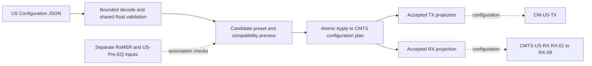

| Flow owner | Canonical contract |
| --- | --- |
| [US Configuration document/input](#us-configuration) | Public configuration entrypoint and original preset inventory. |
| [CMTS decode, preview and Apply](#cmts-configuration-us-configuration-json) | Shared admission, immutable plan and endpoint projections defined in this subsection. |
| [CM-US-TX](#cm-us-tx-block-architecture) | Accepted transmitter configuration before TX-01. |
| [CMTS-US-RX stages](#receiver-stage-sequence) | Accepted receiver view before RX-01; unchanged nine-stage sequence. |
| [RxMER](#rxmer-input) / [US-Pre-EQ](#us-pre-eq-input) | Independently owned PNM inputs checked for compatibility. |

Retain the US Configuration budgets: 16 MiB per file, 64 MiB original bytes per
batch, bounded preset/profile inventories and at most 1,048,576 retained expanded
carrier assignments. Check nested list lengths, compact-range expansion, derived
work, integer widths and combined memory before allocation; exact schema limits
must agree with source constraints and the shared domain budget. A preset
inventory is separate from each channel's legal IUC inventory and a CM's assigned
IUC count. No arbitrary all-profile expansion or unbounded raw-extension cache.

**Delivery and acceptance.** Complete the coverage matrix → finalize schema and
generic presets → implement typed Rust admission/parser → integrate CMTS plan/
TX/RX views → expose matching Python/UI consumers. Test valid/invalid source
boundaries, duplicates/holes/overlaps, reserved choices, optional/default meaning,
multiple presets/IUCs, byte/provenance retention, schema round trips/migrations,
stale generations, atomic failures, work limits and truth-isolated projections.
Every applicable source entry needs a JSON mapping and fixture before the
coverage milestone is checked. This task records the plan and updates flows;
it does not create JSON/schema code or enable a deferred waveform mode.

#### Receiver stage sequence

Every overview/output label links to its completed local stage contract. All nine
stages have architecture within their explicitly declared initial modes; proposed
files and scientific processing remain unimplemented. Preserve this stage order.

```mermaid
flowchart LR
    C[Channel output samples] --> R1
    DOC[US Configuration JSON: planned] -. decode and validate .-> CMTS[CMTS configuration owner]
    CMTS -. accepted TX settings .-> TX[CM-US-TX]
    CMTS -. accepted RX settings .-> R1
    subgraph RECEIVER[CMTS-US-RX]
        R1[RX-01 Burst framing and timing] --> R2[RX-02 Useful-symbol extraction]
        R2 --> R3[RX-03 FFT]
        R3 --> R4[RX-04 CH-EST-RX and equalization]
        R4 --> R5[RX-05 Resources and inverse interleaving]
        R5 --> R6[RX-06 Soft QAM demapping]
        R6 --> R7[RX-07 Soft derandomization]
        R7 --> R8[RX-08 Shortening restoration and LDPC]
        R8 --> R9[RX-09 Information deframing]
    end
    R9 --> ASSOC[Independent source-range association]
    ASSOC --> V[PRBS-RX comparison and results]
    EXPECTED[Expected source only] -.-> V
```

| Stage | Responsibility and inspectable result |
| --- | --- |
| [RX-01: burst framing/timing](#rx-01-burst-framing-and-timing) | Admit indexed received samples and configured burst timing; expose bounded framed intervals and validity. |
| [RX-02: useful-symbol extraction](#rx-02-useful-symbol-extraction) | Select the configured FFT interval, preserving raw and useful sample references. |
| [RX-03: FFT](#rx-03-fft) | Produce centered physical bins with the shared unitary convention, before correction. |
| [RX-04: CH-EST-RX/equalization](#rx-04-channel-estimation-and-equalization) | Estimate effective C×H from received pilots and expose estimate/coverage/corrected I/Q separately. |
| [RX-05: resources/inverse interleaving](#rx-05-resource-extraction-and-inverse-interleaving) | Recover ordered loaded cells/roles with the shared resource and inverse-visit plan. |
| [RX-06: soft QAM demapping](#rx-06-soft-qam-demapping) | Produce MSB-first natural-log P(0)/P(1) LLRs; positive favors zero. |
| [RX-07: soft derandomization](#rx-07-phy-soft-derandomization) | Regenerate the grant mask, reverse LLR signs and separate coded words from grant padding. |
| [RX-08: LDPC recovery](#rx-08-shortening-restoration-and-ldpc-decoding) | Restore shortening, decode and retain separate decisions/convergence/checks/iterations. |
| [RX-09: information deframing](#rx-09-information-deframing) | Remove only receiver-known fill and return information decisions/coverage in grant coordinates. |

| Stage output | Retained identity and inspection |
| --- | --- |
| [RX-01 framed samples](#rx-01-burst-framing-and-timing) | Actual received intervals, timing basis and gaps; SA on contiguous available samples. |
| [RX-02 useful samples](#rx-02-useful-symbol-extraction) | One contiguous useful window per symbol with its original sample indices; SA. |
| [RX-03 physical bins](#rx-03-fft) | Raw received symbol/carrier I/Q, roles and transform convention; QAM. |
| [RX-04 estimate/corrected cells](#rx-04-channel-estimation-and-equalization) | Received-pilot estimate, validity and corrected I/Q; response diagnostics and QAM. |
| [RX-05 ordered cells](#rx-05-resource-extraction-and-inverse-interleaving) | Grant/block/cell coordinates and actual per-role loading; QAM. |
| [RX-06 soft bits](#rx-06-soft-qam-demapping) | Cell bit positions, LLR sign/magnitude and confidence policy; soft-bit inspector. |
| [RX-07 coded-word LLRs](#rx-07-phy-soft-derandomization) | Actual derandomized word coordinates, omitted shortening and removed pad counts; LLR inspector. |
| [RX-08 decoded words](#rx-08-shortening-restoration-and-ldpc-decoding) | Actual decisions, code identity, iterations and independent check flags; FEC/bit inspection. |
| [RX-09 information decisions](#rx-09-information-deframing) | Payload/fill accounting, recovered/missing coordinates and outcomes; independent verifier input. |

The pipeline changes domain from time samples (RX-01/02) to physical/equalized/
ordered cells (RX-03..05), soft bits (RX-06/07), and decoded information
(RX-08/09). Bind every boundary to the same accepted run/configuration and
grant/frame/symbol/codeword coordinates as applicable. Retain existing shared
tap names; detailed sections add typed taps only for actual produced outputs.
Sample arrays are not carrier QAM points, FFT bins are not SA waveforms, and
failed/missing decisions do not become zero-error statistics.

RX-05/06 may be fused if varying cell orders/loading are preserved exactly.
Derandomization precedes LDPC decoding because the upstream randomizer follows
FEC at TX. Pre-Eq is transmitter compensation; the receiver corrects estimated
effective response rather than separately dividing by a hidden injected `C` or `H`.
The noiseless first mode uses an explicit finite-confidence LLR policy so zero
noise never causes division by zero. That confidence is a reference assumption,
not a measured SNR; received noise estimation is a later receiver capability.
The receiver does not infer original source length from PRBS truth or strip
arbitrary decoded values as padding. Start with continuous PRBS filling the
accepted data capacity. Finite-file payload framing needs an explicit shared
length/segmentation contract before it can promise recovered original bytes.

The nine contracts below cover configured-timing scheduled data, frame-based
received-pilot estimation and finite reference-confidence MaxLog demapping.
Blind acquisition, fast within-frame response tracking, calibrated received-noise
estimation, finite-file/MAC deframing and ranging/probe recovery remain explicit
future modes. No new module or scientific acceptance is implied by these designs.

#### RX-01: Burst framing and timing

[Return to RX stage index](#receiver-stage-sequence).

Status: **architecture defined for the declared initial mode; implementation planned**.

| Path | Disposition | Responsibility |
| --- | --- | --- |
| `crates/phy/src/receiver/framing.rs` | Create (planned) | Indexed input admission, configured burst framing and bounded buffering. |
| `crates/phy/src/configuration/receiver.rs` | Create (planned) | Receiver-owned timing/limits and explicit configured-timing mode. |
| `crates/phy/src/configuration/burst.rs` | Create (planned) | Shared scheduled-data origin/grant definition, with no channel-truth correction. |
| `crates/phy/tests/rx_framing.rs` | Create (planned) | Independent origin/range, arbitrary chunk, gap and lifecycle cases. |

**Scope and input.** ConfiguredTiming is the initial scheduled-data mode. The
receiver's accepted [US Configuration](#us-configuration) supplies its frame
origin B, symbol count J, N, CP C, RP R, sample rate and grant/profile identity.
Use B as the first prefix sample and stride `S=N+C`. Derive symbol j's prefix
origin `B+j*S` and useful start `B+j*S+C` with checked integer arithmetic. Keep
frame-local versus burst-global symbol indices explicit. No preamble detection,
AGC, timing search, CFO or sample-clock recovery is hidden in this mode.

Admit actual received complex samples, absolute first index, count, fs and
stream/run/configuration identity. Timing comes from the receiver's accepted
configuration, never TX snapshots, injected channel delay or Pre-EQ updates.
A wrong configured origin is an experiment that may fail recovery. Do not move
it until a separately designed received-signal acquisition mode exists.

**Framed stream and gaps.** Retain absolute sample coordinates and availability.
Accept a finite observation interval `[O0,O1)` and initialize the input cursor at
O0. Scheduled windows before/after that interval get explicit missing coverage.
Input events are either available sample blocks or explicit missing intervals;
both must continue the previously accepted stream position. Reject unexplained
gaps, overlaps, duplicate/reordered blocks, stale identities, wrong fs and index
overflow. A missing interval advances only the declared timeline and yields
missing coverage, never invented zero samples. Actual measured/modelled zero
samples remain available data. Before/after-burst observations may be retained
under the configured observation interval, but do not create extra data symbols.

RX-01 emits bounded indexed blocks/gap descriptors plus receiver-derived symbol
boundaries to RX-02. It does not concatenate disjoint intervals or copy the whole
burst. A readable but incomplete burst remains inspectable. Nonfinite values
are an invalid input call, not automatically converted into erasures.

**State, bounds and completion.** Admit at most 65,536 samples in one external
block; execute in quanta of at most 4096 with at most one ready quantum. Freeze
finite observation extent, scheduled J and total sample/work/output budgets
before consumption. Keep a next-input cursor and next-symbol/frame counters;
raw history belongs only to the bounded downstream window/observation owners.
Validate the complete offered block's identity/range/finite values first, then
commit each admitted quantum and its consumed count atomically. Backpressure
can leave an explicitly unconsumed suffix; retries do not emit it twice.

Empty input is a no-op. Explicit finish closes the observation, records any
scheduled windows absent at the edges and propagates finish once. Missing
samples do not make a burst successful merely because a queue is empty. Extra
filter/guard samples are observations, not inferred new grants. Pause preserves
cursors; cancellation retains delivered intervals and reports scheduled/pending
coverage. Inspection/SA never advances framing or fills gaps. A fresh burst
needs an explicit new identity/reset; no stale sample enters its windows.

**Planned acceptance and evidence.** Test literal B/S/C offsets, nonzero/large
origins, arbitrary splits including prefix/useful boundaries, exact lengths,
explicit versus unexplained gaps, actual zeros, overflow, stale/duplicate input,
truncated start/end, finish idempotence, backpressure, pause/cancel/retry and
observer neutrality. Test a deliberately wrong origin without truth-based
repair. PHY I20 §7.4.11–7.4.11.1, PDF pp70–71, Figure 19 establishes CM
prefix/frame and useful-symbol references; configured RX framing, gap events
and budgets are engineering policies. Blind acquisition/ranging remain deferred.

#### RX-02: Useful-symbol extraction

[Return to RX stage index](#receiver-stage-sequence).

Status: **architecture defined for the declared initial mode; implementation planned**.

| Path | Disposition | Responsibility |
| --- | --- | --- |
| `crates/phy/src/receiver/symbols.rs` | Create (planned) | Select complete useful receive windows, with explicit sample origin/validity. |
| `crates/phy/src/configuration/waveform.rs` | Create (planned) | Same accepted upstream N/clock/CP/RP geometry as TX-07/08. |
| `crates/phy/src/types/samples.rs` | Create (planned) | Shared indexed time blocks; raw/useful intervals retain distinct references. |
| `crates/phy/tests/rx_symbols.rs` | Create (planned) | Independent useful-window offsets, truncation and CP/overlap boundaries. |

**Window selection.** For physical symbol j, collect exactly the available
received samples in the half-open interval `[U_j,U_j+N)`, where
`U_j=B+j*(N+C)+C` is derived by RX-01. Return one owned useful window with the
same run/grant/frame/symbol identity, absolute U_j, fs and transform convention.
Retain raw-prefix/guard intervals as distinct observations when requested; they
are not copied into the N-sample FFT input.

The complete useful interval lies in TX-08's flat transmit-window region for
the admitted `R<C` geometry in the unity experiment. Do not apply a receive
Hann/taper, divide by the TX window, add overlapping tails, reverse samples or
rescale energy. TX-08 has already assembled the actual transmitted overlap.
Useful windows are N samples long and separated by C samples in absolute time;
joining them into a packed array does not make a continuous waveform for SA.
The final R-sample burst tail is not another useful window.

For an aligned causal finite response, a sufficient circular-convolution
condition is that the total nonzero response lag fits `C-R`; this is an
engineering derivation from TX-08's flat cyclic extension, not a receiver
promise for arbitrary echo/delay/CFO. The receiver does not inspect injected
taps/delay to declare that condition satisfied. Insufficient guard or wrong
timing can produce ISI/ICI and failed recovery, without changing extraction.

**Availability and state.** Keep at most N<=4096 sample values and a bounded
availability map for the current useful window, plus one ready window. Arbitrary
transport chunks append by exact index; CP/guards need not be buffered. An
explicit gap touching the useful interval makes that symbol unavailable for
FFT. Return a typed missing-window outcome with actual coverage, not a zero-
filled FFT array. A gap confined to discarded CP/guards does not by itself
invalidate a complete useful interval. Never slide the window to find data.

Validate prospective copy/count/identity before committing input progress and
window state. Only a complete available window goes to RX-03. At the configured
end of a missing/truncated window, emit its unavailable descriptor exactly once
and advance the symbol coordinate; later stages preserve that position. Finish
and cancellation report an incomplete current window rather than emitting its
partial samples as a full symbol. Pause and arbitrary drain boundaries preserve
sample order. Disable/full SA retention cannot alter extraction.

**Planned acceptance and evidence.** Use an independent numbered-sample vector
to assert exact first/last useful indices and discarded intervals, including
B!=0, first/last symbols, R=0, maximal admitted CP/RP and splits at every window
edge. Check CP-only gaps versus useful gaps, duplicate samples, truncation,
no padding/window compensation and no accidental concatenated-SA timeline.
A separate TX-08 unity experiment compares useful samples, without giving TX
arrays to normal RX. PHY I20 §7.4.9–11, PDF pp65–71, especially Figure 18/p69
and Figure 19/p71, supplies waveform/timing conventions. Original p69 was
rendered and inspected for cyclic copies and the flat/taper support; extraction
and missing-window policies are receiver engineering choices.

#### RX-03: FFT

[Return to RX stage index](#receiver-stage-sequence).

Status: **architecture defined for the declared initial mode; implementation planned**.

| Path | Disposition | Responsibility |
| --- | --- | --- |
| `crates/phy/src/receiver/fft.rs` | Create (planned) | Admit one useful receive window and return raw physical bins/metadata. |
| `crates/phy/src/signal_processing/transform.rs` | Create (planned) | Same centered unitary forward/inverse numerical owner as TX-07. |
| `crates/phy/tests/transforms.rs` | Create (planned) | Independent forward convention, tone/impulse, energy and paired-transform checks. |

**Forward operation.** Admit only a complete finite RX-02 N-sample useful
window, with N=2048/4096, the corresponding 50/25 kHz geometry and
fs=102.4 Msamples/s. Reuse [TX-07's shared transform](#tx-07-ifft), with separate
receiver scratch and admission; do not introduce another FFT convention.
For physical bin k in ascending frequency and local time i:

```text
Y[k] = (1/sqrt(N)) * sum_i r[i] * exp(-j*2*pi*i*(k-N/2)/N)
```

Implement the centered wrapper as multiplication of the received samples by
`(-1)^i` before the conventional negative-root forward transform, then unitary
scaling. This matches TX-07's declared baseband reference. Do not use a shifted
raw-library storage index as physical k, conjugate I/Q, create a Hermitian
mirror or add another occupied-carrier/pilot normalization.

**Output and failures.** Return all N raw received bins with physical frequency
origin/spacing, original useful start, frame/symbol identity, reference plane
and transform/scale metadata. Resource roles come from the accepted receiver
plan; excluded/inactive bins remain actual received observations and may contain
noise/leakage. Do not force them to zero or mistake a zero-valued sample/bin
for unavailable input. No equalization, pilot removal or decision slicing occurs
here. A missing useful window propagates an unavailable-symbol descriptor and
coordinates; it never invokes FFT on fabricated zeros.

Bound input/output/scratch to O(N), with one in-flight transform and at most the
two admitted immutable transform plans per owner. Check identity, shape, finite
inputs and capacity before work, and finite outputs before publication. Numeric
overflow rejects the candidate without consuming the window or publishing a
partial transform. Pause/cancel are observed between bounded transforms; finish
has no transform tail. Passive raw-QAM snapshots borrow/copy actual output under
separate retention limits and cannot change the transform state.

**Independent acceptance and evidence.** For an impulse of amplitude a at local
index i0, expect `a/sqrt(N)*exp(-j*2*pi*i0*(k-N/2)/N)`. A constant input a lands
at k=N/2 with amplitude `a*sqrt(N)`; the centered single tone
`a*exp(+j*2*pi*i*(k0-N/2)/N)` lands at k0. Verify signed tones near both edges,
complex impulses, energy preservation and physical-bin/frequency association
against direct sums, not only IFFT/FFT round trips. Test wrong shapes, nonfinite
and overflowing values, immutable inputs, repeated preview and missing windows.
PHY I20 §7.4.9, PDF pp65–66 defines the upstream bin/time convention. Unitary
analysis scaling and the safe Rust radix-2 plan are engineering contracts shared
with TX-07; these tests do not establish a complete DOCSIS receiver.

#### RX-04: Channel estimation and equalization

[Return to RX stage index](#receiver-stage-sequence).

Status: **architecture defined for the declared initial policies; implementation planned**.

| Path | Disposition | Responsibility |
| --- | --- | --- |
| `crates/phy/src/receiver/channel_estimation.rs` | Create (planned) | Compose received-pilot estimation, coverage and correction; keep outcomes distinct. |
| `crates/phy/src/signal_processing/channel_estimation.rs` | Create (planned) | Pure received-pilot estimate/reliability numerical owner. |
| `crates/phy/src/signal_processing/equalization.rs` | Create (planned) | Complex correction with explicit validity/null/failure behavior. |
| `crates/phy/src/resources/pilots.rs` | Create (planned) | Same physical role/amplitude expectations as TX-05. |
| `crates/phy/src/bit_processing/pilot_sequence.rs` | Create (planned) | Shared known pilot sequence; receiver uses its own context. |
| `crates/phy/tests/channel_estimation.rs` | Create (planned) | Independent pilot sign/gain, coverage, estimate/correction and truth-isolation cases. |

**Inputs and pilot reference.** Accept RX-03 raw bins/availability, the receiver's
resource/pilot plan and an explicit estimation policy. Generate the known BPSK
sign independently with TX-05's physical-bin-indexed 12-bit sequence. Its value
is `p[j,k]=sign[k]*a_p[j,k]`, including the exact known-pilot role gain. Pilot
power three means amplitude sqrt(3), not three; the complementary-cell exception
remains in the shared role plan. Complementary data is unknown payload and must
never be treated as a known pilot or fed back from a TX label.

Estimate the effective response G=C×H, including any uncorrected receiver phase/
timing effects, from received Y and known p. At a received pilot, the raw ratio
is `Y/p`; retain Y, p, physical coordinates and this estimate. Normal inputs
contain no injected H, TX C/update schedule, expected source data, target RxMER
or channel noise seed. A Pre-EQ update is observable only through its effect on
received samples. No supplied-truth equalizer is silently selected for unity.

**Declared estimation policies.** Buffer one accepted OFDMA frame at a time.
The following are engineering estimators, not PHY-prescribed CMTS algorithms:

| Policy | Estimate and coverage |
| --- | --- |
| FrameFlatLs | Fit one complex G from all available known pilots in this frame: `G=sum(conj(p)*Y)/sum(abs(p)^2)`. At least one finite nonzero reference is needed. Apply it to the frame's scheduled cells under the explicit flat, frame-stationary assumption. This is the first unity-loop policy. |
| FramePilotLinear | At each pilot-bearing physical carrier, use the same least-squares sum over its available pilots in this frame. Retain that carrier estimate as an anchor. Between two anchors in the same contiguous eligible carrier region, interpolate real and imaginary components linearly in physical k. Require an accepted maximum anchor separation. Exact anchor bins use their own estimate; unbracketed bins are unavailable. |

FramePilotLinear never interpolates across excluded/unused/ungranted frequency
holes, across frames/grants or beyond its configured gap limit. One anchor
covers only its own bin, unlike the deliberately flat policy. Keep finite zero
anchors visible; do not discard them and bridge across a notch. No phase-unwrapped
interpolation, edge extrapolation, data-decision feedback or automatic policy
fallback is implied. Record the contributing symbols/carriers and weights.

Both policies assume the effective response is sufficiently stationary within
one frame; they wait for that frame and may use its later pilots. This is bounded
frame processing, not a causal online tracker. There is no cross-frame estimate
history. A change of C during a frame can smear the fit and cause recovery errors;
the receiver does not read update event times to repair that. General fast
tracking/CFO/ISI correction needs a future estimator, not an advertised guarantee
of the Pre-EQ replay input. Missing symbols remain explicitly missing even if
other pilots permit a channel estimate at their coordinates.

**Correction, validity and confidence.** For a supported finite estimate, use
stable complex division `Z=Y/G`, equivalent to `Y*conj(G)/abs(G)^2`. Retain raw Y,
G, observed/interpolated/flat provenance, coverage and corrected Z separately.
Choose an explicit finite positive `response_power_floor` in receiver settings
(proposed reference value 1e-12 in normalized response-power units). Estimates
at or below the floor, absent brackets/pilots and missing Y produce unavailable
corrected cells with typed reasons. Never invent unity, clamp an inverse or turn
an unavailable value into measured zero. Nonfinite arithmetic is a rejected
numeric transaction; a physical zero response is a valid observed failure.

This is zero-forcing with validity rejection, not MMSE or calibrated noise
estimation. Keep pilot/complementary boost in Z; RX-05 removes only the known
payload role amplitude. Estimate fit residuals and anchor count are diagnostics,
not a receiver noise variance or field RxMER. In-fit pilot equalization can
produce an artificially zero residual; neither it nor a single pilot proves
signal quality. The initial finite demapper confidence is explicitly configured
in RX-06; later received-noise estimation requires independent/out-of-fit design.

**State, bounds and failures.** Admit only the accepted frame geometry (at most
36 symbols and N<=4096, conservatively 147,456 bin slots). Bound raw bins,
availability and output with at most one frame in progress/ready; transfer
ownership downstream before collecting another. Preflight combined RX-04/05
storage/work and checked allocation counts, rather than allocating each stage's
maximum independently. Frame completion includes descriptors for unavailable
symbols. Publish estimates/corrected-frame outcomes only after candidate
validation; reject stale/reordered frames and mismatched roles without changing
previous output. Pause retains the frame; cancel preserves completed frames
and reports the partial frame. Instruments query snapshots without updating fits.

**Planned acceptance and evidence.** Use literal complex pilot/reference cases,
including boosted p and common complex G, to verify LS estimates and correction.
Test two-anchor interpolation with known weights, holes, edge coverage, weak/
zero anchors, all-missing pilots, complex division extremes and atomic failure.
Test a within-frame response step without oracle repair, frame boundaries,
missing-window propagation and bounded buffering. Verify pilot references and
boost exceptions independently of the estimator. PHY I20 §7.4.16/§7.4.16.3/6,
PDF pp101–107 and §7.4.15.3.3, pp98–99 define the transmitted references;
§7.4.17, pp106–108 establishes transmitter C. These receiver fits, interpolation,
floors and validity rules are engineering choices. No full mask audit, adaptive
tracking or measured-noise capability is claimed implemented.

#### RX-05: Resource extraction and inverse interleaving

[Return to RX stage index](#receiver-stage-sequence).

Status: **architecture defined for the declared initial policies; implementation planned**.

| Path | Disposition | Responsibility |
| --- | --- | --- |
| `crates/phy/src/receiver/resources.rs` | Create (planned) | Recover granted loaded cells and logical inverse-visit identities. |
| `crates/phy/src/resources/pilots.rs` | Create (planned) | Shared physical role/amplitude rules; remove the known payload boost once. |
| `crates/phy/src/resources/grid.rs` | Create (planned) | Same physical grid, roles/loading and coverage plan as TX-01/05. |
| `crates/phy/src/resources/permutation.rs` | Create (planned) | Shared joint visit/address sequence, applied in the receiver's inverse direction. |
| `crates/phy/src/resources/interleaving_blocks.rs` | Create (planned) | Same bounded block partition as TX-05. |
| `crates/phy/tests/upstream_interleaving.rs` | Create (planned) | Independent inverse visits, partitions and conservation across blocks. |
| `crates/phy/tests/ofdma_framing.rs` | Create (planned) | Independent physical/logical association, inverse ordering and conservation cases. |

**Inverse visit and ordering.** Accept a corrected physical frame with validity,
plus the same independently accepted grant/profile/role plan as TX-01/04/05.
Reconstruct eligible minislots, physical holes and per-frame block partition
with the shared resource owners. For each block in configured order, enumerate
the exact TX-05 joint `(t,f)` visit sequence and read the received value at that
physical coordinate. This traversal recovers original cell-word order; it is
not a second generic bit permutation or a payload-only interleaver counter.

The shared iterator still visits known-pilot coordinates, but they consume no
payload bits. Gather ordinary data and data-bearing complementary cells using
their actual loading `m`, including the complementary `max(m_data-4,1)` rule.
Excluded/unused/ungranted and zero-valued minislots contribute no payload;
missing or uncorrectable scheduled payload cells retain their original m-bit
position with unavailable status. Never compact the available cells and shift
later word/randomizer offsets. Coordinates, not the numerical I/Q value,
determine whether a resource carries payload.

Process all blocks of a frame in the configured block order, then the next
frame of the same grant. Physical received symbols arrive column by column
across all blocks; inverse visitation may need later columns before emitting
an earlier logical cell. Reuse the bounded frame retained for RX-04/05 and
release it only after every planned visit is emitted. At most one such frame
is retained; the maximum block is 24 minislots, Q=8/16 rows per minislot and
K_frame<=36. Do not buffer an arbitrary complete grant or emit all received
symbols of one block as if that were their physical receive order.

**Role scaling and output.** Each ordered payload-cell record carries physical
frame/symbol/carrier, block/visit ordinal, role, m, accepted grant-bit offset,
corrected I/Q or unavailable reason, estimate coverage and role amplitude a.
Use the shared pilot/role gain owner. For available payload cells return the
unit-reference QAM value `z=Z/a`, where a is one or the prescribed sqrt(3).
Keep pre-removal Z and a in passive metadata if retained. Remove this known
role gain exactly once, after response correction; do not normalize the actual
constellation to its observed power, divide by C again or call a zero z missing.
Known pilots are separate diagnostics and do not pass through payload demapping.

Compute bit offsets cumulatively in visit order, not as cell_index times one
fixed loading. Preserve spans where a cell crosses codeword/pad boundaries.
At grant finish the sum of m over emitted available/unavailable payload cells
must equal accepted coded capacity G. For every block, visits cover each of its
K_frame*L physical positions exactly once; all blocks restore the original
physical mapping. Wrong duplicate/absent coordinates are plan/input errors,
not erasures to hide an interleaver defect.

**State and acceptance.** Keep frame ownership, block/iterator state, next visit
and grant-bit offset. Emit at most 16,384 cell records per call with bounded
ready queue and checked output/work limits; RX-06 may request smaller batches.
Validate the next output against candidate state; backpressure/rejection never
advances the visit. Pause/cancel retain the unfinished traversal and previously
emitted cells. Frame/block boundaries reset only their address counters; grant
bit order and downstream PHY randomizer continue until the grant ends.

Use independently transcribed small block visits, including power-of-two and
non-power-of-two K/L, multiple blocks/frames, exclusion holes, edge/body masks,
mixed QAM/complementary loading and zero-valued minislots. Check literal received-
coordinate order and bit-capacity conservation, not just TX/RX round trips.
Exercise unavailable positions, boosted complementary exceptions, split output,
stale/duplicate input and cancellation. PHY I20 §7.4.5–7.4.5.1, PDF pp58–63,
Figures 8–12 requires CMTS inverse de-interleaving; §7.4.6–7, pp64–65 and
§7.4.16, pp101–107 control loading/roles. TX-05 remains the single source-indexed
partition/permutation/mask contract; full independent mask/visit fixtures remain
implementation-time prerequisites, not completed normative transcriptions.

#### RX-06: Soft QAM demapping

[Return to RX stage index](#receiver-stage-sequence).

Status: **architecture defined for the declared initial policies; implementation planned**.

| Path | Disposition | Responsibility |
| --- | --- | --- |
| `crates/phy/src/receiver/demapping.rs` | Create (planned) | Admit loaded corrected cells and expose ordered soft bits/confidence metadata. |
| `crates/phy/src/signal_processing/demapping.rs` | Create (planned) | Shared soft-metric numerical owner using exact label/scale references. |
| `crates/phy/src/signal_processing/qam.rs` | Create (planned) | Same constellation lookup/reference owner as TX-04. |
| `crates/phy/src/signal_processing/qam_tables.rs` | Create (planned) | Same source-indexed constellation labels/scales as TX-04. |
| `crates/phy/tests/soft_demapping.rs` | Create (planned) | Independent labels, MSB positions, LLR sign/scale and finite/noiseless policy cases. |

**Input and supported labels.** Admit RX-05 unit-reference payload cells in
ordered grant-bit coordinates, with role, m, availability and reference scale.
Use the same exact source-indexed constellation labels/scales as TX-04: QPSK
through 4096-QAM, including 8/32-QAM and other admitted odd-bit mappings; BPSK
is restricted to complementary payload here. Known pilots are not payload.
CMTS mandatory versus optional 2048/4096-QAM support remains as recorded in
TX-04; recognizing an order never enables unaudited labels or a full decoder.
Reject an unsupported mapping instead of substituting a square/Gray default.

**Metric and confidence contract.** The initial metric is MaxLog, with explicit
finite ReferenceVariance v>0 in the unit-average-power constellation plane
*after* RX-05 role-gain removal. This is an engineering confidence assumption,
including for the noiseless loop, not measured noise or an input RxMER curve.
Require a finite representable variance/reciprocal; do not infer zero variance
from an impairment-free model. No channel settings object is accepted here.
For bit position b, where b=0 is the cell's MSB, let S_b0/S_b1 be the accepted
labeled constellation subsets. Compute:

```text
d0 = min(abs(z-s)^2 for s in S_b0)
d1 = min(abs(z-s)^2 for s in S_b1)
L_raw[b] = (d1-d0)/v
L[b] = clamp(L_raw[b], -50, +50)
```

The sign convention is natural-log P(0)/P(1), positive for zero. MaxLog is an
approximation to the log-sum likelihood, not an exact posterior or calibrated
BER. v is complex error power E|e|^2 in the hypothetical circular-Gaussian
reference, with real/I/Q variance v/2; do not add a second factor two. For
unit BPSK {0:+1,1:-1}, the unclipped result is `4*Re(z)/v`.

Emit m finite LLRs MSB first and preserve cell-bit/absolute grant coordinates.
The ±50 ceiling matches the current codec's finite saturation; count clipped
metrics and retain the declared confidence policy. Stable distance arithmetic
must reject nonrepresentable candidate results; NaN/infinity is not rescued by
clamping. An available cell exactly on a bit decision boundary may legitimately
produce zero LLR. For unavailable cells emit exactly m zero LLR erasures with
the original reason; zero confidence is not an observed zero-valued point.
Hard decisions use L<0 for one, L>0 for zero, and a recorded deterministic zero
bit on an exact tie. Ties/erasures remain distinguishable in diagnostics.

Only reference-confidence demapping is designed here. Received-noise variance
estimation, per-bin calibrated likelihoods and exact log-sum metrics are future
explicit policies. A finite reference LLR does not reproduce field RxMER; any
later variance transformation through G and role gain needs its own tests and
reference-plane declaration. No TX labels or source truth calibrate decisions.

**Bounds, state and tests.** Process whole cells with at most 16,384 output LLRs
per call and a candidate-work ceiling of 1,048,576 constellation/bit-subset visits.
Preflight the sum of `M*(m+1)` per cell for distance plus bit reductions; split
batches before exceeding it. One 4096-QAM/12-bit cell fits, but an arbitrarily
large batch does not. Keep only bounded reference tables/current-cell scratch,
next cell/grant-bit offset and one ready batch. No point/LLR history grows with
the run. Validate full cell availability/identity/loading before committing output;
pause/retry/preview cannot change later metrics or consume RNG (none is needed).

Independent acceptance covers literal Annex A labels and every enabled MSB bit
partition, BPSK sign/scale, symmetric ties, mixed loading, exact erasure counts,
role-gain removal once, clipping and finite extremes. Compare MaxLog metrics
with independently enumerated subsets, not just the shared mapper. Verify
noiseless source decisions separately from LLR calibration and decoder recovery.
PHY I20 §7.4.6–7.4.7.2, PDF pp64–65, Figure 13 and Annex A pp197–206 define
label/bit/scale conventions. The likelihood approximation, v and clipping are
receiver engineering policies; full label audits and runtime acceptance remain
pending even though this stage contract is defined.

#### RX-07: PHY soft derandomization

[Return to RX stage index](#receiver-stage-sequence).

Status: **architecture defined; implementation planned**.

| Path | Disposition | Responsibility |
| --- | --- | --- |
| `crates/phy/src/receiver/derandomization.rs` | Create (planned) | Grant/offset context, LLR mask reversal, codeword ordering and pad separation. |
| `crates/phy/src/bit_processing/randomizer.rs` | Create (planned) | Same grant-seeded PHY mask algorithm as TX-03, with independent RX state. |
| `crates/phy/src/grant/plan.rs` | Create (planned) | Shared retained-word/shortening/grant-pad lengths and order. |
| `crates/phy/tests/randomization.rs` | Create (planned) | Independent soft-sign inverse, reset/offset/pad and chunk-state cases. |

**Grant mask and inverse.** Accept ordered RX-06 finite LLRs, availability/reason
metadata, exact grant-bit offsets and the independently derived grant/codeword
plan. Use TX-03's shared 23-bit mask primitive with a separate RX register and
the accepted PHY seed. Load at each actual grant start; compute the first mask
from the loaded state before clocking. The PRBS15 source seed never enters this
stage. For mask bit q at transmitted offset j:

```text
L_derandomized[j] = L_received[j]       if q=0
                   -L_received[j]      if q=1
```

Magnitude is unchanged. A zero-confidence erasure remains zero (canonicalize
signed zero for stable snapshots), with the same unavailable/tie metadata. The
inverse operates on soft metrics before LDPC; hard slicing first would discard
confidence. The grant register advances once for every transmitted position,
including erasures and final randomized grant pad, and never for omitted
shortening, known pilots or excluded/ungranted resources.

Codeword, byte, QAM-cell, block/frame, transport-chunk and Pre-EQ update
boundaries do not reset the register. A new grant reloads even if its seed equals
the previous grant's seed. Reject missing/duplicate/reordered offsets instead of
compacting them. A complete scheduled unavailable cell already supplies m erasure
positions from RX-06. If an input segment has not been delivered at cancellation,
report it as incomplete; do not clock it secretly and pretend its word arrived.

**Word assembly and pad.** Partition the inverse stream using the shared plan's
ordered transmitted lengths T, including both shortened words when borrowing
requires them. A cell/LLR chunk may cross a word boundary. Preserve the complete
order `[retained information, parity]` for each word and its shortening count;
there are no transmitted slots for the shortened zeros. Emit one owned complete
T-element word with code identity, grant offset, observed/erased counts and
confidence policy. Send no grant-pad positions to RX-08. Optional pad sign/error
inspection occurs after derandomization, separately from FEC/source statistics;
never locate pad by scanning received or decoded zero runs.

**State, bounds and failures.** Keep accepted grant identity/seed/G, next bit
and codeword offset, the mask register and at most one assembling mother-word-
sized buffer (T<=16200), plus one bounded ready word. Limit offered soft chunks
to 16,384 finite LLRs and configured run/output budgets. Reserve space before
masking/appending; candidate failure leaves register, cursor, partial word and
prior output unchanged. Backpressure at a completed word stops the next input
prefix and reports consumed counts. No unbounded whole-grant mask or LLR cache.

Finish requires exactly G transmitted positions, all complete words accounted
for and exactly the planned pad removed. A no-transmission grant emits no
codewords. Premature finish/cancellation retains completed words and an explicit
partial-word/pad remainder; it is not a smaller legitimate codeword. Pause keeps
the register and partial word. Preview uses retained snapshots or independent
state and never reloads the live grant.

**Planned acceptance and evidence.** Use independent Figure 7 mask vectors and
literal positive/negative/zero LLR cases to check signs and unchanged magnitudes.
Cover every cell/word/chunk split, cross-frame continuation, erasure clocks,
shortening non-clocks, same-seed new grants, pad-only suffix, borrowing with two
shortened words, no-transmission, overflow and transactional rejection. Check
soft inverse separately from source recovery. PHY I20 §7.4.4, PDF p58/Figure 7
and §7.4.3.1, pp52–55 control the transmitted mask/order boundary. Original p58
was rendered and inspected for taps, seed and first-bit convention. LLR sign
reversal, erasure metadata and bounded word assembly are engineering inverses.

#### RX-08: Shortening restoration and LDPC decoding

[Return to RX stage index](#receiver-stage-sequence).

Status: **architecture defined; source validation and integration planned**.

| Path | Disposition | Responsibility |
| --- | --- | --- |
| `crates/phy/src/receiver/ldpc.rs` | Create (planned) | Admit ordered retained-word LLRs, restore known-zero shortening and adapt codec outcomes. |
| `crates/ldpc/src/codec.rs` | Reuse (existing) | Existing upstream standalone codec; independent of QAM/channel/grant orchestration. |
| `crates/phy/src/grant/plan.rs` | Create (planned) | Same family/length/shortening descriptors used independently by both endpoints. |
| `crates/phy/tests/rx_ldpc.rs` | Create (planned) | Receiver/codec length/order/known-zero and separate outcome integration cases. |

**Codec boundary and shortening.** Accept exactly one complete derandomized
transmitted word from RX-07 and a validated shared descriptor. Use mother-code
sizes `N_m,K_m`, parity `P=N_m-K_m`, retained information I and shortening
`S_short=K_m-I`. The wire LLR count is `T=I+P=N_m-S_short`. Reject wrong family,
length, stale grant/word identity, unsupported ordering or nonfinite input before
codec mutation. Do not infer code selection from observed hard bits or a lone
IUC; both endpoints derive it from the accepted grant/profile plan.

Reuse existing `LdpcSettings`/`LdpcCodec` rather than implementing another
restorer/decoder in PHY. The adapter passes the T retained LLRs to `decode`.
That existing codec restores the logical mother coordinates as follows:

```text
mother[0:I]       = retained[0:I]
mother[I:K_m]     = +50                 known omitted zeros
mother[K_m:N_m]   = retained[I:T]       all parity positions
```

The codec clamps finite received inputs to ±50; this agrees with RX-06's ceiling.
The +50 prior is a finite engineering approximation to known zero, not an
infinite numeric value or an extra received observation. Restoration lives
inside the codec; do not pad to N_m in the adapter and restore a second time.
No parity puncturing, BCH outer code or ranging-code substitution is permitted
in ordinary scheduled data. Information-fill ones were transmitted/encoded and
are not shortened-zero coordinates or stronger decoder priors.

**Owned outcomes.** Preserve the codec's actual I information decisions and full
N_m mother decisions, including on nonconvergence. Return code/shortening/word
coordinates, observed/erased counts, declared LLR policy, actual iterations,
engine convergence, independently recomputed mother syndrome, shortened-zero
consistency and hard-decision changes. Existing codec checks own those numerical
results; the PHY adapter must not replace them with a single success flag.

A word may converge with zero syndrome yet contain wrong payload, or violate
restored zeros. Record each flag independently. All-erasure input can even
converge to a valid arbitrary word; preserve zero observed coverage and do not
call that verified recovery. Never replace failed decisions with expected bits,
re-encode them to manufacture parity success or drop failures from result counts.
Word transport completion, FEC check acceptance and independent source match are
separate statuses. RX-09 receives actual decisions and their quality flags;
original payload comparison happens only after the receiver.

**Work, cancellation and lifetime.** Use the existing limit of 1..100 iterations
per word and one active job-owned codec at a time. Its scratch resets per decode
call. Reuse it only for the same admitted settings; changing family/I constructs
an appropriately admitted codec at a word boundary, without an unbounded
settings cache. Preflight matrix/scratch/output storage and cumulative word/
iteration work from the shared plan. One decode is the bounded atomic work unit;
this codec exposes no mid-iteration pause/cancel/resume API. Check cancellation
before and after it, retain a just-completed outcome and pause between words.
Do not promise cancellation latency shorter than one admitted decode call.

Codec-construction/input errors produce typed stage failures with earlier words
retained; nonconvergence is an ordinary completed decode outcome. Reserve output
capacity before decoding, publish once and do not rerun a completed word after
backpressure/resume. Incomplete words remain not-decoded coverage, without fake
iterations/parity flags. Optional full-mother/LLR snapshots obey independent
retention budgets; their absence does not change codec decisions.

**Planned acceptance and source gate.** Test all three families, full/shortened
lengths and exact restored positions using independent expected mother layouts.
Exercise borrowed consecutive shortened words, erasures, finite saturation,
invalid lengths/numerics, known-zero inconsistency, actual iterations, bounded
nonconvergence, valid-but-wrong-codeword source comparison and cancellation at
word boundaries. Assert no aliasing/mutation of caller LLRs and owned outcomes
survive the next decode. Existing codec unit tests are reuse evidence only.

PHY I20 §7.4.3–7.4.3.3, PDF pp52–58, Table 8 and the source matrices control
the code/shortening boundary. LDPC-01/02 source and isolated-codec acceptance
passed on 2026-11-20, including corrected long/medium tables and independent
regression fixtures. See the [audit record](development/features/ldpc-source-audit/validation.md).
The receiver adapter and waveform acceptance remain planned; standalone codec
acceptance does not close those integration tasks.

#### RX-09: Information deframing

[Return to RX stage index](#receiver-stage-sequence).

Status: **architecture defined; implementation planned**.

| Path | Disposition | Responsibility |
| --- | --- | --- |
| `crates/phy/src/receiver/deframing.rs` | Create (planned) | Receiver-known information/fill accounting and explicit partial information decisions. |
| `crates/phy/src/grant/plan.rs` | Create (planned) | Shared codeword/information-role plan; no original-source ledger. |
| `crates/phy/src/receiver/result.rs` | Create (planned) | Shared owned recovery outcome/coverage model for orchestration and adapters. |
| `crates/phy/tests/deframing.rs` | Create (planned) | Independent fill/length accounting, failed/missing words and no truth-based trimming. |

**Information coordinates and known fill.** Admit RX-08 actual I-bit information
decisions/outcomes or an explicit not-decoded descriptor in the shared ordered
grant plan. Mother parity and omitted shortened zeros are already outside those
I decisions. Concatenate the *logical coordinates* of retained information across
words in plan order, without compacting missing words or resetting byte position
at each codeword. RX-07 has removed grant pad; never remove it again here.

For the initial continuous-PRBS framing, let `I_total=sum(I_word)` and
`r=I_total mod 8`. TX-01 fills all complete information bytes, so the first
`I_total-r` positions are meaningful payload and only the final r positions are
receiver-known information-fill ones. Identify that tail from the accepted
plan, not the decoded values. Remove only those known positions from payload;
record their actual decisions and a separate match/mismatch/unavailable fill
check. Do not correct a mismatch or change codec flags because a fill bit failed.
When r=0 there is no residual-bit fill. A byte may straddle two codewords.

Future finite-file framing can also have unused whole 0xFF information bytes,
but those are indistinguishable from legitimate payload without an explicit
receiver-known length/segmentation contract. That contract remains deferred.
Never strip trailing runs of ones/zeros, consult the PRBS seed/source ledger or
use original-file length as a hidden deframing input. The stage does not parse
MAC packets, verify a nonexistent CRC or promise recovered original files.

**Output, quality and partial recovery.** Return owned information/payload chunks
with run/configuration/grant/word identities, logical information/payload offsets,
actual bit decisions and explicit coverage/quality. Keep available decisions
from nonconverged/parity-failed/known-zero-failed words, marked with their actual
outcomes. Undecoded words remain unavailable ranges; do not manufacture zero
bits or align later words by dropping a gap. Decoded erasures still have actual
decisions but carry their observed/erased coverage and FEC flags. These are
separate from missing decisions due to an unattempted/incomplete word.

Optional bytes use MSB-first packing as in TX-01 and exist only when all eight
bit decisions are present; preserve the byte offset, per-word quality and gaps.
Do not join the two available halves around a missing word into a new byte.
A completed burst may have failed checks; cancellation may leave useful completed
word results. Stage/run completion, decision availability, FEC quality and later
source verification are independent dimensions, not one green success flag.

Orchestration associates returned grant/word/payload coordinates with its bounded
source ledger after RX. The independent PRBS verifier compares all available
meaningful decisions, including FEC-failed decisions, with separate strata and
an explicit compared/missing denominator. Information fill, grant pad, omitted
shortening and unavailable ranges never count as error-free source bits. No
association metadata gives source content back to RX-01..09.

**State, bounds and acceptance.** Keep the next word/information/payload cursor
and at most seven bits for an incomplete packed byte, with explicit availability/
quality. Emit bounded chunks of at most 16,384 information decisions and one
ready chunk; preflight total retained-result/coverage-record budgets. Transfer
completed results instead of retaining the whole source/burst. Reject duplicate/
stale/out-of-order word IDs and inconsistent I/descriptor/decision values against
candidate state before advancing offsets. Backpressure, pause and cancellation
preserve completed output and the current byte coordinate; finish reports missing
words/fill checks without declaring them decoded. Observer retention failure
cannot change decisions or deframing counts.

Test independent I totals with every residue r=0..7, bytes spanning words,
full/shortened/borrowed layouts, legitimate 0xFF/zero payload, failed-but-available
words, completely undecoded words, erasure coverage and cancellation. Verify
that only plan-known fill is removed, no unavailable bits are invented and
source comparison remains outside RX. PHY I20 §7.4.3–7.4.3.1.1, PDF pp52–56
and TX-01 establish byte/order/information-fill boundaries; §7.4.3.3, p58
separates shortening. Owned coverage/quality and partial-byte output are local
engineering contracts, not an implemented MAC deframer or interoperability claim.

### Shared QAM Analyzer and Spectrum Analyzer

**Planned code paths (repository-relative).**

| Path | Disposition | Responsibility |
| --- | --- | --- |
| `crates/phy/src/instruments/observation.rs` | Create (planned) | Bounded typed taps, run/grant/reference identities and owned snapshots. |
| `crates/phy/src/instruments/qam.rs` | Create (planned) | Matched QAM observations and diagnostic results; reuse shared constellation definitions. |
| `crates/phy/src/instruments/spectrum.rs` | Create (planned) | Sample-based PSD/window/normalization and SA results. |
| `crates/phy/src/signal_processing/transform.rs` | Create (planned) | Shared numerical transform; instrument settings remain independent of active TX/RX state. |
| `crates/phy/tests/instruments.rs` | Create (planned) | Known spectra, reference-plane matching, bounded retention and observer neutrality. |


Keep one reusable instrument implementation per instrument type, with tap
selection rather than separate numerical implementations for TX/channel/RX.
The instrument availability table is an interface plan, not a list of implemented taps.

| Proposed tap | Data and reference plane | Instruments |
| --- | --- | --- |
| `tx.qam.mapped` | Normalized loaded cell symbols before grant permutation/Pre-Eq | QAM |
| `tx.grid.iq` | Role-scaled physical data/pilot/complementary-data cells before Pre-Eq | QAM |
| `tx.pre_eq.iq` | Actual corrected carrier symbols after the admitted Pre-Eq bank | QAM |
| `tx.output.samples` | Complete assembled complex baseband burst | SA |
| `channel.input.samples` | Identical channel-input waveform/reference plane to TX output | SA |
| `channel.output.samples` / `rx.input.samples` | Actual delivered waveform/reference plane; identical in the unity baseline | SA |
| `rx.useful.samples` | Actual contiguous FFT-input samples with CP/guards removed, identified per symbol | SA |
| `rx.fft.iq` | Received physical-bin I/Q before correction | QAM |
| `rx.equalized.iq` | Received I/Q after CH-EST-RX correction and before decisions | QAM; default RX view |
| `rx.deinterleaved.iq` | Corrected loaded cells in recovered grant order | QAM |

**QAM Analyzer:** retain the reference workbench's Raw / Equalized / Paired
views and symbol/carrier/range selection. Offer upstream **Data / Known pilots /
Complementary data** roles with profile/IUC and actual modulation filters. Do
not show downstream PLC/NCP selectors or pool incompatible constellations. Match
raw/equalized/TX-reference observations by run, burst, frame, symbol, carrier,
role and loading; mark mismatches/unretained history unavailable. A reference
overlay is an independent diagnostic view and must not feed receiver recovery.
Show real/imaginary points, nominal constellation/labels, bounded sample count,
reference plane and available Rust-derived MER/EVM. Keep hard-decision/LLR and
FEC diagnostics as separate views of the same recovered cells/codewords.

**SA:** reuse the same tap chooser and viewing/zoom pattern, powered by one
Rust PSD estimator using actual contiguous complex time samples. Never feed
bit arrays, FFT-bin lists or concatenated discontinuous useful symbols as if
they were one time waveform. Independent useful-symbol windows retain their own
time/validity metadata. Carry sample rate, FFT length, window/averaging policy,
frequency origin, PSD units and bounds in every result. Default to complex
baseband frequency offset; an RF-frequency display mapping changes labels only.
Use normalized power density until explicit physical calibration exists.

The upstream geometry must be admitted explicitly: PHY3.1 §7.4.9 specifies
102.4 Msamples/s with 2048 useful samples at 50 kHz or 4096 at 25 kHz. The
reference SA/FFT currently binds downstream geometry and 204.8 MHz; numerical
reuse needs parameterized geometry/sample rate. Preserve its periodic-Hann,
linear-power averaging, explicit zero-power and bounded viewport principles.
Analysis windowing is separate from transmit CP/windowing. TX/channel/RX SA
results must agree for the same sample interval through the unity channel.

All observation/PSD/QAM/MER/LLR calculations and retained buffers belong to Rust.
Capture identity includes run/configuration generation, burst/grant, source or
receive sample range, domain, normalization, role and validity. Use bounded
retention/queues; disabled, failed or exhausted observers must not change RNG,
interleaver or receiver state. Qt or a future Python adapter only selects/displays
Rust results. Applying settings affects the next run and invalidates stale views;
pause/resume preserves source, randomizer, interleaver and receiver state.

### Ownership, results and acceptance

**Planned code paths (repository-relative).**

| Path | Disposition | Responsibility |
| --- | --- | --- |
| `crates/phy/src/simulation/job.rs` | Create (planned) | Accepted-run lifecycle, bounded pipeline work, pause/resume and partial cancellation. |
| `crates/phy/src/simulation/source_ledger.rs` | Create (planned) | Source-range metadata owner, separate from normal receiver inputs. |
| `crates/phy/src/simulation/comparison.rs` | Create (planned) | Independent source and matched-symbol metrics after receiver recovery. |
| `crates/phy/tests/closed_loop.rs` | Create (planned) | Bounded unity runs with independent source comparison and lifecycle invariants. |
| `crates/morgana/src/experiment.rs` | Create (planned) | Typed public Rust experiment operation delegating into PHY orchestration. |
| `crates/morgana/src/lib.rs` | Extend (existing) | Expose reviewed operations and preserve existing FEC imports/methods. |
| `crates/morgana/src/report.rs` | Extend (existing) | Add reviewed versioned experiment results while preserving schema-1 FEC behavior. |
| `crates/morgana/tests/experiment.rs` | Create (planned) | Public configuration, errors, owned results and FEC compatibility. |
| `crates/cli/src/args.rs` | Extend (existing) | Parse future experiment requests without numerical calculations. |
| `crates/cli/src/command.rs` | Extend (existing) | Dispatch through the same facade and serialize returned results. |
| `bindings/python/src/lib.rs` | Create (planned) | Later native Python adapter to the same public Rust operations. |
| `bindings/python/tests/test_experiment.py` | Create (planned) | Later adapter contract tests; expected science comes from independent Rust fixtures. |


Retain `crates/ldpc` as the waveform-independent codec. The
[planned code layout](#planned-code-layout) defines the proposed `crates/phy`
module roots; the per-stage tables above name their implementation/test files.
These remain planned responsibilities, not empty files to create now.
`crates/morgana` exposes their typed Rust facade
and reports; the CLI and future Python wrapper consume it. Numerical reuse from
the reference toolkit follows a reviewed local-adaptation plan with preserved
licenses and independently checked upstream behavior; no project dependency
is introduced by the accepted reuse strategy.
Actual GPL Qt presentation reuse requires a separate compatible application
adapter; it does not change the Apache scientific-core boundary.

The result joins recovered source ranges/BER, separate convergence and parity
flags, failed codewords, actual LDPC iterations, receiver estimate/coverage,
sample/cell observations and configuration provenance. Reference-based data
RxMER compares matched symbols in an independent metrics branch, never in the
receiver's equalization path. Receiver-derived pilot/decision metrics are labeled
by their own reference and must not be presented as injected-truth measurements.
Zero observed symbol error has an explicit unbounded/zero-error status rather
than fabricated finite RxMER or a non-JSON infinity. Finite reconstruction
residuals may still exist in a no-impairment run.

Implement in dependency order: resolve LDPC source validation → typed grant/
codeword plan and PRBS source → TX stages → unity channel boundary → configured-
timing RX with pilot-derived correction → exact payload comparison → shared
QAM/SA instruments → optional impairment/acquisition extensions. Stage-level
typed taps are added with each stage; GUI implementation stays separate.

Acceptance requires independent stage/order/source checks, exact unity sample
transport under different chunking, complete noiseless source recovery, matched
TX/raw/equalized cell observations and identical unity-path SA reference planes.
Full codeword convergence and original-bit comparison remain separate assertions.
No external interoperability or clean-machine/native UI claim follows from these
planned internal checks. See [ARCH-01 design](development/features/upstream-signal-path/design.md)
and the official checklist for current prerequisite gaps.

Source: CM-SP-PHYv3.1-I20-230419 §7.4.1, Figure 5, PDF p50; §7.4.1.5–7,
p51; §7.4.3–7, pp52–65; §7.4.9–10, pp65–69; §7.4.16–17, pp101–107.
Figure 5/p50 was checked in the original local PDF; remaining detailed equations,
pilot tables and permutations require their implementation-time PDF checks.
PHY4.0 I07 §7.2.4 and §7.3.4 delegation was checked in pinned extracted text;
FDX/FDD extensions remain separate applicability work, not implied full support.

## High-level Rust and Python APIs

Status: separate architecture and paired interface stubs only. The existing
`Morgana::{new,run_ldpc}`, `LdpcCodec` re-exports and schema-1 `FecReport` are
implemented. The proposed `morgana::api` module, `Simulation` session, native
Python extension and Python type stubs do not exist. No new API is callable.
See the [feature design/checklist](development/features/public-api/design.md).

### API ownership and dependency flow

The high-level surface composes the existing stage architecture rather than
adding processing stages. Both language APIs support a standalone headless
library: no CLI process, Qt objects, source checkout or Python sidecar is needed
by a Rust consumer. Python is an optional native adapter around Rust.

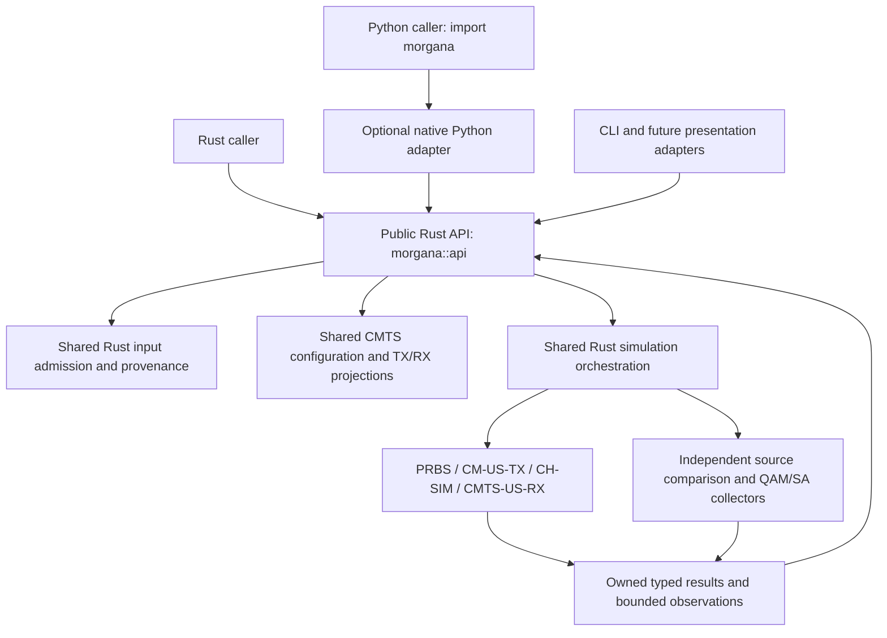

Linked owners: [US Configuration](#cmts-configuration-us-configuration-json),
[PNM RxMER](#rxmer-input), [PNM US-Pre-EQ](#us-pre-eq-input),
[PRBS](#prbs-block-architecture), [CM-US-TX](#cm-us-tx-block-architecture),
[CH-SIM](#channel-simulator-unity-stub-first),
[CMTS-US-RX](#cmts-us-rx-block-architecture),
[QAM/SA](#shared-qam-analyzer-and-spectrum-analyzer) and
[results](#ownership-results-and-acceptance). Receiver views still exclude
simulator truth; public result access does not feed truth back to RX.

Rust owns parsing/materialization, units, profile inventory, measurement
association, validation, preparation, resource limits, lifecycle and all science.
Python converts checked arguments and returned snapshots, maps errors and manages
interpreter interaction. JSON remains one input/export adapter; typed Rust/Python
models are first-class contracts. Filesystem convenience methods read bounded
bytes and call the same Rust loaders; the engine accepts typed domain inputs.

### API modules and planned stub paths

Every path is repository-relative. Create entries are planned placement, with
no source files, manifests or dependencies added during this architecture task.

| Path | Disposition | Responsibility |
| --- | --- | --- |
| `crates/morgana/src/lib.rs` | Extend (existing) | Export `pub mod api`; preserve existing `Morgana`, LDPC re-exports and FEC behavior. |
| `crates/morgana/src/report.rs` | Reuse (existing) | Schema-1 FEC snapshots; keep separate from future experiment documents. |
| `crates/morgana/src/api/mod.rs` | Create (planned) | Document/re-export the high-level public contract. |
| `crates/morgana/src/api/simulation.rs` | Create (planned) | Idle session, atomic configuration/selection and engine dispatch. |
| `crates/morgana/src/api/configuration.rs` | Create (planned) | Public configuration, run/observation limits, playback requests and readiness projections; reuse PHY validators. |
| `crates/morgana/src/api/inputs.rs` | Create (planned) | Named bounded input values, typed retained IDs and inventory/provenance projections; delegate decoding to shared input modules. |
| `crates/morgana/src/api/units.rs` | Create (planned) | Checked units/IDs and public re-exports of canonical PHY types; no duplicate numerical definitions. |
| `crates/morgana/src/api/error.rs` | Create (planned) | `ApiError`, `ErrorCode`, `ApiResult` and preserved lower-level diagnostic mapping. |
| `crates/morgana/src/api/control.rs` | Create (planned) | Public shared Rust run-control/progress handles; delegate lifecycle to simulation. |
| `crates/morgana/src/api/reports.rs` | Create (planned) | Owned experiment/batch entries, outcomes, provenance and bounded QAM/SA access. |
| `crates/morgana/src/inputs/mod.rs`, `crates/morgana/src/inputs/us_configuration.rs`, `crates/morgana/src/inputs/rxmer.rs`, `crates/morgana/src/inputs/pre_eq.rs` | Create (already planned) | Shared Rust decoding; API input types compose these owners. |
| `crates/phy/src/simulation/mod.rs`, `crates/phy/src/simulation/job.rs` | Create (already planned) | Sole scientific run/lifecycle owner; API control is an adapter to it. |
| `bindings/python/Cargo.toml`, `bindings/python/pyproject.toml` | Create (planned) | Separate opt-in PyO3/maturin build, own lockfile when introduced; depend on `morgana`, independent of Qt/CLI. |
| `bindings/python/src/lib.rs` | Create (planned) | Native extension registration, version and public error mapping. |
| `bindings/python/src/simulation.rs`, `inputs.rs`, `configuration.rs`, `control.rs`, `reports.rs`, `units.rs` | Create (planned) | Leaf files under `bindings/python/src/`; conversions and dispatch matching the Rust module owners. |
| `bindings/python/python/morgana/__init__.py`, `__init__.pyi`, `py.typed` | Create (planned) | Thin package exports, typed signature declarations and typing marker; no scientific Python implementation. |
| `crates/morgana/tests/public_api.rs`, `api_inputs.rs`, `api_lifecycle.rs`, `api_reports.rs` | Create (planned) | Rust contract, atomic state, bounded lifecycle and result ownership checks. |
| `bindings/python/tests/test_api.py`, `test_experiment.py`, `test_parity.py`, `test_lifecycle.py`, `test_typing.py` | Create (planned) | Native exports, execution, Rust/Python parity, concurrency and declaration checks. |
| `examples/rust/high_level.rs`, `examples/python/high_level.py` | Create (planned) | Paired configure/preview/run/report examples; add package registration and example indexes when executable. |
| `docs/user/api/README.md`, `docs/user/python/README.md` | Create (planned) | Maintained language-specific guides once supported. |
| `Cargo.toml`, `crates/morgana/Cargo.toml`, `scripts/validate.sh` | Extend (existing, later) | Register API/examples and separate native-binding checks when implemented; keep Rust-only validation independent. |

The Python import name is proposed as `morgana`, backed by native
`morgana._native`; the separate adapter Rust package is proposed as
`morgana-python`. Distribution name availability, dependency/tool versions,
interpreter/platform support and wheel publication are future packaging decisions,
not inferred from another toolkit. No stable C ABI or exposed Rust memory layout
is promised. Keep application, configuration schema and report versions separate.

### Paired Rust and Python interface stubs

The signatures below are **design declarations**, not compilable Rust, runnable
Python or installed `.pyi` files. All types and methods in this table are proposed.
`ApiResult<T>` means typed Rust failure; Python raises `ApiError` with matching
`code`, `message` and structured details, returning ordinary values on success.
Declarations will be finalized against implemented domain contracts before export.

| Rust declaration on `Simulation` | Python declaration on `Simulation` | Contract |
| --- | --- | --- |
| `new() -> Self` | `__init__(self) -> None` | Empty idle one-CM/one-channel session; no allocation of waveform work. |
| `load_us_configuration(&mut self, input: NamedInput) -> ApiResult<ConfigurationInventory>` | `load_us_configuration(self, input: NamedInput) -> ConfigurationInventory` | Retain bounded original bytes/provenance and inspect all presets through Rust; no automatic run. |
| `configuration_inventory(&self) -> ConfigurationInventory` | `configuration_inventory(self) -> ConfigurationInventory` | Owned inventory, including unsupported entries and readiness reasons; empty before load. |
| `select_configuration(&mut self, id: ConfigurationId) -> ApiResult<()>` | `select_configuration(self, id: ConfigurationId) -> None` | Atomically select a valid preset and recheck retained input compatibility. |
| `configure(&mut self, config: ExperimentConfig) -> ApiResult<()>` | `configure(self, config: ExperimentConfig) -> None` | Accept a typed synthetic/reference request through the same validators; preserves state on failure. |
| `add_rxmer(&mut self, input: RxMerInput) -> ApiResult<RxMerId>` | `add_rxmer(self, input: RxMerInput) -> RxMerId` | One typed capture; repeated calls retain multiple captures without guessed pairing. |
| `add_pre_eq(&mut self, input: PreEqInput) -> ApiResult<PreEqId>` | `add_pre_eq(self, input: PreEqInput) -> PreEqId` | Admit a corrective bank with unchanged provenance; never reinterpret as injected H. |
| `add_pre_eq_update(&mut self, input: PreEqUpdateInput) -> ApiResult<PreEqUpdateId>` | `add_pre_eq_update(self, input: PreEqUpdateInput) -> PreEqUpdateId` | Retain an explicit update identity/order/time; validate missing/duplicate/ambiguous references. |
| `set_options(&mut self, options: ExperimentOptions) -> ApiResult<()>` | `set_options(self, options: ExperimentOptions) -> None` | Set bounded run, source, channel, receiver, observation and single/multi playback policies. |
| `preview(&self) -> ApiResult<ExperimentPreview>` | `preview(self) -> ExperimentPreview` | Pure readiness, resolved selection/association and capacity/resource plan; no engine execution. |
| `run(&mut self) -> ApiResult<BatchReport>` | `run(self) -> BatchReport` | Explicit bounded blocking execution using a frozen accepted snapshot. |
| `run_with_control(&mut self, control: &RunControl) -> ApiResult<BatchReport>` | `run_with_control(self, control: RunControl) -> BatchReport` | Same engine with shared cooperative cancellation and bounded progress access. |

Companion planned declarations:

| Rust | Python | Shared meaning |
| --- | --- | --- |
| `NamedInput::new(name: String, bytes: Vec<u8>) -> ApiResult<NamedInput>` | `NamedInput(name: str, data: bytes)` | Owned bounded input and descriptive name; no path interpreted by the engine. |
| `RxMerInput::from_bytes(input: NamedInput) -> ApiResult<Self>` | `RxMerInput.from_bytes(input: NamedInput) -> RxMerInput` | Shared decoded/capture admission only after upstream format verification. |
| `PreEqInput::from_bytes(input: NamedInput) -> ApiResult<Self>` | `PreEqInput.from_bytes(input: NamedInput) -> PreEqInput` | Same source-format gate for corrective banks. |
| `PreEqUpdateInput::from_bytes(input: NamedInput) -> ApiResult<Self>` | `PreEqUpdateInput.from_bytes(input: NamedInput) -> PreEqUpdateInput` | Same source-format gate for bank/update references. |
| `RunControl::new() -> Self` / `cancel(&self) -> ()` | `RunControl()` / `cancel(self) -> None` | Shared cooperative stop token; no forced thread termination. |
| `RunControl::progress(&self) -> ProgressSnapshot` | `progress(self) -> ProgressSnapshot` | Owned bounded current snapshot, polled independently of a busy session. |
| `BatchReport::to_json(&self) -> ApiResult<String>` | `to_json(self) -> str` | Versioned export of Rust results; not a saved experiment or replacement for typed access. |
| `BatchReport::qam(&self, query: QamQuery) -> ApiResult<QamSnapshot>` | `qam(self, query: QamQuery) -> QamSnapshot` | Bounded access to retained selected tap/cell observations, never reruns simulation. |
| `BatchReport::spectrum(&self, query: SpectrumQuery) -> ApiResult<SpectrumSnapshot>` | `spectrum(self, query: SpectrumQuery) -> SpectrumSnapshot` | Shared Rust SA calculations over retained samples; unavailable taps remain unavailable. |

`ExperimentConfig` composes typed US configuration, source/grant, channel,
receiver and execution requests; it does not duplicate their PHY definitions.
`ExperimentOptions` covers runtime policies, not a second mutable configuration
authority. `configure` replaces the accepted configuration transactionally;
`set_options` changes only policy. Typed synthetic measurement constructors will
share the measurement models and validation, without requiring a binary decoder.

One input is a single-shot case; repeated admission plus an explicit existing
[RxMER](#rxmer-input)/[Pre-EQ](#us-pre-eq-input) policy defines a multi-input run.
Do not silently form a Cartesian product of captures, presets or update banks.
Preview identifies selected/unused inputs, effective update boundaries and any
unresolved association. A preset inventory is not an automatic multi-preset job.
IDs belong to the retaining session, survive unrelated additions, and reject
unknown/cross-session references. Replacing a document invalidates its old IDs
explicitly; a failed replacement changes neither accepted state nor IDs.

### API lifecycle, errors and result contracts

Loading, construction, configuration, selection and preview stay idle. Failed
admission preserves accepted inputs/options. A run freezes a validated plan;
configuration changes while running return Busy. Rust requires exclusive mutable
session access. Python serializes access without holding its session lock through
native execution, exposes Busy for competing calls and restores its session on
every exit. Separate sessions can execute independently within their own limits.

Rust bounds bytes, capture count, expanded resources, samples, observations,
iterations, duration and retained history before work/allocation. Existing input
budgets remain applicable; final job-wide cumulative budgets must be finalized
before implementation. Cancellation is checked at documented stage quanta and
between indivisible LDPC calls. Preserve completed trials and explicit incomplete/
not-started entries. Progress is a bounded Rust snapshot; no Python callback runs
inside a core worker or while core locks are held. Python releases the interpreter
lock for long work; signal handling requests cooperative cancellation and returns
the partial report under the documented native wrapper policy.

Pause/resume signatures are reserved until the engine defines safe boundaries,
frozen PRBS/randomizer/interleaver/Pre-EQ/RNG state, paused-time accounting and
stop-from-paused behavior. They remain unavailable before that lifecycle contract
and native tests exist. BACKEND-03 schedules them after the accepted bounded/
cancellable reference loop; they are not a first-loop prerequisite. No
Python-specific scheduler or polling DSP is introduced.

Proposed error categories: InvalidInput, MissingSetting, UnsupportedFormat,
UnsupportedVersion, UnsupportedCapability, InvalidIdentifier, IncompatibleGrid,
AssociationFailed, ResourceLimit, Busy, Io and Engine. Domain errors preserve
structured context/field paths and lower-level causes. Negative/overflowing
Python integers and invalid buffers are checked before Rust conversion; native
Python argument-type errors may use TypeError/OverflowError. Do not parse error
messages or turn scientific nonconvergence into a loading exception.

Reports independently own configuration/provenance and completed/partial results,
and remain valid after later calls or session destruction. Keep decoder convergence,
syndrome, shortened-zero consistency, recovered coverage and independent source
comparison distinct. Preserve absent samples/null measurements, seeds, original
hashes/timestamps/grids and explicit zero-error/unbounded metric states. Copy
conversion is the default; any future zero-copy view needs a proven lifetime and
layout contract. Optional values are `Option<T>` in Rust and `T | None` in Python.

The existing FEC report schema remains unchanged. Future experiment export and
US Configuration versions are distinct; no saved-workbench loader is implied.
If one is introduced, decoding/generated recipes and all supported settings must
load and run through both language APIs with migration or structured rejection.

### API delivery and validation gates

Deliver in order: paired architecture → approved typed Rust session/input/error
foundation → source-verified waveform prerequisites → experiment execution/results
and controls → optional native Python wrapper and real `.pyi` exports → paired
examples/guides and native parity. BACKEND-06 develops the Rust session with the
backend and accepts the unity loop through that API before Python work begins.
An early FEC-only Python wrapper is outside the selected delivery order.

Rust acceptance covers idle loading, atomic rejection, inventory/selection,
single/multi association, invalid units/IDs/nulls, limits, owned results and
bounded cancellation. Independently executed native Python runs must match Rust
on resolved settings, seeds, provenance, statuses, completed word outcomes and
partial coverage, with declared tolerances for numerical arrays. Exercise
conversion failures, lock release, Busy, cancellation, result lifetimes and actual
`.pyi`/extension export agreement. Mock wrappers do not establish parity.

Keep a Rust-only build/test path without Python/PyO3/Qt, and a separate native
binding build/import/test gate when the adapter exists. Existing workspace tests
validate the checkpoint, not these proposed contracts. Implementation, native
runtime, packaging and publication remain unchecked in the official checklist.
