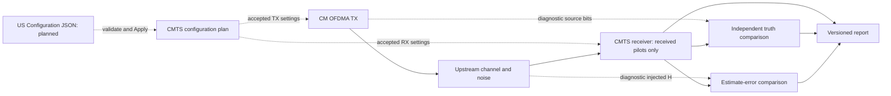

# MORGANA foundation and upstream FEC design

Status: unfinished checkpoint; further scientific implementation awaits plan
approval. Source inspection and checkpoint review: 2026-11-19.

## FOUNDATION-01: Requirements and PDE assessment

Create a standalone Apache-2.0 Rust upstream OFDMA scientific toolkit, beginning
with isolated upstream LDPC. MERLIN and PDE remain read-only. No GUI, Python
implementation, scheduler, device/network control, publication or system install.

PDE was inspected at revision `6f7197d17b0efc7a4be0d44a517d886b2f03009d`:
`templates/rust/Cargo.toml`, `templates/project/{AGENTS,requirements,architecture,checklist}.md`,
`templates/project/third-party-notices.md`, `templates/workflows/validate.sh`,
`docs/adoption.md`, and repository-baseline/third-party-reuse guidance.
Its Rust starter is a single-package 2021 manifest, not a ready-made workspace;
its workflow starter invokes PDE-specific Python checks, not Rust CI.
Adopt its requirements → architecture → checklist → implementation → validation
sequence, local feature records, relative skill discovery, explicit version owner,
fixture hygiene, contribution records and notice inventory. Author project-local
implementations. Do not copy private history, archives, installers, Python/Qt/Java
starters, Git helpers or unrelated dependencies. No root PDE license was found.
Initial scaffolding used organizational ideas. The subsequent explicit request
to bring in skills authorizes local adoption of selected complete skill folders,
references and required templates; source hashes, adaptations and unresolved
public redistribution terms are in [the adoption record](../../foundation-adoption.md).
No PDE executable is copied.

## FOUNDATION-02: MERLIN reuse assessment

Inspected clean MERLIN revision `096d5a476194d4f2e016863d723b225257bb6037`.
Paths below are relative to that repository; it is not a build dependency.

| Component | Exact owner / interface | Decision |
| --- | --- | --- |
| LDPC engine | `crates/fec-codec/src/ldpc.rs`, `LdpcCodec`, ldpc-toolbox =0.10.1 | Reuse pinned engine and layered decoder; downstream `Code::R8_9short` is unsuitable for upstream |
| Sparse encoding | `crates/fec-codec/src/sparse_encoder.rs`, private `SparseEncoder` | Adapt Apache substitution plan into separate upstream codec crate; avoid engine's dense general encoder |
| BCH/concatenation | `crates/fec-codec/src/{bch,concatenated}` | Exclude from upstream data coding |
| PRBS15 | `crates/ofdm/src/simulation/source/prbs.rs`, `Prbs15`, `PrbsVerifier` | Future extraction candidate; maintain recurrence and independent source verification; not needed for FEC fixture inputs |
| Complex samples | `crates/ofdm/src/types`, `IqPair`; `waveform/samples.rs`, `SampleBlock` | Reusable representation; separate geometry/provenance contracts before sharing |
| FFT | `signal_processing/waveform/{transform,fft,ifft}.rs`, `TransformPlan`, `ForwardTransform` | Numerical radix-2 reusable; current public geometry is downstream 4K/8K; upstream requires 2K/4K adaptation |
| QAM / LLR | `signal_processing/modulation/{qam,soft_bits}.rs`, `map_symbol`, `qam_llrs` | Candidate numerical reuse after upstream labels, loading and LLR normalization verification; retained table licenses required |
| Noise | `signal_processing/noise/awgn.rs`, `signal_processing/channel/awgn.rs` | Seeded numerical methods reusable; downstream grid admission is not upstream policy |
| Channel/filter | `signal_processing/channel/{filter,composition,impairments}.rs` | Reuse numerical response/filter ideas; downstream capture plans need separate upstream inputs |
| Estimation | `signal_processing/receiver/channel_estimation/{pilot,interpolation,reliability}.rs`, `PilotChannelEstimator` | Least squares/interpolation candidates; do not reuse downstream pilot layout/acquisition |
| Jobs/metrics | `simulation/channel`, `simulation/{results,test_points}` | Bounded control, partial-result and truth separation patterns; downstream runners/configuration are unsuitable |
| High-level API | `crates/ofdm/src/api`, `docs/reference/public-api.md` | Configure/run/report and structured error conventions; no downstream WB schema import |
| Measurements | `crates/pnm-input` and optional PNM decoder | Defer until upstream Pre-Eq inventory/contracts are verified; no Python decoder sidecar |

`docs/architecture.md`, `docs/user/receiver-estimation/README.md`,
`docs/user/simulation/README.md`, manifests, lockfile and NOTICE were inspected.
No dependency on MERLIN's GPL Qt application, optional Python adapter or BCH code.
The temporary small Apache encoder adaptation is documented, not a fork of the
downstream stack. A future neutral shared Rust crate may own matrix-independent
codec/numerical primitives; MERLIN and MORGANA would both depend on it. Migration
requires an approved plan, preserved re-exports and unchanged downstream tests.
No circular dependency or MERLIN modification is authorized here.

## LDPC-01: Normative evidence and engine feasibility

Controlling evidence: CableLabs `CM-SP-PHYv3.1-I20-230419`, §7.4.3 Table 8,
PDF p52; §7.4.3.2, pp56–57; §7.4.3.3, p58. Original p57 is available locally
and was rendered for matrix transcription; text extraction omits those tables.
Source PDF SHA-256:
`304c26937f5beaf7ffddc88158abacead4ead2bc29e6acaae5226898c9f716bc`.
Keep PDF and rendered images local/ignored. Publish implementation constants and
small derived tests, not PDFs, page images or wholesale specification extracts.

| Code | N | K | Checks | Lift | Base dimensions |
| --- | ---: | ---: | ---: | ---: | --- |
| Upstream long | 16200 | 14400 | 1800 | 360 | 5 × 45 |
| Upstream medium | 5940 | 5040 | 900 | 180 | 5 × 33 |
| Upstream short | 1120 | 840 | 280 | 56 | 5 × 20 |

CM MUST use the p57 matrices. Expand right-shifted identity blocks with
column = block-column × lift + (local-row + shift) mod lift. A dash is no edge.
Information coordinates precede parity. Validate diagonal parity blocks and
substitution completeness before use. These matrices differ from DVB-S2/C2
downstream coding even where dimensions coincide.

`ldpc-toolbox` 0.10.1 supplies `SparseMatrix`, `HLPhif64` soft decoding, failed
decisions and actual iteration counts. Its `Encoder::from_h` accepts general
matrices but uses dense elimination for non-staircase parity, as verified in
upstream `src/encoder.rs` at `62b02cef2df8c6a3b74843d5b4d1947715fbf78d`.
The upstream QC parity blocks are triangular shifted identities, allowing the
existing Apache MERLIN sparse plan instead. No puncturing or BCH stage.

Shortening appends zeros after information, computes full parity, then removes
only those zero coordinates. RX restores finite known-zero priors and verifies
the shortened decisions separately from convergence and payload comparison.
Standalone mother-code shortening permits 1..K information bits; normal-grant
selection is a separate unimplemented §7.4.3.1.1 policy and imposes tighter sizes.
Iterations are application-bounded to 1..100; inputs are exact-size binary bits
or finite natural-log P(0)/P(1) LLRs, positive favoring zero. No silent fallback.

## LDPC-02: Acceptance and evidence limits

For each code: matrix dimensions/selected source cells, systematic order, zero
syndrome, noiseless exact recovery, controlled LLR sign errors, deterministic
BPSK/AWGN LLRs, real iteration counts, forced nonconvergence, wrong-valid-codeword
truth separation, invalid/nonfinite inputs and shortening boundaries.
Use a test-only bit-packed Gaussian solver as an independent encoder oracle,
with column-based circulant expansion to check production row-based lifting.
Such reference words are internally derived normative arithmetic, not external
interoperability vectors. No externally produced vectors have been supplied.
Preserve that gap explicitly, including after internal tests pass.

## FOUNDATION-03: Workspace and public API

Target tree (some entries remain planned; see the official checklist):

```text
morgana/
  crates/ldpc/              # morgana-ldpc: matrices, encoding, decoding, shortening
  crates/morgana/           # morgana: bounded FEC facade and versioned reports
  crates/cli/               # morgana-cli: single-codeword executable, JSON stdout
  docs/architecture.md
  docs/development/checklist.md
  docs/development/features/foundation/
  docs/reference/           # source pins, public API and licensing records
  docs/user/ldpc.md
  examples/                # runnable Rust example and synthetic fixtures
  skills/                  # focused local instructions, relative discovery links
  scripts/validate.sh
  .github/workflows/        # Master validation; manual release preparation
```

Future crates/modules are design only: PHY configuration/resource mapping,
TX, channel, receiver, capture adapter, simulation orchestration and optional
`bindings/python`. Do not create empty algorithm placeholders.
The [planned code layout](../../../architecture.md#planned-code-layout) expands
these module roots into concrete per-block/stage implementation and test paths,
including explicit existing reuse versus new files. It is the canonical future
layout; this checkpoint's source tree and dependency registration are unchanged.

First implemented API is explicitly FEC-only: validated `LdpcSettings`,
`LdpcCodec::{new,encode,decode,valid_syndrome}` and
`Morgana::{new,run_ldpc}`. Run inputs remain unchanged; results own snapshots;
mutable codecs own decoder scratch space and are not concurrently shared.
Rust errors have typed categories, never console-driven library failures.
JSON report schema starts at 1 and is not a saved workbench contract.

The original future facade sketch is superseded by the separate
[high-level Rust/Python architecture](../../../architecture.md#high-level-rust-and-python-apis):
proposed `morgana::api::Simulation` exposes typed configuration, preview and run,
with a matching optional native Python wrapper. Preserve `Morgana::new` and
`run_ldpc` rather than repurposing their FEC contract. The API section owns paired
signature stubs, concrete paths and delivery gates. No waveform or Python method
is claimed implemented; parsing, validation and scientific work remain shared Rust.

## PHY-01 onward: Dependency-ordered plan

| ID | Deliverable | Acceptance |
| --- | --- | --- |
| FOUNDATION-01..03 | Assessments, standalone workspace, docs, skills, CI | Build/test/lint locally; no source checkout runtime dependencies |
| LDPC-01..02 | All three upstream codecs and isolated closed loops | Source arithmetic, syndrome, recovery, bounded failure and shortening tests |
| PHY-01 | Typed US Configuration and grant/codeword selector | Independent §7.4.3.1.1 boundary cases, UCD/IUC meaning verified |
| WAVE-TX-01 | One upstream data burst | Verify randomizer/interleaver/map/pilot/preamble order and exact coordinates |
| WAVE-RX-01 | Received-only noiseless receiver | Recover exact original bytes without TX truth in RX interfaces |
| WAVE-CH-01 | Exact unity channel boundary | Preserve actual samples, indices and metadata under arbitrary chunking |
| WAVE-CH-02 | Later channel, measured Pre-Eq and deterministic noise | Reference-plane accounting; controlled RxMER/FEC effects |
| API-01 | Full experiment reports/test points; Python adapter | Rust/Python validation, ownership and cancellation parity |

Waveform gaps: §7.4.4 randomization, §7.4.5 joint interleaving, §7.4.6–7 mapping,
§7.4.9–10 IFFT/prefix/window, pilot/preamble and acquisition details need focused
PDF review. Actual UCD/MAP parsing needs MULPI evidence; Pre-Eq files need pinned
OSSI/PNM format evidence and lawful fixtures. No IUC implies a fixed QAM order.
DOCSIS 4.0 I07 §7.2.4.3 p53 (FDX) and §7.3.4.3 p114 (FDD) delegate FEC to
PHYv3.1 §7.4.3, as checked in the pinned extraction; original 4.0 PDF not inspected.
This supports FEC applicability only, not complete FDX/FDD waveform support.

## Architecture and receiver isolation



The diagram describes planned integration. The first executable covers only
information bits → upstream LDPC encode → LLRs → decode → independent bit compare.
The expanded [PRBS/TX/unity-channel/RX and QAM/SA architecture](../../../architecture.md#planned-upstream-signal-path-and-workbenches)
is the current stage/observation plan. Its
[CMTS configuration subsection](../../../architecture.md#cmts-configuration-us-configuration-json)
records the generic OFDMA JSON delivery/coverage plan, with shared typed Rust
admission and separate TX/RX projections; schema/parser implementation is pending.
The first future full waveform path keeps
the Channel Simulator as an exact unity stub; impairment integration is later.
For future pilots, receiver estimates H_eff = C H from Y/X; injected H and C
remain outside normal receiver inputs. Inverting measured Pre-Eq is an explicitly
regularized estimate with gain/delay assumptions, never exact RF truth or noise.

## Licensing and release boundaries

MORGANA-owned scientific code/tooling: Apache-2.0. Retain MERLIN Apache encoder
copyright/notice and adaptation record. ldpc-toolbox is MIT OR Apache-2.0; choose
Apache-2.0 and preserve its full license and applicable notices. No AFF3CT BCH,
GPL Qt, QAM assets or PNM parser copied in this phase. PDE guidance is selectively
adopted by explicit user request; its public redistribution terms remain pending.
Dependency license inventory and source-package review
must follow the actual lockfile before any publication. Native Windows/macOS
execution and hosted CI remain unverified until actual runs.

## FOUNDATION-04: Checkpoint and agent guidance

The user requested planning-only scope after the initial code was written, then
requested saving existing work and adopting PDE/MERLIN skills. Preserve science
as an unfinished checkpoint. Adopt complete relevant PDE skill folders and local
resource dependencies, pinned PHY lookup instructions/navigation and adapted
upstream scientific/API rules. Keep bulk corpora local/ignored and canonical
skill discovery relative. No new PHY correction/feature is authorized by this save.

`AGENTS.md`, the architecture and official checklist record current support and
authorization. `tools/git/git-save.sh` is a project-owned minimal all-change save
helper with local validation and HEAD/index/candidate guards. It never pushes,
tags or bumps versions; failed validation leaves staged work available. Test this
operation only in disposable repositories. The user's actual Git initialization
is retained; this task prepares, rather than executes, the first commit command.

Known source issue: long-code base row 5, zero-based column 20, currently contains
-1 where PDF p57 shows 12. Round trips and the test Gaussian encoder share table
constants and cannot detect that transcription. Keep LDPC-01/02 unchecked until
the approved scientific follow-up corrects and independently verifies the source.
See [checkpoint validation](validation.md) for actual checks and their limits.
